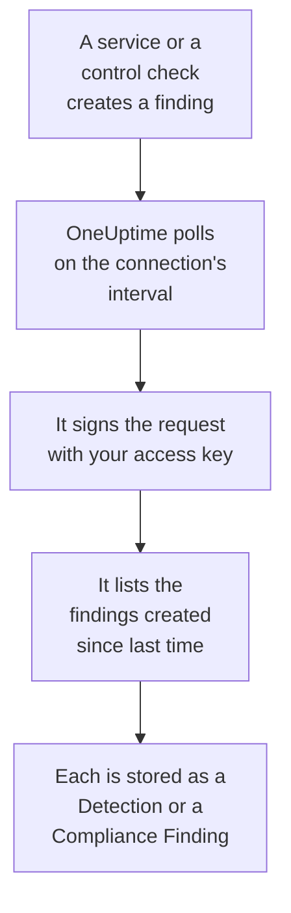

# AWS Security Hub

Import [AWS Security Hub](https://aws.amazon.com/security-hub/) findings into OneUptime's Security Events: GuardDuty, Inspector, Macie and IAM Access Analyzer findings, Security Hub's own control checks, and partner products' findings. There you search them beside your logs, traces and metrics, correlate them with every other source, and page on-call for the ones that matter. OneUptime reads them with an access key you create, allowed one read-only action, and changes nothing in AWS. There is no agent, EventBridge rule or S3 export to set up.

:::cards
- [Set up the connection](#set-up-the-connection): An IAM policy, an access key, and the connection's form.
- [What is imported](#what-is-imported): How each finding becomes a security event.
- [How polling works](#how-polling-works): The window each poll reads, and why it overlaps by 30 minutes.
- [Troubleshooting](#troubleshooting): What each error means, and what to change.
:::

## How it works



Every minute, OneUptime polls each enabled connection whose poll interval has passed. A poll calls Security Hub's `GetFindings` in your Region, signed with [Signature Version 4](https://docs.aws.amazon.com/IAM/latest/UserGuide/reference_sigv-create-signed-request.html), for the findings created since the last poll. It stores each one as an [OCSF](https://schema.ocsf.io/) event: a control check as a Compliance Finding (class `2003`), and every other finding as a Detection Finding (class `2004`). Detection rules, monitors and dashboards then treat it like a security event from any other source.

## Before you begin

- In OneUptime, the Project Owner, Project Admin or Security Admin role. Security Members and Security Viewers can see connections and their run history, but cannot change them.
- An AWS account with Security Hub enabled in the Region you connect. Security Hub is Regional: a connection reads the findings one account holds in one Region.
- To read every account's and every Region's findings through one connection, the Security Hub delegated administrator account, in its home Region, with [cross-Region aggregation](https://docs.aws.amazon.com/securityhub/latest/userguide/finding-aggregation.html) on. **Security Hub → Settings → Regions** shows the home Region.
- Outbound HTTPS from the OneUptime app and workers to `securityhub.<region>.amazonaws.com`, or `securityhub.<region>.amazonaws.com.cn` in China, and a correct clock on their hosts: AWS refuses a request signed more than 5 minutes off.

## Set up the connection

The connection signs its requests with an IAM access key. The key's identity needs one action, `securityhub:GetFindings`, and nothing else: the connection never changes a finding.

:::steps
### Allow reading findings

In the [IAM console](https://console.aws.amazon.com/iam/), open **Policies → Create policy**, choose **JSON**, and paste this policy. Name it, for example, `OneUptimeSecurityHubRead`:

```json
{
  "Version": "2012-10-17",
  "Statement": [
    {
      "Effect": "Allow",
      "Action": "securityhub:GetFindings",
      "Resource": "*"
    }
  ]
}
```

`GetFindings` cannot be limited to a resource, so `Resource` stays `*`. The managed policy `AWSSecurityHubReadOnlyAccess` works too, but allows more.

### Create an access key

1. Open **Users → Create user**, name the user, for example `oneuptime-security-hub`, leave console access off, and attach the policy. For other accounts' findings, do this in the delegated administrator account.
2. Open the user, then **Security credentials → Access keys → Create access key**, and choose **Third-party service**.
3. Copy the **Access key ID** and the **Secret access key**. AWS shows the secret once.

### Add the connection in OneUptime

Open **Products → Security Events → Connections** (`/dashboard/{projectId}/security-events/connections`), click **Add connection**, choose **AWS Security Hub**, and click **Next**. Fill in the settings in the table below, click **Next**, and paste the secret into **Secret access key**.

### Test it before you save

Click **Test these settings** under **Test before saving**. The test signs a request with the values in the form, and stores nothing, so a wrong key or a missing permission shows up before the connection exists. Then click **Next**, give the connection a **Name**, and create it.
:::

| Setting | What to enter |
| --- | --- |
| **Region** | The Region's code, such as `us-east-1`, `eu-central-1` or `us-gov-west-1`: for other accounts' findings, the administrator account's home Region. |
| **Access key ID** | The key's ID: 16 to 128 letters or digits, usually 20 starting with `AKIA`, or `ASIA` for temporary credentials. |
| **Secret access key** | The key's secret. It is encrypted, never returned by the API and never shown again. Replace it with **Update credentials** on the connection. |
| **Session token** | Only for temporary credentials, which need it: an `ASIA` key is refused without one, and an `AKIA` key is refused with one. |

Temporary credentials from `aws sts assume-role` or `aws sts get-session-token` expire, after 12 hours at most for an assumed role, and polling stops until you paste new ones with **Update credentials**. A long-lived key with this narrow policy, rotated on your own schedule, keeps polling unattended. To move from temporary credentials to a long-lived key, enter the new key in **Update credentials** and turn on **Remove the stored Session token**.

The **Polling** step also has an optional **Description**, the **Poll Interval (Minutes)**, a whole number from `1` to `1440` that starts at `5`, and **Enabled**, which starts on.

## What is imported

Each finding becomes one event, with vendor `Amazon Web Services` and product `AWS Security Hub`. A finding with a `Compliance` object, a control check against a standard such as AWS Foundational Security Best Practices or CIS, becomes a Compliance Finding (OCSF class `2003`). Every other finding becomes a Detection Finding (OCSF class `2004`).

| Finding field | OneUptime column |
| --- | --- |
| `Id`, an ARN for findings AWS creates | Event UID, which is also what duplicates are dropped by |
| `CreatedAt`, else `UpdatedAt`, else `FirstObservedAt` | Event time |
| `Title` | Rule name |
| `GeneratorId`, such as the GuardDuty finding type or the control's ID | Rule ID |
| `Title`, else `Description` | Message |
| `Severity.Label`, else a band of `Severity.Normalized` | Severity |
| `Workflow.Status`: `NEW`, `NOTIFIED`, `RESOLVED` or `SUPPRESSED`, else the older `WorkflowState` | Status |
| `Types` under `TTPs/`: `TTPs/Initial Access/...` becomes `TA0001` | MITRE ATT&CK tactics and techniques |
| The IAM user of an access key or user resource, `Network.SourceIpV4` or `SourceIpV6`, `Process.Name` or `Process.Path` | Principal user, IP and process |
| `Process.Name` and `Process.Path` | Process name and path. A finding names neither a command line nor a parent. |
| The instance ID of an `AwsEc2Instance` resource, `Network.DestinationIpV4` or `DestinationIpV6`, `Network.DestinationPort`, the first `Resources[].Id` | Target host, IP, port and resource |
| Those, every `Resources[].Id`, `AwsAccountId`, the network's domains, malware names and threat intelligence values | Observables |
| The whole finding, flattened to dotted keys, such as `Compliance.Status` and `Remediation.Recommendation.Url` | `attributes` |

When a finding has no `Severity.Label`, `Severity.Normalized` decides: `0` is Informational, `1` to `39` Low, `40` to `69` Medium, `70` to `89` High, and `90` to `100` Critical. A finding Security Hub updates later, a new `Workflow.Status` or a control that now passes, keeps its `Id`, so it is not imported again: the event keeps the finding as it was when imported.

## How polling works

Each poll lists the findings created in its window, oldest first, 100 to a page, and follows `NextToken` until it has read the whole window:

```text
POST https://securityhub.{region}.amazonaws.com/findings
    {"Filters": {"CreatedAt": [{"Start": "{window start}", "End": "{window end}"}]},
     "SortCriteria": [{"Field": "CreatedAt", "SortOrder": "asc"}],
     "MaxResults": 100}
```

- **Creation time is the cursor.** Findings are listed by `CreatedAt`, never by `FirstObservedAt`. GuardDuty creates a finding once it has seen enough activity, and a control check when Security Hub first checks the resource, hours or days after the activity began. A cursor over observation time would skip them.
- **The first poll looks back 24 hours**, so a new connection shows its recent findings at once.
- **Every later poll starts 30 minutes before the saved cursor.** `CreatedAt` is set by the service that found the issue, and the finding reaches Security Hub later: GuardDuty sends new findings within five minutes, and a failed delivery through EventBridge is retried for up to 24 hours. The overlap reads such findings on the next poll. One that arrives more than 30 minutes after its `CreatedAt` can fall behind the cursor: import its time range to recover it.
- **A poll reads at most 24 hours past the cursor.** A connection whose cursor fell behind catches up in a row of 24 hour windows, and its **Health** reads **Catching up**.
- **Duplicates are dropped by the finding's `Id`** within the project, so the overlap, a retried window and an import never store a finding twice.

### When a window holds more than one poll can read

A poll sends at most 20 requests of 100 findings: 2,000 findings. When a window holds more, the run is **Partial**, with a warning such as:

```text
Stopped after 20 findings requests (the per-run request limit) before the window was fully read. The last finding read was created at 2026-09-14T08:12:44.000Z.
```

Findings are read oldest first, so OneUptime moves the cursor to the creation time of the last finding it read, and the next poll starts there, without the 30 minute overlap, with the same window length. A busy account catches up about 2,000 findings a poll, instead of reading the same ones again. The overlap comes back once the cursor has moved 30 minutes past that point.

When a run cannot get past the saved cursor at all, for example because the 30 minutes of overlap alone hold more than 2,000 findings, OneUptime shortens the window instead:

1. **Narrow.** The next poll reads a window half as long, from the same starting point, and halves again until a window reads completely, down to one minute. The run's warning says so: `This window holds more records than one poll can read; the next poll reads a {n} minute window from the same starting point.`
2. **Grow back.** After a window reads completely, the next one is twice as long again, up to 24 hours.
3. **Move past a single minute.** If even one minute holds more than a poll can read, polling moves past it, so newer findings keep arriving, and later polls' overlap no longer reaches back into it. The run stays **Partial**, and **Last Error** reads `More records were created in the one minute from {cursor} to {end} than one poll can read. Polling moved past this minute so newer records keep arriving; use Import this time range in Diagnostics on this minute to recover what one run can read.` Import that minute with **Import this time range** to recover what one run can read.

A run that fails outright, with an error from AWS, keeps the cursor and the window length, and the next poll reads the same window again. The one exception is a request that timed out: the cursor stays, but the next window is half as long, since a window too heavy to answer in time would time out on every try. Changing the **Poll Interval (Minutes)** changes none of this: it decides how often a poll starts, not where its window begins.

### Run, preview and import on demand

Click **Diagnostics** on a connection to see its recent runs and to work with it by hand. Anyone who can change the connection can start these; everyone who can see it can read the history.

- **Run now** starts a poll at once, with the usual cursor, even while the connection is not **Enabled**.
- **Preview findings** reads a time range of up to 7 days and imports nothing.
- **Import this time range** imports a range of up to 7 days, after you confirm, without moving the cursor. Findings already imported are skipped.
- **Copy diagnostics** on a run copies its report for support. It never includes credentials.

## Test connection

**Test connection** on a connection's row, and **Test these settings** in the form, run in the API process, not in a background worker, so a test still answers when the workers are the problem. It runs these checks, in order:

| Check | What it checks |
| --- | --- |
| **Configuration** | Every setting is present and well formed. Nothing is contacted when this fails. |
| **Authenticate with AWS** | AWS accepts a signed `GetFindings` request for one finding created in the last 24 hours. AWS checks the signature before the IAM policy, so a refusal by the policy still passes this check: the key is right. |
| **Read findings** | Security Hub answers that request: the identity may call `securityhub:GetFindings`, and Security Hub is enabled in the Region. |
| **Findings available to import** | How many findings were created in the last 24 hours and the last 7 days, one page of 100 each, so `100+` means more. None in 7 days is a warning, not a failure. |
| **Background workers**, **Poll scheduler**, **Security event storage** | OneUptime's own side: a process takes the Worker queue's jobs, the poll job runs every minute, and the store of security events answers. |
| **Scheduled polling** | For a saved connection: polling is on, no run is stuck waiting for a worker, and polls run on time. |

Every request in a test has a 20 second deadline. A test never imports anything or moves the cursor, and each failed check says what to change.

## Troubleshooting

The connection's **Last Error** keeps the complete error message, with credentials redacted, behind a prefix that names the step that failed. When a connection has an error, select **View Error** in its **Actions** column to read it, and **Copy Error** in the dialog to copy it. Every message starts with `AWS Security Hub findings request`; read what follows it.

:::details Last Error says `failed (HTTP 401)` or `failed (HTTP 403)`
AWS refused the request. The message quotes AWS's error code, or AWS's own words when it sent no code:

- `AccessDeniedException`, or `is not authorized to perform`: the key is right, but its identity may not call `securityhub:GetFindings`. Attach the policy from [Set up the connection](#set-up-the-connection). A permissions boundary or a service control policy can deny it too.
- `InvalidAccessException`, or `is not subscribed to AWS Security Hub`: Security Hub is not enabled for this account in this **Region**, or the account is not its administrator there.
- `InvalidSignatureException` or `SignatureDoesNotMatch`, or `The request signature we calculated does not match`: the **Secret access key** does not belong to the **Access key ID**. Create a new access key, and save it with **Update credentials**.
- `UnrecognizedClientException` or `InvalidClientTokenId`, or `The security token included in the request is invalid`: AWS does not know the **Access key ID**. It is mistyped, deleted, deactivated or from another partition, or it is a temporary key without its **Session token**.
- `ExpiredTokenException`, or `The security token included in the request is expired`: the temporary credentials expired. Issue new ones, or switch to a long-lived key.
- `RequestTimeTooSkewed` or `RequestExpired`, or `Signature expired`: the OneUptime hosts' clock is more than 5 minutes off. Fix NTP on the app and worker hosts.
- No code at all: AWS did not say whether the key or the policy refused it. Check the key first, then the policy.
:::

:::details Last Error says `failed (HTTP ...)` with another status
- `HTTP 404`: no Security Hub endpoint answered at this **Region**. Compare it with the Region menu of the AWS console: `us-east-1`, not `us-east1` or `N. Virginia`.
- `HTTP 429`: the account hit Security Hub's limit, 3 `GetFindings` requests a second in a Region. The next poll tries again. If it keeps happening, look for another tool or connection that reads the same account and Region.
- `HTTP 5xx`: Security Hub had a problem on its side. The next poll tries again.
- `HTTP 400`: Security Hub refused the query, which OneUptime builds, not your settings. Send the message to OneUptime support.
:::

:::details Last Error says `returned`, `timed out` or `Could not reach data source`
- `returned a non-JSON body` or `returned an unrecognized response shape`: something other than Security Hub answered, such as a proxy's sign-in page or a gateway that rewrites answers. This is reported rather than taken as an empty window, so the cursor never moves past findings nobody read.
- `timed out after 60 seconds with no response`, or `failed: Could not reach data source`: the request got no answer. Security Hub's endpoints are public, so check DNS, firewalls and proxies between the OneUptime app and workers and `securityhub.<region>.amazonaws.com`.
:::

:::details Last Polled is Never and Last Error is empty
No poll has finished for this connection. Run **Test connection**: its **Background workers** and **Poll scheduler** checks name the cause. On a self-hosted install, the usual cause is `DISABLE_QUEUE_WORKERS=true` on the app, with no separate worker deployment taking the jobs: set it to `false`, or run the worker deployment (Helm: `worker.enabled: true`).
:::

:::details A run is Partial
- `Stopped after 20 findings requests`: the window held more than the 2,000 findings one run reads. Nothing is lost: the next poll starts after the last finding read. A connection that stays **Partial** poll after poll is catching up on a backlog, and its **Last Polled** and **Last Event Imported** keep moving. If it never catches up, the account creates more than 2,000 findings per poll interval: shorten the **Poll Interval (Minutes)**.
- `More records were created in the one minute from ... than one poll can read`: polling moved past that minute. Import it with **Import this time range** in **Diagnostics**. An import reads as much as one poll.
:::

:::details The test passes, but nothing is imported
Read **Findings available to import** in the test's report. `0` in the last 7 days means Security Hub created no finding in this account and Region: check that GuardDuty, Inspector or a security standard is on there. To see other accounts' and Regions' findings, connect the administrator account in its home Region.
:::

:::details A finding in the Security Hub console never arrived
Compare its `CreatedAt` with its `ProcessedAt`, when Security Hub received it. A finding that arrived more than 30 minutes after its `CreatedAt` can fall behind the cursor: import its `CreatedAt` with **Import this time range**.
:::

## What you get

- **Search.** Filter findings by severity, status, rule, account, resource or any observable in the Security Events explorer, beside every other source.
- **Correlation.** Every finding's users, instances, IPs, resource ARNs and account IDs are indexed as observables, so one search finds everything that mentions them.
- **Detection rules.** Sigma rules that run on a schedule over your security events, and open alerts that page on-call.
- **Monitors.** Security Events monitors count matching events, for example new critical GuardDuty findings or failed controls, and open incidents or alerts past a threshold.

Security events are billed like the rest of your telemetry, per GB ingested. See [Pricing](https://oneuptime.com/pricing).

## Next steps

:::cards
- [Security Events](/docs/telemetry/security-events): Search, correlate and alert on what you import.
- [Okta System Log](/docs/integrations/okta): Import your identity provider's sign-ins too.
- [Roles](/docs/permissions/reference#roles): What the Security roles can see and change.
- [Integrations Overview](/docs/integrations/index): The other tools you can connect.
:::
