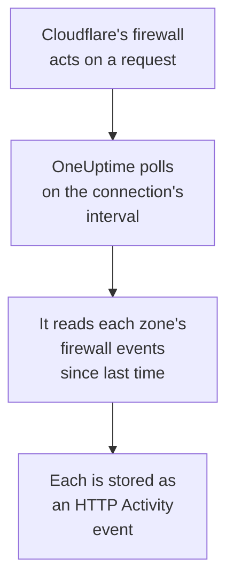

# Cloudflare

Import what [Cloudflare](https://www.cloudflare.com)'s firewall did at the edge into OneUptime's Security Events: the requests its WAF managed and custom rules, rate limiting, IP Access rules, bot management and HTTP DDoS protection blocked, challenged or logged. Each one sits beside your app's own requests, so a case says what Cloudflare stopped and what still reached your app. OneUptime reads them with an API token that can only read, and changes nothing in Cloudflare unless you turn on blocking, which enforces your blocklist there.

:::cards
- [Set up the connection](#set-up-the-connection): An API token with two read permissions, and the connection's form.
- [What is imported](#what-is-imported): Which events, and how each becomes a security event.
- [How polling works](#how-polling-works): The window each poll reads, and why it overlaps by 10 minutes.
- [Block addresses at Cloudflare](#block-addresses-at-cloudflare): Your blocklist, enforced by two IP lists and one custom rule per list.
- [Troubleshooting](#troubleshooting): What each error means, and what to change.
:::

## How it works

Every minute, OneUptime polls each enabled connection whose poll interval has passed. A poll lists the account's zones, reads what each zone's plan allows from the GraphQL Analytics API's settings node, and reads each zone's firewall events since the last poll from the `firewallEventsAdaptive` dataset ([Security Events](https://developers.cloudflare.com/waf/analytics/security-events/)), oldest first. Each event is stored as an [OCSF](https://schema.ocsf.io/) HTTP Activity event.

## Before you begin

- In OneUptime, the Project Owner, Project Admin or Security Admin role. Security Members and Security Viewers can see connections and their run history, but cannot change them.
- A Cloudflare user who can create API tokens for the account's zones.
- Zones whose traffic goes through Cloudflare: their DNS records are proxied.
- Outbound HTTPS from the OneUptime app and workers to `api.cloudflare.com`.

## Set up the connection

The connection reads with an [API token](https://developers.cloudflare.com/fundamentals/api/get-started/create-token/), never a Global API Key: a token is scoped to the account and its zones, and you can revoke it on its own. It needs two [permissions](https://developers.cloudflare.com/fundamentals/api/reference/permissions/), both read-only:

| Permission | What OneUptime reads with it |
| --- | --- |
| `Zone > Zone > Read` | The zones, with their accounts and plans. |
| `Zone > Analytics > Read` | Each zone's firewall events, through the GraphQL Analytics API. |

:::steps
### Create an API token

1. In the Cloudflare dashboard, open **My Profile → API Tokens**, select **Create Token**, and choose **Create Custom Token**.
2. Name it `oneuptime-security-events`. Under **Permissions**, add `Zone > Zone > Read` and `Zone > Analytics > Read`.
3. Under **Zone Resources**, include all zones from the account, or the zones to import.
4. Select **Continue to summary**, then **Create Token**, and copy the token. Cloudflare shows it once.

### Add the connection in OneUptime

Open **Products → Security Events → Connections** (`/dashboard/{projectId}/security-events/connections`), click **Add connection**, choose **Cloudflare** under **Cloud security**, and click **Next**. Paste the token into **API token**. OneUptime then lists the accounts and zones the token can read: pick the **Account**, and in **Zones** leave **All zones**, or pick the zones to import.

### Test it before you save

Click **Test these settings** under **Test before saving**. The test checks each permission with the values in the form, names any that is missing, and stores nothing. Then click **Next**, give the connection a **Name**, and create it.
:::

| Setting | What to enter |
| --- | --- |
| **Account** | The Cloudflare account to read, picked from the accounts your API token reads. A token that reads one account picks it for you. |
| **Zones** | Optional. Empty reads every active zone of the account, including zones added later. One connection reads at most 50 zones. |
| **API token** | The token alone, without `Bearer`. It is encrypted, never returned by the API and never shown again. Replace it with **Update credentials** on the connection. |

The **Polling** step also has an optional **Description**, the **Poll Interval (Minutes)**, a whole number from `1` to `1440` that starts at `5`, and **Enabled**, which starts on. Cloudflare's events are requests, not alerts, so the form does not ask **Open Cases From**: cases come from the detection rules that read them.

### Write access is a separate choice

This connection changes nothing in Cloudflare until you turn on blocking, on its row. Only then does OneUptime ask for write permissions, and it checks them before it blocks anything: [Block addresses at Cloudflare](#block-addresses-at-cloudflare) names each one and what it is for. Add them to the token only when you turn blocking on.

## What is imported

Every event has vendor `Cloudflare` and product `Cloudflare WAF`, and is an HTTP Activity (`4002`) event.

| Cloudflare's field | In the security event |
| --- | --- |
| `clientIP` | The principal IP, and `client.address` |
| `clientRequestHTTPHost`, `clientRequestPath`, `clientRequestQuery` | The target host, the target resource (the path and the query), and `url.original` |
| `clientRequestHTTPMethodName`, `userAgent` | The activity, `http.request.method` and `user_agent.original` |
| `action` | The status, and `oneuptime.edge.action` |
| `source`, `ruleId`, `description` | The rule ID, the rule name, and `cloudflare.source` |
| `rayName`, `clientCountryName`, `clientAsn` | `cloudflare.ray_id`, `cloudflare.client.country` and `cloudflare.client.asn` |
| `sampleInterval` | `oneuptime.edge.sample_interval` |

| What Cloudflare did | Status | `oneuptime.edge.action` | Request outcome | Severity |
| --- | --- | --- | --- | --- |
| Blocked, closed the connection, or a challenge failed | Blocked, or Dropped for a closed connection | `blocked` | Rejected | Low |
| Answered with a managed, JS or interactive challenge | Challenge | `challenged` | Rejected | Low |
| A challenge passed, or a visitor who had passed one | Allowed | `passed-challenge` | None | Informational |
| Logged it and let it through | Logged | `logged` | The origin's status code | Medium; High when the origin failed; Low when it turned the request away |
| Let it through on a skip or allow rule of yours | Allowed | `let-through` | The origin's status code | As for a logged request |

A request one of your own skip or allow rules let through is imported only when it carries an attack (SQL injection, path traversal or a Log4Shell lookup), or Cloudflare's WAF attack score calls it one. The rest is traffic you allowed on purpose, such as your monitors: each run counts it and leaves it out.

Cloudflare samples a busy zone's events. Each event keeps its sample interval, the number of requests like it that it stands for, and every count OneUptime makes from them says *about*.

The events show in Events, in Campaigns (attack requests by address), in Entity Risk, and in detection rules. A case about an address shows, under **At the edge** in its Impact, what Cloudflare did with the address's requests beside what reached your app. The rule library's Cloudflare rules read them as imported here: many managed rule hits from one address, an address that passed a challenge then sent attacks, and an attack Cloudflare let through that reached your app.

## Plan limits

Every plan has firewall events through the API. **What each zone's plan gives**, in **Test connection**, reads each zone's own limits from Cloudflare.

| Plan | Free | Pro | Business | Enterprise |
| --- | --- | --- | --- | --- |
| Firewall events kept | 31 days | 31 days | 31 days | 31 days |
| Longest query | 30 days | 30 days | 30 days | 31 days |

Cloudflare's Logpush can also send firewall events, on every plan since 30 September 2026, priced by use. This connection polls instead, so it needs nothing beyond the two read permissions.

## How polling works

- **Events are read by when they happened at the edge.** Cloudflare's analytics are queryable a minute or two after the request.
- **The first poll looks back 24 hours**, so a new connection shows its recent events at once.
- **Every later poll starts 10 minutes before the saved cursor**, so an event Cloudflare makes readable late is read on the next poll, and duplicates are dropped by each event's Ray ID within the project.
- **A poll reads at most 24 hours past the cursor.** A connection whose cursor fell behind catches up in a row of 24 hour windows.
- **Zones are read in turn**, a page of up to 2,000 events each, so a busy zone cannot use up a poll before a quiet one is read.
- **Cloudflare's rate limits are kept.** Cloudflare allows 1,200 REST requests and 300 GraphQL queries in five minutes. A `429` that asks to wait 30 seconds or less is waited out and asked again; a longer one stops the poll, and the next one carries on.
- **A zone the token cannot read holds nothing up.** The other zones are imported, the run is **Partial**, and its warning names the zone. Give the token `Zone > Analytics > Read` there, then use **Import this time range** to recover the window.
- **A failed run changes nothing.** After a network error, or an error status from Cloudflare, the cursor and the window length stay as they were, and the next poll reads the same window again. The one exception is a request that timed out: the cursor stays, but the next window is half as long, since a window too heavy to answer in time would time out on every try.

### When a window holds more than one poll can read

A poll sends 120 requests at most, reads 20,000 events at most, and stops after 4 minutes. Events are read oldest first, so when a budget stops a poll, the run is **Partial** and the next poll resumes from the oldest event the unfinished zones were read to. When not every zone could be read once, OneUptime shortens the window instead:

1. **Narrow.** The next poll reads a window half as long, from the same starting point, and halves again until a window reads completely, down to one minute. The run's warning says so: `This window holds more records than one poll can read; the next poll reads a {n} minute window from the same starting point.` Events already imported from the longer window are skipped as duplicates.
2. **Grow back.** After a window reads completely, the cursor moves to its end, and the next window is twice as long again, up to 24 hours.
3. **Move past a single minute.** If even one minute holds more than a poll can read, polling moves past it, so newer events keep arriving. The run stays **Partial**, and **Last Error** reads `More records were created in the one minute from {cursor} to {end} than one poll can read. Polling moved past this minute so newer records keep arriving; use Import this time range in Diagnostics on this minute to recover what one run can read.` Import that minute with **Import this time range** to recover what one run can read.

Changing the **Poll Interval (Minutes)** changes none of this: it decides how often a poll starts, not where its window begins.

### Run, preview and import on demand

Click **Diagnostics** on a connection to see its recent runs and to work with it by hand. Anyone who can change the connection can start these; everyone who can see it can read the history.

- **Run now** starts a poll at once, with the usual cursor, even while the connection is not **Enabled**.
- **Preview firewall events** reads a time range of up to 7 days and imports nothing.
- **Import this time range** imports a range of up to 7 days, after you confirm, without moving the cursor. Events already imported are skipped. Cloudflare keeps 31 days of firewall events.
- **Copy diagnostics** on a run copies its report for support. It never includes credentials.

## Test connection

**Test connection** on a connection's row, and **Test these settings** in the form, run in the API process, not in a background worker, so a test still answers when the workers are the problem. It runs these checks, in order:

| Check | What it checks |
| --- | --- |
| **Configuration** | The token, the account and the zones are well formed. Nothing is contacted when this fails. |
| **Verify the API token** | Cloudflare accepts the token, a user's or one the account owns, and it is active. One that expires within 14 days is a warning. |
| **List the zones** | The token has `Zone > Zone > Read`: it lists the account's zones, and every zone chosen. |
| **Read firewall events** | The token has `Zone > Analytics > Read` on every zone. A failure names the zones it is missing on. |
| **What each zone's plan gives** | How long each zone's plan keeps firewall events, and how long one query may be. A zone whose plan has none is a warning. |
| **Firewall events available to import** | About how many events the last 24 hours and the last 7 days hold. None is a warning. |
| **Background workers**, **Poll scheduler**, **Security event storage** | OneUptime's own side: a process takes the Worker queue's jobs, the poll job runs every minute, and the store of security events answers. |
| **Scheduled polling** | For a saved connection: polling is on, no run is stuck waiting for a worker, and polls run on time. |

Every request in a test has a 20 second deadline. A test never imports anything or moves the cursor, and each failed check says what to change.

## Block addresses at Cloudflare

With blocking on, Cloudflare enforces your project's [blocklist](/docs/telemetry/security-cases#blocklist). Each address you block is added to an IP list in your Cloudflare account within a minute, and in each zone one custom rule per list blocks or challenges the addresses it holds. On the **Blocklist**, **Enforced At** names Cloudflare for each block OneUptime has read back from Cloudflare; a block not read back within 10 minutes is not enforced there.

Blocking needs write permissions on the connection's API token:

| Permission | What OneUptime does with it |
| --- | --- |
| `Account > Account Filter Lists > Edit` | Makes its two lists, and adds and removes their addresses. |
| `Zone > Zone WAF > Edit`, on each zone to block in | Adds its custom rules, and reads the zone's own. |
| `Account > Account Firewall Access Rules > Edit` | Adds and removes IP Access Rules, on a plan without a list or a custom rule to spare. |

:::steps
### Give the token write permissions

In Cloudflare, open **My Profile → API Tokens**, edit the connection's token, and add the permissions above. Or create a token that has them and the two read permissions.

### Turn blocking on

On the connection's row, select **Block Addresses**. Paste a new token in **New API Token**, or leave it empty to keep the current one, and in **Zones** leave **All zones**, or pick the zones to block in. **Check Permissions** asks Cloudflare whether the token has each permission, and changes nothing. **Turn On Blocking** turns blocking on only when every check passes, and OneUptime sets Cloudflare up within a minute.
:::

While blocking is on, **Test connection** runs the same checks: **How blocking is set up**, **Edit the lists**, **Edit custom rules in each zone** and, where IP Access Rules are used, **Edit IP Access Rules**.

### What OneUptime adds to Cloudflare

| In Cloudflare | What it is |
| --- | --- |
| The lists `oneuptime_block` and `oneuptime_challenge` | Two IP lists in the account, one for blocks and one for challenges. Their description names your OneUptime project. |
| One custom rule per list, in each zone | `(ip.src in $oneuptime_block)` with the action Block, and `(ip.src in $oneuptime_challenge)` with the action Managed Challenge. Their description says OneUptime manages them. |
| One list item per block | Its comment names the case and when the block ends, such as `OneUptime case CASE-42 until 2026-11-21 10:42 UTC`. |

Each rule goes first among the zone's custom rules, so it runs before yours: a skip rule of yours cannot let a blocked address past it. When your skip rules let addresses through, such as your monitors' or a partner's, **Blocking Status** names them. **Protect These Addresses** adds them to **Protected Entities**, which no one can block.

### Plan limits for blocking

| Plan | Free | Pro | Business | Enterprise |
| --- | --- | --- | --- | --- |
| Lists in the account | 1 | 10 | 10 | 1,000 |
| List items in the account | 10,000 | 10,000 | 10,000 | 500,000 |
| Custom rules in a zone | 5 | 20 | 100 | 1,000 |

Your own lists and rules count too. When you turn blocking on, each action takes a list, and a rule in every zone, where the plan has them to spare, Block first; where not, it takes IP Access Rules. On a Free plan whose one list is free, blocks take the list and challenges take IP Access Rules. An account holds 50,000 IP Access Rules, each an address, an IPv4 range of /16 or /24, or an IPv6 range of /32, /48 or /64: a block of another range is not enforced there, and the **Blocklist** says why. **How blocking is set up** says what each action takes, and why.

### When someone changes a rule

OneUptime reads its lists and rules back every 3 minutes, and never undoes a change someone made in Cloudflare. A rule turned off, deleted or changed there shows on the connection's row and in **Blocking Status**, with its zone, and the **Blocklist** shows the blocks of that zone's rule as not enforced at Cloudflare. **Put It Back** sets the rule up again. While **Zones** is **All zones**, a zone added to the account later is set up by itself.

### Turn blocking off

**Turn Off Blocking** asks whether to remove OneUptime's lists and rules from Cloudflare, with **Remove OneUptime's lists and rules from Cloudflare** selected. Removal takes away OneUptime's rules, its two lists and the IP Access Rules it added, found by the names, references and notes it gave them, and nothing else. Kept, they stay in Cloudflare and go on blocking what they hold. A connection that blocks addresses cannot be deleted: turn blocking off first, and delete it once the removal is done.

## Troubleshooting

The connection's **Last Error** keeps the complete error message, with credentials redacted. When a connection has an error, select **View Error** in its **Actions** column to read it, and **Copy Error** in the dialog to copy it. Every message names the request that failed, and quotes Cloudflare's own reason.

:::details Last Error says `Invalid API Token (1000)`
Cloudflare does not know the token: it was deleted, rolled or never pasted whole. A Global API Key is refused before it is sent. Create a token as above, and save it with **Update credentials**.
:::

:::details Last Error says `Unauthorized to access requested resource (9109)`
The token cannot list zones. Give it `Zone > Zone > Read`, with the zones to import under **Zone Resources**.
:::

:::details Last Error says `cannot read the analytics of`
The token lacks `Zone > Analytics > Read` on the zones the message names. Add it there, then use **Import this time range** to recover what was not imported.
:::

:::details Last Error says `rate limit`
Something else that uses the same Cloudflare user spent its quota. Polling carries on by itself once the five minutes are over; give OneUptime a token of its own user to keep the quota apart.
:::

:::details Last Error says `did not complete`
The request got no answer: a timeout, a name that does not resolve, or a refused address. Check that the OneUptime app and workers can reach `api.cloudflare.com`, through any proxy you use.
:::

:::details A case shows Cloudflare's actions, but none of the address's requests in your app
Behind Cloudflare, your app's requests come from Cloudflare's addresses, and the visitor's address is the last one Cloudflare adds to `X-Forwarded-For`. Record that header (`http.request.header.x-forwarded-for`) and the connection's own address (`network.peer.address`) on your traces. While this connection exists, OneUptime trusts Cloudflare's addresses as a proxy, so it reads the visitor from the header and matches your app's requests to the address Cloudflare acted on. A `client.address` your app copies from `CF-Connecting-IP` is not trusted: anyone who reaches your app directly can send that header.
:::

:::details Blocking Status says `already exists in this Cloudflare account`
Another OneUptime project, or a person, made a list named `oneuptime_block` or `oneuptime_challenge`, and OneUptime never changes a list it did not make for this project. Rename or delete that list in Cloudflare, or turn blocking off in the project that made it. OneUptime sets blocking up again within 5 minutes.
:::

:::details The test passes, but Last Polled is Never
The poll job has never run. Read the **Background workers** and **Poll scheduler** checks. On a self-hosted install, the usual cause is `DISABLE_QUEUE_WORKERS=true` on the app, with no separate worker deployment taking the jobs: set it to `false`, or run the worker deployment (Helm: `worker.enabled: true`, which is `false` by default).
:::

## Next steps

:::cards
- [Security Events](/docs/telemetry/security-events): Search, correlate and alert on what you import.
- [Security Cases](/docs/telemetry/security-cases): See what Cloudflare did beside what reached your app.
- [Integrations Overview](/docs/integrations/index): The other tools you can connect.
:::
