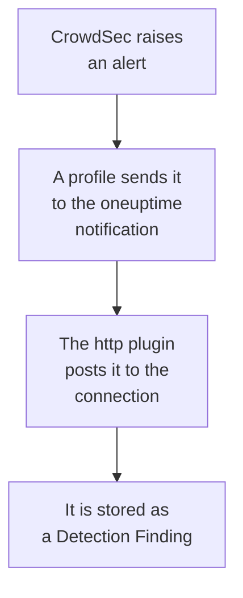

# CrowdSec

Receive [CrowdSec](https://www.crowdsec.net/)'s alerts in OneUptime's Security Events as CrowdSec raises them, and block the addresses on your project's blocklist with CrowdSec. CrowdSec's own notification plugin sends each alert to a CrowdSec connection, which opens cases from CrowdSec's detections. Once you turn blocking on, OneUptime bans each address you block through CrowdSec's Local API, and every bouncer that reads it blocks the address.

:::cards
- [Set up the connection](#set-up-the-connection): A connection, and the notification that sends CrowdSec's alerts to it.
- [What is received](#what-is-received): How each CrowdSec alert becomes a security event.
- [Block addresses with CrowdSec](#block-addresses-with-crowdsec): Ban the addresses on your blocklist in CrowdSec.
- [Read CrowdSec's blocklists](#read-crowdsecs-blocklists): The lists CrowdSec's Console serves, as a threat intel feed.
- [Troubleshooting](#troubleshooting): What each error means, and what to change.
:::

## How it works



CrowdSec's Local API hands each alert a profile sends to a notification to that notification's plugin. The connection's notification uses CrowdSec's `http` plugin: it posts the alert, in CrowdSec's own JSON, to the Security Events ingest with your ingestion key, naming the connection. OneUptime stores it as an [OCSF](https://schema.ocsf.io/) Detection Finding event (class `2004`), checks it against your detection rules, and opens a case from each of CrowdSec's own detections at or above the connection's **Open Cases From**. Nothing is polled: an alert arrives seconds after CrowdSec raises it.

## Before you begin

- In OneUptime, the Project Owner, Project Admin or Security Admin role. Security Members and Security Viewers can see connections, but cannot change them.
- CrowdSec 1.5 or later, with its Local API and the `http` notification plugin it ships with. This page is written against CrowdSec v1.8.2.
- Outbound HTTPS from the host that runs CrowdSec's Local API to your OneUptime.
- To block addresses too: OneUptime able to reach the Local API, and a machine for it (see [Block addresses with CrowdSec](#block-addresses-with-crowdsec)).

## Set up the connection

:::steps
### Add the connection in OneUptime

Open **Products → Security Events → Connections** (`/dashboard/{projectId}/security-events/connections`), click **Add connection**, choose **CrowdSec**, and click **Next**. To receive alerts alone, leave every setting in the table below empty; to block addresses too, fill them in.

### Test it before you save

Click **Test these settings** under **Test before saving**. With no Local API set, the test says so and contacts nothing; with one, it reaches the Local API and signs in as the machine, and stores nothing. Then click **Next**, give the connection a **Name** on the **Alerts** step, choose what **Open Cases From**, and create it.

### Save the notification on the CrowdSec host

Creating the connection opens its **Send alerts**, which you open again from the connection's row. **Pick an ingestion key**, then save the notification it shows, with your key and your connection filled in, on the host that runs CrowdSec's Local API:

```yaml title="/etc/crowdsec/notifications/oneuptime.yaml"
type: http
name: oneuptime

# info or quieter: at debug, CrowdSec logs each request's headers.
log_level: info

format: |
  {{.|toJson}}

url: https://oneuptime.com/security-events/v1/ingest?connection=YOUR_CONNECTION_ID&format=crowdsec
method: POST
headers:
  Content-Type: application/json
  x-oneuptime-token: YOUR_INGESTION_TOKEN
```

### Send your profiles' alerts to it

In `/etc/crowdsec/profiles.yaml`, add `oneuptime` to the `notifications` of each profile whose alerts OneUptime should receive, then reload CrowdSec:

```yaml title="/etc/crowdsec/profiles.yaml"
notifications:
  - oneuptime
```

```bash
sudo systemctl reload crowdsec
```

### Send a test alert

```bash
sudo cscli notifications test oneuptime
```

**Send alerts** says when it arrives, and **View alerts** opens it in Security Events. It is an informational event, and opens no case.
:::

| Setting | What to enter |
| --- | --- |
| **Local API URL** | Only to block addresses: where OneUptime reaches CrowdSec's Local API, such as `https://crowdsec.example.com:8080`. Use `https` wherever it crosses a network. |
| **Machine ID** | Only to block addresses: the machine OneUptime signs in as, added on the CrowdSec host with `sudo cscli machines add oneuptime --auto -f -`. |
| **Block addresses with CrowdSec** | Off on a new connection. On, it bans the addresses and ranges on your blocklist in CrowdSec, and needs the other three settings (see [Block addresses with CrowdSec](#block-addresses-with-crowdsec)). |
| **Machine password** | Only to block addresses: the password `cscli` printed for the machine. It is encrypted, never returned by the API and never shown again. Replace it with **Update credentials** on the connection. |

The **Alerts** step also has an optional **Description**, and **Enabled**, which starts on. A connection that is not enabled keeps the alerts it receives as events, and opens no case from them.

In a container, the notification goes in the folder mounted at `/etc/crowdsec/notifications/`, and a restart of the container reads it. A Kubernetes install names it in its Helm values under `config.notifications`, with `profiles.yaml` beside it under `config`.

## What is received

Each alert CrowdSec sends becomes one Detection Finding event (OCSF class `2004`), with vendor and product `CrowdSec`:

| CrowdSec field | OneUptime column |
| --- | --- |
| `uuid`, or a hash of an alert without one | Event UID, which is also what duplicates are dropped by |
| `stop_at`, or `start_at` | Event time |
| `scenario` | Rule ID, and the rule name: the scenario's title on the CrowdSec Hub, or its name |
| `source.ip`, or `source.value` of an `Ip` alert | Principal IP |
| `target_fqdn` or `target_host` of the alert or its events, else the `machine` its events name | Target host |
| `target_user`, `target_uri` | Target user and resource |
| The first decision's `type` | Status: `Blocked` for a ban, `Challenge` for a captcha, `Logged` without a decision or in simulation mode |
| The scenario's behavior | Severity, and its MITRE ATT&CK tactics and techniques |
| Everything else, such as `source.cn`, `source.as_name` and `events_count` | `attributes`: the alert's fields flattened to dotted keys, its first 10 events whole, and OneUptime's reading under `crowdsec.` |

A CrowdSec alert has no severity of its own, so OneUptime takes it from what the scenario detects, as the CrowdSec Hub labels it (`ssh:bruteforce`, `http:exploit`):

| Behavior | Severity |
| --- | --- |
| An exploit, such as a CVE or what the AppSec component blocked, or what an attacker does once inside | High |
| Brute force, denial of service, fraud, an impossible sign-in, or a behavior OneUptime cannot place | Medium |
| Scans, probes, crawls, bots, spam and cloud audit changes | Low |
| CrowdSec's own test scenarios | Informational |

With **Open Cases From** at **High and above**, CrowdSec's exploits open cases, and its everyday bans of scanners and password guessers stay events for your detection rules. Only CrowdSec's own detections open cases. A decision someone added with `cscli` or in CrowdSec's Console, an address on a CrowdSec blocklist, the test alert, and OneUptime's own bans coming back are Informational, and open none. An alert sent twice, as `cscli notifications reinject` does, is stored once.

## Block addresses with CrowdSec

Turn on **Block addresses with CrowdSec** on a connection, and the addresses and ranges on your project's [blocklist](/docs/telemetry/security-cases#blocklist) are banned in CrowdSec. Every bouncer that reads its Local API, such as its firewall, nginx and Traefik bouncers, blocks them where it runs, as it blocks CrowdSec's own bans. Blocks go through the same approvals, automatic response limits and **Lift** as every other place your blocklist is enforced.

The switch is off on a new connection. To turn it on:

1. On the CrowdSec host, add a machine for OneUptime, which prints its password:

   ```bash
   sudo cscli machines add oneuptime --auto -f -
   ```

2. Let OneUptime reach the Local API, which listens on `127.0.0.1:8080` unless told otherwise: set `api.server.listen_uri` in CrowdSec's `config.yaml`, serve it over TLS or behind an `https` proxy, and let OneUptime's addresses through your firewall.
3. Edit the connection, fill in **Local API URL** and **Machine ID**, put the password in **Machine password**, turn on **Block addresses with CrowdSec**, and save. **Test connection** then checks the machine signs in and reads OneUptime's bans, without changing anything.

How a ban is made, and how it ends:

- Each block is one ban decision, made as `cscli decisions add` makes one, under the scenario `oneuptime/blocklist`. CrowdSec keeps it as a manual decision, so it is never shared with CrowdSec's Central API unless you share manual decisions. OneUptime reads and removes only its own bans, never one a person or CrowdSec made.
- A block with an end is a ban until exactly that end, and CrowdSec lifts it then by itself, whether or not OneUptime can reach it. A block until it is lifted is a ban of 7 days, renewed once 3 days or less are left, so a ban OneUptime no longer keeps ends within a week.
- **Lift** removes the ban at the next pass, within a minute. A ban removed in CrowdSec, by `cscli decisions delete` or a flush, is made again at the next pass while the block lasts.
- An address or a range on one of CrowdSec's allowlists is never banned: the block shows it as not enforced there, naming the allowlist, and a ban already made is removed once an allowlist holds it.
- Your project's own addresses, such as your **Trusted Proxies**, load balancers and edges, are never blocked anywhere, CrowdSec included.
- CrowdSec bans: a challenge is not applied there, and a domain, a URL or a file is not sent to it.

When the Local API cannot be reached, nothing changes in CrowdSec: the bans it holds stay, and end when they end. **Enforced At** on the **Blocklist** says when CrowdSec last held each block, and OneUptime tries again after 1 minute, then waits twice as long each time, up to 30 minutes. A new block waits until it can be made.

## Read CrowdSec's blocklists

CrowdSec's Console serves the blocklists your organization subscribes to as a Raw IP List integration: an address a line, behind a username and password. A [threat intel feed](/docs/telemetry/threat-intelligence) reads them, and matches your events against them:

1. In the CrowdSec Console, create a Raw IP List integration, with IP aggregation off: OneUptime matches addresses, not ranges. Copy its endpoint, username and password.
2. In OneUptime, open **Products → Security Events → Detections → Threat Intel**, click **Create Threat Intel Feed**, and pick **List of indicators**.
3. Paste the endpoint as the **List URL**, pick **Username and password** under **Sign-in**, and paste both. On CrowdSec's Community plan, which allows one download a day, set **Poll Interval (Minutes)** to `1440`.

The lists are CrowdSec's: you may use them in your own tools, not pass them on. OneUptime offers no list of its own.

## Test connection

**Test connection** on a connection's row, and **Test these settings** in the form, run in the API process, not in a background worker. They run these checks, in order:

| Check | What it checks |
| --- | --- |
| **Configuration** | The settings are either all empty or all given, and well formed. Nothing is contacted when this fails. |
| **Reach CrowdSec's Local API** | `GET /health` answers. With no Local API set, the check says the connection only receives alerts, and the next three are not run. |
| **Sign in to the Local API** | `POST /v1/watchers/login` accepts the machine and its password. |
| **Read CrowdSec's allowlists** | `GET /v1/allowlists` answers, and how many addresses and ranges they hold. A Local API older than 1.6.8, which has none, passes. |
| **Block with CrowdSec** | Only with **Block addresses with CrowdSec** on: the machine can read OneUptime's bans back, and how many are in force. It changes nothing. |
| **Background workers**, **Security event storage** | OneUptime's own side: a process takes the Worker queue's jobs, which store what CrowdSec sends, and the store of security events answers. |
| **Alerts received** | For a saved connection: when the last alert arrived. None yet is a warning, with how to send a test alert. |

A test never bans or removes anything. **Copy report** copies the checklist as JSON, without the password or tokens.

## Troubleshooting

The connection's **Health** reads **Waiting for alerts** until the first alert arrives, then **Receiving alerts**, however long the next one takes; **Cases paused** means the connection is not enabled. CrowdSec writes what the plugin answered to its own log, `/var/log/crowdsec.log`, as `HTTP server returned non 200 status code`.

:::details No alert arrives
- Run `sudo cscli notifications list`: `oneuptime` must be listed, and active in a profile. A notification no profile names sends nothing.
- `401`: the ingestion key in `x-oneuptime-token` is missing, wrong or expired, and `422`: it is turned off. Pick a key in **Send alerts**, and copy the notification again.
- `400`: the address names no CrowdSec connection of this project. Copy the address from the connection's **Send alerts**: it ends in the connection's ID.
- Nothing at all in the log: the CrowdSec host cannot reach your OneUptime. Check outbound HTTPS from it, and its proxy.
:::

:::details Test connection fails at Reach CrowdSec's Local API
`CrowdSec Local API health check could not be completed` means nothing answered: the Local API listens on `127.0.0.1` by default, so OneUptime cannot reach it until `api.server.listen_uri` and your firewall let it. A warning that it answers over `http` means the machine's password crosses the network unencrypted: serve the Local API over TLS, or put an `https` proxy in front of it.
:::

:::details Test connection fails at Sign in to the Local API
`CrowdSec Local API login failed (HTTP 401)` ends with what to do: check the machine ID and the password with `sudo cscli machines list`, validate a machine that is not validated yet with `sudo cscli machines validate oneuptime`, or add a machine that signs in with a password. Save a new password with **Update credentials**.
:::

:::details A block is not enforced in CrowdSec
Hover its **Enforced At**: it names an allowlist that holds the address, a challenge CrowdSec does not apply, or the Local API's error. While the Local API cannot be reached, OneUptime keeps trying, and the bans CrowdSec already holds stay in force.
:::

:::details Last Polled is Never and Last Error is empty
A CrowdSec connection is never polled, so both stay empty. What CrowdSec sends is stored by the background workers: on a self-hosted install with `DISABLE_QUEUE_WORKERS=true` on the app and no separate worker deployment, alerts are taken in and never stored. Set it to `false`, or run the worker deployment (Helm: `worker.enabled: true`).
:::

## Next steps

:::cards
- [Security Events](/docs/telemetry/security-events): Search, correlate and alert on what CrowdSec sends.
- [Security Cases](/docs/telemetry/security-cases): Work the cases CrowdSec's detections open, and block from them.
- [Threat Intelligence](/docs/telemetry/threat-intelligence): Match your events against CrowdSec's blocklists.
- [Integrations Overview](/docs/integrations/index): The other tools you can connect.
:::
