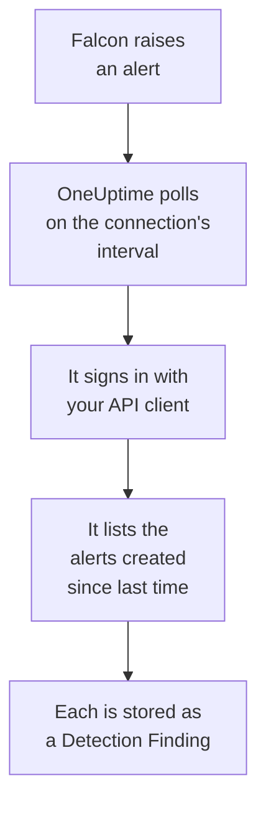

# CrowdStrike Falcon

Import [CrowdStrike Falcon](https://www.crowdstrike.com/platform/) alerts, from endpoint, identity and cloud detections, into OneUptime's Security Events. There you search them beside your logs, traces and metrics, correlate them with every other source, and page on-call for the ones that matter. OneUptime reads them through the Falcon Alerts API with an API client you create, and never writes to Falcon.

:::cards
- [Set up the connection](#set-up-the-connection): An API client with one scope, and the connection's form.
- [What is imported](#what-is-imported): How each Falcon alert becomes a security event.
- [How polling works](#how-polling-works): The window each poll reads, and what a busy CID does to it.
- [Troubleshooting](#troubleshooting): What each error means, and what to change.
:::

## How it works



Every minute, OneUptime polls each enabled connection whose poll interval has passed. A poll signs in to your Falcon cloud with the API client's ID and secret, asks the Alerts API for the alerts created since the last poll, and stores each one as an [OCSF](https://schema.ocsf.io/) Detection Finding event (class `2004`). Detection rules, monitors and dashboards then treat it like a security event from any other source.

## Before you begin

- In OneUptime, the Project Owner, Project Admin or Security Admin role. Security Members and Security Viewers can see connections and their run history, but cannot change them.
- A Falcon customer ID (CID), and a Falcon console user who can manage API clients: the Falcon Administrator role, or a custom role with the API clients and keys permission.
- Outbound HTTPS from the OneUptime app and workers to your Falcon cloud's API host, listed under **Falcon cloud** below.

## Set up the connection

:::steps
### Create an API client

1. In the Falcon console, open **Support and resources → API clients and keys**, and select **Create API client**.
2. Name it, for example `OneUptime security events`. Under **API scopes**, turn on **Alerts → Read**, and leave every other scope off: the connection never writes to Falcon.
3. Create the client. Falcon shows its client ID, its secret and its base URL once. Copy all three now: the secret can be reset later, but never shown again.

### Find your Falcon cloud

The base URL Falcon showed tells you the cloud your CID is in. The **API clients and keys** page also shows it, beside each client. A client from one cloud is refused by the others.

| Base URL Falcon shows | Falcon cloud |
| --- | --- |
| `https://api.crowdstrike.com` | US-1 |
| `https://api.us-2.crowdstrike.com` | US-2 |
| `https://api.eu-1.crowdstrike.com` | EU-1 |
| `https://api.laggar.gcw.crowdstrike.com` | US-GOV-1 |

### Add the connection in OneUptime

Open **Products → Security Events → Connections** (`/dashboard/{projectId}/security-events/connections`), click **Add connection**, choose **CrowdStrike Falcon**, and click **Next**. Fill in the settings in the table below, click **Next**, and paste the secret into **Client secret**.

### Test it before you save

Click **Test these settings** under **Test before saving**. The test signs in and reads alerts with the values in the form, and stores nothing, so the wrong cloud or a missing scope shows up before the connection exists. Then click **Next**, give the connection a **Name**, and create it.
:::

| Setting | What to enter |
| --- | --- |
| **Client ID** | The API client's ID, as Falcon showed it when you created the client. |
| **Falcon cloud** | The cloud your CID is in: **US-1 (api.crowdstrike.com)**, **US-2 (api.us-2.crowdstrike.com)**, **EU-1 (api.eu-1.crowdstrike.com)** or **US-GOV-1 (api.laggar.gcw.crowdstrike.com)**. Every request goes to that cloud's API host. |
| **Client secret** | The API client's secret. It is encrypted, never returned by the API and never shown again. Replace it with **Update credentials** on the connection. |

The **Polling** step also has an optional **Description**, the **Poll Interval (Minutes)**, a whole number from `1` to `1440` that starts at `5`, and **Enabled**, which starts on. A connection that is not enabled can still be tested, and polled by hand.

## What is imported

The connection reads Falcon's alerts: what the Falcon console lists under **Endpoint security → Endpoint detections** and **Next-Gen SIEM → Alerts**, from every product that raises them. Each alert becomes one Detection Finding event (OCSF class `2004`), with vendor `CrowdStrike` and product `Falcon`:

| Falcon field | OneUptime column |
| --- | --- |
| `composite_id` | Event UID, which is also what duplicates are dropped by |
| `created_timestamp` | Event time |
| `display_name`, or `name` | Rule name |
| `pattern_id` | Rule ID |
| `description`, or the rule name | Message |
| `severity_name`, or `severity` from 0 to 100 | Severity |
| `status`, such as `new`, `in_progress` or `closed` | Status |
| `tactic_id`, `technique_id` | MITRE ATT&CK tactics and techniques |
| `device.hostname`, `device.local_ip`, `user_name`, `filename` or `cmdline` | Principal host, IP, user and process |
| `filename`, `filepath` and `cmdline`; `parent_details.filename`, `parent_details.filepath` and `parent_details.cmdline` | Process name, path and command line; parent process name, path and command line |
| `device.hostname`, `device.local_ip`, `device.external_ip`, `user_name`, `sha256` | Observables |
| Everything else, such as `device.platform_name`, `falcon_host_link`, `product` and `timestamp` | `attributes`, flattened to dotted keys |

The event's time is when Falcon created the alert, on purpose: the time of the behaviour behind it, `timestamp`, stays in `attributes.timestamp`.

## How polling works

- **Creation time is the cursor.** Alerts are listed by `created_timestamp`, never by the time of the behaviour behind them. Falcon can raise an alert well after the activity it describes, and a cursor over activity time would skip every such alert.
- **The first poll looks back 24 hours**, so a new connection shows its recent alerts at once.
- **Every later poll starts 1 minute before the saved cursor**, so an alert created on the boundary between two windows is never missed.
- **A poll reads at most 24 hours past the cursor.** A connection whose cursor fell behind catches up in a row of 24 hour windows.
- **Duplicates are dropped by `composite_id`** within the project, so the overlap and a retried window never store an alert twice.
- **Each window costs** one token request, kept for the token's lifetime, then one alerts query and one alert fetch per 1,000 alerts, each with its own timeout.

### When a window holds more than one poll can read

A poll sends at most 20 requests. With one token request and two requests for every 1,000 alerts, it reads at most 9,000 alerts. When a window holds more, the run is **Partial**, with a warning such as:

```text
Stopped after 19 requests before reading the whole window. Alerts are read oldest first; every alert created before 2026-09-14T08:12:44.995Z was read.
```

The alerts query is sorted by `created_timestamp`, oldest first, so OneUptime moves the cursor to the creation time of the last alert it read, and the next poll starts there with the same window length, from offset `0`. A busy CID catches up about 9,000 alerts a poll, instead of reading the same ones again. The alerts created at that same instant are read twice, and the duplicate check drops the second copy.

Falcon's alerts query cannot page past 10,000 results (`limit` plus `offset`). The request limit stops a run at 9,000 alerts, before that ceiling. If the ceiling ever stops a read, it is handled the same way: the run is **Partial**, the cursor moves to the last alert read, and the next query starts again from offset `0`.

When a run cannot get past the saved cursor at all, for example because more than 9,000 alerts share the minute of overlap, OneUptime shortens the window instead:

1. **Narrow.** The next poll reads a window half as long, from the same starting point, and halves again until a window reads completely, down to one minute. The run's warning says so: `This window holds more records than one poll can read; the next poll reads a {n} minute window from the same starting point.`
2. **Grow back.** After a window reads completely, the next one is twice as long again, up to 24 hours.
3. **Move past a single minute.** If even one minute holds more than a poll can read, polling moves past it, so newer alerts keep arriving. The run stays **Partial**, and **Last Error** reads `More records were created in the one minute from {cursor} to {end} than one poll can read. Polling moved past this minute so newer records keep arriving; use Import this time range in Diagnostics on this minute to recover what one run can read.` Import that minute with **Import this time range** to recover what one run can read.

A run that fails outright, with an error from Falcon, keeps the cursor and the window length, and the next poll reads the same window again. The one exception is a request that timed out: the cursor stays, but the next window is half as long, since a window too heavy to answer in time would time out on every try. Changing the **Poll Interval (Minutes)** changes none of this: it decides how often a poll starts, not where its window begins.

### Run, preview and import on demand

Click **Diagnostics** on a connection to see its recent runs and to work with it by hand. Anyone who can change the connection can start these; everyone who can see it can read the history.

- **Run now** starts a poll at once, with the usual cursor, even while the connection is not **Enabled**.
- **Preview alerts** reads a time range of up to 7 days and imports nothing.
- **Import this time range** imports a range of up to 7 days, after you confirm, without moving the cursor. Alerts already imported are skipped.
- **Copy diagnostics** on a run copies its report for support. It never includes credentials.

## Test connection

**Test connection** on a connection's row, and **Test these settings** in the form, run in the API process, not in a background worker, so a test still answers when the workers are the problem. It runs these checks, in order:

| Check | What it checks |
| --- | --- |
| **Configuration** | **Client ID**, **Falcon cloud** and **Client secret** are present and well formed. Nothing is contacted when this fails. |
| **Authenticate with CrowdStrike Falcon** | `POST /oauth2/token` with the API client's ID and secret, on your cloud's host, returns a token. |
| **Read alerts from the Falcon Alerts API** | An alerts query for one alert (`limit=1`) over the last 24 hours is accepted, which proves the **Alerts → Read** scope. |
| **Alerts available to import** | How many alerts were created in the last 24 hours and the last 7 days. None in 7 days is a warning, not a failure: polling imports new alerts as Falcon creates them. |
| **Background workers**, **Poll scheduler**, **Security event storage** | OneUptime's own side: a process takes the Worker queue's jobs, the poll job runs every minute, and the store of security events answers. |
| **Scheduled polling** | For a saved connection: polling is on, no run is stuck waiting for a worker, and polls run on time. |

Every request in a test has a 20 second deadline. A test never imports anything or moves the cursor, and each failed check says what to change. **Copy report** copies the checklist as JSON, without credentials or tokens.

## Troubleshooting

The connection's **Last Error**, and every failed check, keep the complete error message, with credentials redacted, behind a prefix that names the step that failed. When a connection has an error, select **View Error** in its **Actions** column to read it, and **Copy Error** in the dialog to copy it. Read the prefix first.

:::details Last Error starts with `CrowdStrike Falcon token request`
- `CrowdStrike Falcon token request failed (HTTP 401)` or `(HTTP 403)`: Falcon refused the API client's ID and secret, before the Alerts API was contacted. Check that **Falcon cloud** is the cloud of your CID, since a client from another cloud is refused here, that **Client ID** is the client's, and that **Client secret** is the secret issued with it. If the secret was lost, reset it in the Falcon console, and save it with **Update credentials**.
- `CrowdStrike Falcon token request returned ...`: Falcon answered with something unusable, a body that is not JSON or has no `access_token`. That is usually a proxy or gateway in between, not the credentials.
:::

:::details Last Error starts with `CrowdStrike Falcon alerts`
- `CrowdStrike Falcon alerts query failed (HTTP 403)`: the token was accepted, but the API client has no **Alerts → Read** scope. Turn it on for the client under **API clients and keys**, and save. It applies to the next token, so test again after a minute.
- `CrowdStrike Falcon alerts query failed (HTTP 401)`: the Alerts API refused the token, which almost always means **Falcon cloud** is not the cloud that issued the client.
- `CrowdStrike Falcon alerts query failed (HTTP 429)` or `CrowdStrike Falcon alerts fetch failed (HTTP 429)`: Falcon is rate limiting this API client. OneUptime's HTTP client keeps no response headers on an error, so the message usually ends with `the X-RateLimit-RetryAfter header was not available` rather than quoting it. Scheduled polls try again on their own. If it keeps happening, give OneUptime an API client of its own, rather than one shared with other tools.
- `CrowdStrike Falcon alerts query failed (HTTP 400)`: Falcon refused the query. The connection sends a fixed FQL filter on `created_timestamp`, so copy the report and send it to OneUptime support.
- `CrowdStrike Falcon alerts query returned ...` or `CrowdStrike Falcon alerts fetch returned ...`: Falcon answered `200`, with a body that is not JSON, or not in a shape the connection knows. This is reported rather than taken as an empty window, so the cursor never moves past alerts nobody read.
- `CrowdStrike Falcon alerts fetch failed (HTTP ...)`: the alerts were listed, but fetching them failed, for the same reasons as the query. A `403` here means the scope was removed between the two calls.
:::

:::details Last Error says the request could not be completed
`CrowdStrike Falcon token request could not be completed`, `CrowdStrike Falcon alerts query could not be completed` and `CrowdStrike Falcon alerts fetch could not be completed` mean nothing came back: a timeout, a DNS failure or blocked outbound traffic. Check outbound HTTPS from the OneUptime app and workers to your cloud's API host, such as `api.crowdstrike.com`.
:::

:::details Last Error names an unknown cloud
`CrowdStrike Falcon cloud "..." is not one of us-1, us-2, eu-1, us-gov-1` means the saved cloud is not one the connection knows. Edit the connection, and pick a cloud from the list.
:::

:::details A run is Partial
- `Stopped after 19 requests before reading the whole window`: the window held more than the 9,000 alerts one run reads. Nothing is lost: the next poll starts after the last alert read. A connection that stays **Partial** poll after poll is catching up on a backlog, and its **Last Polled** and **Last Event Imported** keep moving. The count can be a little over 19 when the token was renewed during the run.
- `Falcon returned alerts out of created_timestamp order, so this run cannot name a point to resume from.`: the query ignored the oldest-first order, so the run cannot move the cursor to its last alert, and the next poll reads a shorter window instead. If it keeps happening, send the run's report to OneUptime support.
- `More records were created in the one minute from ... than one poll can read`: polling moved past that minute. Import it with **Import this time range** in **Diagnostics**. An import reads as much as one poll.
:::

:::details Last Polled is Never and Last Error is empty
No poll has run, so nothing has reached Falcon. **Test connection** shows it as a failed **Background workers** or **Poll scheduler** check. On a self-hosted install, the usual cause is `DISABLE_QUEUE_WORKERS=true` on the app, with no separate worker deployment taking the jobs: set it to `false`, or run the worker deployment (Helm: `worker.enabled: true`).
:::

:::details The test passes, but no events appear
Read **Alerts available to import**: a warning there means Falcon created no alerts in the last 7 days, so there is nothing to import yet. Otherwise open **Diagnostics**, check the last poll's window and counts, and use **View events in this time range** on a run to open the time range of the alerts it imported.
:::

## What you get

- **Search.** Filter Falcon alerts by severity, status, MITRE tactic, host, user or any observable in the Security Events explorer, beside that host's logs and metrics.
- **Correlation.** Every alert's host names, IPs, users and file hashes are indexed as observables, so one search finds everything that mentions a host across every source.
- **Detection rules.** Sigma rules that run on a schedule over your security events, and open alerts that page on-call.
- **Monitors.** Security Events monitors count matching events, and open incidents or alerts past a threshold.

Security events are billed like the rest of your telemetry, per GB ingested. See [Pricing](https://oneuptime.com/pricing).

## Next steps

:::cards
- [Security Events](/docs/telemetry/security-events): Search, correlate and alert on what you import.
- [Microsoft Defender XDR](/docs/integrations/microsoft-defender-xdr): Import the alerts of Microsoft's Defender workloads too.
- [Roles](/docs/permissions/reference#roles): What the Security roles can see and change.
- [Integrations Overview](/docs/integrations/index): The other tools you can connect.
:::
