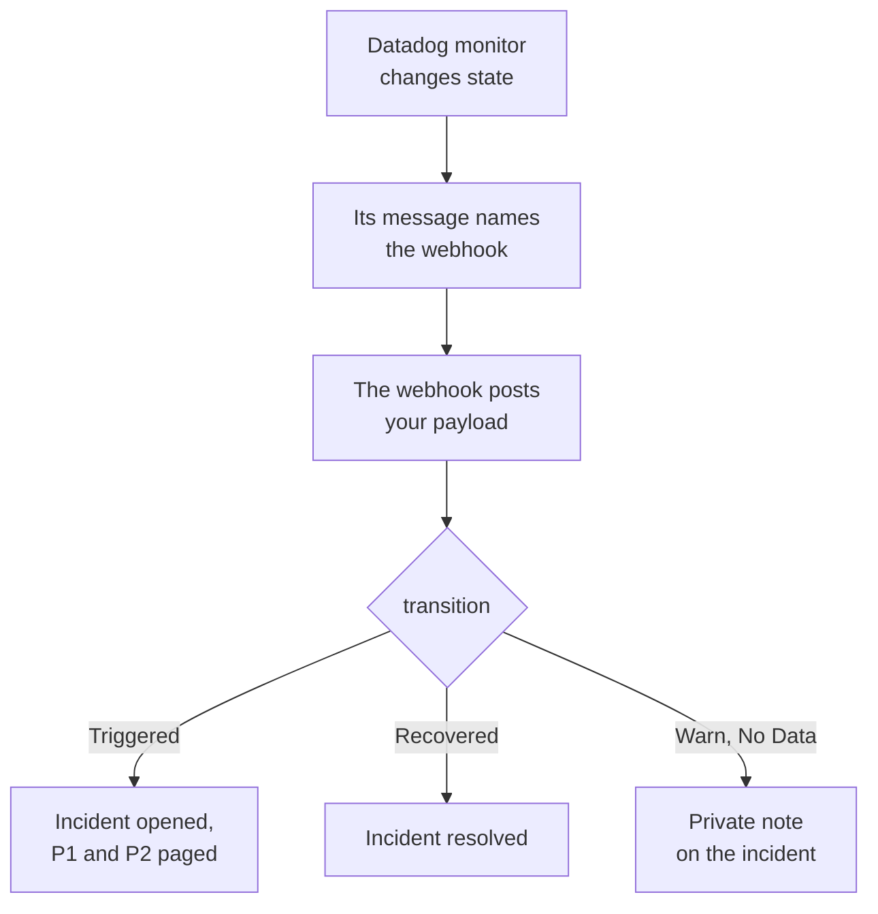

# Datadog

Send [Datadog](https://www.datadoghq.com) monitor alerts to OneUptime, so each one becomes an incident or an alert, pages your on-call team when it is urgent, and is resolved when the Datadog monitor recovers. Datadog sends its alerts through its [Webhooks integration](https://docs.datadoghq.com/integrations/webhooks/), so there is nothing to install on either side.

:::cards
- [Choose how OneUptime receives alerts](#choose-how-oneuptime-receives-alerts): A workflow template, or an Incoming Request monitor.
- [Start from the template](#start-from-the-template): Pick who to page, copy the URL, and see what each alert does.
- [Receive alerts with a monitor](#receive-alerts-with-a-monitor): One incident per alert, resolved on recovery.
- [Configure Datadog](#configure-datadog): A webhook, and the monitors that notify it.
- [Troubleshooting](#troubleshooting): When alerts do not arrive, or incidents stay open.
:::

## How it works



A Datadog monitor notifies the webhooks its message mentions when it changes state: when it triggers, warns, recovers or has no data. You write the webhook's JSON body yourself, from Datadog's [template variables](https://docs.datadoghq.com/integrations/webhooks/#usage), so this guide gives you one that names each alert and says what happened to it.

## Before you begin

- A Datadog account where you can configure integrations and edit monitors.
- In OneUptime, the right to create workflows, or monitors if you take that way. On OneUptime Cloud, workflows need the **Growth** plan or above.

## Choose how OneUptime receives alerts

Set up OneUptime first: it gives you the URL Datadog sends to.

| Way | Use it when |
| --- | --- |
| The workflow template (recommended) | You want each alert as an incident or an alert at a severity from the monitor's priority, paged to on-call for P1 and P2, with warnings noted on it, and resolved on recovery. There is nothing to build. |
| An Incoming Request monitor | You want incidents without a workflow, on any plan, and a monitor whose status follows Datadog. |

Both get the same JSON from the same webhook, so you can start with one and switch later by changing one URL in Datadog.

## Start from the template

The **Create a workflow** dialog has two Datadog templates, under **Datadog** in its category list: **Declare an incident when a Datadog monitor triggers**, and **Create an alert when a Datadog monitor triggers** for alerts. Both do the same, each with its own kind of record.

:::steps
1. Go to **Workflows** and click **Create Workflow**. Under **Or start from a template**, choose **Datadog** in the category list, click **Declare an incident when a Datadog monitor triggers**, or **Create an alert when a Datadog monitor triggers**, and click **Use this template**.
2. Under **Who to page for P1 and P2 monitors**, pick the on-call policies to page, or none to page nobody, and click **Create Workflow**. The workflow opens in the **Builder**, switched off.
3. Click the **Webhook** trigger, then **Copy URL**, and keep the URL for Datadog.
4. Switch **Enabled** on at the top of the **Builder**. A workflow that is off answers Datadog with `400`.
:::

Then [configure Datadog](#configure-datadog) to send its alerts to that URL. The workflow's `read-event-1` step opens with the same setup, for when you come back to it in the **Builder**.

### What the workflow does

After the **Webhook** trigger, the `read-event-1` **Check With JavaScript** step reads the `transition` Datadog sends, and **Incident From Another Tool**, or **Alert From Another Tool** in the alert template, does what it means, by the alert's cycle key. Datadog keeps that key from the moment an alert triggers until it recovers, and the next time it triggers the key is new, so each time gets an incident of its own. The incident keeps the key in its custom field `datadogAlertCycleKey`.

| Transition | What the workflow does |
| --- | --- |
| `Triggered`, `Re-Triggered` | Declares an incident titled `Datadog: <monitor>`, at the severity the monitor's priority maps to, kept off your status pages. Its description links the alert in Datadog, and lists the priority, the host, the scope and the monitor's message. A notification for an alert that has its incident opens no second one, and pages nobody again. |
| `Recovered` | Resolves the alert's incident, unless it is resolved already. Why is on its timeline. |
| `Warn`, `Re-Warn`, `No Data`, `Re-No Data` | Adds a private note to the alert's incident, saying what the monitor's state is now. |
| `Renotify` | Nothing: the alert is still open. |

A warning or a recovery for an alert with no incident changes nothing. Anything else, such as a request from another tool, is left alone: `read-event-1` takes **No**, and the run's **Steps** say why. Nothing goes back to Datadog: it resolves its own alerts when the signal recovers, and that is what resolves the incident.

### Priorities and paging

A new incident pages the on-call policies you picked when its monitor is P1 or P2, or has no priority. P3, P4 and P5 open an incident and page nobody. In a new project, the priorities map onto these incident and alert severities:

| Datadog priority | Incident | Alert | On-call |
| --- | --- | --- | --- |
| P1 | Critical Incident | High | Paged |
| P2 | Critical Incident | High | Paged |
| No priority | Critical Incident | High | Paged |
| P3 | Major Incident | Low | Not paged |
| P4 | Minor Incident | Low | Not paged |
| P5 | Minor Incident | Low | Not paged |

With severities of your own, P1, P2 and no priority go to your most severe, P3 to the middle one, and P4 and P5 to your least severe.

- To map a priority to one of yours by name, edit `SEVERITY_BY_NAME` in the `read-event-1` step, such as `{ P3: 'Minor Incident' }`.
- To page for P3 too, set **Compare with** of the `if-page-1` **If / Else** step to `3`.

## Receive alerts with a monitor

An [Incoming Request monitor](/docs/monitor/incoming-request-monitor) gives you a URL, and its criteria decide what each alert does.

:::steps
### Create the monitor

Go to **Monitors** and click **Create Monitor**. Pick **Incoming Request** under **Monitor Type**, name it `Datadog`, and click **Next**.

### Declare an incident for each alert

On the **Criteria** step, open the first criteria, the one that marks the monitor offline. Set its filter to **Request Body**, **Contains**, `"transition":"Triggered"`. This criteria already declares an incident when its filter matches. Fill the incident in:

- **Incident Title**: `{{requestBody.title}}`.
- **Incident Description**, under **Description**: `{{requestBody.body}}`, then `Datadog: {{requestBody.link}}` on a line of its own.
- **Severity**: the incident severity these alerts should have.
- **On-Call Policies**, under **On-Call**: the policies to page.
- **Auto Resolve Incident**, under **More fields**: leave it on, as it starts. Without it, recoveries are ignored and incidents stay open.

### Open one incident per alert

In the same criteria, open **Settings** and turn on **Group incidents and alerts by a payload field**. Fill it in as below, so each alert gets its own incident, and its recovery resolves it:

| Field | Value |
| --- | --- |
| **Open a separate incident for each…** | `requestBody.alert_key` |
| **Field that signals recovery** | `requestBody.transition` |
| **Value that means recovered** | `Recovered` |

### Bring the monitor back online

Open the second criteria, the one that marks the monitor online, and set its filter to **Request Body**, **Contains**, `"transition":"Recovered"`.

### Copy the URL

Click **Create Monitor**. The monitor's **Overview** page shows its **Heartbeat URL**. Copy it for Datadog:

```text
https://oneuptime.com/heartbeat/<secret key>
```

A self-hosted install has its own host in place of `oneuptime.com`.
:::

The payload below sets `alert_key` to the Datadog monitor's ID and the tags of the group that alerted, so each group of a multi alert monitor gets its own incident, and that group's recovery resolves it. A monitor that re-triggers or renotifies while its incident is open opens no second one. See [Receiving alerts from another system](/docs/monitor/incoming-request-monitor#receiving-alerts-from-another-system) for what each setting does.

> [!NOTE]
> A **Warn** or **No Data** notification opens no incident with these filters. To be paged for warnings too, click **Add Criteria**, give the new criteria the filter **Request Body**, **Contains**, `"transition":"Warn"`, an incident with its own **Severity**, and the same grouping settings, then drag it above the first criteria. Criteria are checked from the top, and the first that matches decides.

## Configure Datadog

:::steps
### Add the webhook

In Datadog, open the [Webhooks integration tile](https://app.datadoghq.com/integrations/webhooks), and install it if it is not installed yet. Add a webhook with these settings, then save it:

- **Name**: `oneuptime`. Monitors mention the webhook by this name, as `@webhook-oneuptime`.
- **URL**: the URL you copied from OneUptime.
- **Payload**:

  ```json
  {
    "alert_key": "$ALERT_ID $ALERT_SCOPE",
    "alert_cycle_key": "$ALERT_CYCLE_KEY",
    "transition": "$ALERT_TRANSITION",
    "alert_priority": "$ALERT_PRIORITY",
    "title": "$EVENT_TITLE",
    "body": "$TEXT_ONLY_MSG",
    "host": "$HOSTNAME",
    "scope": "$ALERT_SCOPE",
    "priority": "$PRIORITY",
    "link": "$LINK"
  }
  ```

### Mention the webhook in your monitors

In each Datadog monitor that should page through OneUptime, add `@webhook-oneuptime` to the monitor's notification message, and save the monitor. Datadog then sends that monitor's alerts and recoveries to OneUptime.
:::

| Variable | What Datadog puts in it |
| --- | --- |
| `$ALERT_ID` | The ID of the Datadog monitor that alerted. |
| `$ALERT_SCOPE` | The tags of the group that alerted, such as `host:web-1`. |
| `$ALERT_CYCLE_KEY` | An ID that stays the same from the moment an alert triggers until it recovers. |
| `$ALERT_TRANSITION` | What happened: `Triggered`, `Re-Triggered`, `Warn`, `Recovered`, `No Data` or `Renotify`, among others. |
| `$ALERT_PRIORITY` | The priority of the Datadog monitor, `P1` to `P5`, or nothing for a monitor with none. |
| `$EVENT_TITLE` | The title of the event, such as `[Triggered] High CPU`. |
| `$TEXT_ONLY_MSG` | The monitor's message, without Markdown. |
| `$LINK` | A link to the event in Datadog. |

One payload serves both ways: the template goes by `alert_cycle_key` and `alert_priority`, and the monitor by `alert_key`. Keep them all, and you can switch later by changing the URL alone.

## Test it

Send an alert to the URL you copied, as Datadog would:

```bash
curl -X POST "<url>" \
  -H "Content-Type: application/json" \
  -d '{
    "alert_key": "1234 host:web-1",
    "alert_cycle_key": "7151157925468446720",
    "transition": "Triggered",
    "alert_priority": "P1",
    "title": "[Triggered] High CPU",
    "body": "CPU is above 90% on web-1.",
    "host": "web-1",
    "scope": "host:web-1",
    "priority": "normal",
    "link": "https://app.datadoghq.com/event/event?id=1"
  }'
```

With the template, an incident opens, titled `Datadog: High CPU`, and the on-call policies you picked are paged. With the monitor, an incident opens, titled `[Triggered] High CPU`. Send the same request with `transition` set to `Recovered`, and the incident is resolved.

Then test from Datadog: open a monitor that mentions the webhook, click **Test Notifications**, and send its **Alert** notification. To see that it arrived, open the workflow's **Logs → Runs**, or the OneUptime monitor's timeline.

## Troubleshooting

:::details Nothing arrives in OneUptime
- Check that the Datadog monitor's message mentions `@webhook-oneuptime`, spelled as the webhook is named.
- The monitor answers `200` at once, before it checks anything, even for a wrong secret key. Check the monitor's timeline to see whether alerts land.
- A workflow that is off answers `400`. Switch **Enabled** on at the top of its **Builder**.
:::

:::details The workflow runs, but opens nothing
Open the run in **Logs → Runs**. The `read-event-1` entry in its **Steps** says why it took **No**.

- `Datadog named no alert cycle key`: add `"alert_cycle_key": "$ALERT_CYCLE_KEY"` to the webhook's payload in Datadog.
- `Datadog named no transition`: add `"transition": "$ALERT_TRANSITION"` to the webhook's payload in Datadog.
:::

:::details On-call is not paged
- Only P1 and P2 monitors and monitors with no priority page. See [Priorities and paging](#priorities-and-paging).
- A notification for an alert that has its incident pages nobody again.
- With nobody picked in the **Create a workflow** dialog, the workflow has no step that pages.
:::

:::details Incidents open but are never resolved
- The Datadog monitor must notify the webhook of its recoveries too. A message that mentions the webhook only for alerts, inside a condition, sends no recovery.
- With the template, open the recovery's run in **Logs → Runs**: its last step says why. The recovery's `alert_cycle_key` must be the alert's, so keep `$ALERT_CYCLE_KEY` as it is in the payload.
- With the monitor, the criteria's incident needs **Auto Resolve Incident**, under **More fields**.
- **Value that means recovered** must be exactly `Recovered`. The comparison is case-sensitive.
- The `alert_key` of the recovery must be the alert's: keep `$ALERT_ID $ALERT_SCOPE` as it is in the payload.
:::

:::details A field shows a variable's name, or nothing
Datadog fills in only the variables that apply to the event. Send a test notification, then look at what arrived: in the monitor's timeline, or for a workflow in **Logs → Runs**.
:::

:::details Every alert of a monitor folds into one incident
With the monitor, each group needs its own `alert_key`. Check that the payload sets it from both `$ALERT_ID` and `$ALERT_SCOPE`, and that the grouping path is `requestBody.alert_key`.
:::

## Security

- **Treat the URL like a password.** Anyone who has it can open incidents. If it leaks, reset it: **Reset URL** in the workflow's **Webhook** trigger, or **Reset Incoming Request Secret Key** on the monitor's **Settings** page. Then update the webhook's **URL** in Datadog.
- **Links go to Datadog.** The template links an alert only on a Datadog site, whatever a request says, and writes what Datadog sent as text.
- **Self-hosted?** Datadog sends webhooks from the internet, so your OneUptime must be reachable from it over HTTPS.

## Next steps

:::cards
- [Workflow Templates](/docs/workflows/authoring): Create a workflow from a template, and change it in the Builder.
- [Incoming Request Monitor](/docs/monitor/incoming-request-monitor): Every setting of the monitor that receives your alerts.
- [New Relic](/docs/integrations/new-relic): The same template, for New Relic issues.
- [Escalation Rules](/docs/on-call/escalation-rules): Decide who an on-call policy pages, and when.
- [Integrations Overview](/docs/integrations/index): The other tools you can connect.
:::
