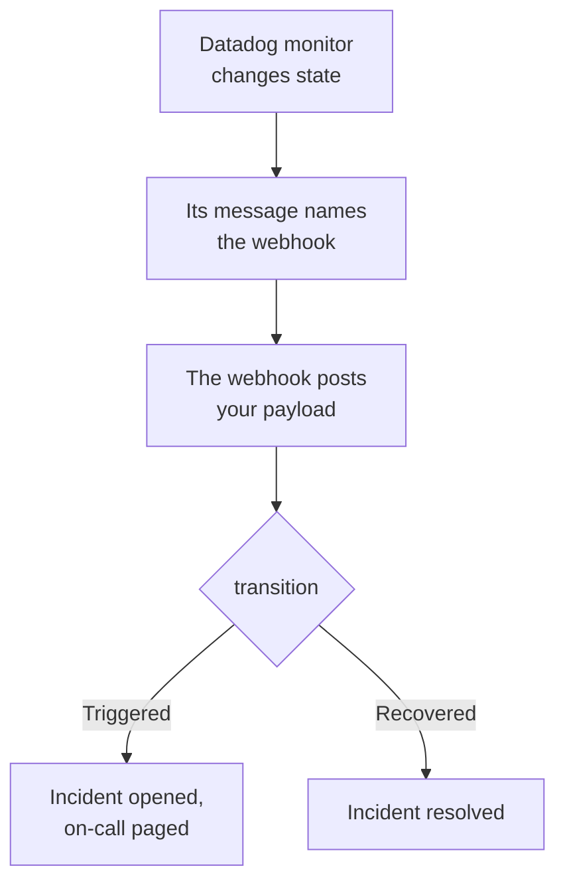

# Datadog

Send [Datadog](https://www.datadoghq.com) monitor alerts to OneUptime, so each alert becomes an incident that pages your on-call team, and is resolved when the Datadog monitor recovers. Datadog sends its alerts through its [Webhooks integration](https://docs.datadoghq.com/integrations/webhooks/), so there is nothing to install on either side.

:::cards
- [Choose how OneUptime receives alerts](#choose-how-oneuptime-receives-alerts): An Incoming Request monitor, or a workflow of your own.
- [Receive alerts with a monitor](#receive-alerts-with-a-monitor): One incident per alert, resolved on recovery.
- [Configure Datadog](#configure-datadog): A webhook, and the monitors that notify it.
- [Troubleshooting](#troubleshooting): When alerts do not arrive, or incidents stay open.
:::

## How it works



A Datadog monitor notifies the webhooks its message mentions when it changes state: when it triggers, warns, recovers or has no data. You write the webhook's JSON body yourself, from Datadog's [template variables](https://docs.datadoghq.com/integrations/webhooks/#usage), so this guide gives you one that names each alert and says what happened to it.

## Before you begin

- A Datadog account where you can configure integrations and edit monitors.
- In OneUptime, the right to create monitors, or workflows if you take that way.

## Choose how OneUptime receives alerts

Set up OneUptime first: it gives you the URL Datadog sends to.

| Way | Use it when |
| --- | --- |
| An Incoming Request monitor (recommended) | You want every alert to be an incident that pages on-call, and is resolved when the Datadog monitor recovers. There is nothing to build. |
| A workflow with a Webhook trigger | You need logic of your own: filter alerts, reshape them, or call other systems first. A workflow declares an incident for every alert it gets, and does not resolve it on recovery. |

Both get the same JSON from the same webhook, so you can start with one and switch later by changing one URL in Datadog.

## Receive alerts with a monitor

An [Incoming Request monitor](/docs/monitor/incoming-request-monitor) gives you a URL, and its criteria decide what each alert does.

:::steps
### Create the monitor

Go to **Monitors** and click **Create Monitor**. Pick **Incoming Request** under **Monitor Type**, name it `Datadog`, and click **Next**.

### Declare an incident for each alert

On the **Criteria** step, open the first criteria, the one that marks the monitor offline. Set its filter to **Request Body**, **Contains**, `"transition":"Triggered"`. This criteria already declares an incident when its filter matches. Fill the incident in:

- **Incident Title**: `{{requestBody.title}}`.
- **Incident Description**, under **Description**: `{{requestBody.body}}`, then `Datadog: {{requestBody.link}}` on a line of its own.
- **Severity**: the incident severity these alerts should have.
- **On-Call Policies**, under **On-Call**: the policies to page.
- **Auto Resolve Incident**, under **More fields**: leave it on, as it starts. Without it, recoveries are ignored and incidents stay open.

### Open one incident per alert

In the same criteria, open **Settings** and turn on **Group incidents and alerts by a payload field**. Fill it in as below, so each alert gets its own incident, and its recovery resolves it:

| Field | Value |
| --- | --- |
| **Open a separate incident for each…** | `requestBody.alert_key` |
| **Field that signals recovery** | `requestBody.transition` |
| **Value that means recovered** | `Recovered` |

### Bring the monitor back online

Open the second criteria, the one that marks the monitor online, and set its filter to **Request Body**, **Contains**, `"transition":"Recovered"`.

### Copy the URL

Click **Create Monitor**. The monitor's **Overview** page shows its **Heartbeat URL**. Copy it for Datadog:

```text
https://oneuptime.com/heartbeat/<secret key>
```

A self-hosted install has its own host in place of `oneuptime.com`.
:::

The payload below sets `alert_key` to the Datadog monitor's ID and the tags of the group that alerted, so each group of a multi alert monitor gets its own incident, and that group's recovery resolves it. A monitor that re-triggers or renotifies while its incident is open opens no second one. See [Receiving alerts from another system](/docs/monitor/incoming-request-monitor#receiving-alerts-from-another-system) for what each setting does.

> [!NOTE]
> A **Warn** or **No Data** notification opens no incident with these filters. To be paged for warnings too, click **Add Criteria**, give the new criteria the filter **Request Body**, **Contains**, `"transition":"Warn"`, an incident with its own **Severity**, and the same grouping settings, then drag it above the first criteria. Criteria are checked from the top, and the first that matches decides.

## Configure Datadog

:::steps
### Add the webhook

In Datadog, open the [Webhooks integration tile](https://app.datadoghq.com/integrations/webhooks), and install it if it is not installed yet. Add a webhook with these settings, then save it:

- **Name**: `oneuptime`. Monitors mention the webhook by this name, as `@webhook-oneuptime`.
- **URL**: the URL you copied from OneUptime.
- **Payload**:

  ```json
  {
    "alert_key": "$ALERT_ID $ALERT_SCOPE",
    "transition": "$ALERT_TRANSITION",
    "title": "$EVENT_TITLE",
    "body": "$TEXT_ONLY_MSG",
    "host": "$HOSTNAME",
    "priority": "$PRIORITY",
    "link": "$LINK"
  }
  ```

### Mention the webhook in your monitors

In each Datadog monitor that should page through OneUptime, add `@webhook-oneuptime` to the monitor's notification message, and save the monitor. Datadog then sends that monitor's alerts and recoveries to OneUptime.
:::

| Variable | What Datadog puts in it |
| --- | --- |
| `$ALERT_ID` | The ID of the Datadog monitor that alerted. |
| `$ALERT_SCOPE` | The tags of the group that alerted, such as `host:web-1`. |
| `$ALERT_TRANSITION` | What happened: `Triggered`, `Re-Triggered`, `Warn`, `Recovered`, `No Data` or `Renotify`, among others. |
| `$EVENT_TITLE` | The title of the event, such as `[Triggered] High CPU`. |
| `$TEXT_ONLY_MSG` | The monitor's message, without Markdown. |
| `$LINK` | A link to the event in Datadog. |

## Test it

Send OneUptime an alert, as Datadog would:

```bash
curl -X POST "https://oneuptime.com/heartbeat/<secret key>" \
  -H "Content-Type: application/json" \
  -d '{
    "alert_key": "1234 host:web-1",
    "transition": "Triggered",
    "title": "[Triggered] High CPU",
    "body": "CPU is above 90% on web-1.",
    "host": "web-1",
    "priority": "normal",
    "link": "https://app.datadoghq.com/event/event?id=1"
  }'
```

An incident opens, titled `[Triggered] High CPU`. Send the same request with `transition` set to `Recovered`, and the incident is resolved.

Then test from Datadog: open a monitor that mentions the webhook, click **Test Notifications**, and send its **Alert** notification. Check the OneUptime monitor's timeline to see that it arrived.

## Receive alerts with a workflow

Use a [workflow](/docs/workflows/index) when you need steps of your own between Datadog and the incident.

:::steps
### Create the workflow

Go to **Workflows**, click **Create Workflow**, then **Start from scratch**. Name it `Datadog alerts` and click **Create Workflow**.

### Add the Webhook trigger

Click the dashed **Choose what starts this workflow** block and pick **Webhook**. Click the trigger, then **Copy URL**, and use that URL in the webhook in Datadog.

### Check that the monitor triggered

Click **Add Component**, add an **If / Else** block, and connect the trigger's **Out** dot to it. Set **Value to check** to `{{local.components.webhook-1.returnValues.request-body.transition}}`, **Comparison** to **is equal to**, and **Compare with** to `Triggered`.

### Declare the incident

Add a **Create One Incident** block, and connect the **Yes** side of the **If / Else** block to it. In **Incident Template**, pick a template that sets the severity and the on-call policies to page (see [Incident templates](/docs/incidents/settings#incident-templates)). In **JSON Object**, set what comes from Datadog:

```json
{
  "title": "{{local.components.webhook-1.returnValues.request-body.title}}",
  "description": "{{local.components.webhook-1.returnValues.request-body.body}}\nDatadog: {{local.components.webhook-1.returnValues.request-body.link}}"
}
```

Without a template, **JSON Object** also needs `incidentSeverityId`, the ID of one of the project's incident severities.

### Turn the workflow on

Switch **Enabled** on at the top of the **Builder**. A workflow that is off answers Datadog with `400`.
:::

Every `Triggered` notification declares a new incident. A recovery takes the **No** side of the **If / Else** block, where nothing is connected, so the run ends there. For one incident per alert, resolved on recovery, use the monitor.

## Troubleshooting

:::details Nothing arrives in OneUptime
- Check that the Datadog monitor's message mentions `@webhook-oneuptime`, spelled as the webhook is named.
- The monitor answers `200` at once, before it checks anything, even for a wrong secret key. Check the monitor's timeline to see whether alerts land.
- A workflow that is off answers `400`. Switch **Enabled** on at the top of its **Builder**.
:::

:::details Incidents open but are never resolved
- The Datadog monitor must notify the webhook of its recoveries too. A message that mentions the webhook only for alerts, inside a condition, sends no recovery.
- The criteria's incident needs **Auto Resolve Incident**, under **More fields**.
- **Value that means recovered** must be exactly `Recovered`. The comparison is case-sensitive.
- The `alert_key` of the recovery must be the alert's: keep `$ALERT_ID $ALERT_SCOPE` as it is in the payload.
:::

:::details A field shows a variable's name, or nothing
Datadog fills in only the variables that apply to the event. Send a test notification, then look at what arrived: in the monitor's timeline, or for a workflow in **Logs → Runs**.
:::

:::details Every alert of a monitor folds into one incident
Each group needs its own `alert_key`. Check that the payload sets it from both `$ALERT_ID` and `$ALERT_SCOPE`, and that the grouping path is `requestBody.alert_key`.
:::

## Security

- **Treat the URL like a password.** Anyone who has it can open incidents. If it leaks, reset it: **Reset Incoming Request Secret Key** on the monitor's **Settings** page, or **Reset URL** in the workflow's **Webhook** trigger. Then update the webhook's **URL** in Datadog.
- **Self-hosted?** Datadog sends webhooks from the internet, so your OneUptime must be reachable from it over HTTPS.

## Next steps

:::cards
- [Incoming Request Monitor](/docs/monitor/incoming-request-monitor): Every setting of the monitor that receives your alerts.
- [Prometheus Alertmanager](/docs/integrations/prometheus-alertmanager): The same setup, for Alertmanager.
- [Escalation Rules](/docs/on-call/escalation-rules): Decide who an on-call policy pages, and when.
- [Integrations Overview](/docs/integrations/index): The other tools you can connect.
:::
