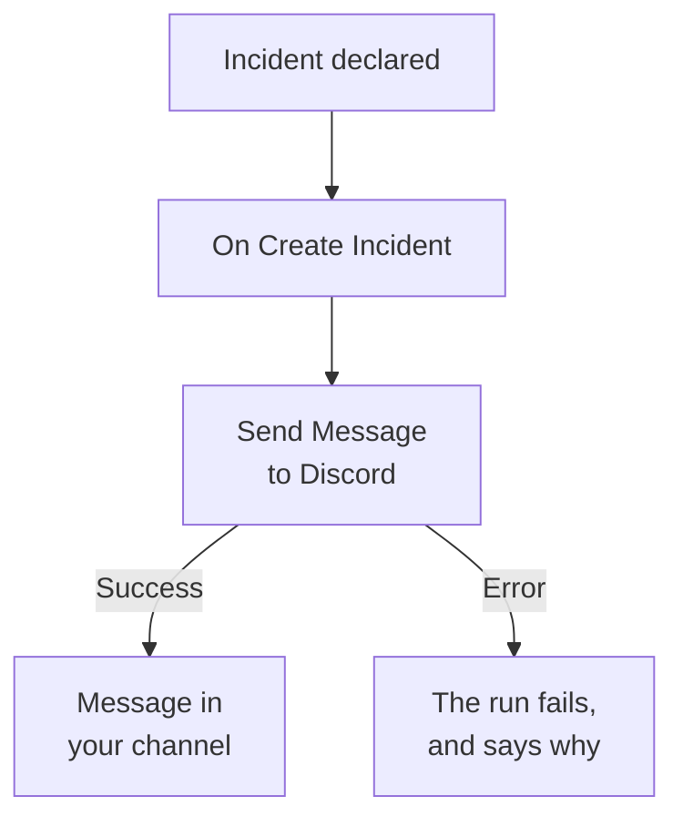

# Discord

Post a message to a [Discord](https://discord.com) channel when an incident opens, so the people who watch that channel know at once. OneUptime's **Send Message to Discord** workflow step posts through the channel's webhook, and a ready-made template builds the whole workflow for you. This integration is **outbound**: OneUptime posts in the channel, and doesn't read what's said there.

:::cards
- [How it works](#how-it-works): What the workflow does when an incident opens.
- [Set it up](#set-up-the-integration): A webhook in Discord, then the workflow: from the template or from scratch.
- [Tips](#tips): Formatting, long messages, and more events.
- [Troubleshooting](#troubleshooting): What the step's errors mean, and what to change.
:::

## How it works



The step posts the **Message Text** to the channel's webhook. It takes its **Success** output when Discord takes the message, and its **Error** output, with Discord's reason, when Discord refuses it. With nothing connected to **Error**, as in the template, a run that could not post fails, and its **Steps** say why.

## Before you begin

- In Discord, the **Manage Webhooks** permission on the channel.
- In OneUptime, the right to create workflows and variables. On OneUptime Cloud, workflows need the **Growth** plan or above.

## Set up the integration

:::steps
### Create a webhook in Discord

1. In Discord, open the channel's settings with **Edit Channel**, then **Integrations → Webhooks**, and select **New Webhook**.
2. Name it, for example `OneUptime`, and check that it posts to the right channel.
3. Select **Copy Webhook URL**.

Anyone who has the URL can post in the channel, so keep it as safe as a password.

### Build the workflow

Start from the template, which builds the whole workflow for you, or from scratch.

:::tabs
@tab From the template
1. Open **Workflows** and click **Create Workflow**.
2. Type `Discord` in **Search templates…**, click **Tell Discord when an incident opens**, then click **Use this template**.
3. Keep the name, **Notify Discord on new incident**, or change it, and click **Next**.
4. Paste the URL into **Discord Webhook URL**, and click **Create Workflow**.

The workflow opens in the **Builder** with two steps: **On Create Incident**, and **Send Message to Discord**, which posts the incident's number, title, severity and state. The URL is saved as the workflow's secret variable `discordWebhookUrl`.
@tab From scratch
1. Save the URL as a secret global variable: go to **Workflows → Global Variables**, click **Create Workflow Variable**, name it `DISCORD_WEBHOOK_URL`, and click **Next**. Paste the URL into **Content**, turn on **Secret**, and click **Create Workflow Variable**.
2. Go to **Workflows**, click **Create Workflow**, choose **Start from scratch**, name the workflow, and click **Create Workflow**.
3. In the **Builder**, click **Choose what starts this workflow** and pick **On Create Incident** under **Popular**. Click the trigger: its **Fields to pass on** starts with **Title**, so click **Add field** and pick the other fields your message shows, such as **Incident Number With Prefix**.
4. Click **Add Component**, search for `discord`, and click **Send Message to Discord**. Connect the trigger's **Success** output to it.
5. Click the new step. In **Discord Incoming Webhook URL**, click **{ }** and pick `DISCORD_WEBHOOK_URL` under **Global variables**. In **Message Text**, write the message, and insert the incident's fields with **{ }**.
:::

A message from scratch reads the incident's fields with references such as these:

```text
🚨 **Incident {{local.components.incident-on-create-1.returnValues.model.incidentNumberWithPrefix}} declared**
**Title:** {{local.components.incident-on-create-1.returnValues.model.title}}
```

### Turn it on and test it

Switch **Enabled** on at the top of the **Builder**. From now on, every new incident is posted in the channel.

To test it without opening an incident, click **Run Workflow** and pick an incident you already have under **Incident**: the most recent ones are listed, and typing its number or part of its title finds another. Click **Run Workflow Manually** and confirm with **Run**. The **Workflow Run** panel follows the run, and the message shows up in the channel. If the step takes **Error** instead, the run fails, and the step's entry in **Steps** says why: see [Troubleshooting](#troubleshooting).
:::

## Tips

- **Format with Discord's Markdown.** The text is sent as typed, so Discord's Markdown works in it: asterisks around a word make it bold, and a URL shows as a link.
- **Mind the 2,000-character limit.** Discord takes messages of up to 2,000 characters. A longer one is cut, and ends with "… (truncated — see OneUptime for the full text)", rather than refused.
- **Post more than new incidents.** Build another workflow on **On Update Incident** for state changes, or on **On Create Alert** for alerts, with the same step. To post only some incidents, put an **If / Else** block before the step.
- **Only Discord's own addresses.** The step posts to an `https` URL on `discord.com` or `discordapp.com`, and doesn't follow redirects, so a URL that points anywhere else stops the run.

## Troubleshooting

When the step takes **Error**, the run fails, and the step's entry in the run's **Steps** gives Discord's reason.

:::details "Unknown Webhook" or "Invalid Webhook Token"
The webhook was deleted, or the URL was copied wrong. Create a new webhook, and replace the URL: in the template's workflow, the `discordWebhookUrl` variable; in a workflow of your own, the content of `DISCORD_WEBHOOK_URL`.
:::

:::details "You are being rate limited"
Discord limits how often one webhook can post. A burst of incidents can hit it: post fewer messages, for example only for some severities.
:::

:::details The run stops with "Discord Webhook URL must be an https URL on discord.com or discordapp.com"
**Discord Incoming Webhook URL** holds something other than a Discord webhook, or the variable it reads is empty. Paste the URL from **Copy Webhook URL** again.
:::

## Next steps

:::cards
- [Workflow Components](/docs/workflows/components#discord): Every setting of the step, and what its outputs mean.
- [Telegram](/docs/integrations/telegram): The same idea, in a Telegram chat.
- [Workflow Runs](/docs/workflows/runs-and-logs): Read what each run of the workflow did.
- [Integrations Overview](/docs/integrations/index): The outbound pattern, and the other tools you can connect.
:::
