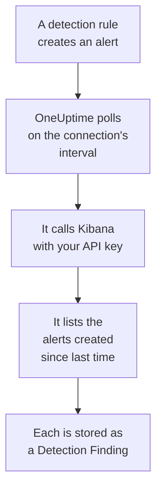

# Elastic Security

Import the detection alerts your [Elastic Security](https://www.elastic.co/security) rules raise into OneUptime's Security Events. There you search them beside your logs, traces and metrics, correlate them with every other source, and page on-call for the ones that matter. OneUptime reads them through Kibana's detection engine API with an API key you create, and changes nothing in Elastic.

:::cards
- [Set up the connection](#set-up-the-connection): An API key, its privileges, and the connection's form.
- [What is imported](#what-is-imported): How each detection alert becomes a security event.
- [How polling works](#how-polling-works): The window each poll reads, and what a busy space does to it.
- [Troubleshooting](#troubleshooting): What each error means, and what to change.
:::

## How it works



Every minute, OneUptime polls each enabled connection whose poll interval has passed. A poll asks Kibana for the detection alerts created in your space since the last poll, 1,000 at a time, and stores each one as an [OCSF](https://schema.ocsf.io/) Detection Finding event (class `2004`). Every kind of rule counts: custom query, threshold, EQL, indicator match, machine learning and new terms. Detection rules, monitors and dashboards then treat the alerts like security events from any other source.

## Before you begin

- In OneUptime, the Project Owner, Project Admin or Security Admin role. Security Members and Security Viewers can see connections and their run history, but cannot change them.
- Elastic Security 8.x or later, on Elastic Cloud or your own Elastic stack, with detection rules running in a Kibana space.
- Kibana access that can view detection alerts in that space: the `read` and `view_index_metadata` index privileges on `.alerts-security.alerts-<space-id>`, and a Kibana Security feature privilege that lets it read alerts there.
- A Kibana OneUptime can reach over HTTPS. OneUptime Cloud connects from the internet, so Kibana needs a public address, as Elastic Cloud deployments have: private addresses are refused. A self-hosted OneUptime connects from its app and worker containers, and can reach a Kibana on your private network unless `DATA_SOURCE_BLOCK_PRIVATE_ADDRESSES` is `true`.

## Set up the connection

:::steps
### Create an API key

1. In Kibana, open **Stack Management → API keys**, and select **Create API key**.
2. Name it, for example `oneuptime-security-events`. A key has the privileges of the user who creates it, unless you give it fewer: it needs only the ones above.
3. Choose when it expires, or never. A key that expires stops the connection until you replace it.
4. Create the key, and copy its **Base64** value, which Kibana shows once. Not the key's ID, and not the `id:api_key` pair.

### Find your space's ID

Alerts are stored per space. Open the space that runs your rules: its ID is the part of Kibana's address after `/s/`, such as `security` in `https://kibana.example.com/s/security/app/security`. The default space has no `/s/` part, and needs no ID.

### Add the connection in OneUptime

Open **Products → Security Events → Connections** (`/dashboard/{projectId}/security-events/connections`), click **Add connection**, choose **Elastic Security**, and click **Next**. Fill in the settings in the table below, click **Next**, and paste the key into **API key**.

### Test it before you save

Click **Test these settings** under **Test before saving**. The test signs in and reads alerts with the values in the form, and stores nothing, so a wrong space or a missing privilege shows up before the connection exists. Then click **Next**, give the connection a **Name**, and create it.
:::

| Setting | What to enter |
| --- | --- |
| **Kibana URL** | The address Kibana is served from, such as `https://kibana.example.com` or `https://<deployment>.kb.<region>.cloud.es.io`. No path: not `/app/security`, not `/api`, and not the `/s/<space>` part. |
| **Kibana space** | The space's ID, not its name: letters, digits, hyphens and underscores. Leave it empty for the default space. |
| **API key** | The key's **Base64** value, on its own: OneUptime adds the `ApiKey` scheme itself. It is encrypted, never returned by the API and never shown again. Replace it with **Update credentials** on the connection. |

The **Polling** step also has an optional **Description**, the **Poll Interval (Minutes)**, a whole number from `1` to `1440` that starts at `5`, and **Enabled**, which starts on.

## What is imported

Each detection alert becomes one Detection Finding event (OCSF class `2004`), with vendor `Elastic` and product `Elastic Security`:

| Alert field | OneUptime column |
| --- | --- |
| `_id`, the alert's ID | Event UID, which is also what duplicates are dropped by |
| `kibana.alert.original_time`, else `kibana.alert.start`, else `@timestamp` | Event time |
| `kibana.alert.rule.name` | Rule name |
| `kibana.alert.rule.uuid`, else `kibana.alert.rule.rule_id` | Rule ID |
| `kibana.alert.reason`, else the rule name, else `kibana.alert.rule.description` | Message |
| `kibana.alert.severity`, else a band of `kibana.alert.risk_score` | Severity |
| `kibana.alert.workflow_status`: `open`, `acknowledged` or `closed` | Status |
| `kibana.alert.rule.threat`, sub-techniques included | MITRE ATT&CK tactics and techniques |
| `user.name`, `host.name`, `source.ip` or `host.ip`, `process.name` or `process.executable` | Principal user, host, IP and process |
| `process.name`, `process.executable` and `process.command_line`; `process.parent.name`, `process.parent.executable` and `process.parent.command_line` | Process name, path and command line; parent process name, path and command line |
| `user.target.name`, `destination.domain`, `destination.ip`, `destination.port`, `file.path` | Target user, host, IP, port and resource |
| Those, and `related.*`, `dns.question.name`, `url.domain` and file hashes | Observables |
| The whole alert, flattened to dotted keys, with `_index` and `_id` | `attributes` |

An alert's time is the time of the activity it is about, on purpose. Its `@timestamp`, when the rule created it, is what polling reads, so an alert created today about yesterday's activity shows under yesterday in the Security Events explorer. When an alert has no severity, its risk score decides: `74` and up is Critical, `48` and up High, `22` and up Medium, and anything lower Low.

## How polling works

Each poll lists the alerts created in its window, oldest first, 1,000 to a page. In a space other than the default, the path starts with `/s/{Kibana space}`:

```text
POST {Kibana URL}/api/detection_engine/signals/search
    {"query": {"range": {"@timestamp": {"gte": "{window start}", "lt": "{window end}"}}},
     "size": 1000, "sort": [{"@timestamp": "asc"}]}
```

- **Creation time is the cursor.** Alerts are listed by their own `@timestamp`, when the rule run created them, never by the time of the activity they are about. A rule that runs hourly creates alerts about activity up to an hour old, and a cursor over activity time would skip every one of them.
- **The first poll looks back 24 hours**, so a new connection shows its recent alerts at once.
- **Every later poll starts 1 minute before the saved cursor**, so an alert created on the boundary between two windows is never skipped.
- **A poll reads at most 24 hours past the cursor.** A connection whose cursor fell behind catches up in a row of 24 hour windows, and its **Health** reads **Catching up**.
- **Duplicates are dropped by the alert's `_id`** within the project, so the overlap, a retried window and an import never store an alert twice.

Kibana's alert search takes a size and a sort, but no page token. So OneUptime pages by moving the start of the range to the last alert of each page, and leaves out, by `_id`, the alerts it has read at that instant. One rule run often stamps many alerts with the same time, and such a group is read page by page, none twice and none skipped.

### When a window holds more than one poll can read

A poll reads at most 10,000 alerts, in at most 20 requests. When a window holds more, the run is **Partial**, with a warning such as:

```text
Stopped after collecting 10000 alerts; the window holds more.
```

Alerts are read oldest first, so OneUptime moves the cursor to the creation time of the last alert it read, and the next poll starts there with the same window length. A busy space catches up 10,000 alerts a poll, instead of reading the same ones again. The alerts created at that same instant are read twice, and the duplicate check drops the second copy.

The IDs left out travel in each request, and Kibana limits a request's size. When more alerts share one instant than one request can leave out, about 7,800, the run stops there as **Partial**, with a warning that names the instant.

When a run cannot get past the saved cursor at all, OneUptime shortens the window instead:

1. **Narrow.** The next poll reads a window half as long, from the same starting point, and halves again until a window reads completely, down to one minute. The run's warning says so: `This window holds more records than one poll can read; the next poll reads a {n} minute window from the same starting point.`
2. **Grow back.** After a window reads completely, the next one is twice as long again, up to 24 hours.
3. **Move past a single minute.** If even one minute holds more than a poll can read, polling moves past it, so newer alerts keep arriving. The run stays **Partial**, and **Last Error** reads `More records were created in the one minute from {cursor} to {end} than one poll can read. Polling moved past this minute so newer records keep arriving; use Import this time range in Diagnostics on this minute to recover what one run can read.` Import that minute with **Import this time range** to recover what one run can read.

A run that fails outright, with an error from Kibana, keeps the cursor and the window length, and the next poll reads the same window again. The one exception is a request that timed out: the cursor stays, but the next window is half as long, since a window too heavy to answer in time would time out on every try. Changing the **Poll Interval (Minutes)** changes none of this: it decides how often a poll starts, not where its window begins.

### Run, preview and import on demand

Click **Diagnostics** on a connection to see its recent runs and to work with it by hand. Anyone who can change the connection can start these; everyone who can see it can read the history.

- **Run now** starts a poll at once, with the usual cursor, even while the connection is not **Enabled**.
- **Preview alerts** reads a time range of up to 7 days and imports nothing.
- **Import this time range** imports a range of up to 7 days, after you confirm, without moving the cursor. Alerts already imported are skipped.
- **Copy diagnostics** on a run copies its report for support. It never includes credentials.

## Test connection

**Test connection** on a connection's row, and **Test these settings** in the form, run in the API process, not in a background worker, so a test still answers when the workers are the problem. It runs these checks, in order:

| Check | What it checks |
| --- | --- |
| **Configuration** | Every setting is present and well formed. Nothing is contacted when this fails. |
| **Authenticate with Kibana** | Kibana's `/api/status` answers in full. Kibana answers callers it did not authenticate too, with less, so a short answer fails this check. |
| **Read detection alerts** | One alert created in the last 24 hours can be read. This proves the privileges and the space. |
| **Alerts available to import** | How many alerts were created in the last 24 hours and the last 7 days, with `+` where Elasticsearch counted only part of them. None in 7 days is a warning, not a failure. |
| **Background workers**, **Poll scheduler**, **Security event storage** | OneUptime's own side: a process takes the Worker queue's jobs, the poll job runs every minute, and the store of security events answers. |
| **Scheduled polling** | For a saved connection: polling is on, no run is stuck waiting for a worker, and polls run on time. |

Every request in a test has a 20 second deadline. A test never imports anything or moves the cursor, and each failed check says what to change.

## Send security events to Elastic Security

OneUptime can also send what it finds to Elasticsearch, as Elastic Common Schema (ECS) documents in a data stream, so Elastic Security's alerts, timelines and detection rules see OneUptime's detections next to your own. A detection is a document with `event.kind` `alert`, and every other event has `event.kind` `event`.

:::steps
### Create an API key that can write

In Kibana, open **Stack Management → API keys**, click **Create API key**, give it the privileges below, and copy its **Encoded** value.

### Add the destination

Open **Products → Security Events → Connections**. Under **Send to your SIEM**, click **Add destination**, choose Elastic Security under **SIEM** and click **Next**. Fill in the **Elasticsearch URL**, the deployment's Elasticsearch endpoint rather than Kibana's, and paste the key into **API key**. **Data stream** is optional: left empty, documents go to `logs-oneuptime.security-default`, which Elasticsearch creates on the first write.

### Send a test event and start sending

Click **Send a test event**: one document arrives in the data stream. Then under **What to send** keep **Detections only** or choose **All security events**, and click **Start sending**.
:::

The key's privileges, for the default data stream:

```json title="oneuptime-writer-role.json"
{
  "oneuptime-writer": {
    "indices": [
      {
        "names": [
          "logs-oneuptime.security-*"
        ],
        "privileges": [
          "create_doc",
          "auto_configure"
        ]
      }
    ]
  }
}
```

- Documents go in batches of up to 500, each with its event's own id, so an event sent twice is stored once.
- A document Elasticsearch cannot map is left out and named in **View Error**, and one it cannot take for now (`429`) is sent again.
- Alerts OneUptime imported from Elastic Security are never sent back to it.

## Troubleshooting

The connection's **Last Error** keeps the complete error message, with credentials redacted, behind a prefix that names the step that failed. When a connection has an error, select **View Error** in its **Actions** column to read it, and **Copy Error** in the dialog to copy it. Read the prefix first.

:::details Last Error starts with `Elastic Security status request`
- `Elastic Security status request failed (HTTP ...)`: Kibana refused the status request.
  - `HTTP 401`: Kibana did not accept the API key. It is not the **Base64** value, or it expired or was invalidated. Create a new key, and save it with **Update credentials**.
  - `HTTP 404`: the **Kibana URL** has a path, or is not Kibana.
  - `HTTP 503`: Kibana reports itself unavailable, usually because it cannot reach Elasticsearch.
  - `HTTP 3xx`: Kibana redirected the request, and redirects are refused. Use the address Kibana is served from.
- `Elastic Security status request returned ...`: something other than Kibana answered, such as a sign-in page or a proxy.
- When only the test fails, saying Kibana `answered without authenticating the request`, the key did not reach Kibana. Check that it is the **Base64** value, and that no proxy in front of Kibana drops the `Authorization` header.
:::

:::details Last Error starts with `Elastic Security alerts search`
- `Elastic Security alerts search failed (HTTP ...)`: Kibana refused the alert search.
  - `HTTP 403`: the key signs in, but cannot read the space's alerts. Give it the privileges under [Before you begin](#before-you-begin).
  - `HTTP 404`: no space has that **Kibana space** ID, or Elastic Security is not enabled in it.
  - `HTTP 429` or `HTTP 5xx`: Kibana or Elasticsearch is limiting requests or failing. The next poll tries again.
- `Elastic Security alerts search returned ...`: Kibana answered `200`, but with no readable page of alerts, such as its own error. The message quotes it. This is reported rather than taken as an empty window, so the cursor never moves past alerts nobody read.
:::

:::details Last Error ends with `did not complete`
`Elastic Security alerts search did not complete`, and the same for the status request, means the request got no answer: a timeout, a name that does not resolve, a refused connection, or a private address refused. Check that the OneUptime app and workers can reach Kibana, on the right scheme and port. After a timeout, the next poll reads a window half as long.
:::

:::details Last Polled is Never and Last Error is empty
No poll has finished for this connection. Run **Test connection**: its **Background workers** and **Poll scheduler** checks name the cause. On a self-hosted install, the usual cause is `DISABLE_QUEUE_WORKERS=true` on the app, with no separate worker deployment taking the jobs: set it to `false`, or run the worker deployment (Helm: `worker.enabled: true`).
:::

:::details A run is Partial
- `Stopped after collecting 10000 alerts; the window holds more`: the window held more than the 10,000 alerts one run reads. Nothing is lost: the next poll starts after the last alert read. A connection that stays **Partial** poll after poll is catching up on a backlog, and its **Last Polled** and **Last Event Imported** keep moving. If it never catches up, the space creates more than 10,000 alerts per poll interval: shorten the **Poll Interval (Minutes)**.
- `More records were created in the one minute from ... than one poll can read`: polling moved past that minute. Import it with **Import this time range** in **Diagnostics**. An import reads as much as one poll.
:::

:::details The test passes, but nothing is imported
Read **Alerts available to import** in the test's report. `0` in the last 7 days means no rule created an alert in that space: check that rules are enabled there, and that **Kibana space** is the space they run in. If alerts exist, widen the time range in the Security Events explorer: alerts show under the time of their activity, which can be well before they were created.
:::

## What you get

- **Search.** Filter alerts by severity, status, rule, MITRE ATT&CK technique, user, host or any observable in the Security Events explorer, beside every other source.
- **Correlation.** Every alert's users, hosts, IPs, domains and hashes are indexed as observables, so one search finds everything that mentions them.
- **Detection rules.** Sigma rules that run on a schedule over your security events, and open alerts that page on-call.
- **Monitors.** Security Events monitors count matching events, for example new critical alerts, and open incidents or alerts past a threshold.

Security events are billed like the rest of your telemetry, per GB ingested. See [Pricing](https://oneuptime.com/pricing).

## Next steps

:::cards
- [Security Events](/docs/telemetry/security-events): Search, correlate and alert on what you import.
- [Splunk Enterprise Security](/docs/integrations/splunk): Import the notable events of a Splunk search head too.
- [Roles](/docs/permissions/reference#roles): What the Security roles can see and change.
- [Integrations Overview](/docs/integrations/index): The other tools you can connect.
:::
