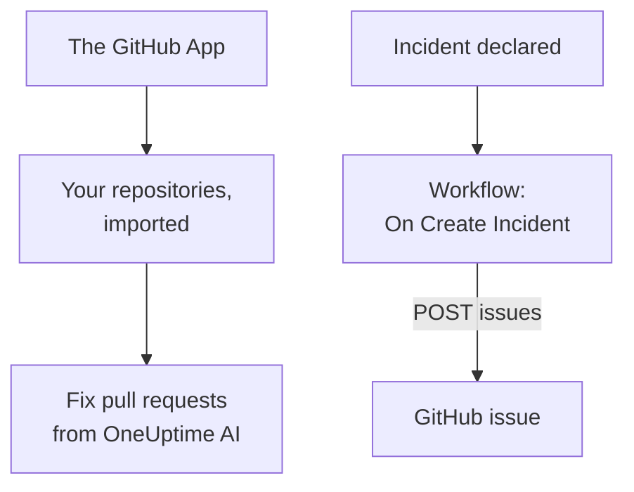

# GitHub

OneUptime works with [GitHub](https://github.com) in two ways. Connect your repositories through the OneUptime GitHub App, and OneUptime's AI opens pull requests that fix what it finds, and answers when you mention it on an issue or a pull request. Or build a workflow that opens a GitHub issue for every incident, so the follow-up work is tracked in the repository that owns the service.

:::cards
- [Choose how to connect](#choose-how-to-connect): The GitHub App or a workflow, and what each one does.
- [Connect your repositories](#connect-your-repositories): The GitHub App, for fix pull requests.
- [Open an issue for every incident](#open-a-github-issue-for-every-incident): One workflow, two blocks.
- [Troubleshooting](#troubleshooting): When GitHub refuses a request.
:::

## How it works



The two are separate, and you can use either or both. The GitHub App works in the repositories you install it on. The workflow needs only a token, and calls GitHub's [REST API](https://docs.github.com/en/rest/issues/issues#create-an-issue) like any other API.

## Choose how to connect

| Way | What it does | What it needs |
| --- | --- | --- |
| The GitHub App | Imports your repositories. OneUptime AI opens pull requests in them that fix exceptions, slow traces and the causes its investigations find, and answers mentions on issues and pull requests. | An organization or account to install the app on. On OneUptime Cloud, the **Growth** plan. |
| A workflow | Opens a GitHub issue for every incident, in the repository you choose. | A GitHub token that can create issues, and a workflow of two blocks. |

## Connect your repositories

Open **Products → Code → Tasks**, then **Code Repositories**, and click **Connect with GitHub App**. GitHub asks where to install the app and which repositories it may use. Every repository in the installation is imported, and stays in step as you add repositories to the installation or take them out.

A self-hosted instance needs a GitHub App of its own first: [GitHub Integration](/docs/self-hosted/github-integration) shows how to create it. From then on, [Fix Tasks](/docs/ai/ai-agent) open pull requests in your repositories, and the [GitHub App](/docs/ai/github-app) page shows what it does when you mention it on an issue or a pull request.

## Before you begin

The rest of this page builds the workflow. It needs:

- A GitHub token that can create issues in the repository: a fine-grained personal access token for that repository, with the **Issues** permission set to **Read and write**, or a classic token with the `repo` scope. Create one in GitHub's [token settings](https://github.com/settings/tokens).
- In OneUptime, the right to create workflows and global variables. On OneUptime Cloud, workflows need the **Growth** plan or above.

## Store the token

:::steps
1. Go to **Workflows → Global Variables** and click **Create Workflow Variable**.
2. Name it `GITHUB_TOKEN` and click **Next**.
3. Paste the token into **Content**, turn on **Secret**, and click **Create Workflow Variable**.
:::

A secret variable is replaced with `[REDACTED]` in run logs, so the token never shows in a run.

## Open a GitHub issue for every incident

:::steps
### Create the workflow

Go to **Workflows**, click **Create Workflow**, then **Start from scratch**. Name it `Incidents to GitHub` and click **Create Workflow**.

### Add the trigger

Click the dashed **Choose what starts this workflow** block and pick **On Create Incident**. Click the trigger, and in **Fields to pass on** pick `title`, `description` and `incidentNumberWithPrefix`.

### Open the issue

Click **Add Component**, add an **API Post (JSON)** block, and connect the trigger's **Success** dot to it. Set its **URL** to `https://api.github.com/repos/your-org/your-repo/issues`, with your repository's owner and name. Under **More fields**, set its **Request Headers** to:

```json
{
  "Authorization": "Bearer {{global.variables.GITHUB_TOKEN}}",
  "Accept": "application/vnd.github+json",
  "X-GitHub-Api-Version": "2022-11-28"
}
```

And its **Request Body** to:

```json
{
  "title": "{{local.components.incident-on-create-1.returnValues.model.title}}",
  "body": "{{local.components.incident-on-create-1.returnValues.model.description}}\n\nOpened by OneUptime for incident {{local.components.incident-on-create-1.returnValues.model.incidentNumberWithPrefix}}.",
  "labels": ["incident"]
}
```

### Test it, then turn it on

Click **Run Workflow**, pick a test incident under **Incident**, and run it. The **API Post (JSON)** step shows a `201` response holding the new issue, with its `number` and its `html_url`. Then switch **Enabled** on at the top of the **Builder**.
:::

The issue stays open when the incident is resolved, since the follow-up work usually outlives the incident. For tickets kept in step with the incident both ways, see [Jira](/docs/integrations/jira).

## Tips

- **GitHub Enterprise Server.** Send the request to your server instead: `https://your-github-host/api/v3/repos/your-org/your-repo/issues`. A server on a private network address needs a self-hosted OneUptime whose administrator allows it: see [Outbound network access](/docs/workflows/configuration#outbound-network-access).
- **Assign it.** Add `"assignees": ["octocat"]` or `"milestone": 3` to the body. GitHub drops labels, assignees and milestones without a word when the token cannot push to the repository.
- **Only some incidents.** Put an **If / Else** block between the trigger and the API block, and open issues only on its **Yes** side, for example for one severity.

## Troubleshooting

The **API Post (JSON)** step takes **Error** when GitHub refuses the request. Its **Response Status** and **Response Body** in the run say why.

:::details GitHub answers 401
The token is wrong, expired or revoked. Create a new one, and replace the content of `GITHUB_TOKEN`.
:::

:::details GitHub answers 403
The token cannot create issues there: a fine-grained token without **Issues** set to **Read and write** on this repository, a token your organization has not approved, or a classic token not authorized for your organization's single sign-on. A 403 whose body speaks of a rate limit means the token sent too many requests: wait, or open issues for fewer incidents.
:::

:::details GitHub answers 404
The owner or the repository in the **URL** is wrong, or the token cannot see the repository. GitHub answers 404, not 403, for a private repository a token cannot see.
:::

:::details GitHub answers 410 or 422
- `410`: issues are turned off in the repository's settings.
- `422`: GitHub cannot read the body. Check that it is valid JSON, that `title` is set, and that `labels` and `assignees` are lists.
:::

## Next steps

:::cards
- [GitHub App](/docs/ai/github-app): Ask OneUptime AI for a change, a revision or a review from GitHub itself.
- [GitLab](/docs/integrations/gitlab): The same workflow, for GitLab issues.
- [Workflow Components](/docs/workflows/components#api): Every setting of the API blocks.
- [Integrations Overview](/docs/integrations/index): The patterns behind every integration.
:::
