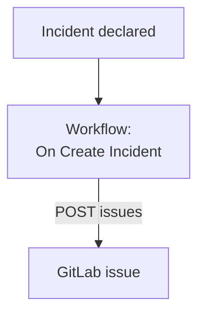

# GitLab

Open a [GitLab](https://gitlab.com) issue for every OneUptime incident, so the follow-up work is tracked in the project that owns the service. A workflow calls GitLab's [Issues API](https://docs.gitlab.com/api/issues/#new-issue), on GitLab.com or on a GitLab of your own.

:::cards
- [Store the token](#store-the-token): Keep GitLab's token out of your workflows.
- [Open an issue for every incident](#open-a-gitlab-issue-for-every-incident): One workflow, two blocks.
- [Tips](#tips): A GitLab of your own, project paths and assignees.
- [Troubleshooting](#troubleshooting): When GitLab refuses a request.
:::

> [!NOTE]
> OneUptime AI works in GitLab repositories too: connect them in Code with an access token, and it opens a merge request for each fix. See [Connect a repository](/docs/ai/ai-agent#connect-a-repository).

## How it works



The workflow runs once for every new incident. Its **API Post (JSON)** block sends the incident's title and description to the project's issues, signed with an access token.

## Before you begin

- The GitLab project's ID. On the project's overview page, select the actions menu, the vertical ellipsis, then **Copy project ID**.
- A GitLab access token with the `api` scope, for a user or bot whose role in the project can create issues: a project, group or personal access token. Create it under **Settings → Access tokens** in the project, the group or your user settings.
- In OneUptime, the right to create workflows and global variables. On OneUptime Cloud, workflows need the **Growth** plan or above.

## Store the token

:::steps
1. Go to **Workflows → Global Variables** and click **Create Workflow Variable**.
2. Name it `GITLAB_TOKEN` and click **Next**.
3. Paste the token into **Content**, turn on **Secret**, and click **Create Workflow Variable**.
:::

A secret variable is replaced with `[REDACTED]` in run logs, so the token never shows in a run.

## Open a GitLab issue for every incident

:::steps
### Create the workflow

Go to **Workflows**, click **Create Workflow**, then **Start from scratch**. Name it `Incidents to GitLab` and click **Create Workflow**.

### Add the trigger

Click the dashed **Choose what starts this workflow** block and pick **On Create Incident**. Click the trigger: its **Fields to pass on** starts with **Title**, so click **Add field** and pick **Description** and **Incident Number With Prefix**.

### Open the issue

Click **Add Component**, add an **API Post (JSON)** block, and connect the trigger's **Success** dot to it. Set its **URL** to `https://gitlab.com/api/v4/projects/12345678/issues`, with your project's ID in place of `12345678`. Under **More fields**, set its **Request Headers** to:

```json
{
  "PRIVATE-TOKEN": "{{global.variables.GITLAB_TOKEN}}"
}
```

And its **Request Body** to:

```json
{
  "title": "{{local.components.incident-on-create-1.returnValues.model.title}}",
  "description": "{{local.components.incident-on-create-1.returnValues.model.description}}\n\nOpened by OneUptime for incident {{local.components.incident-on-create-1.returnValues.model.incidentNumberWithPrefix}}.",
  "labels": "incident,oneuptime"
}
```

### Test it, then turn it on

Click **Run Workflow**, pick a test incident under **Incident**, and run it. The **API Post (JSON)** step shows a `201` response holding the new issue, with its `iid` and its `web_url`. Then switch **Enabled** on at the top of the **Builder**.
:::

The block sends JSON, so it needs no `Content-Type` header. GitLab creates labels it has not seen, so `incident` and `oneuptime` need no setting up. The issue stays open when the incident is resolved, since the follow-up work usually outlives the incident.

## Tips

- **A GitLab of your own.** Send the request to your server instead: `https://gitlab.example.com/api/v4/projects/12345678/issues`. A server on a private network address needs a self-hosted OneUptime whose administrator allows it: see [Outbound network access](/docs/workflows/configuration#outbound-network-access).
- **The project's path for its ID.** The path works in place of the ID, with its `/` written as `%2F`: `projects/your-group%2Fyour-project/issues`. The URL is sent exactly as written, so encode it yourself.
- **Assign it.** Add `"assignee_ids": [42]` or `"due_date": "2026-12-31"` to the body, or `"confidential": true` to show it only to project members.
- **Only some incidents.** Put an **If / Else** block between the trigger and the API block, and open issues only on its **Yes** side, for example for one severity.

## Troubleshooting

The **API Post (JSON)** step takes **Error** when GitLab refuses the request. Its **Response Status** and **Response Body** in the run say why.

:::details GitLab answers 401
The token is wrong, expired or revoked. Create a new one, and replace the content of `GITLAB_TOKEN`.
:::

:::details GitLab answers 403
The token has no `api` scope, or its user's role in the project cannot create issues. The body names `insufficient_scope` when it is the scope.
:::

:::details GitLab answers 404
The project's ID in the **URL** is wrong, or the token cannot see the project. GitLab answers 404, not 403, for a private project a token cannot see.
:::

:::details GitLab answers 400
GitLab cannot read the body: `title` is missing, or a field has the wrong type. The body names the field.
:::

## Next steps

:::cards
- [GitHub](/docs/integrations/github): The same workflow for GitHub, and the GitHub App.
- [Workflow Components](/docs/workflows/components#api): Every setting of the API blocks.
- [Workflow Runs](/docs/workflows/runs-and-logs): Read what each request sent and got back.
- [Integrations Overview](/docs/integrations/index): The patterns behind every integration.
:::
