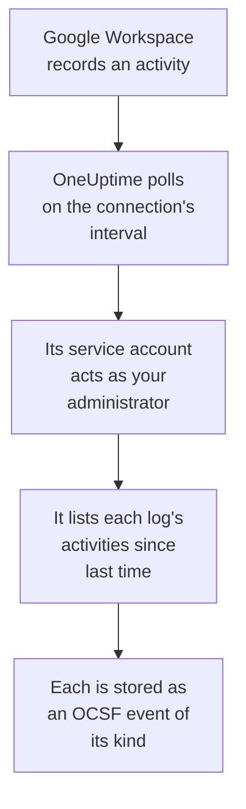

# Google Workspace

Import [Google Workspace](https://workspace.google.com)'s audit logs into OneUptime's Security Events: sign-ins and what Google flagged about them, administrators' changes, apps given access to data, single sign-on, accounts' own security settings and, if you choose, files shared outside the organization or downloaded in Google Drive. There you search them beside your logs, traces and metrics, correlate them with every other source, and page on-call for the ones that matter. OneUptime reads them with a service account that acts as one of your administrators, and changes nothing in Google Workspace.

:::cards
- [Set up the connection](#set-up-the-connection): A service account, domain-wide delegation, and the connection's form.
- [What is imported](#what-is-imported): Which activities, and how each becomes a security event.
- [How polling works](#how-polling-works): The window each poll reads, and why it overlaps by 2 hours.
- [Troubleshooting](#troubleshooting): What each error means, and what to change.
:::

## How it works

Every minute, OneUptime polls each enabled connection whose poll interval has passed. A poll signs in as your service account on behalf of the administrator you name, and lists each audit log's activities since the last poll ([Activities: list](https://developers.google.com/admin-sdk/reports/reference/rest/v1/activities/list)): admin, sign-ins, OAuth tokens, SAML, account security and, when the **Drive activity** option is on, Drive. Each event of an activity is stored as an [OCSF](https://schema.ocsf.io/) event: a sign-in as an Authentication event, an admin role assigned as a User Access Management event, a sign-in Google flagged as a Detection Finding.

## Before you begin

- In OneUptime, the Project Owner, Project Admin or Security Admin role. Security Members and Security Viewers can see connections and their run history, but cannot change them.
- A Google Workspace super administrator, to allow domain-wide delegation, and an administrator for the service account to act as, with the Reports privilege. A super administrator has it.
- A Google Cloud project in which you can create a service account and turn on the Admin SDK API.
- For Drive activity, an edition with Drive's audit log, such as Business Standard, Business Plus, Enterprise or Education.
- Outbound HTTPS from the OneUptime app and workers to `oauth2.googleapis.com` and `admin.googleapis.com`.

## Set up the connection

The connection signs in with a service account's key and [domain-wide delegation](https://developers.google.com/identity/protocols/oauth2/service-account#delegatingauthority), with one read-only scope: `https://www.googleapis.com/auth/admin.reports.audit.readonly`.

:::steps
### Create a service account and a key

1. In the [Google Cloud console](https://console.cloud.google.com), pick a project, open **APIs & Services → Library**, find **Admin SDK API**, and select **Enable**.
2. Open **IAM & Admin → Service accounts → Create service account**, name it `oneuptime-security-events`, and select **Done**. It needs no role in the project.
3. Open the service account and copy its **Unique ID**, the client ID that delegation names. On the **Keys** tab, select **Add key → Create new key → JSON**, and keep the file: it is the key.

### Allow domain-wide delegation

1. In the [Google Admin console](https://admin.google.com), as a super administrator, open **Security → Access and data control → API controls → Manage domain-wide delegation**, and select **Add new**.
2. Enter the service account's **Unique ID** as the **Client ID**, and `https://www.googleapis.com/auth/admin.reports.audit.readonly` as the **OAuth scope**. Select **Authorize**. Google can take a few minutes to apply it.
3. To let playbooks suspend, unsuspend and sign out users (see [Containment](/docs/telemetry/security-cases#containment)), add `https://www.googleapis.com/auth/admin.directory.user` and `https://www.googleapis.com/auth/admin.directory.user.security` to the same client's scopes, separated by commas. The administrator the connection acts as must then be one who manages those users.

### Add the connection in OneUptime

Open **Products → Security Events → Connections** (`/dashboard/{projectId}/security-events/connections`), click **Add connection**, choose **Google Workspace** under **Identity**, and click **Next**. Enter the **Administrator email**, click **Next**, and paste the key file's contents into **Service account JSON**. On the **Polling** step, turn on **Drive activity** to read Drive too.

### Test it before you save

Click **Test these settings** under **Test before saving**. The test signs in and reads the sign-in and admin logs with the values in the form, and stores nothing, so a missing delegation shows up before the connection exists. Then click **Next**, give the connection a **Name**, and create it.
:::

| Setting | What to enter |
| --- | --- |
| **Administrator email** | The address of the administrator the service account acts as, such as `admin@example.com`. It must have the Reports privilege. |
| **Drive activity** | Optional, off by default. On, each poll also reads Drive's sharing and downloads. |
| **Service account JSON** | The whole key file, which holds `client_email` and `private_key`. It is encrypted, never returned by the API and never shown again. Replace it with **Update credentials** on the connection. |

The **Polling** step also has an optional **Description**, the **Poll Interval (Minutes)**, a whole number from `1` to `1440` that starts at `5`, and **Enabled**, which starts on.

## What is imported

Every event has vendor `Google` and product `Google Workspace`. An activity that holds several events becomes one security event each, and every event keeps the activity's fields and its own, as `event.name`, `event.type` and `parameters.<name>`, so a rule reads them by Google's names.

| Log | Events | OCSF class | Severity |
| --- | --- | --- | --- |
| Sign-ins (`login`) | `login_success`, `login_failure` with its reason, `login_challenge`. A sign-out is read but not imported. | Authentication (`3002`) | Informational; Low for a failure; Medium when Google marks it `is_suspicious` |
| Google's findings (`login`) | `suspicious_login` and its kinds, `gov_attack_warning`, `account_disabled_hijacked` and the other accounts Google disabled | Detection Finding (`2004`) | Medium; High for a government-backed attack, a hijacked account or a leaked password |
| Admin (`admin`) | Admin privileges and roles granted or revoked, domain-wide delegation, users created, deleted or suspended, two-step verification turned off, group members, settings | User Access Management (`3005`), Account Change (`3001`), Group Management (`3006`), Entity Management (`3004`) | Medium for power granted; Low for a user deleted or two-step verification turned off |
| OAuth tokens (`token`) | An app given access to someone's data, with its scopes, or that access taken away | Authorize Session (`3003`) | Informational |
| SAML (`saml`) | Single sign-on into an app | Authentication (`3002`) | Low for a failure |
| Account security (`user_accounts`) | Two-step verification, password and recovery changes | Account Change (`3001`) | Low when it weakens the account |
| Drive (`drive`), with the option on | `change_user_access`, `change_document_visibility`, `change_document_access_scope`, `change_acl_editors`, `download` | File Hosting Activity (`6006`) | Low for a file shared outside the owner's domain or opened to a link |

The rule library's rules for Google Workspace read these as imported here, such as the ones for a sign-in Google flagged, admin privileges granted and a file made public in Drive.

## How polling works

- **Activities are read by when they happened.** The Reports API has no other time to list them by, and Google documents its logs arriving minutes to hours late.
- **The first poll looks back 24 hours**, so a new connection shows its recent activities at once.
- **Every later poll starts 120 minutes before the saved cursor**, so an activity Google makes readable up to 2 hours late is read on the next poll, and duplicates are dropped by each event's ID within the project. One that arrives later than that is not read by polling: import its time range from **Diagnostics**.
- **A poll reads at most 24 hours past the cursor.** A connection whose cursor fell behind catches up in a row of 24 hour windows.
- **Drive is read one event at a time**, since Drive records every file anyone opens. When Google refuses Drive's log, the run warns, and the other logs are still imported.
- **A failed run changes nothing.** After a network error, or an error status from Google, the cursor and the window length stay as they were, and the next poll reads the same window again. The one exception is a request that timed out: the cursor stays, but the next window is half as long, since a window too heavy to answer in time would time out on every try.

### When a window holds more than one poll can read

Each log has a budget of its own, in pages of 1,000 activities: 10 for sign-ins, 5 each for admin, OAuth tokens and SAML, 3 for account security, and 4 for each Drive event. A poll stops after 4 minutes. When a budget stops a log before the end of its window, the run is **Partial**, and its warning names the log and the budget. Google lists activities newest first, so OneUptime shortens the window instead of moving the cursor past activities it never reached:

1. **Narrow.** The next poll reads a window half as long, from the same starting point, and halves again until a window reads completely, down to one minute. The run's warning says so: `This window holds more records than one poll can read; the next poll reads a {n} minute window from the same starting point.` Activities already imported from the longer window are skipped as duplicates.
2. **Grow back.** After a window reads completely, the cursor moves to its end, and the next window is twice as long again, up to 24 hours.
3. **Move past a single minute.** If even one minute holds more than a poll can read, polling moves past it, so newer activities keep arriving. The run stays **Partial**, and **Last Error** reads `More records were created in the one minute from {cursor} to {end} than one poll can read. Polling moved past this minute so newer records keep arriving; use Import this time range in Diagnostics on this minute to recover what one run can read.` Import that minute with **Import this time range** to recover what one run can read.

Changing the **Poll Interval (Minutes)** changes none of this: it decides how often a poll starts, not where its window begins.

### Run, preview and import on demand

Click **Diagnostics** on a connection to see its recent runs and to work with it by hand. Anyone who can change the connection can start these; everyone who can see it can read the history.

- **Run now** starts a poll at once, with the usual cursor, even while the connection is not **Enabled**.
- **Preview audit events** reads a time range of up to 7 days and imports nothing.
- **Import this time range** imports a range of up to 7 days, after you confirm, without moving the cursor. Activities already imported are skipped. Google keeps 6 months of audit logs.
- **Copy diagnostics** on a run copies its report for support. It never includes credentials.

## Test connection

**Test connection** on a connection's row, and **Test these settings** in the form, run in the API process, not in a background worker, so a test still answers when the workers are the problem. It runs these checks, in order:

| Check | What it checks |
| --- | --- |
| **Configuration** | The administrator's address and the key are well formed. Nothing is contacted when this fails. |
| **Authenticate with Google** | Google lets the service account act as the administrator: domain-wide delegation is in place. |
| **Read the audit logs** | The sign-in and admin logs of the last 24 hours can be read. |
| **Read Drive activity** | Only with the option on: Drive's log can be read. |
| **Activities available to import** | How many sign-in and admin activities the last 24 hours hold, 1,000 each at most, so `1000+` means more. None is a warning. |
| **Background workers**, **Poll scheduler**, **Security event storage** | OneUptime's own side: a process takes the Worker queue's jobs, the poll job runs every minute, and the store of security events answers. |
| **Scheduled polling** | For a saved connection: polling is on, no run is stuck waiting for a worker, and polls run on time. |

Every request in a test has a 20 second deadline. A test never imports anything or moves the cursor, and each failed check says what to change.

## Troubleshooting

The connection's **Last Error** keeps the complete error message, with credentials redacted. When a connection has an error, select **View Error** in its **Actions** column to read it, and **Copy Error** in the dialog to copy it. Every message starts with `Google Workspace`, then names the request that failed, and quotes Google's own reason.

:::details Last Error says `token request failed`
- `unauthorized_client`: the service account has no domain-wide delegation for the scope. Add its **Unique ID** with `https://www.googleapis.com/auth/admin.reports.audit.readonly` under **Manage domain-wide delegation**.
- `invalid_grant` with `Invalid email or User ID`: the **Administrator email** is not a user of this Google Workspace.
- `invalid_grant` with `Invalid JWT Signature`: the key was deleted or disabled. Create a new key, and save it with **Update credentials**.
:::

:::details Last Error says `activities request failed (HTTP 403)`
- Reason `SERVICE_DISABLED` or `accessNotConfigured`: the Admin SDK API is off in the service account's project. Enable it, and test again in a few minutes.
- Reason `forbidden`: the administrator lacks the Reports privilege. Assign it under **Account → Admin roles** in the Google Admin console, or name a super administrator.
:::

:::details Drive activity is not read
Drive's log needs an edition that has it, and an administrator with the Reports privilege. Each run warns `Drive activity was not read`, and the other logs are still imported. Turn **Drive activity** off when your edition has no Drive log.
:::

:::details Last Error says `did not complete`
The request got no answer: a timeout, a name that does not resolve, or a refused address. Check that the OneUptime app and workers can reach `oauth2.googleapis.com` and `admin.googleapis.com`, through any proxy you use.
:::

:::details The test passes, but Last Polled is Never
The poll job has never run. Read the **Background workers** and **Poll scheduler** checks. On a self-hosted install, the usual cause is `DISABLE_QUEUE_WORKERS=true` on the app, with no separate worker deployment taking the jobs: set it to `false`, or run the worker deployment (Helm: `worker.enabled: true`, which is `false` by default).
:::

## Next steps

:::cards
- [Security Events](/docs/telemetry/security-events): Search, correlate and alert on what you import.
- [Microsoft Entra ID](/docs/integrations/microsoft-entra-id): Import Microsoft's sign-ins and directory changes.
- [Google SecOps](/docs/integrations/google-secops): Bring Google SecOps detections in too.
- [Integrations Overview](/docs/integrations/index): The other tools you can connect.
:::
