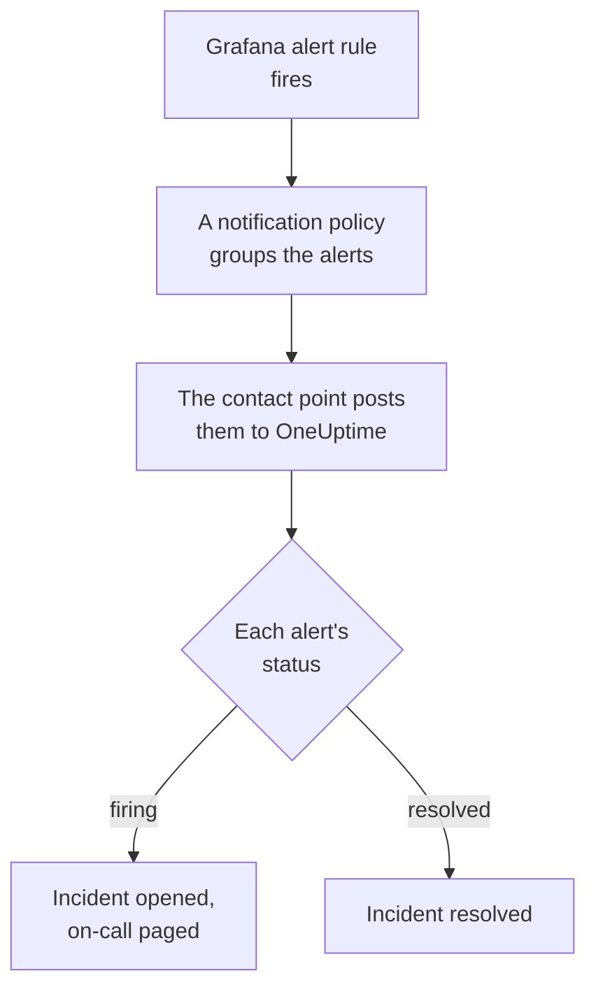

# Grafana

Send [Grafana](https://grafana.com) alerts to OneUptime, so each firing alert becomes an incident that pages your on-call team, and is resolved when the alert recovers. Grafana sends its alerts through a webhook contact point, so there is nothing to install on either side.

:::cards
- [Choose how OneUptime receives alerts](#choose-how-oneuptime-receives-alerts): An Incoming Request monitor, or a workflow of your own.
- [Receive alerts with a monitor](#receive-alerts-with-a-monitor): One incident per alert, resolved on recovery.
- [Configure Grafana](#configure-grafana): A webhook contact point, and the policy that uses it.
- [Troubleshooting](#troubleshooting): When alerts do not arrive, or incidents stay open.
:::

## How it works



Grafana's notification policies group the alerts that fire, and a webhook contact point posts each group as one JSON notification. It has the same shape as a [Prometheus Alertmanager](/docs/integrations/prometheus-alertmanager) notification: a `status`, an `alerts` list in which each alert has its own `status` and `fingerprint`, and the `commonLabels` and `commonAnnotations` its alerts share. Grafana adds a `title` and a `message` written for people.

## Before you begin

- Grafana 9 or later, with Grafana Alerting, the default since Grafana 9. It must be able to reach your OneUptime over HTTPS.
- In OneUptime, the right to create monitors, or workflows if you take that way.

## Choose how OneUptime receives alerts

Set up OneUptime first: it gives you the URL Grafana sends to.

| Way | Use it when |
| --- | --- |
| An Incoming Request monitor (recommended) | You want every alert to be an incident that pages on-call, and is resolved when the alert recovers. There is nothing to build. |
| A workflow with a Webhook trigger | You need logic of your own: filter alerts, reshape them, or call other systems first. A workflow opens one incident per notification, not per alert, and does not resolve it on recovery. |

Both get the same JSON from the same contact point, so you can start with one and switch later by changing one URL in Grafana.

## Receive alerts with a monitor

An [Incoming Request monitor](/docs/monitor/incoming-request-monitor) gives you a URL, and its criteria decide what each notification does.

:::steps
### Create the monitor

Go to **Monitors** and click **Create Monitor**. Pick **Incoming Request** under **Monitor Type**, name it `Grafana`, and click **Next**.

### Declare an incident for each firing alert

On the **Criteria** step, open the first criteria, the one that marks the monitor offline. Set its filter to **Request Body**, **Contains**, `"status":"firing"`. This criteria already declares an incident when its filter matches. Fill the incident in:

- **Incident Title**: `{{requestBody.commonLabels.alertname}}`.
- **Incident Description**, under **Description**: `{{requestBody.message}}`, the text Grafana writes for the notification.
- **Severity**: the incident severity these alerts should have.
- **On-Call Policies**, under **On-Call**: the policies to page.
- **Auto Resolve Incident**, under **More fields**: leave it on, as it starts. Without it, recoveries are ignored and incidents stay open.

### Open one incident per alert

In the same criteria, open **Settings** and turn on **Group incidents and alerts by a payload field**. Fill it in as below, so each alert gets its own incident, and its recovery resolves it:

| Field | Value |
| --- | --- |
| **Open a separate incident for each…** | `requestBody.alerts[*].fingerprint` |
| **Field that signals recovery** | `requestBody.alerts[*].status` |
| **Value that means recovered** | `resolved` |

### Bring the monitor back online

Open the second criteria, the one that marks the monitor online, and set its filter to **Request Body**, **Contains**, `"status":"resolved"`.

### Copy the URL

Click **Create Monitor**. The monitor's **Overview** page shows its **Heartbeat URL**. Copy it for Grafana:

```text
https://oneuptime.com/heartbeat/<secret key>
```

A self-hosted install has its own host in place of `oneuptime.com`.
:::

Each alert of a notification opens its own incident, up to **Max incidents per request** of them (`100` unless you change it), and each alert's own `status` decides when its incident is resolved. Grafana's `fingerprint` identifies an alert by its labels, so it is the value to group by. See [Receiving alerts from another system](/docs/monitor/incoming-request-monitor#receiving-alerts-from-another-system) for what each setting does.

> [!WARNING]
> Do not group by a label every alert of a notification shares. Grafana's default notification policy groups alerts by `grafana_folder` and `alertname`, so every alert of one notification has the same `alertname`: grouping by `requestBody.alerts[*].labels.alertname` folds the whole notification into one incident.

`{{requestBody.commonLabels.alertname}}` and `{{requestBody.message}}` describe the whole notification, which is one alert rule under the default policy. The grouping key is a variable too, `{{fingerprint}}`, but it is a hash that tells a responder nothing. See [Incident & Alert Dynamic Templating](/docs/monitor/incident-alert-templating) for every variable you can use.

## Configure Grafana

:::steps
### Add a webhook contact point

In Grafana, go to **Alerting → Contact points** and click **+ Add contact point**. In Grafana 11 and later, **Alerting** is under **Alerts & IRM**, and **Contact points** is a tab of **Notification configuration**.

Name the contact point `OneUptime`, choose **Webhook** under **Integration**, and paste the URL you copied into **URL**. Leave **HTTP Method** on `POST`, and click **Save contact point**.

### Send alerts to it

Go to **Alerting → Notification policies**. Set the contact point of the default policy to `OneUptime`, or add a child policy that matches the alerts OneUptime should get, with `OneUptime` as its contact point.
:::

Grafana sends `Content-Type: application/json`, which the monitor needs to read the fields of a notification. The contact point's **Max Alerts** setting caps the alerts of one notification: keep it at `0`, no limit, or at most the monitor's **Max incidents per request**.

## Test it

1. In Grafana, open the `OneUptime` contact point and click **Test**. Grafana sends a firing test alert, and an incident opens in OneUptime. A test alert never recovers, so resolve that incident by hand.
2. Let a real alert rule fire, for example by lowering its threshold for a moment, and watch its incident open, then resolve when you put the threshold back.

## Receive alerts with a workflow

Use a [workflow](/docs/workflows/index) when you need steps of your own between Grafana and the incident.

:::steps
### Create the workflow

Go to **Workflows**, click **Create Workflow**, then **Start from scratch**. Name it `Grafana alerts` and click **Create Workflow**.

### Add the Webhook trigger

Click the dashed **Choose what starts this workflow** block and pick **Webhook**. Click the trigger, then **Copy URL**, and use that URL in the contact point in Grafana.

### Check that the notification fires

Click **Add Component**, add an **If / Else** block, and connect the trigger's **Out** dot to it. Set **Value to check** to `{{local.components.webhook-1.returnValues.request-body.status}}`, **Comparison** to **is equal to**, and **Compare with** to `firing`.

### Declare the incident

Add a **Create One Incident** block, and connect the **Yes** side of the **If / Else** block to it. In **Incident Template**, pick a template that sets the severity and the on-call policies to page (see [Incident templates](/docs/incidents/settings#incident-templates)). In **JSON Object**, set what comes from Grafana:

```json
{
  "title": "{{local.components.webhook-1.returnValues.request-body.title}}",
  "description": "{{local.components.webhook-1.returnValues.request-body.message}}"
}
```

Without a template, **JSON Object** also needs `incidentSeverityId`, the ID of one of the project's incident severities.

### Turn the workflow on

Switch **Enabled** on at the top of the **Builder**. A workflow that is off answers Grafana with `400`.
:::

A run handles one notification, so it declares one incident however many alerts the notification holds. A notification that is `resolved` takes the **No** side of the **If / Else** block, where nothing is connected, so the run ends there. For one incident per alert, resolved on recovery, use the monitor.

## Troubleshooting

:::details Nothing arrives in OneUptime
- Click **Test** on the contact point: Grafana shows an error when it cannot reach the URL. Grafana's server log has the details.
- The monitor answers `200` at once, before it checks anything, even for a wrong secret key. Check the monitor's timeline to see whether notifications land.
- A workflow that is off answers `400`. Switch **Enabled** on at the top of its **Builder**.
:::

:::details Incidents open but are never resolved
- The criteria's incident needs **Auto Resolve Incident**, under **More fields**.
- **Field that signals recovery** must be `requestBody.alerts[*].status`, and **Value that means recovered** exactly `resolved`. The comparison is case-sensitive.
- The grouping paths must start with `requestBody.`, and only the first `[*]` of a path reads a list. A path that breaks either rule matches nothing, without an error.
:::

:::details One incident for a notification full of alerts
You grouped by a label that is the same for every alert of a notification, such as `alertname` under the default policy. Group by `requestBody.alerts[*].fingerprint` instead.
:::

:::details The incident shows a reference instead of a value
A reference to a field the notification does not have is left as written, braces and all. Check the field's name against what Grafana sent: for a workflow, open the run in **Logs → Runs** and compare with what the trigger received.
:::

The [Prometheus Alertmanager](/docs/integrations/prometheus-alertmanager#troubleshooting) guide covers more cases, and they apply to Grafana's notifications too.

## Security

- **Treat the URL like a password.** Anyone who has it can open incidents. If it leaks, reset it: **Reset Incoming Request Secret Key** on the monitor's **Settings** page, or **Reset URL** in the workflow's **Webhook** trigger. Then update the contact point's **URL** in Grafana.
- **Self-hosted?** Let Grafana reach your OneUptime over HTTPS through your firewall.

## Next steps

:::cards
- [Incoming Request Monitor](/docs/monitor/incoming-request-monitor): Every setting of the monitor that receives your alerts.
- [Prometheus Alertmanager](/docs/integrations/prometheus-alertmanager): The same setup, with a dead man's switch for your alerting.
- [Metrics Monitor](/docs/monitor/metrics-monitor): Alert on the same metrics in OneUptime itself.
- [Integrations Overview](/docs/integrations/index): The other tools you can connect.
:::
