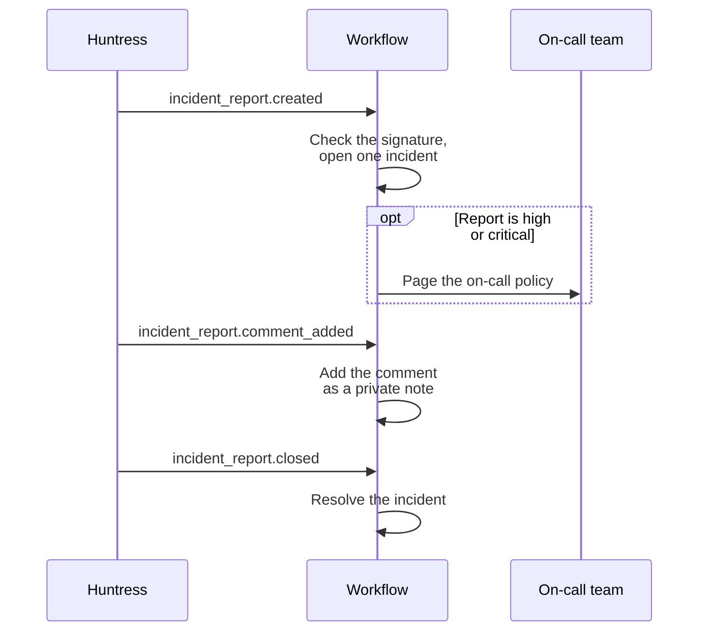

# Huntress Integration

Page your on-call team for Huntress incident reports, with a workflow. When the Huntress SOC sends an incident report about an endpoint or an identity, the workflow opens one incident for it, pages the on-call policy you pick, adds comments made in Huntress as private notes, and resolves the incident when the report is closed in Huntress.

This integration is **inbound**: Huntress sends every event about an incident report to the workflow's own URL, signed with the endpoint's signing secret. OneUptime never calls Huntress, so it needs no Huntress API key.

:::cards
- [How it works](#how-it-works): What the workflow does with each event about a report.
- [Set it up](#set-up-the-integration): Create the workflow, add the endpoint in Huntress, save its signing secret, send a test.
- [The trigger](#the-huntress-incident-report-trigger): The values a report hands the workflow, and the trigger's settings.
- [Troubleshooting](#troubleshooting): What the trigger's errors mean, and what to change.
:::

## How it works

Huntress sends an event about an incident report when the report is sent, when someone comments on it and when it is closed. The **Huntress Incident Report** trigger starts the workflow once for each event, and its **Event** says which one it was: `created`, `comment-added` or `closed`.

1. **Check.** A request must be signed with the endpoint's signing secret, no more than five minutes before it arrives. Anything else is refused, and the trigger's settings say why.
2. **Start the workflow.** Each event starts one run, with the report's fields as the trigger's values. An event Huntress sends again starts nothing more.
3. **Open one incident.** On `created`, the workflow opens an incident titled after the report, such as `Huntress: Incident on DESKTOP-01 (Acme Corp)`. Its description holds the report's summary, its severity in Huntress, the organization, the affected host or identity, the indicators Huntress found, and a link to the report in Huntress. The incident is labelled with the report's organization, and pages the on-call policy you pick when the report is high or critical.
4. **Follow the report.** On `comment-added`, the comment becomes a private note on the incident. On `closed`, the incident is resolved, with why on its timeline.

The incident keeps the report's number in its custom fields, as `huntressReportId`: that is how the workflow finds it again when Huntress comments on or closes the report. Incidents opened this way are never shown on a status page, and your incident rules (on-call, owner, label and privacy rules) apply to them like to any other incident.

## Before you begin

- In OneUptime, a role that can create and edit workflows, such as **Project Owner**, **Project Admin** or **Workflow Admin**.
- In Huntress, the **Account Admin** role: only account admins can add webhooks.
- An on-call policy to page.
- On OneUptime Cloud, a plan with workflows: Growth or above. Each event Huntress sends is one workflow run.
- On a self-hosted installation, a OneUptime that Huntress can reach from the internet over HTTPS: Huntress sends webhooks only to `https://` URLs.

## Set up the integration

:::steps
### Create the workflow

Open **Workflows** and click **Create Workflow**. Under **Or start from a template**, choose **Huntress** as the category, pick **Open an incident for each Huntress incident report**, and click **Use this template**.

### Pick who to page

The dialog then asks who to page: under **Who to page for high and critical reports**, pick the on-call policies to page, or none to page nobody, and click **Create Workflow**. The workflow opens in the **Builder**, switched off. To change who it pages later, click its **Page an On-Call Policy** step and change its **On-Call Policies**.

### Add a webhook endpoint in Huntress

Click the **Huntress Incident Report** trigger, and click **Copy URL** under **Add a webhook endpoint in Huntress**. The URL looks like `https://oneuptime.com/workflow/huntress/<key>`; on a self-hosted installation it starts with your own host.

In Huntress, open the menu at the top right and choose **Integrations**. Click **Add an Integration**, choose **Webhooks**, and click **Add Endpoint**. Paste the URL, turn on **Incident Reports**, and save. Leave **Escalations**, **Platform Actions** and **Account Notices** off: the trigger accepts those events and starts nothing for them.

### Save the endpoint's signing secret

In Huntress, open the endpoint's menu (⋯) and choose **View Signing Secret**. Copy all of it: it starts with `whsec_`. In the trigger, click **Save Signing Secret**, paste it, and click **Save Signing Secret**. The secret is encrypted, and never shown again.

Until the secret is saved, the trigger refuses every request. Huntress sends a refused event again later, so an event refused now still arrives.

### Turn the workflow on, and send a test

Switch **Enabled** on at the top of the **Builder**. In Huntress, open the endpoint's menu (⋯) and choose **Send Test**. Within a few seconds, the trigger shows **Receiving reports**.

> [!NOTE]
> Whatever the test carries, the trigger shows that it arrived. A test that carries an incident report starts the workflow like any other report.
:::

## What the workflow does

After the trigger, **Incident From Another Tool** does what each **Event** asks, by the report's number:

| Event | What the workflow does |
| --- | --- |
| `created` | Opens an incident at the trigger's **Incident Severity ID**, labelled with its **Organization Label ID**. For a high or critical report, **Page an On-Call Policy** pages your policy; a low report pages nobody. A report that has an incident already opens no other. |
| `comment-added` | Finds the report's incident and adds the comment to it as a private note. |
| `closed` | Finds the report's incident and resolves it, unless it is resolved already. Why is on its timeline: Huntress closed the report. |

It is a workflow like any other, so you can change what it does: page for critical reports only by changing what the **If / Else** after **Incident From Another Tool** compares, post each report to a chat channel with a Slack or Microsoft Teams step, or route each organization to its own on-call policy with a **Switch / Case** on **Organization**. Every run is listed under the workflow's runs, with what each step did.

### Severities

Huntress gives every incident report one of three severities. The trigger's **Incident Severity ID** is the incident severity the report opens at: the one its setting picks, or else your incident severities' rank order, as **Incidents → Settings → Incident Severity** lists them:

| Huntress severity | What Huntress means by it | Setting | Incident severity when the setting is empty |
| --- | --- | --- | --- |
| Critical | Hands-on-keyboard attackers, dangerous malware or active compromise, to contain immediately. | **Severity For Critical Reports** | The most severe |
| High | Confirmed malware that needs urgent remediation, or actionable identity compromise. | **Severity For High Reports** | The second |
| Low | Potentially unwanted programs, malware artifacts and older identity findings. | **Severity For Low Reports** | The third |

A project with fewer severities uses its least severe one for the rest. A report that names no severity is handled as high. If a severity you picked is deleted, the rank order decides again.

### Organizations

The trigger's **Organization Label ID** is a label named after the report's Huntress organization, such as _Acme Corp_, which it makes the first time a report from that organization arrives. One workflow receives the reports of every organization in your Huntress account, and the trigger's **Only These Organizations** narrows that down: one organization name or ID per line, names ignoring case.

> [!TIP]
> To page each customer's own team, add an incident on-call rule per organization, such as "If **Incident Labels** has any of _Acme Corp_", that executes that customer's policy. See [Incident on-call rules](/docs/incidents/settings#incident-on-call-rules).

## The Huntress Incident Report trigger

The trigger opens on Huntress: its URL, a check beside each setup step that is done, and what Huntress last sent. Its settings, all optional, are folded under **More fields**: **Only These Organizations**, **Severity For Critical Reports**, **Severity For High Reports** and **Severity For Low Reports**.

| Value | What it holds |
| --- | --- |
| **Event** | `created`, `comment-added` or `closed`. A report that is already closed or dismissed is `closed`, whichever event carried it. |
| **Report ID** | The report's number in Huntress. |
| **Severity** | `critical`, `high` or `low`. |
| **Status** | The report's status in Huntress, such as `sent`, `closed` or `dismissed`. |
| **Subject** | The report's subject, as Huntress writes it. |
| **Summary** | What the SOC analyst wrote. |
| **Organization**, **Organization ID** | The Huntress organization the report is about. |
| **Affected** | The host or identity the report is about. |
| **Platform**, **Indicators** | Where Huntress found it, and what it found. |
| **Comment** | The comment someone added, on `comment-added`. |
| **Report URL** | Where the report opens in Huntress. |
| **Incident Title**, **Incident Description** | A title and a Markdown description for an incident about the report. |
| **Note** | Markdown for a note about the event: the comment, or that Huntress closed the report. |
| **Incident Severity ID**, **Organization Label ID** | The incident severity and the label, as above. |
| **Received At** | When OneUptime received the event. |

**Summary** and **Comment** are text Huntress's analysts wrote. To put them in an incident or a note, use **Incident Description** and **Note**: they keep the formatting, and nothing in them fetches an image or mentions anyone.

To try the workflow without Huntress, click **Run Workflow** on the **Builder** and type an **Event**, a **Report ID** and the fields you need. Use the same **Report ID** to follow one report from `created` to `closed`.

## Huntress connections made before

Huntress used to be set up under **Incidents → Integrations → Huntress**. Each Huntress connection became a workflow of the same name, switched on, that does what the connection did: it pages the same on-call policies for the same reports, adds the same labels, and resolves (or only notes) the same way. Its URL is still the connection's, `https://oneuptime.com/api/huntress/webhook/<connection-id>`, and its signing secret is the same, so there is nothing to change in Huntress. The incidents the connection opened keep their report's number, so the workflow finds them when Huntress comments on or closes those reports.

## Security

- **Signed requests only.** The trigger checks the `svix-id`, `svix-timestamp` and `svix-signature` headers Huntress sends against the request body exactly as it arrived. A request that is not signed with the saved secret, or was signed more than five minutes earlier or later, is refused.
- **The secret stays secret.** It is encrypted at rest, never returned by the API, and never shown again. **Replace Signing Secret** in the trigger saves another one, such as the secret of a new endpoint.
- **The URL is an address, not a password.** It ends in the workflow's key; only a request signed with the endpoint's secret starts the workflow.
- **One endpoint per workflow.** Each workflow has its own URL and secret. To receive the reports of a second Huntress account, create a second workflow.

## Using email instead

Huntress also emails incident reports, and an [Incoming Email monitor](/docs/monitor/incoming-email-monitor) can open incidents from those emails, for example when the subject contains `Critical Incident Report`. It treats the emails as one monitor's status, though: while its incident is open, the next report opens none, and the incident is resolved by the monitor's criteria rather than when Huntress closes the report. The workflow opens one incident per report and resolves each with its report, so prefer it. Once the workflow receives reports, stop sending the emails to the monitor, or each report pages twice.

## Troubleshooting

When the trigger refuses a request, its settings show the reason under **The last request was refused**. In Huntress, **View Delivery Attempts** in the endpoint's menu (⋯) lists every delivery with OneUptime's answer.

:::details "A request arrived but was refused, because no signing secret is saved for this workflow yet"
Save the endpoint's signing secret: see [Set up the integration](#set-up-the-integration). Huntress sends the refused request again.
:::

:::details "The request's signature does not match the signing secret"
The saved secret is not this endpoint's. Each endpoint has its own: in Huntress, open the endpoint's menu (⋯), choose **View Signing Secret**, copy all of it, and save it with **Replace Signing Secret**.
:::

:::details "The request was signed more than five minutes from now"
The clocks of Huntress and your OneUptime server are more than five minutes apart, or the request is a replay. On a self-hosted installation, check that the server's clock is right.
:::

:::details "A request arrived while this workflow is off"
Switch **Enabled** on at the top of the **Builder**. Huntress sends the refused request again, and it starts the workflow then.
:::

:::details "No Huntress workflow has this address."
The workflow was deleted or archived, its trigger is no longer **Huntress Incident Report**, or the endpoint's URL in Huntress is not the workflow's. Copy the URL from the trigger and paste it into the endpoint in Huntress again.
:::

:::details No incident was opened
Open the workflow's runs and the run of the report. If **Incident From Another Tool** failed with `This project has no incident severities to put the incident at.`, add one under **Incidents → Settings → Incident Severity**.
:::

:::details Nobody was paged
A low report opens an incident without paging. Otherwise, the run of the report says what **Page an On-Call Policy** did, and the incident's **On-Call Executions** page shows what each policy did.
:::

## Next steps

:::cards
- [Workflow Triggers](/docs/workflows/triggers): The other ways to start a workflow.
- [Incident on-call rules](/docs/incidents/settings#incident-on-call-rules): Page each organization's own team, by its label.
- [Incident States & Severities](/docs/incidents/states-and-severities): Rank the severities Huntress reports open at.
- [Integrations Overview](/docs/integrations/index): The other tools you can connect.
:::
