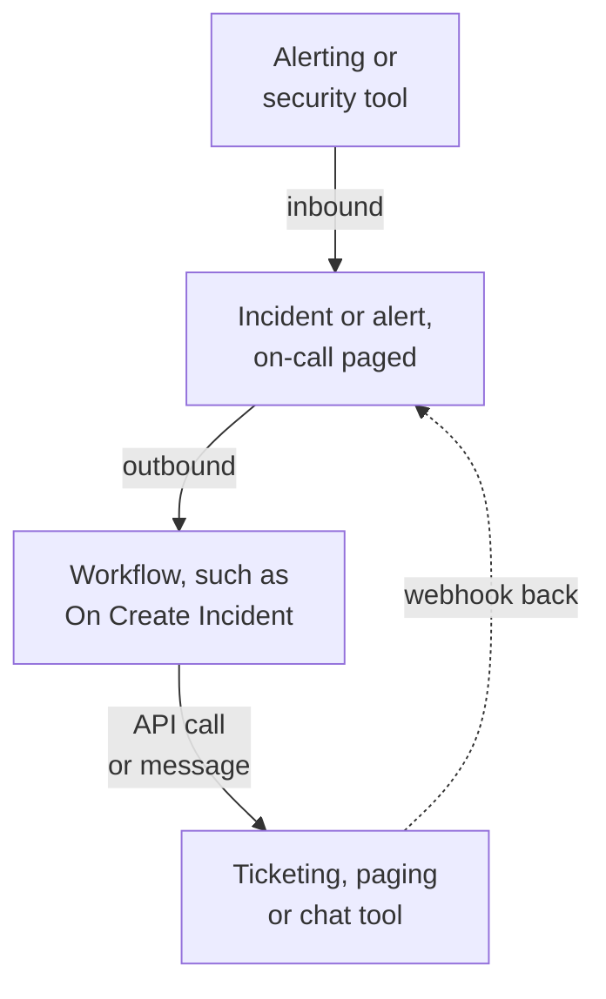

# Integrations Overview

OneUptime works with the tools your team already uses. Alerting tools open incidents in it, and it opens tickets, pages and chat messages in other tools. Some tools connect from a form, and some from a ready-made workflow template. Any other tool with a webhook or an API connects through a workflow you build.

:::cards
- [Choose how to connect](#choose-how-to-connect): The four ways in, and when to use each.
- [Catalog](#catalog): Every tool with a guide, grouped by what it does.
- [Build your own integration](#build-your-own-integration): The inbound and outbound patterns, for any other tool.
- [Keep credentials safe](#keep-credentials-safe): Secret variables, and the headers each tool expects.
:::

## How integrations work

Every integration moves data in one direction or both. **Inbound**, another tool tells OneUptime that something is wrong, and OneUptime opens an incident or an alert and pages the on-call team. **Outbound**, something happens in OneUptime, and a workflow tells another tool: it files a ticket, pages someone or posts a message.



A two-way integration, like Jira or Dynamics 365, uses both directions: one workflow sends the incident out, and another one, started by the other tool's webhook, brings changes back.

## Choose how to connect

| Way | Best for | Examples |
| --- | --- | --- |
| A built-in connection | Tools OneUptime connects to itself. You fill in a form, and there is nothing to build. | [Slack](/docs/workspace-connections/slack), [Microsoft Teams](/docs/workspace-connections/microsoft-teams), the [Security Events](/docs/telemetry/security-events) connections |
| A workflow template | Ticketing tools, kept in step both ways, monitoring problems, security incident reports and chat messages. You pick a template and fill in a few settings. | [Jira](/docs/integrations/jira), [Microsoft Dynamics 365](/docs/integrations/microsoft-dynamics-365), [Huntress](/docs/integrations/huntress), [Zabbix](/docs/integrations/zabbix) |
| An Incoming Request monitor | Alerting tools that send a webhook. You get one incident per alert, paged to on-call and resolved when the alert recovers, with no workflow. | [Zabbix](/docs/integrations/zabbix), [Prometheus Alertmanager](/docs/integrations/prometheus-alertmanager), [Grafana](/docs/integrations/grafana) |
| A workflow you build | Any tool with a webhook or a REST API, and any logic of your own. | [PagerDuty](/docs/integrations/pagerduty), [Opsgenie](/docs/integrations/opsgenie), [ServiceNow](/docs/integrations/servicenow) |

Start from the top of the table: the higher a way is, the less there is to maintain.

## Catalog

### Monitoring and alerting tools

| Tool | Direction | What it does |
| --- | --- | --- |
| [Zabbix](/docs/integrations/zabbix) | Both | Turn Zabbix problems into incidents or alerts, resolve them on recovery, and acknowledge or close the problems from OneUptime. |
| [Prometheus Alertmanager](/docs/integrations/prometheus-alertmanager) | Inbound | Turn Alertmanager notifications into incidents. |
| [Grafana](/docs/integrations/grafana) | Inbound | Turn Grafana alerts into incidents. |
| [Datadog](/docs/integrations/datadog) | Inbound | Turn Datadog monitor alerts into incidents. |

### Security tools

| Tool | Direction | What it does |
| --- | --- | --- |
| [Huntress](/docs/integrations/huntress) | Inbound | Page on-call for Huntress incident reports, and resolve the incident when the report closes. |
| [Google SecOps](/docs/integrations/google-secops) | Both | Bring Google SecOps detections and indicators into Security Events, and send it what OneUptime finds. |
| [Microsoft Sentinel](/docs/integrations/microsoft-sentinel) | Both | Bring Microsoft Sentinel incidents into Security Events, and send it what OneUptime finds. |
| [Microsoft Defender XDR](/docs/integrations/microsoft-defender-xdr) | Inbound | Bring Microsoft Defender XDR alerts into Security Events. |
| [CrowdStrike Falcon](/docs/integrations/crowdstrike-falcon) | Inbound | Bring CrowdStrike Falcon alerts into Security Events. |
| [Splunk Enterprise Security](/docs/integrations/splunk) | Both | Bring Splunk notable events into Security Events, and send it what OneUptime finds. |
| [Elastic Security](/docs/integrations/elastic-security) | Both | Bring Elastic Security detection alerts into Security Events, and send it what OneUptime finds. |
| [AWS Security Hub](/docs/integrations/aws-security-hub) | Inbound | Bring AWS Security Hub findings into Security Events. |
| [Okta System Log](/docs/integrations/okta) | Inbound | Bring Okta sign-ins, account changes and threat detections into Security Events. |
| [Microsoft Entra ID](/docs/integrations/microsoft-entra-id) | Inbound | Bring Microsoft Entra ID sign-ins and directory changes, and the Microsoft 365 audit log, into Security Events. |
| [Google Workspace](/docs/integrations/google-workspace) | Inbound | Bring Google Workspace sign-ins, admin changes and Google's own findings into Security Events. |

### Ticketing and IT service management

| Tool | Direction | What it does |
| --- | --- | --- |
| [Jira](/docs/integrations/jira) | Both | Open a Jira issue for every incident or alert, and bring status changes and comments back. |
| [Microsoft Dynamics 365](/docs/integrations/microsoft-dynamics-365) | Both | Open a Dynamics 365 case for every incident or alert, and bring status changes and notes back. |
| [ServiceNow](/docs/integrations/servicenow) | Outbound | Open a ServiceNow incident for every OneUptime incident, and resolve it with the incident. |
| [GitHub](/docs/integrations/github) | Outbound | Open a GitHub issue for an incident. |
| [GitLab](/docs/integrations/gitlab) | Outbound | Open a GitLab issue for an incident. |

### Paging tools

| Tool | Direction | What it does |
| --- | --- | --- |
| [PagerDuty](/docs/integrations/pagerduty) | Outbound | Trigger a PagerDuty incident for every OneUptime incident, and resolve it with the incident. |
| [Opsgenie](/docs/integrations/opsgenie) | Outbound | Create an Opsgenie alert for every OneUptime incident, and close it with the incident. |

### Chat tools

| Tool | Direction | What it does |
| --- | --- | --- |
| [Slack](/docs/workspace-connections/slack) | Both | A built-in connection: incident channels, actions from Slack, and on-call. |
| [Microsoft Teams](/docs/workspace-connections/microsoft-teams) | Both | A built-in connection: incident channels, actions from Teams, and on-call. |
| [Mattermost](/docs/workflows/components#mattermost) | Outbound | Post incident updates to a Mattermost channel. |
| [Discord](/docs/integrations/discord) | Outbound | Post incident updates to a Discord channel. |
| [Telegram](/docs/integrations/telegram) | Outbound | Send a message to a Telegram chat when an alert fires. |
| [IRC](/docs/integrations/irc) | Outbound | Post incident updates to an IRC channel. |

> [!TIP]
> Slack and Microsoft Teams also have workflow steps. Use the built-in connection for incident channels and on-call, and a workflow step when you only need a message in a channel.

### Hosting platforms

| Tool | Direction | What it does |
| --- | --- | --- |
| [Vercel](/docs/integrations/vercel) | Inbound | Add OneUptime from the Vercel Marketplace: traces, logs, uptime monitors and a status page for your Vercel projects. |

## Moving from another tool

To leave another on-call, uptime or status page tool, bring your team over instead of connecting the two. **Project Settings → Advanced → Import from another tool** reads your account with an API key, shows you what it found, and creates what you tick. Each tool has a guide:

- On-call and incident tools: [Opsgenie](/docs/moving-to-oneuptime/opsgenie), [PagerDuty](/docs/moving-to-oneuptime/pagerduty), [incident.io](/docs/moving-to-oneuptime/incident-io), [Splunk On-Call](/docs/moving-to-oneuptime/splunk-on-call) and [Grafana OnCall](/docs/moving-to-oneuptime/grafana-oncall).
- Uptime and status page tools: [UptimeRobot](/docs/moving-to-oneuptime/uptimerobot), [Atlassian Statuspage](/docs/moving-to-oneuptime/atlassian-statuspage), [Better Stack](/docs/moving-to-oneuptime/better-stack), [Pingdom](/docs/moving-to-oneuptime/pingdom), [StatusCake](/docs/moving-to-oneuptime/statuscake) and [Uptime Kuma](/docs/moving-to-oneuptime/uptime-kuma).

## Build your own integration

A tool without a guide still fits one of two patterns. If it can send a webhook, use the inbound pattern. If it has a REST API, use the outbound pattern. Both are workflows: see [Workflows Overview](/docs/workflows/index) to get started.

### Inbound: another tool sends data into OneUptime

For an alerting tool, start with an [Incoming Request monitor](/docs/monitor/incoming-request-monitor#receiving-alerts-from-another-system): it opens one incident per alert and resolves it on recovery, with nothing to build. Build a workflow when you need logic of your own:

:::steps
1. Open **Workflows**, click **Create Workflow**, then **Start from scratch**. Name the workflow and click **Create Workflow**.
2. Click the dashed **Choose what starts this workflow** block and pick **Webhook**. Click the trigger, then **Copy URL**.
3. In the other tool, send its webhook to that URL as a `POST` with `Content-Type: application/json`.
4. Add the blocks that act on it. They read the request with references such as `{{local.components.webhook-1.returnValues.request-body.status}}`: an **If / Else** block to check a field, then **Create One Incident** to declare an incident.
5. Switch **Enabled** on at the top of the **Builder**, send a test from the other tool, and open **Logs → Runs** to see what arrived.
:::

The URL is the only credential, so treat it like a password. See [Webhook](/docs/workflows/triggers#webhook).

### Outbound: OneUptime sends data to another tool

:::steps
1. Save the tool's API key as a secret global variable, as shown [below](#keep-credentials-safe).
2. Create a workflow, click the dashed block and pick an event trigger, such as **On Create Incident**. Click the trigger: its **Fields to pass on** starts with **Title**, so click **Add field** and pick the other fields to send, such as **Description**.
3. Click **Add Component** and add an **API Post (JSON)** block. Connect the trigger's **Success** dot to it.
4. Fill in its **URL**, its **Request Headers** with the `Authorization` header, and its **Request Body** with the incident's fields, such as `{{local.components.incident-on-create-1.returnValues.model.title}}`.
5. Click **Run Workflow**, pick an incident under **Incident**, and run it. A test run really sends the request. Then switch **Enabled** on.
:::

When the tool needs data reshaped first, add a [Run Custom JavaScript](/docs/workflows/components#custom-code) block between the two. The recipe is the same for Zendesk, New Relic, AWS (through SNS), StatusCake and the long tail: only the URL and the body change.

## Keep credentials safe

Never paste an API key or a token into a block. Save it once as a secret global variable:

:::steps
1. Go to **Workflows → Global Variables** and click **Create Workflow Variable**.
2. Name it, such as `JIRA_AUTH`, and click **Next**.
3. Paste the key into **Content**, turn on **Secret**, and click **Create Workflow Variable**.
:::

Any block reads it as `{{global.variables.JIRA_AUTH}}`. A variable's content cannot be read back once it is saved, and a secret one is replaced with `[REDACTED]` in run logs. For tokens that expire, such as Microsoft Entra ID's, an [OAuth 2.0 variable](/docs/workflows/variables#oauth-20-variables-tokens-that-refresh-themselves) fetches a new one by itself. See [Workflow Variables](/docs/workflows/variables#global-variables).

### Authentication cheat sheet

Most outbound integrations put the key in a request header. The common forms:

| Scheme | What to send | Used by |
| --- | --- | --- |
| Bearer token | `Authorization: Bearer {{global.variables.TOKEN}}` | GitHub, and most modern APIs |
| Basic auth | `Authorization: Basic {{global.variables.BASE64_USER_PASS}}` | Jira Cloud, ServiceNow |
| API key header | `Authorization: GenieKey {{global.variables.OPSGENIE_KEY}}` | Opsgenie |
| Private token header | `PRIVATE-TOKEN: {{global.variables.GITLAB_TOKEN}}` | GitLab |
| Key in the body | `routing_key` in the JSON body | PagerDuty Events API |
| OAuth 2.0 client credentials | `Authorization: Bearer {{local.variables.dynamicsAccessToken}}`, from an OAuth 2.0 variable | Microsoft Dynamics 365 |

For Basic auth, encode `username:password`, or `email:api_token`, once, and save the result as the secret. On macOS or Linux:

```bash
printf '%s' 'you@example.com:your_api_token' | base64 | tr -d '\n'
```

Use `printf`, not `echo`: `echo` adds a newline, which is encoded with the rest and breaks the credentials. `tr` keeps a long result on one line.

## Self-hosted installations

A self-hosted OneUptime calls other tools from your network, and other tools call it from theirs:

- **Outbound:** workflow requests to private network addresses are refused unless an administrator allows them. See [Outbound network access](/docs/workflows/configuration#outbound-network-access).
- **Inbound:** a tool's webhooks must reach your OneUptime over HTTPS, so a tool in the cloud needs a public address to call.
- **Built-in integrations** each have a setup guide: [Slack](/docs/self-hosted/slack-integration), [Microsoft Teams](/docs/self-hosted/microsoft-teams-integration), [GitHub](/docs/self-hosted/github-integration), [Twilio](/docs/self-hosted/twilio-integration), [SendGrid Inbound Email](/docs/self-hosted/sendgrid-inbound-email) and [Push Notifications](/docs/self-hosted/push-notifications).

## Next steps

:::cards
- [Workflows Overview](/docs/workflows/index): How workflows run, and how to build your first one.
- [Incoming Request Monitor](/docs/monitor/incoming-request-monitor): Receive alerts from any tool without a workflow.
- [Jira](/docs/integrations/jira): A complete two-way integration, from templates.
- [Workflow Variables](/docs/workflows/variables): Pass data between blocks, and keep secrets out of them.
:::
