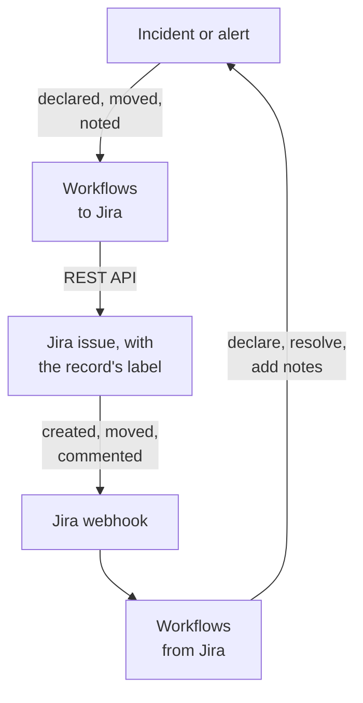

# Jira

Keep [Jira](https://www.atlassian.com/software/jira) issues in step with your OneUptime incidents and alerts, both ways. Ready-made workflow templates open an issue for every incident or alert, move it as the record moves and copy notes into it as comments. Others declare incidents from new issues and bring status changes, comments and edits back. There is no plugin: the workflows call Jira's REST API, and Jira calls their webhook URLs.

:::cards
- [Start from a template](#start-from-a-template): The 17 templates, what they ask for, and how to set them up.
- [How the templates work](#how-the-templates-work): How issues and records stay linked, without loops.
- [Build it yourself](#build-it-yourself): Each direction by hand, for when a template does not fit.
- [Troubleshooting](#troubleshooting): What Jira's answers mean.
:::

> [!NOTE]
> Atlassian is renaming things in Jira Cloud: a **project** is now a **space** in much of the UI, and an **issue** is a **work item**. Sites use both words, so where the wording matters you will find both here.

## How it works



Each template is a small workflow, so you take only the directions you want, for incidents, alerts or both. The OneUptime → Jira templates start from an event in OneUptime and call Jira's REST API. The Jira → OneUptime templates start from a Jira webhook. They all find each other's records by two labels on the issue.

Everything on this page is written for **Jira Cloud**. [Jira Data Center](#jira-data-center) lists what changes on a self-managed Jira.

## Before you begin

- A Jira Cloud site, such as `https://your-domain.atlassian.net`, and a project to file issues in.
- A Jira user for the integration, and an API token for it. Give the user **Browse Projects**, **Create Issues**, **Edit Issues**, **Add Comments** and **Transition Issues** in the project.
- A Jira administrator, to register the webhooks the Jira → OneUptime templates need.
- In OneUptime, the right to create workflows. On OneUptime Cloud, workflows need the **Growth** plan or above.

## Start from a template

The **Create a workflow** dialog has 17 Jira templates, under **Jira** in its category list: nine for incidents, then eight for alerts, each set under its own heading. They share one convention, labels on the Jira issue, so any combination of them works together.

### Incident templates

| Template                                                          | What it does                                                                                                                                                                  | What it asks for                                                         |
| ----------------------------------------------------------------- | ----------------------------------------------------------------------------------------------------------------------------------------------------------------------------- | ------------------------------------------------------------------------ |
| **OneUptime → Jira**                                              |                                                                                                                                                                               |                                                                          |
| Create a Jira issue when an incident is declared                  | Files an issue for every new incident and labels it with the incident's id. Incidents declared from Jira, and private incidents, are skipped.                                 | API URL, API token, project key, issue type, OneUptime URL               |
| Move the Jira issue when the incident is acknowledged or resolved | Moves the linked issue forward: to an In Progress status when the incident is acknowledged, and to a Done status when it is resolved. Never moves it back.                    | API URL, API token                                                       |
| Copy incident private notes to the Jira issue                     | Posts each new private note as a comment on the linked issue — an internal comment in Jira Service Management.                                                                | API URL, API token                                                       |
| Copy incident public notes to the Jira issue                      | Posts each new public note as a comment on the linked issue.                                                                                                                  | API URL, API token                                                       |
| Comment on the Jira issue when the incident is edited             | When the incident's title, severity, description, root cause or remediation notes change, posts how the incident now stands — an internal comment in Jira Service Management. | API URL, API token                                                       |
| **Jira → OneUptime**                                              |                                                                                                                                                                               |                                                                          |
| Declare an incident when a Jira issue is created                  | Declares an incident for each new issue, kept off your status pages, with a severity chosen from the issue's priority, then labels the issue to link the two.                 | Site URL, API URL, API token, and a Jira webhook for **Issue created**   |
| Acknowledge or resolve the incident when its Jira issue moves     | Acknowledges the incident when its linked issue moves to an In Progress status, and resolves it when the issue moves to a Done status.                                        | A Jira webhook for **Issue updated**                                     |
| Add Jira comments to the incident as private notes                | Copies each comment on a linked issue onto the incident as a private note.                                                                                                    | Site URL, API URL, API token, and a Jira webhook for **Comment created** |
| Add Jira issue changes to the incident as private notes           | Notes each edit to a linked issue — priority, assignee, summary and so on — on the incident as a private note. Status changes are left to the template above.                 | Site URL, and a Jira webhook for **Issue updated**                       |

### Alert templates

The alert templates do the same jobs for alerts. There is one fewer, because alerts have no public notes. [What is different for alerts](#what-is-different-for-alerts) lists the rest.

| Template                                                       | What it does                                                                                                                                                              | What it asks for                                                         |
| -------------------------------------------------------------- | ------------------------------------------------------------------------------------------------------------------------------------------------------------------------- | ------------------------------------------------------------------------ |
| **OneUptime → Jira**                                           |                                                                                                                                                                           |                                                                          |
| Create a Jira issue when an alert is created                   | Files an issue for every new alert, including every alert a monitor raises, and labels it with the alert's id. Alerts created from Jira, and private alerts, are skipped. | API URL, API token, project key, issue type, OneUptime URL               |
| Move the Jira issue when the alert is acknowledged or resolved | Moves the linked issue forward: to an In Progress status when the alert is acknowledged, and to a Done status when it is resolved. Never moves it back.                   | API URL, API token                                                       |
| Copy alert private notes to the Jira issue                     | Posts each new private note as a comment on the linked issue — an internal comment in Jira Service Management.                                                            | API URL, API token                                                       |
| Comment on the Jira issue when the alert is edited             | When the alert's title, severity, description, root cause or remediation notes change, posts how the alert now stands — an internal comment in Jira Service Management.   | API URL, API token                                                       |
| **Jira → OneUptime**                                           |                                                                                                                                                                           |                                                                          |
| Create an alert when a Jira issue is created                   | Creates an alert for each new issue, with a severity chosen from the issue's priority, then labels the issue to link the two.                                             | Site URL, API URL, API token, and a Jira webhook for **Issue created**   |
| Acknowledge or resolve the alert when its Jira issue moves     | Acknowledges the alert when its linked issue moves to an In Progress status, and resolves it when the issue moves to a Done status.                                       | A Jira webhook for **Issue updated**                                     |
| Add Jira comments to the alert as private notes                | Copies each comment on a linked issue onto the alert as a private note.                                                                                                   | Site URL, API URL, API token, and a Jira webhook for **Comment created** |
| Add Jira issue changes to the alert as private notes           | Notes each edit to a linked issue — priority, assignee, summary and so on — on the alert as a private note. Status changes are left to the template above.                | Site URL, and a Jira webhook for **Issue updated**                       |

None of the OneUptime → Jira templates send an incident marked [**Private Incident**](/docs/incidents/declaring-incidents#step-1-incident-details), or an alert marked **Private Alert**, to Jira: not the record, its state, its notes or its edits, unless you switch that on. See [Limitations](#limitations).

### What is different for alerts

Each alert template is built like its incident twin, step for step. Where alerts differ from incidents, so do the templates:

- **No public notes.** Alerts only have private notes, so every comment the alert templates post is an internal comment in Jira Service Management.
- **No status page.** An alert never reaches a status page, so **Create an alert when a Jira issue is created** writes the severity, title, description and `customFields.jiraIssueKey`, and nothing else.
- **Two severities, so Medium becomes Low.** A new project has two alert severities, High and Low, where it has three incident severities. The create template spreads Jira's priorities across the severities the project has. On the default two, Highest, High, Critical and Blocker become High, and every other priority becomes Low, Medium and Major included. To send Medium to High, change `medium: 1` to `medium: 0` in `PRIORITY_RANK` in the `prepare-alert-1` script.
- **Alert links and labels.** The issue links to `/dashboard/<project id>/alerts/<alert id>`, and is labelled `oneuptime-alert-<alert id>`.
- **Numbers say what they number.** With the default `#` prefix, an alert and an incident can both be `#12`, so the templates write `Alert #12` or `Incident #12`. A number with its own prefix, such as `ALT-12`, is written as it is.
- **Private alerts.** An alert marked **Private Alert**, by hand or by an alert privacy rule, stays out of Jira unless you set `SYNC_PRIVATE_ALERTS` to `true`.

**Monitors raise alerts on their own, and can raise a lot of them.** **Create a Jira issue when an alert is created** files an issue for every one. Unless every alert deserves a ticket, put a condition in front of the Jira step. To file issues only for High alerts:

1. Open the workflow's **Builder** and add an **If / Else** block.
2. Set **Value to check** to `{{local.components.alert-on-create-1.returnValues.model.alertSeverity.name}}`, **Comparison** to **is equal to**, and **Compare with** to `High`.
3. Remove the line from `alert-on-create-1` to `prepare-issue-1` by dragging its end off the dot (see [Tidying up](/docs/workflows/authoring#tidying-up)). Connect the trigger's **Success** to the **If / Else** block, and its **Yes** to `prepare-issue-1`.

An alert that takes the **No** side ends the run there, and no issue is filed for it.

### What the templates ask for

The **Configure** step of the create wizard asks for up to five values. The tables above show which ones each template needs.

- **Jira Site URL** — the address you open Jira at, such as `https://your-domain.atlassian.net`. On Jira Data Center, its base URL, such as `https://jira.example.com:8443` or `https://example.com/jira`. The templates that bring Jira into OneUptime link the issue in the description or note they write, and that link always goes to this site, whatever the event says. So the field takes a site's address and nothing else: a scheme, a host, a port if there is one and, on Data Center, the path Jira runs under. It refuses the address of a page in the site, a query or a user name, and says what to type instead. A slash at the end is fine. If the variable is later emptied, the issue is named without a link.
- **Jira API URL** — where the workflow sends its Jira requests: your site, such as `https://your-domain.atlassian.net`, with no trailing slash. With a scoped API token, which includes every service account token, use `https://api.atlassian.com/ex/jira/<cloudId>` instead. Your `cloudId` is in the JSON at `https://your-domain.atlassian.net/_edge/tenant_info`. With a classic token, this is the same address as the **Jira Site URL**, so in the templates that ask for both, the wizard fills it in from the **Jira Site URL** until you type into it.
- **Jira API Token (base64 of email:token)** — not the token on its own, but the account's email and token encoded together, which is how Jira Cloud takes Basic auth. [Create the API token](#create-the-api-token) shows how. Tokens expire, a year after they are created by default, so note the date somewhere.
- **Jira Project Key** — the project (space) new issues are filed in: the `OPS` in `OPS-123`.
- **Jira Issue Type** — the type of issue to create, spelled exactly as it is in that project, such as `Task`, `Bug` or `Incident`.
- **OneUptime URL** — the address you open OneUptime at: `https://oneuptime.com`, or your own host. The issue's description links back to the incident or alert with it.

### Create the API token

:::steps
1. Create a token for a dedicated Jira user, an ordinary Atlassian account used only by the integration, rather than for a person: issues and comments are attributed to the token's owner. Sign in as that user and create the token at [id.atlassian.com/manage-profile/security/api-tokens](https://id.atlassian.com/manage-profile/security/api-tokens). A classic token (**Create API token**) works with your site URL. A scoped token (**Create API token with scopes**) only works with the `api.atlassian.com` address above. The classic scopes `read:jira-work` and `write:jira-work` cover every call the templates make.
2. Encode that account's email and the token:

   ```bash
   printf '%s' 'jira-bot@example.com:your_api_token' | base64 | tr -d '\n'
   ```

   Use `printf`, not `echo`: `echo` adds a newline, which is encoded with the rest, and Jira no longer accepts the credentials. On your site URL that seldom shows up as a `401` (see [Limitations](#limitations)). `tr` keeps the output on one line: GNU `base64` on Linux wraps every 76 characters, and a current token is long enough to be wrapped.

3. Paste the output into **Jira API Token (base64 of email:token)**.
:::

An Atlassian **service account** works too. An organization admin creates it, and its token, in [admin.atlassian.com](https://admin.atlassian.com) under **Directory → Service accounts**. That token is always scoped, so **Jira API URL** must be the `https://api.atlassian.com/ex/jira/<cloudId>` address (the **Jira Site URL** stays your site), and the email you encode is the service account's own. Give the service account the project permissions listed above, as you would any user.

### Create the workflows

:::steps
1. Open **Workflows → Create Workflow**. Under **Or start from a template**, choose **Jira** from the category list, or type `Jira` into **Search templates…**, and click the template you want. It opens to show what it does and the settings it will ask for. Click **Use this template**.
2. **Name** is filled in from the template. Change it if you like.
3. **Configure** asks for the values above. They are saved as the workflow's own variables, under **Workflow Variables** in its menu. The API token is saved as a secret: it is redacted from **Logs → Runs**, and only ever goes into the `Authorization` header of the Jira calls.
4. Click **Create Workflow**. Every workflow is created switched off: switch **Enabled** on at the top of its **Builder**.
:::

Start with **Create a Jira issue when an incident is declared**, or **Create a Jira issue when an alert is created** for alerts: every other OneUptime → Jira template of the same kind finds the issue by the label this one adds. Turn it on, declare a test incident or create a test alert, and open the workflow's **Logs → Runs**. The run's last step should read `✅ Created Jira issue` and name the new issue.

Each workflow keeps its own copy of these values. When you replace the token, update `jiraBasicAuthToken` under **Workflow Variables** in every Jira workflow that asked for it. If Jira moves to another address, update `jiraSiteUrl` and `jiraBaseUrl` the same way.

### Connect the webhook templates

The Jira → OneUptime templates, four for incidents and four for alerts, start from a [Webhook trigger](/docs/workflows/triggers#webhook), so Jira has to be told where to send its events. Do it in this order:

1. Create the workflow and **turn it on first**. A workflow that is off answers Jira with `400`, and Jira does not retry a delivery refused with a `4xx`. Events sent before you turn it on are lost, not queued.
2. Open the workflow's **Builder**, click the **Webhook** trigger block (`webhook-1`), and click **Copy URL** at the top of its settings. The URL looks like this:

   ```text
   https://<your OneUptime host>/workflow/trigger/<webhook secret key>
   ```

3. In Jira, go to **Settings → System → WebHooks** (under **Advanced**) and click **Create a WebHook**. Paste the URL, tick the event from the table below, under **Issue related events**, and enter a JQL filter so only your project's issues fire it. Leave **Exclude body** unticked: the workflow reads everything from the body.

| Template                                                      | Jira event          | JQL filter                                                   |
| ------------------------------------------------------------- | ------------------- | ------------------------------------------------------------ |
| **Incidents**                                                 |                     |                                                              |
| Declare an incident when a Jira issue is created              | **Issue created**   | `project = OPS AND (labels is EMPTY OR labels != oneuptime)` |
| Acknowledge or resolve the incident when its Jira issue moves | **Issue updated**   | `project = OPS`                                              |
| Add Jira comments to the incident as private notes            | **Comment created** | `project = OPS`                                              |
| Add Jira issue changes to the incident as private notes       | **Issue updated**   | `project = OPS`                                              |
| **Alerts**                                                    |                     |                                                              |
| Create an alert when a Jira issue is created                  | **Issue created**   | `project = OPS AND (labels is EMPTY OR labels != oneuptime)` |
| Acknowledge or resolve the alert when its Jira issue moves    | **Issue updated**   | `project = OPS`                                              |
| Add Jira comments to the alert as private notes               | **Comment created** | `project = OPS`                                              |
| Add Jira issue changes to the alert as private notes          | **Issue updated**   | `project = OPS`                                              |

Replace `OPS` with your project key. The filter on the two templates that create a record keeps the issues OneUptime opened from reaching them at all: they would skip them anyway, but an event that never arrives costs no run. `labels != oneuptime` alone would also drop every issue that has no labels, which is why `labels is EMPTY` is there. The other templates only act on linked issues, so `project = OPS AND labels = oneuptime` is a tighter filter for them.

Each workflow has its own URL, so each needs its own Jira webhook. Two templates on **Issue updated** mean two webhooks, and four when you use the alert versions too.

**Using both templates that create a record?** **Declare an incident when a Jira issue is created** and **Create an alert when a Jira issue is created** both listen for **Issue created**. Each checks the issue's labels with Jira before it creates anything, but the two deliveries arrive together, so a new issue can get both an incident and an alert. Register the two for different issues, by project or by issue type:

```text
project = OPS AND issuetype = Incident AND (labels is EMPTY OR labels != oneuptime)
project = OPS AND issuetype = Alert AND (labels is EMPTY OR labels != oneuptime)
```

Use issue types that exist in your project, spelled as Jira spells them.

Before you rely on it:

- **Jira only calls HTTPS, on its allowed ports.** OneUptime Cloud is fine. A self-hosted install has to be reachable from the internet over HTTPS on a port from Jira's list.
- **Anyone who has the URL can trigger the workflow.** Jira's webhooks carry nothing a workflow can verify, so the URL is the only secret. Someone who has it can declare incidents or create alerts — the templates that create a record ask Jira whether the issue they name exists and is not linked yet, but take the title, description and priority from the request — and can move or add notes to incidents and alerts whose id or Jira issue key they know. Whatever such a request says is written as text (see [Limitations](#limitations)), and the link to the issue goes to the site your **Jira Site URL** names, whatever the request says. Keep the URL in Jira only. If it leaks, click the **Webhook** trigger in the workflow's **Builder**, click **Reset URL**, and paste the new URL into the Jira webhook. The old URL stops working at once.
- **Every event is a run.** On OneUptime Cloud each delivery counts toward your plan's workflow runs, including the ones a template skips. The JQL filter keeps that number down. See [Plan limits](/docs/workflows/configuration#plan-limits).

### Check that it works

Every template ends in a **Log** step that says what happened, so the last step of a run in **Logs → Runs** is the place to look:

- `✅` — it did its job, and names the issue, incident or alert.
- `ℹ️` — it skipped the event on purpose, and says why: the issue is not linked to a record of this kind, the note came from Jira, the record is private, or the new state has no Jira status mapped to it.
- `❌` — a call failed. For a Jira call, the line includes Jira's answer.
- `⚠️` — a template that creates a record from a Jira issue created it, but Jira did not take the link labels, so the other templates cannot find it yet. Add the labels by hand.

A skipped run still ends **Executed**. Skips are normal: most Jira events are not ones a given template acts on. See [Workflow Runs](/docs/workflows/runs-and-logs).

## How the templates work

### How the two sides stay linked

Jira holds the link. An issue that belongs to an incident or an alert carries two labels:

- `oneuptime`, which marks the issue as linked.
- `oneuptime-incident-<incident id>` for an incident, or `oneuptime-alert-<alert id>` for an alert, which names the record. The id is the last part of the record's address in the dashboard: `/dashboard/<project id>/incidents/<incident id>`.

The two create-issue templates add both labels when they file the issue, and the two templates that create a record from a Jira issue add both once the record exists. Every other template crosses over by them: the OneUptime → Jira ones search Jira for the record's label, and the Jira → OneUptime ones read the record's id off the issue's labels. So do not rename or remove them. To link an issue opened by hand, add the two labels yourself, but only when the record has no issue yet.

**An issue is linked to an incident or to an alert, never both.** The templates that create a record skip any issue that carries `oneuptime`, or a label starting with `oneuptime-incident-` or `oneuptime-alert-`, and the templates of one kind ignore issues linked to the other. When you link an issue by hand, give it one record label, not one of each.

**A record has one issue.** The templates that post to or move an issue act only when exactly one issue carries the record's label. Cloning an issue in Jira copies its labels, so a clone of a linked issue claims the same record. From then on those templates stop, and each run ends in a skip that names both issues:

```text
More than one Jira issue is labelled oneuptime-incident-<id> (OPS-17, OPS-30). A cloned issue copies the label: remove it from every issue except the one filed for the incident.
```

The other direction has no such check: status changes, comments and edits on the clone reach the record as if they were made on the original. So when you clone a linked issue, remove both labels from the clone.

Incidents and alerts created from Jira also keep the issue key in `customFields.jiraIssueKey`, written when they are created. That is how the create-issue templates know the record already has an issue.

### How the templates avoid loops

Every write in one direction is an event in the other: a comment posted in Jira comes back as a **Comment created** webhook, and a note added in OneUptime fires the note trigger. Three things stop the echo:

- **Markers in the text.** Every comment the templates post in Jira starts with `Synced from OneUptime`. Every note written from Jira, and the root cause of every state change made from Jira, starts with `Synced from Jira`. Each direction skips text that carries the other side's marker, even in a comment someone wrote that quotes one.
- **Labels on new issues.** Issues OneUptime opened carry the `oneuptime` label, and the templates that create a record skip them. They ask Jira for the issue's labels before they create anything, rather than trusting the event. Records created from Jira carry `customFields.jiraIssueKey`, and the create-issue templates skip them.
- **States only move forward, on both sides.** The status templates write a new row on the record's state timeline, as the **Resolve** button does, and only ever to a later state. The transition templates never move an issue back either. So when one side resolves, the other finds itself already done and changes nothing.

Keep the markers when you edit the templates. They are the `FROM_ONEUPTIME` and `FROM_JIRA` constants in the helper block at the top of every script. A comment or note written without its marker is copied straight back.

### How the transition template picks a status

Jira has no "move to Done" call. An issue moves by a transition, and which transitions it has depends on its workflow and its status. So **Move the Jira issue when the incident is acknowledged or resolved**, and its alert twin, read the transitions open to the issue and choose one by the status it leads to:

- **Only forward.** Jira sorts statuses into three categories, To Do, In Progress and Done, and the template never picks a transition into an earlier category than the issue's, not even for a status named in `STATE_TO_JIRA_STATUS`. Acknowledging an incident whose issue is already Done ends in `Jira issue OPS-17 is already Done, so it was not moved back to an In Progress status.`
- **The usual names first.** For a resolved record, a status named Done, Resolved, Closed, Complete, Completed or Fixed wins. For an acknowledged one, In Progress or Work in Progress wins. A status with another name in the right category is used when it is the only one that fits.
- **Never a guess that drops the work.** A status whose name reads like Canceled, Declined, Rejected, Won't Do, Duplicate, Obsolete, Waiting, Pending, Escalated, On Hold or Blocked is never chosen unless `STATE_TO_JIRA_STATUS` names it. So a Jira Service Management request that can go to Resolved or to Canceled goes to Resolved.
- **Two ways to the same status.** When two transitions lead to one status, it takes the one without a screen.

When that still leaves it unsure, it moves nothing and says why: two statuses fit equally well, or none of the transitions is one it may pick on its own.

```text
Jira issue OPS-17 could move to Released or Deployed for a Done status. Name the one to use in STATE_TO_JIRA_STATUS.
Jira issue OPS-17 has no transition from In Review to a Done status that can be chosen without naming it in STATE_TO_JIRA_STATUS.
```

Then name the status in `STATE_TO_JIRA_STATUS`, at the top of the `plan-transition-1` script, by your OneUptime state names. A state listed there moves the issue to that status by name, whatever its category, as long as that is not backwards:

```javascript
const STATE_TO_JIRA_STATUS = {
  Resolved: "Resolved",
  Acknowledged: "In Progress",
};
```

### Changing what a template does

Open the workflow's **Builder** and click the block you want to change. The settings you are most likely to want are constants near the top of a script, the **JavaScript Code** of a **Run Custom JavaScript** block, just below the shared helper block. The incident and alert versions of a template keep the same constants in the same blocks:

| Constant                          | Template, and block                                                                                                                       | What it controls                                                                                                                                                                                                                                                                                                                                                                                                     |
| --------------------------------- | ----------------------------------------------------------------------------------------------------------------------------------------- | -------------------------------------------------------------------------------------------------------------------------------------------------------------------------------------------------------------------------------------------------------------------------------------------------------------------------------------------------------------------------------------------------------------------- |
| `STATE_TO_JIRA_STATUS`            | Move the Jira issue when the incident (or alert) is acknowledged or resolved — `plan-transition-1`                                        | Maps a OneUptime state name to a Jira status name, such as `{ Resolved: 'Resolved', Acknowledged: 'In Progress' }`. States not listed go by meaning: acknowledged moves the issue to an In Progress status, resolved to a Done one, and any other state is skipped. Name a status here when the run log asks you to — see [How the transition template picks a status](#how-the-transition-template-picks-a-status). |
| `PREFERRED_STATUS`, `NEVER_GUESS` | Move the Jira issue when the incident (or alert) is acknowledged or resolved — `plan-transition-1`                                        | The status names the template prefers when it goes by meaning, and the ones it never picks unless `STATE_TO_JIRA_STATUS` names them. Both are regular expressions matched against the status name, ignoring case.                                                                                                                                                                                                    |
| `SYNC_PRIVATE_INCIDENTS`          | Every incident OneUptime → Jira template — `prepare-issue-1`, `plan-transition-1` or `build-comment-1`                                    | `false` keeps incidents marked **Private Incident** out of Jira: no issue is filed for one, its issue is not moved, and neither its notes nor its edits are posted. Set it to `true` to send them anyway. Each template has its own copy, so set it in every template that should send them.                                                                                                                         |
| `SYNC_PRIVATE_ALERTS`             | Every alert OneUptime → Jira template — `prepare-issue-1`, `plan-transition-1` or `build-comment-1`                                       | The same for alerts marked **Private Alert**: `false` keeps them out of Jira in the same ways, and `true` sends them anyway. Set it in every alert template that should send them.                                                                                                                                                                                                                                   |
| `JIRA_STATUS_TO_STATE`            | Acknowledge or resolve the incident (or alert) when its Jira issue moves — `decide-state-1`                                               | Maps a Jira status name to a OneUptime state name, such as `{ 'In Review': 'Monitoring' }`. Statuses not listed go by Jira's status category: In Progress acknowledges the incident or alert, Done resolves it, and To Do maps to nothing.                                                                                                                                                                           |
| `PRIORITY_RANK`                   | Declare an incident when a Jira issue is created — `prepare-incident-1`; Create an alert when a Jira issue is created — `prepare-alert-1` | Maps a Jira priority, written in lowercase, to `0` (your most severe severity), `1` or `2` (your least severe), with the ones in between spread across the range. Priorities not listed land in the middle. With the two alert severities a new project has, `0` is High and both `1` and `2` are Low, so Medium becomes Low unless you change it to `medium: 0`.                                                    |
| `EVENTS`                          | Add Jira comments to the incident (or alert) as private notes — `read-comment-1`                                                          | The comment events that become notes. Add `'comment_updated'` to also copy edits — each edit becomes a new note — and tick **Comment updated** on the Jira webhook as well.                                                                                                                                                                                                                                          |
| `IGNORED_FIELDS`                  | Add Jira issue changes to the incident (or alert) as private notes — `read-changes-1`                                                     | The Jira fields, in lowercase, whose changes are not worth a note. A change is left out when either its field id or its name is listed, which is how `'rank'` catches Rank, a custom field that arrives as an id like `customfield_10019`. Status is on the list because the status template handles it.                                                                                                             |

State and status names used as keys must be spelled exactly as they are named, capitals included. Keep `{{` out of the code: a script is filled in like any other setting before it runs, so two opening braces in a row would be read as a reference.

To send more fields on new issues, edit the **Request Body** of the `create-issue-1` block of the create-issue templates. It holds the issue's project, issue type, summary, labels and description, and you can add a priority, components, an assignee or custom fields inside `fields`, in the shapes [Fill in more fields](#fill-in-more-fields) describes. Keep both labels. The wording of the summary and description is in the `prepare-issue-1` script. The description gives the record's severity, state and description, then its root cause and remediation notes when it has them: a monitor fills those in when it raises an incident or alert, and they often explain it.

Private notes and edit comments are marked internal by the `properties` entry, `sd.public.comment`, in the **Request Body** of their `post-comment-1` block. Only Jira Service Management reads it. Delete it only if customers should see those comments.

### Limitations

- **Jira Cloud only.** The templates call the Jira Cloud REST API v3 with Basic auth. Data Center has no v3 and takes a personal access token as `Bearer`, so every API block needs the changes in [Jira Data Center](#jira-data-center): `/rest/api/2/...` paths, plain strings instead of Atlassian Document Format bodies, and the header. The `find-issue-1` blocks change the most: Data Center has no `/search/jql`, so they must `POST` to `/rest/api/2/search` instead.
- **Incidents declared from Jira are quiet.** They are created hidden from your status pages, without notifying status page subscribers, because an issue's text was not written for customers. To show one, turn on **Visible on Status Page** on the incident's **Settings** page (see [Keeping an incident off the status page](/docs/incidents/states-and-severities#keeping-an-incident-off-the-status-page)), or change `isVisibleOnStatusPage` and `shouldStatusPageSubscribersBeNotifiedOnIncidentCreated` in the template's `create-incident-1` block.
- **Private incidents and alerts stay in OneUptime.** The OneUptime → Jira templates skip them, and each skip says so in **Logs → Runs**. To send them anyway, set `SYNC_PRIVATE_INCIDENTS` or `SYNC_PRIVATE_ALERTS` to `true`. Making a record private later stops the sync from then on, but does not take back what Jira already has. The Jira → OneUptime templates do not check, so comments, edits and status changes on a linked issue still reach a private record.
- **Nothing moves backwards.** Reopening a Jira issue changes nothing in OneUptime, and a status in the To Do category maps to no state. See [Order is a real constraint](/docs/incidents/states-and-severities#order-is-a-real-constraint-not-a-display-preference). The transition templates never move an issue to an earlier status category either.
- **Every alert gets an issue.** Apart from private alerts, the alert create-issue template files an issue for every alert, including each one a monitor raises. [What is different for alerts](#what-is-different-for-alerts) shows how to add a condition.
- **The first few seconds can miss the issue.** Jira's search catches up a moment after an issue changes, so a note, state change or edit in the first seconds after a record is created can miss the new issue and end in the `No Jira issue is labelled …` skip. That run is not retried. The same applies just after a record is created from Jira, until its labels are added.
- **Private and public mean different things in Jira.** In a Jira Service Management project, private notes and edit comments, which carry the root cause and remediation, become internal comments, while an incident's public notes become comments the customer can see. In any other kind of project, all of them are ordinary comments that anyone who can see the issue can read.
- **Edit comments follow saves, not changes.** The incident and alert details forms send the title and severity every time they are saved, so saving one after changing only its labels, or its Private setting, also posts a comment, with the same values as the last one. The trigger hands the workflow the record as it now stands, not what changed.
- **Formatting does not cross over.** Notes are posted to Jira as plain text, so Markdown arrives as its raw characters. Jira's rich text arrives in OneUptime as the wiki markup Jira's webhooks send, such as `*bold*`, and reads exactly as it was written: an image, a link, HTML, a diagram or a chat mention such as `<!channel>` typed in an issue, a comment, a status or a name shows as its characters and does nothing, because an invisible word joiner goes after the character that would start it. A copy of the text keeps the joiner. The link to the issue goes to the site the workflow's **Jira Site URL** names. A workflow keeps the scripts it was created with, so one created from an older version of a template writes text the way that version did: create it again from its template to get this.
- **Workflows created before the Jira Site URL link the issue at the site the event names.** A workflow keeps the scripts and settings it was created with, so a create-from-issue, comment or issue-change workflow made before its template asked for the **Jira Site URL** still takes the issue link's site from the address of the issue in the event. To link to your own site, create the workflow again from its template, which asks for the **Jira Site URL**. Enable the new workflow, paste its webhook URL into the Jira webhook in place of the old one (each workflow has its own URL), then delete the old workflow.
- **A bad or expired token rarely says so.** On your site URL, Jira answers a call it cannot authenticate as it would an anonymous visitor, not with a `401`. So a wrong or expired token shows up as the create template's `The target project doesn't exist or you don't have permission to create issues in it` (a `400`), as `Issue does not exist or you do not have permission to see it` (a `404`), or as the skip `No Jira issue is labelled oneuptime-incident-<id>, or the Jira credentials cannot see it.` A plain `401` is mostly what the `api.atlassian.com` address answers. To test the value, send it to `/rest/api/3/myself`: it answers with the account's name and email when the value works, and `401` when it does not.

  ```bash
  curl -H 'Authorization: Basic <the encoded value>' https://your-domain.atlassian.net/rest/api/3/myself
  ```

- **The same event can arrive twice.** Jira retries a delivery that failed with a server error or timed out. If OneUptime had already started the run, the comment and issue-change templates add a second note. The templates that create a record do not create a second one: they ask Jira for the issue's labels first, and by the time a retry arrives, the first run has labelled the issue. That cannot help when the first run created the record but Jira refused the labels: the run ends in a `⚠️` line, and you should add the labels by hand.

## Build it yourself

The templates cover the common cases. To build a direction yourself, or change one beyond its constants, this section builds both directions by hand, for incidents. [Do the same for alerts](#do-the-same-for-alerts) maps it onto alerts.

### Store the Jira credentials

Jira Cloud takes Basic auth built from the account's email and an API token, encoded together, as in [What the templates ask for](#what-the-templates-ask-for).

1. Go to **Workflows → Global Variables** and click **Create Workflow Variable**. Name it `JIRA_AUTH`, paste the encoded value into **Content**, turn on **Secret**, and create it.
2. Create a second variable, `JIRA_URL`, holding `https://your-domain.atlassian.net` with no trailing slash, and leave **Secret** off.

Any block can then send `Basic {{global.variables.JIRA_AUTH}}` as its `Authorization` header, and the token never appears in the workflow or its runs. With a scoped token, `JIRA_URL` is `https://api.atlassian.com/ex/jira/<cloudId>` instead, and every path below hangs off it unchanged.

Tokens expire after a year by default and do not refresh. To avoid replacing one by hand, an organization on Atlassian's centralized user management can give a service account an [OAuth 2.0 credential](https://support.atlassian.com/user-management/docs/create-oauth-2-0-credential-for-service-accounts/): a client id and secret that a workflow exchanges for a short-lived token, the way the [Microsoft Dynamics 365](/docs/integrations/microsoft-dynamics-365) page does.

### Open a Jira issue for every incident

:::steps
1. Create a workflow from scratch named `Incidents to Jira`. Click the dashed block and add the **On Create Incident** trigger. Its **Fields to pass on** starts with **Title**: click **Add field** and pick **Description** and **Incident Number**. The ID is always passed on. Leave its **Identifier** as `incident-on-create-1`.
2. Click **Add Component**, add an **API Post (JSON)** block, and connect the trigger's **Success** dot to it. Set its **Identifier** to `create-issue`, its **URL** to `{{global.variables.JIRA_URL}}/rest/api/3/issue`, and, under **More fields**, its **Request Headers** to `{"Authorization": "Basic {{global.variables.JIRA_AUTH}}", "Accept": "application/json"}`.
3. Set its **Request Body** to the issue, and replace `OPS` and `Bug` with your project key and an issue type of that project:

   ```json
   {
     "fields": {
       "project": { "key": "OPS" },
       "issuetype": { "name": "Bug" },
       "summary": "OneUptime #{{local.components.incident-on-create-1.returnValues.model.incidentNumber}}: {{local.components.incident-on-create-1.returnValues.model.title}}",
       "labels": ["oneuptime"],
       "description": {
         "type": "doc",
         "version": 1,
         "content": [
           {
             "type": "paragraph",
             "content": [
               {
                 "type": "text",
                 "text": "{{local.components.incident-on-create-1.returnValues.model.description}}"
               }
             ]
           }
         ]
       }
     }
   }
   ```

4. Switch **Enabled** on, declare a test incident, and open **Logs → Runs**. The `create-issue` step shows a `201` and a body with the new issue's `id`, `key` and `self`.
:::

The description looks heavy because Jira Cloud's v3 API takes rich text as **Atlassian Document Format**, a document tree rather than a string. The body above holds the smallest valid document: one paragraph with one text node. The same goes for `environment` and multi-line text custom fields. A later block reads the new key as `{{local.components.create-issue.returnValues.response-body.key}}`.

### Fill in more fields

Inside `fields`, you can add:

- **Priority**: `"priority": { "id": "20000" }`, with a priority id from your site.
- **Assignee**: `"assignee": { "id": "<accountId>" }`. Jira Cloud names people by Atlassian account id.
- **Labels**: `"labels": ["oneuptime", "sev1"]`, a list of strings without spaces.
- **Components**: `"components": [{ "id": "10000" }]`.
- **Custom fields**: `"customfield_10034": "..."`, by the field's own id. A single-select takes `{"value": "red"}`, a multi-line text field a document like the description.

Ask Jira what a project needs rather than guessing. The first call lists a project's issue types, and the second the fields of one of them, which are required, and their `customfield_NNNNN` ids:

```bash
curl -u 'you@example.com:your_api_token' \
  'https://your-domain.atlassian.net/rest/api/3/issue/createmeta/OPS/issuetypes'

curl -u 'you@example.com:your_api_token' \
  'https://your-domain.atlassian.net/rest/api/3/issue/createmeta/OPS/issuetypes/10001'
```

### Carry the incident id into Jira

Each half of a two-way sync needs one system to hold the other's id. Keep the incident's id on the issue: Jira then sends it back with every event, and the inbound workflow reads it from the request. Put it in a label, the same one the [templates](#how-the-two-sides-stay-linked) use, so your workflows and the templates find each other's issues:

```json
"labels": ["oneuptime", "oneuptime-incident-{{local.components.incident-on-create-1.returnValues.model._id}}"]
```

A Jira admin can add a short text custom field instead, named OneUptime Incident ID for example, and you set it as `"customfield_10050": "{{local.components.incident-on-create-1.returnValues.model._id}}"`. It is simpler to read back than a label.

To give everyone in Jira a way back, add an **API Post (JSON)** block after `create-issue` that posts a remote link to `{{global.variables.JIRA_URL}}/rest/api/3/issue/{{local.components.create-issue.returnValues.response-body.key}}/remotelink`:

```json
{
  "globalId": "system=https://oneuptime.com&id={{local.components.incident-on-create-1.returnValues.model._id}}",
  "object": {
    "url": "https://oneuptime.com/dashboard/{{local.components.incident-on-create-1.returnValues.model.projectId.value}}/incidents/{{local.components.incident-on-create-1.returnValues.model._id}}",
    "title": "OneUptime incident #{{local.components.incident-on-create-1.returnValues.model.incidentNumber}}"
  }
}
```

In the trigger's **Fields to pass on**, click **Add field** and pick **Project ID** for this, and keep the `.value`: a column holding another record's id arrives as `{"_type": "ObjectID", "value": "..."}`. The `globalId` makes the call safe to repeat: Jira updates the link that carries it instead of adding a second one.

### Comment and transition as the incident moves

Build this as a second workflow, so a failure here never stops issues being opened.

:::steps
1. Create a workflow named `Incident updates to Jira`, with the **On Update Incident** trigger. In **Fields to watch**, click **Add field** and pick **Current Incident State**. In **Fields to pass on**, click **Add field**, open **Current Incident State** and pick **Name**.
2. Add an **If / Else** block: **Value to check** `{{local.components.incident-on-update-1.returnValues.model.currentIncidentState.name}}`, **Comparison** **is equal to**, **Compare with** `Resolved`, or your resolved state's name.
3. After its **Yes** side, find the issue with an **API Post (JSON)** block whose **Identifier** is `find-issue`, posting to `{{global.variables.JIRA_URL}}/rest/api/3/search/jql`:

   ```json
   {
     "jql": "project = OPS AND labels = \"oneuptime-incident-{{local.components.incident-on-update-1.returnValues.model._id}}\"",
     "fields": ["key"],
     "maxResults": 1
   }
   ```

4. Read the issue's id as `{{local.components.find-issue.returnValues.response-body.issues[0].id}}`, and use it in the calls below.
:::

Post the JQL rather than putting it in the URL: a URL is sent exactly as written, not encoded for you, and JQL is full of spaces, quotes and `=` signs. A query must be bounded, which is why the `project =` clause is there. On Cloud the endpoint is `/rest/api/3/search/jql`; the older `/rest/api/3/search` is gone.

- **Comment**: an **API Post (JSON)** block to `{{global.variables.JIRA_URL}}/rest/api/3/issue/<id>/comment`, with a document as its `body`: `{"body": {"type": "doc", "version": 1, "content": [{"type": "paragraph", "content": [{"type": "text", "text": "Resolved in OneUptime."}]}]}}`.
- **Transition**: an **API Get (JSON)** block on `{{global.variables.JIRA_URL}}/rest/api/3/issue/<id>/transitions` lists the transitions open from the issue's status, each with an `id`, a `name` and the status it leads `to`. An **API Post (JSON)** block to the same URL with `{"transition": {"id": "31"}}` performs one, and answers `204`.

A transition id belongs to the issue's Jira workflow, so a Jira admin editing that workflow can break a hard-coded one. Reading the list at run time, as the templates do, avoids that.

### Receive changes from Jira

First build the receiving workflow:

1. Create a workflow named `Jira to OneUptime`, with the **Webhook** trigger.
2. Open the workflow's **Builder**, click the **Webhook** trigger, and click **Copy URL** at the top of its settings. The URL looks like this:

   ```text
   https://oneuptime.com/workflow/trigger/<webhook secret key>
   ```

   A self-hosted install uses its own host. Treat the URL like a password: anyone who has it can start the workflow. If it leaks, click **Reset URL** in the same place, and the old URL stops working at once.

3. From the trigger, add an **Update One Incident** block. Set its **Query** to `{"_id": "{{local.components.webhook-1.returnValues.request-body.oneuptimeIncidentId}}"}`, and its **Data (JSON Object)** to the change, such as a new `currentIncidentStateId`. A **Find One Incident State** block with the query `{"name": "Resolved"}` gives you that id as `{{local.components.incident-state-find-one-1.returnValues.model._id}}`.

Turn it on, then have Jira call it, from an automation rule or from a webhook:

:::tabs
@tab Automation rule
1. In Jira, open the project's automation: **Space settings → Automation**, or **Project settings → Automation** on older sites. For several projects, use **Settings → System → Global automation**.
2. Create a rule with the **Work item transitioned** trigger (**Issue transitioned** on older sites), set to run when the status moves to **Done**. The **Work item updated** trigger leaves status changes out.
3. Add the **Send web request** action: **Web request URL** the workflow's URL, **HTTP method** `POST`, a `Content-Type: application/json` header, and a **Custom data** body:

   ```json
   {
     "oneuptimeIncidentId": "{{issue.customfield_10050}}",
     "issueKey": "{{issue.key}}",
     "status": "{{issue.status.name}}"
   }
   ```

   With a label rather than a custom field, send `"labels": "{{issue.labels}}"`, and pick the id out with a **Run Custom JavaScript** block.

4. Turn the rule on and move a test issue to Done. Check the rule's audit log in Jira, and **Logs → Runs** in OneUptime.

To be sure a request comes from your rule, add a second header, `X-OneUptime-Secret`, with a value you make up, and use the action's **Hide** option on it. In the workflow, put an **If / Else** block before the update: **Value to check** `{{local.components.webhook-1.returnValues.request-headers.x-oneuptime-secret}}`, **Comparison** **is equal to**, and **Compare with** the same value, kept in a secret global variable.

Send web request only calls ports 80, 8080, 443, 6017, 8443, 8444, 7990, 8090, 8085, 8060, 8900 and 9900. Jira Cloud counts rule runs against a monthly allowance that depends on your plan, so a rule on every transition of a busy project adds up.
@tab Jira webhook
1. As a Jira admin, go to **Settings → System → WebHooks** (under **Advanced**) and click **Create a WebHook**.
2. Paste the workflow's URL, tick **Issue updated**, and enter a JQL filter, such as `project = OPS AND labels = oneuptime`.
3. In the workflow, read Jira's own payload: `issue` holds the issue, and `changelog.items` holds each changed field, before and after. For a status change, take the item whose `field` is `status`. A **Run Custom JavaScript** block is the easiest way to read it.

A webhook can carry a secret, and Jira then signs the body in an `X-Hub-Signature` header. A workflow cannot check it, because the Webhook trigger hands over a body already read as JSON. Jira retries a failed delivery up to five times, so the workflow must cope with the same event twice.
:::

Either way, the workflow's URL is a credential: keep it in Jira, and reset it if it leaks.

### Do the same for alerts

Start with the alert templates in [Start from a template](#start-from-a-template). To build an alert workflow by hand, follow the steps above with the alert version of each block and field:

| Incident                                                     | Alert                                               |
| ------------------------------------------------------------ | --------------------------------------------------- |
| **On Create Incident** (`incident-on-create-1`)              | **On Create Alert** (`alert-on-create-1`)           |
| **On Update Incident** (`incident-on-update-1`)              | **On Update Alert** (`alert-on-update-1`)           |
| **On Create Incident Internal Note**                         | **On Create Alert Internal Note**                   |
| **On Create Incident Public Note**                           | None: alerts have no public notes                   |
| `incidentNumber`, `currentIncidentState`, `incidentSeverity` | `alertNumber`, `currentAlertState`, `alertSeverity` |
| **Find One Incident State**                                  | **Find One Alert State**                            |
| **Update One Incident**                                      | **Update One Alert**                                |
| Label `oneuptime-incident-<incident id>`                     | Label `oneuptime-alert-<alert id>`                  |
| `/dashboard/<project id>/incidents/<incident id>`            | `/dashboard/<project id>/alerts/<alert id>`         |

A workflow has exactly one trigger, so incidents and alerts need one workflow each. To do the same Jira work for both, build it once in a workflow with a **Manual** trigger, and start it from both with an **Execute Workflow** block.

## Jira Data Center

Self-managed Jira works the same way with a handful of substitutions. Jira Server reached its end of support in February 2024, so Data Center is the self-managed target.

| Cloud                                             | Data Center                                                                                                                                                       |
| ------------------------------------------------- | ----------------------------------------------------------------------------------------------------------------------------------------------------------------- |
| `/rest/api/3/...`                                 | `/rest/api/2/...` — there is no v3 on Data Center                                                                                                                 |
| `POST /rest/api/3/search/jql` to search with JQL  | `POST /rest/api/2/search` — there is no `/search/jql` on Data Center. The body keeps `jql`, `fields` and `maxResults`; send `expand` as a list, `["transitions"]` |
| `description` as an Atlassian Document Format doc | `description` as a plain string in wiki markup                                                                                                                    |
| `Authorization: Basic base64(email:api_token)`    | `Authorization: Bearer <personal access token>`                                                                                                                   |
| API token from id.atlassian.com                   | **Profile → Personal access tokens → Create token** on your own Jira account                                                                                      |
| Automation action **Send web request**            | Automation action **Send outgoing web request**                                                                                                                   |

So the create-issue block becomes a `POST` to `/rest/api/2/issue`, with a plain description:

```json
{
  "fields": {
    "project": { "key": "OPS" },
    "issuetype": { "name": "Bug" },
    "summary": "OneUptime #123: Checkout is down",
    "description": "Plain text goes straight in here."
  }
}
```

Other differences to plan for:

- **The Jira Site URL is your base URL**, as **Administration → System → General configuration** shows it, with its port and the path Jira runs under: `https://jira.example.com:8443` or `https://example.com/jira`. The templates link an issue at `<base URL>/browse/<key>`. The field takes a path of one segment, such as `/jira`, and refuses a longer one, which is the address of a page in Jira rather than its base URL.
- **Personal access tokens** exist from Jira Core and Jira Software 8.14 and Jira Service Management 4.15. They expire, after 365 days by default. Basic auth with a password still works, but a few failed logins put up a CAPTCHA that locks the account out of the REST API until someone clears it in a browser. Prefer a token.
- **Automation is built in** from Jira Data Center 10.0. Before that, it was the separately installed Automation for Jira app.
- **Webhook delivery is asynchronous** from Data Center 10.0, so events can arrive out of order. Make the receiving workflow cope with that.

## Troubleshooting

Open the failing step in **Logs → Runs** first. Jira answers with a JSON body naming what it refused, and the API block keeps it in `response-body`.

:::details 401 Unauthorized
Encode `email:api_token` again with `printf`, not `echo`, and update the token: a trailing newline is the usual cause. Then check that the token's account can create issues in the project. On Data Center, check that you send `Bearer`, not `Basic`. On a Cloud site URL, bad credentials more often look like the next entry.
:::

:::details Jira says a project or issue that exists does not, or a search finds nothing
On a Cloud site URL this is usually the credentials, not the data: Jira answers a call it cannot authenticate as it would an anonymous visitor. Send the encoded value to `/rest/api/3/myself`, as [Limitations](#limitations) shows. If it answers `401`, encode it again or replace the token. If it answers with the right account, that account is missing a permission in the project: **Browse Projects** to see its issues, **Create Issues** to file one.
:::

:::details 400 Bad Request naming a field
The issue type does not exist in the project, or the project has a required field you are not sending. Run the `createmeta` calls in [Fill in more fields](#fill-in-more-fields) against that project and issue type, and compare. A `400` about `description` means Cloud's v3 API got a string instead of an Atlassian Document Format document.
:::

:::details 404 Not Found
Check the base URL and the API version: `/rest/api/3/...` on Cloud, `/rest/api/2/...` on Data Center.
:::

:::details 429 Too Many Requests
Jira is limiting how fast you call it. The answer carries `Retry-After`, in seconds. Writes to a single issue are capped tightly, so a workflow that comments and transitions in quick succession can trip it. Put a **Sleep** block between the calls, or move bulk work to a scheduled workflow.
:::

:::details The transition call answers 400
The transition id is not open from the issue's current status. Fetch `/transitions` for that issue, and use an id from the answer.
:::

:::details Jira shows the rule or webhook ran, but nothing reaches OneUptime
Check the port first: Jira calls only its allowed ports. Then send a request to the workflow's URL yourself with `curl`, and look for it in **Logs → Runs**. If yours arrives and Jira's does not, the problem is on Jira's side. If the run is there but refused, check that the workflow is on.
:::

:::details The workflow runs, but the incident does not change
An **Update One Incident** block reports `Items Updated: 0` when its query matched nothing, and that is a success, not an error. Check that the id in the request really is the OneUptime incident's, and that you query `_id`.
:::

:::details A reference shows up as written in a Jira issue
A reference that does not resolve is sent as written, braces and all, rather than emptied. On the run's **Steps** tab, the setting it was in is marked **Did not resolve**: usually a mistyped block identifier or a renamed variable.
:::

## Next steps

:::cards
- [Microsoft Dynamics 365](/docs/integrations/microsoft-dynamics-365): The same two-way sync for Dynamics 365 cases.
- [Workflow Variables](/docs/workflows/variables): Secrets, and reading one block's values from the next.
- [Workflow Configuration & Safety](/docs/workflows/configuration): Webhook security, outbound network access and plan limits.
- [Integrations Overview](/docs/integrations/index): The other tools you can connect.
:::
