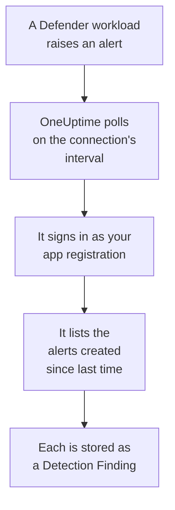

# Microsoft Defender XDR

Import the alerts of every [Microsoft Defender XDR](https://learn.microsoft.com/en-us/defender-xdr/) workload, from endpoints, identities, email and cloud apps, into OneUptime's Security Events. There you search them beside your logs, traces and metrics, correlate them with every other source, and page on-call for the ones that matter. OneUptime reads them through the Microsoft Graph security API with an app registration you create: no agent, playbook or Sentinel workspace is needed.

:::cards
- [Set up the connection](#set-up-the-connection): An app registration, one permission, and the connection's form.
- [What is imported](#what-is-imported): How each Defender alert becomes a security event.
- [How polling works](#how-polling-works): The window each poll reads, and what a busy tenant does to it.
- [Troubleshooting](#troubleshooting): What each error means, and what to change.
:::

## How it works



Every minute, OneUptime polls each enabled connection whose poll interval has passed. A poll signs in to Microsoft Entra ID as your app registration, asks Microsoft Graph for the alerts created since the last poll ([List alerts_v2](https://learn.microsoft.com/en-us/graph/api/security-list-alerts_v2)), and stores each one as an [OCSF](https://schema.ocsf.io/) Detection Finding event (class `2004`). Detection rules, monitors and dashboards then treat it like a security event from any other source.

## Before you begin

- In OneUptime, the Project Owner, Project Admin or Security Admin role. Security Members and Security Viewers can see connections and their run history, but cannot change them.
- A Microsoft Entra tenant with a Microsoft Defender XDR license: any Defender workload onboarded to the Microsoft Defender portal, such as Defender for Endpoint, for Identity, for Office 365 or for Cloud Apps.
- An Entra role that can register applications, such as Application Administrator, and a Global Administrator or Privileged Role Administrator to grant admin consent.
- Outbound HTTPS from the OneUptime app and workers to `login.microsoftonline.com` and `graph.microsoft.com`, or to `login.microsoftonline.us` and `graph.microsoft.us` for Azure Government.

## Set up the connection

The connection signs in with the [OAuth 2.0 client credentials flow](https://learn.microsoft.com/en-us/entra/identity-platform/v2-oauth2-client-creds-grant-flow): as an application, never as a person, with one application permission.

:::steps
### Register an application

1. Sign in to the [Azure portal](https://portal.azure.com) and open **Microsoft Entra ID**.
2. Go to **App registrations → New registration**. Name it `OneUptime Security Events`, leave **Supported account types** on **Accounts in this organizational directory only**, leave the redirect URI empty, and select **Register**.
3. From the app's **Overview** page, copy the **Application (client) ID** and the **Directory (tenant) ID**.

### Let it read alerts

1. Go to **API permissions → Add a permission → Microsoft Graph → Application permissions**, pick `SecurityAlert.Read.All`, and select **Add permissions**. It is the least privileged permission the [List alerts_v2](https://learn.microsoft.com/en-us/graph/api/security-list-alerts_v2#permissions) call accepts for an application: do not add `SecurityAlert.ReadWrite.All`.
2. Select **Grant admin consent for** your tenant, and confirm. The permission's status must read **Granted**: without consent, every read is refused with `403`.

### Create a client secret

Go to **Certificates & secrets → Client secrets → New client secret**, choose when it expires, and select **Add**. Copy the secret's **Value**, not its **Secret ID**, before you leave the page: it is never shown again.

Note when the secret expires. On that day, polling stops with `Microsoft Defender XDR token request failed (HTTP 401)` until you replace it with **Update credentials**.

### Add the connection in OneUptime

Open **Products → Security Events → Connections** (`/dashboard/{projectId}/security-events/connections`), click **Add connection**, choose **Microsoft Defender XDR** under **EDR / XDR**, and click **Next**. Fill in the settings in the table below, click **Next**, and paste the secret's value into **Client secret**.

### Test it before you save

Click **Test these settings** under **Test before saving**. The test signs in and reads alerts with the values in the form, and stores nothing, so a wrong secret or a missing consent shows up before the connection exists. Then click **Next**, give the connection a **Name**, and create it.
:::

| Setting | Where to find it |
| --- | --- |
| **Directory (tenant) ID** | The app's **Overview** page. The tenant's GUID, or a verified domain such as `contoso.onmicrosoft.com`. |
| **Application (client) ID** | The app's **Overview** page. The GUID of the app that has `SecurityAlert.Read.All`. |
| **Cloud** | **Azure public cloud**, which also serves Microsoft 365 GCC, or **Azure Government (US)** for GCC High (`login.microsoftonline.us` and `graph.microsoft.us`). Microsoft 365 DoD and the 21Vianet cloud in China are not supported. |
| **Client secret** | The secret's **Value**. It is encrypted, never returned by the API and never shown again. Replace it with **Update credentials** on the connection. |

The **Polling** step also has an optional **Description**, the **Poll Interval (Minutes)**, a whole number from `1` to `1440` that starts at `5`, and **Enabled**, which starts on.

## What is imported

Each Defender XDR [alert](https://learn.microsoft.com/en-us/graph/api/resources/security-alert) becomes one Detection Finding event (OCSF class `2004`), with vendor `Microsoft` and product `Microsoft Defender XDR`, attributed to the `Microsoft Defender XDR` telemetry service:

| OCSF column | Alert field |
| --- | --- |
| `eventUid` | `id`, the Graph alert ID, which is also what duplicates are dropped by |
| `time` | `firstActivityDateTime`, or `createdDateTime` when there is none |
| `message`, `ruleName` | `title` |
| `ruleId` | `detectorId`, or `alertPolicyId` when there is none |
| `severityName` | `severity`: `informational`, `low`, `medium` or `high`, and `unknown` stays Unknown |
| `statusName` | `status`: `new` becomes New, `inProgress` In Progress, `resolved` Resolved |
| `mitreTechniques` | `mitreTechniques` |
| `mitreTactics` | `categories` or `category`, when it is an ATT&CK tactic: `CredentialAccess` becomes `TA0006`. Other categories stay in `attributes`. |
| `principalHost`, `principalUser`, `principalIp`, `principalProcess` | The `evidence` with the `source`, `attacker` or `compromised` role, or else the first of each kind |
| `processName`, `processPath`, `processCommandLine`, `parentProcessName`, `parentProcessPath` | The process evidence `principalProcess` comes from: its `imageFile`, `processCommandLine` and `parentProcessImageFile`. Graph gives no parent command line. |
| `targetHost`, `targetUser`, `targetIp`, `targetResource` | The `evidence` with a target role, such as `destination` or `attacked`. URLs, mailboxes and cloud resources fill `targetResource`. |
| `observables` | Every host name, IP, user, file name, SHA-1 and SHA-256, URL, domain, mailbox and resource ID in `evidence` |
| `attributes` | The whole alert, flattened to dotted keys such as `evidence.0.hostName`, `serviceSource` and `incidentId` |

Alerts from every `serviceSource` are imported, Microsoft Sentinel's too once Sentinel is connected to the Defender portal. Incidents are not imported, but each alert keeps its `incidentId` and `incidentWebUrl` in `attributes`.

## How polling works

Each poll lists the alerts created in its window, 100 to a page, and follows Graph's `@odata.nextLink` until it has read the whole window:

```text
GET https://graph.microsoft.com/v1.0/security/alerts_v2?$filter=createdDateTime ge {start} and createdDateTime lt {end}&$top=100
```

- **Creation time is the cursor.** Defender often creates an alert hours after its `firstActivityDateTime`, and a cursor over activity time would skip every such alert.
- **The first poll looks back 24 hours**, so a new connection shows its recent alerts at once.
- **Every later poll starts 1 minute before the saved cursor**, so an alert created on the boundary between two windows is read twice and imported once.
- **A poll reads at most 24 hours past the cursor.** A connection whose cursor fell behind, while the workers were down or the tenant was throttled, catches up in a row of 24 hour windows.
- **Duplicates are dropped by the alert's `id`** among the project's events from `Microsoft` / `Microsoft Defender XDR`, so the overlap, a retried window and an import never store an alert twice.
- **A failed run changes nothing.** After a network error, or an error status from Graph, the cursor and the window length stay as they were, and the next poll reads the same window again. The one exception is a request that timed out: the cursor stays, but the next window is half as long, since a window too heavy to answer in time would time out on every try.

### When a window holds more than one poll can read

A poll reads at most 20 pages of 100 alerts: 2,000 alerts. When that limit stops it before the end of its window, the run is **Partial**, with this warning:

```text
Stopped after 20 alerts requests (the per-run request limit) before reading the whole window. Microsoft Graph lists alerts newest first and documents no way to sort them oldest first, so this run cannot name a point to resume from.
```

[List alerts_v2](https://learn.microsoft.com/en-us/graph/api/security-list-alerts_v2) documents `$filter`, `$top`, `$skip` and `$count`, but not `$orderby`, and it returns the newest alerts first. The 2,000 alerts a stopped run read are the newest of its window, so moving the cursor past them would skip the older ones it never reached. OneUptime shortens the window instead:

1. **Narrow.** The next poll reads a window half as long, from the same starting point, and halves again until a window reads completely, down to one minute. The run's warning says so: `This window holds more records than one poll can read; the next poll reads a {n} minute window from the same starting point.` Alerts already imported from the longer window are skipped as duplicates.
2. **Grow back.** After a window reads completely, the cursor moves to its end, and the next window is twice as long again, up to 24 hours.
3. **Move past a single minute.** If even one minute holds more than 2,000 alerts, polling moves past it, so newer alerts keep arriving. The run stays **Partial**, and **Last Error** reads `More records were created in the one minute from {cursor} to {end} than one poll can read. Polling moved past this minute so newer records keep arriving; use Import this time range in Diagnostics on this minute to recover what one run can read.` Import that minute with **Import this time range** to recover what one run can read.

A run that is **Partial** for another reason, such as an alert that could not be read into a security event, is retried the same way, from the same starting point. Changing the **Poll Interval (Minutes)** changes none of this: it decides how often a poll starts, not where its window begins.

### Run, preview and import on demand

Click **Diagnostics** on a connection to see its recent runs and to work with it by hand. Anyone who can change the connection can start these; everyone who can see it can read the history.

- **Run now** starts a poll at once, with the usual cursor, even while the connection is not **Enabled**.
- **Preview alerts** reads a time range of up to 7 days and imports nothing.
- **Import this time range** imports a range of up to 7 days, after you confirm, without moving the cursor. Alerts already imported are skipped.
- **Copy diagnostics** on a run copies its report for support. It never includes credentials.

## Test connection

**Test connection** on a connection's row, and **Test these settings** in the form, run in the API process, not in a background worker, so a test still answers when the workers are the problem. It runs these checks, in order:

| Check | What it checks |
| --- | --- |
| **Configuration** | The four settings are present and well formed. Nothing is contacted when this fails. |
| **Authenticate with Microsoft Entra** | Microsoft Entra ID issues a token for Microsoft Graph, in the cloud you picked. It fails on a wrong or expired secret, a wrong tenant or client ID, or the wrong cloud. |
| **Read alerts from Microsoft Graph** | One alert created in the last 24 hours can be read (`$top=1`). A `403` here is the missing `SecurityAlert.Read.All` permission, the missing admin consent, or a tenant without Defender XDR. |
| **Alerts available to import** | How many alerts were created in the last 24 hours and the last 7 days, one page of 100 each, so `100+` means more. None in 7 days is a warning, not a failure. |
| **Background workers**, **Poll scheduler**, **Security event storage** | OneUptime's own side: a process takes the Worker queue's jobs, the poll job runs every minute, and the store of security events answers. |
| **Scheduled polling** | For a saved connection: polling is on, no run is stuck waiting for a worker, and polls run on time. |

Every request in a test has a 20 second deadline. A test never imports anything or moves the cursor, and each failed check says what to change.

## Troubleshooting

The connection's **Last Error** keeps the complete error message, with credentials redacted, behind a prefix that names the step that failed. When a connection has an error, select **View Error** in its **Actions** column to read it, and **Copy Error** in the dialog to copy it. Read the prefix first.

:::details Last Error starts with `Microsoft Defender XDR token request`
- `Microsoft Defender XDR token request failed (HTTP ...)`: Microsoft Entra ID refused to issue a token, so Graph was never contacted. The message ends with a hint, keyed on Entra's `error` code:
  - `invalid_client` (`AADSTS7000215`): the secret is wrong, expired, or belongs to another app. Create a new one under **Certificates & secrets**, and save it with **Update credentials**.
  - `unauthorized_client` (`AADSTS700016`): the **Application (client) ID** is not in that **Directory (tenant) ID**, or **Cloud** is wrong.
  - `AADSTS90002`: no such tenant.
  - `invalid_scope`: the Graph scope does not exist in the cloud you picked. Check **Cloud**.
- `Microsoft Defender XDR token request returned ...`: Microsoft Entra ID answered with something unusable, a body that is not JSON or has no `access_token`. That is usually a proxy or gateway in between, not the credentials.
- `Microsoft Defender XDR token request did not complete: ...`: the token endpoint could not be reached, or did not answer in time. Check outbound HTTPS from the OneUptime app and workers to `login.microsoftonline.com`, or `login.microsoftonline.us`.
:::

:::details Last Error starts with `Microsoft Defender XDR alerts request`
- `Microsoft Defender XDR alerts request failed (HTTP ...)`: Graph refused to list the alerts. The message names Graph's error code, and a hint:
  - `403` (`Authorization_RequestDenied`): `SecurityAlert.Read.All` or its admin consent is missing, or the tenant has no Defender XDR license. Consent takes a few minutes to apply.
  - `401` (`InvalidAuthenticationToken`) after a token was issued: **Cloud** usually does not match the tenant.
  - `429` (`TooManyRequests`): Graph is throttling the app, and the next poll reads the same window again. The message cannot quote Graph's `Retry-After`, because OneUptime's HTTP client keeps no response headers on an error. If it keeps happening, raise the **Poll Interval (Minutes)**.
  - `5xx`: a problem on Graph's side. The next poll tries again.
  - `400`: Graph would not run the query, which OneUptime builds, not your settings. Copy the message for OneUptime support.
- `Microsoft Defender XDR alerts request returned ...`: Graph answered `200`, but with something the connector could not use: a body that is not JSON, no `value` list, or an `@odata.nextLink` that is not an `https://` link on the Graph host of your cloud. Such a link is refused, so the token is never sent anywhere else. This is reported rather than taken as an empty window, so the cursor never moves past alerts nobody read.
- `Microsoft Defender XDR alerts request did not complete: ...`: Graph could not be reached, or did not answer in time: 60 seconds for a poll, 20 for a test. Check outbound HTTPS to `graph.microsoft.com`, or `graph.microsoft.us`.
:::

:::details The test passes, but Last Polled is Never
The poll job has never run. Read the **Background workers** and **Poll scheduler** checks. On a self-hosted install, the usual cause is `DISABLE_QUEUE_WORKERS=true` on the app, with no separate worker deployment taking the jobs: set it to `false`, or run the worker deployment (Helm: `worker.enabled: true`, which is `false` by default).
:::

:::details Polls succeed, but an alert you know of is missing
Compare the alert's `createdDateTime` in the Defender portal with the run's window in **Diagnostics**: windows are on creation time, not activity time.

- An alert created before the connection existed is older than the first 24 hour look back. Import it with **Import this time range**.
- A **Partial** run was stopped by the 2,000-alert limit. The next poll reads a shorter window from the same start, so the alert is imported once a window that holds it reads completely.
- If **Last Error** names a minute polling moved past, import that minute with **Import this time range**.
:::

:::details The same alert appears twice
The 1 minute overlap does not do it: the second read is counted as a duplicate and not stored. Two events with the same `eventUid` were imported under different products, such as the same alert also arriving through a Microsoft Sentinel connection. Duplicates are dropped per vendor and product.
:::

## What you get

- **Search.** Filter Defender alerts by severity, status, MITRE technique, host, user, IP or any observable in the Security Events explorer, beside that host's logs and metrics.
- **Correlation.** Every alert's evidence, its devices, users, IPs, files and URLs, is indexed as observables, so one search finds everything that mentions a host across every source.
- **Detection rules.** Sigma rules that run on a schedule over your security events, and open alerts that page on-call.
- **Monitors.** Security Events monitors count matching events, and open incidents or alerts past a threshold.

Security events are billed like the rest of your telemetry, per GB ingested. See [Pricing](https://oneuptime.com/pricing).

## Next steps

:::cards
- [Security Events](/docs/telemetry/security-events): Search, correlate and alert on what you import.
- [Microsoft Sentinel](/docs/integrations/microsoft-sentinel): Import the incidents of a Sentinel workspace too.
- [Roles](/docs/permissions/reference#roles): What the Security roles can see and change.
- [Integrations Overview](/docs/integrations/index): The other tools you can connect.
:::
