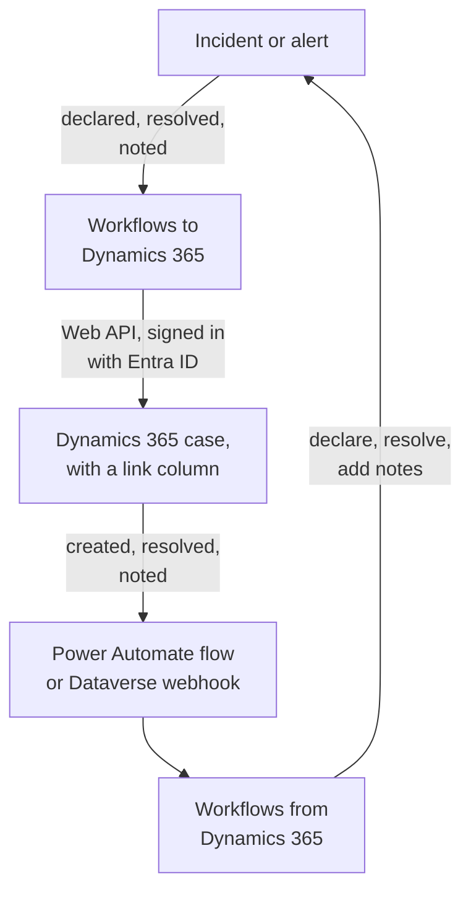

# Microsoft Dynamics 365

Keep [Microsoft Dynamics 365](https://www.microsoft.com/dynamics-365) cases in step with your OneUptime incidents and alerts, both ways. Ready-made workflow templates open a case for every incident or alert, close it when the record is resolved and copy notes into it. Others declare incidents from new cases and bring resolutions and notes back. There is no plugin: the workflows call the Dataverse Web API, and Dynamics 365 calls their webhook URLs.

:::cards
- [Prepare Dynamics 365](#prepare-dynamics-365): An app registration, an application user and a link column.
- [Start from a template](#start-from-a-template): The 13 templates, what they ask for, and how to set them up.
- [How the templates work](#how-the-templates-work): How cases and records stay linked, without loops.
- [Build it yourself](#build-it-yourself): Each direction by hand, for when a template does not fit.
:::

## How it works



Each template is a small workflow, so you take only the directions you want, for incidents, alerts or both. The OneUptime → Dynamics 365 templates call the Dataverse Web API, signed in as an application through Microsoft Entra ID. The Dynamics 365 → OneUptime templates start when a Power Automate flow or a Dataverse webhook calls them. A text column you add to the Case table links each case to its record.

## Before you begin

- A Dynamics 365 environment with the **Case** table. Cases come from Dynamics 365 Customer Service: a Dataverse environment without it has no `incident` table to write to.
- Rights to register an application in **Microsoft Entra ID**, and to create an application user in the environment. These are often two different administrators.
- In OneUptime, the right to create workflows. On OneUptime Cloud, workflows need the **Growth** plan or above.

> [!NOTE]
> This page uses Dataverse's names, not the labels on the Dynamics forms. A case is the `incident` table, its collection in a URL is `incidents`, its key is `incidentid` and its title column is `title`. The case number you see is `ticketnumber`.

## Prepare Dynamics 365

The templates and a workflow you build both need these. OneUptime signs in as an application, not as a person, with the OAuth 2.0 client credentials flow.

:::steps
### Register an application in Microsoft Entra ID

1. Sign in to the [Azure portal](https://portal.azure.com) as an administrator of your Dynamics environment's tenant, and open **Microsoft Entra ID**.
2. Go to **App registrations → New registration**. Name it `OneUptime Integration`, leave **Supported account types** on **Accounts in this organizational directory only**, and select **Register**.
3. From the app's **Overview** page, copy the **Application (client) ID** and the **Directory (tenant) ID**.
4. Go to **Certificates & secrets → Client secrets → New client secret**, and copy the secret's **Value**, not its ID, before you leave the page: it is never shown again. A client secret lives at most 24 months, so note when it expires.

Add no API permissions and grant no admin consent: with no signed-in user, they do nothing. Dynamics 365 decides what the application may do, through its application user.

### Create the application user

1. In the [Power Platform admin center](https://admin.powerplatform.microsoft.com/), select **Manage → Environments**, then your environment.
2. Select **Settings → Users + permissions → Application users**, then **+ New app user** and **+ Add an app**. Choose the registration and select **Add**.
3. Pick a **Business unit**, then give it a custom security role with the edit icon beside **Security roles**. At the Organization level, the role needs:
   - **Case**: Create, Read, Write, Append and Append To.
   - **Note**: Create, Read and Append, for the note templates.
   - **Activity**: Create, Read and Append, because closing a case records a Case Resolution, which is an activity.
   - **Account**, and **Contact** if cases are filed against a contact: Read and Append To.
4. Select **Save**, then **Create**.

An application user can only have a custom role: copy an existing one and trim it down. Without this user, Microsoft Entra ID still issues tokens, but every call to Dynamics 365 fails with `403` and `0x80072560`, "The user isn't a member of the organization."

### Add a link column to the Case table

Dataverse has nothing like Jira's labels, so a case and a OneUptime record find each other through a column you add.

1. In [make.powerapps.com](https://make.powerapps.com), pick your environment, open **Tables → Case → Columns**, and select **New column**.
2. Name it `OneUptime Link`, keep **Data type** as **Single line of text**, and save. The default maximum length of 100 is plenty: the templates write at most 55 characters.
3. Open the new column and copy its **Logical name**, such as `new_oneuptimelink`. The prefix comes from your solution's publisher, so yours may differ, like `cr4f2_oneuptimelink`.

Add the column to the Case form if agents should see the link.
:::

## Start from a template

The **Create a workflow** dialog has 13 Dynamics 365 templates, under **Dynamics 365** in its category list: seven for incidents, then six for alerts, each set under its own heading. They share the link column, so any combination of them works together.

### Incident templates

| Template                                                     | What it does                                                                                                                                                                                         | What it asks for                                                                 |
| ------------------------------------------------------------ | ---------------------------------------------------------------------------------------------------------------------------------------------------------------------------------------------------- | -------------------------------------------------------------------------------- |
| **OneUptime → Dynamics 365**                                 |                                                                                                                                                                                                      |                                                                                  |
| Create a Dynamics 365 case when an incident is declared      | Opens a case for every new incident, with a priority chosen from its severity and the incident's id in the link column. Incidents declared from Dynamics 365, and private incidents, are skipped.  | The five Dynamics 365 settings, the customer for new cases, and the OneUptime URL |
| Resolve the Dynamics 365 case when the incident is resolved  | Closes the linked case as **Problem Solved** when the incident is resolved, recording a Case Resolution as resolving it by hand does. Never reopens a case.                                         | The five Dynamics 365 settings                                                   |
| Copy incident private notes to the Dynamics 365 case         | Adds each new private note to the linked case as a note.                                                                                                                                             | The five Dynamics 365 settings                                                   |
| Copy incident public notes to the Dynamics 365 case          | Adds each new public note to the linked case as a note, so agents can tell customers what the status page says.                                                                                     | The five Dynamics 365 settings                                                   |
| **Dynamics 365 → OneUptime**                                 |                                                                                                                                                                                                      |                                                                                  |
| Declare an incident when a Dynamics 365 case is created      | Declares an incident for each new case, kept off your status pages, with a severity chosen from the case's priority, then writes the incident's id into the case's link column.                   | The five Dynamics 365 settings, and a flow or webhook for new cases              |
| Resolve the incident when its Dynamics 365 case is resolved  | Resolves the incident when its linked case is resolved.                                                                                                                                              | The five Dynamics 365 settings, and a flow or webhook for case status changes    |
| Add Dynamics 365 case notes to the incident as private notes | Copies each note an agent adds to a linked case onto the incident as a private note.                                                                                                                 | The five Dynamics 365 settings, and a flow or webhook for new notes              |

### Alert templates

The alert templates do the same jobs for alerts. There is one fewer, because alerts have no public notes, and **Create an alert when a Dynamics 365 case is created** writes no status page settings, because an alert never reaches a status page.

| Template                                                  | What it does                                                                                                                                  | What it asks for                                                                 |
| --------------------------------------------------------- | --------------------------------------------------------------------------------------------------------------------------------------------- | -------------------------------------------------------------------------------- |
| **OneUptime → Dynamics 365**                              |                                                                                                                                               |                                                                                  |
| Create a Dynamics 365 case when an alert is created       | Opens a case for every new alert, including every alert a monitor raises. Alerts created from Dynamics 365, and private alerts, are skipped. | The five Dynamics 365 settings, the customer for new cases, and the OneUptime URL |
| Resolve the Dynamics 365 case when the alert is resolved  | Closes the linked case as **Problem Solved** when the alert is resolved.                                                                      | The five Dynamics 365 settings                                                   |
| Copy alert private notes to the Dynamics 365 case         | Adds each new private note to the linked case as a note.                                                                                      | The five Dynamics 365 settings                                                   |
| **Dynamics 365 → OneUptime**                              |                                                                                                                                               |                                                                                  |
| Create an alert when a Dynamics 365 case is created       | Creates an alert for each new case, with a severity chosen from the case's priority, then writes the alert's id into the case's link column. | The five Dynamics 365 settings, and a flow or webhook for new cases              |
| Resolve the alert when its Dynamics 365 case is resolved  | Resolves the alert when its linked case is resolved.                                                                                          | The five Dynamics 365 settings, and a flow or webhook for case status changes    |
| Add Dynamics 365 case notes to the alert as private notes | Copies each note an agent adds to a linked case onto the alert as a private note.                                                             | The five Dynamics 365 settings, and a flow or webhook for new notes              |

None of the OneUptime → Dynamics 365 templates send an incident marked **Private Incident**, or an alert marked **Private Alert**, to Dynamics 365: not the record, its state or its notes, unless you switch that on. See [Changing what a template does](#changing-what-a-template-does).

**Monitors raise alerts on their own, and can raise a lot of them.** **Create a Dynamics 365 case when an alert is created** opens a case for every one. Unless every alert deserves a case, put an **If / Else** block between the trigger and the rest of the workflow, on `{{local.components.alert-on-create-1.returnValues.model.alertSeverity.name}}` for example, and connect only its **Yes** side onwards.

### What the templates ask for

The **Configure** step of the create wizard asks for up to seven values: every template asks for the first five, the Dynamics 365 settings, and the two create-case templates for the last two as well. It checks the shape of each Dynamics 365 setting before anything is created, and says what to type instead, because a value of the wrong shape is not an error anywhere until a run.

- **Dynamics 365 Environment URL** — your environment's address, such as `https://yourorg.crm.dynamics.com`, from the [Power Platform admin center](https://admin.powerplatform.microsoft.com/) under **Environments**, your environment, **Environment URL**. Only the address: not the Web API endpoint, which ends in `/api/data/v9.2`, and no slash at the end.
- **Directory (Tenant) ID** — from the app registration's **Overview** page.
- **Application (Client) ID** — from the same page.
- **Client Secret Value** — the client secret's **Value** from **Certificates & secrets**. Not its **Secret ID**, which is a GUID: the wizard refuses a GUID here.
- **Case Link Column** — the link column's logical name, such as `new_oneuptimelink`.
- **Customer for New Cases** — only the two create-case templates ask for it. Every case needs a customer, and a OneUptime incident has none, so new cases are all filed against one: paste the id of an account, or `contacts(<id>)` for a contact. Open the record in Dynamics 365: its id is the part after `id=` in the address.
- **OneUptime URL** — only the two create-case templates ask for it: the address you open OneUptime at, such as `https://oneuptime.com`. The case's description links back to the incident or alert with it.

**How the templates sign in.** The wizard saves the tenant, client ID and secret into one [OAuth 2.0 variable](/docs/workflows/variables#oauth-20-variables-tokens-that-refresh-themselves), `dynamicsAccessToken`, under the workflow's **Workflow Variables**: Client Credentials, the token URL `https://login.microsoftonline.com/<tenant>/oauth2/v2.0/token`, the scope `<environment URL>/.default`, and the client secret, sent in the request body and stored encrypted. Every call to Dynamics 365 sends `Authorization: Bearer {{local.variables.dynamicsAccessToken}}`. OneUptime fetches the token the first time a step needs it, fetches a new one before it expires, and replaces it with `[REDACTED]` in run logs and step traces.

To check the sign-in before anything runs, open **Workflow Variables**, click **View** on `dynamicsAccessToken`, and click **Refresh now**. **Access Token Fetched** means the app registration is right. Otherwise Microsoft Entra ID's error names what is wrong, such as `AADSTS7000215: Invalid client secret provided`.

Each workflow keeps its own copy. When you replace the client secret, open `dynamicsAccessToken` in every Dynamics 365 workflow and use **Update Credentials**.

### Create the workflows

:::steps
1. Open **Workflows → Create Workflow**. Under **Or start from a template**, choose **Dynamics 365** from the category list, or type `Dynamics` into **Search templates…**, and click the template you want. It opens to show what it does and the settings it will ask for. Click **Use this template**.
2. **Name** is filled in from the template. Change it if you like.
3. **Configure** asks for the values above.
4. Click **Create Workflow**. Every workflow is created switched off: switch **Enabled** on at the top of its **Builder**.
:::

Start with **Create a Dynamics 365 case when an incident is declared**, or **Create a Dynamics 365 case when an alert is created** for alerts: every other OneUptime → Dynamics 365 template of the same kind finds the case by the link it writes. Turn it on, declare a test incident or create a test alert, and open the workflow's **Logs → Runs**. The run should end **Executed**, and the **Response Body** of its last step, `create-case-1`, holds the new case's `ticketnumber`, such as `CAS-01001-X1Y2Z3`.

### Connect the Dynamics 365 → OneUptime templates

The Dynamics 365 → OneUptime templates, three for incidents and three for alerts, start from a [Webhook trigger](/docs/workflows/triggers#webhook), so Dynamics 365 has to be told where to send its events. Do it in this order:

1. Create the workflow and **turn it on first**. A workflow that is off refuses deliveries, and they are not queued.
2. Open the workflow's **Builder**, click the **Webhook** trigger block (`webhook-1`), and click **Copy URL** at the top of its settings. The URL looks like this:

   ```text
   https://<your OneUptime host>/workflow/trigger/<webhook secret key>
   ```

3. Have Dynamics 365 post to it, from a Power Automate flow or from a Dataverse webhook.

Each template only needs to be told which row changed. It reads that row back from Dynamics 365 before it does anything, so it never takes a case's title, status or link from the request, and it does not mind which of the two sends it.

:::tabs
@tab Power Automate flow
In [Power Automate](https://make.powerautomate.com), create an **Automated cloud flow** with the **Microsoft Dataverse** trigger **When a row is added, modified or deleted**, set as below, with **Scope** set to **Organization**. Add the built-in **HTTP** action: **Method** `POST`, **URI** the workflow's URL, a `Content-Type: application/json` header, and the body below, with the row's id picked from the trigger's dynamic content.

| Template                                                     | Change type | Table name | Select columns         | Body                         |
| ------------------------------------------------------------ | ----------- | ---------- | ---------------------- | ---------------------------- |
| Declare an incident / Create an alert when a case is created | Added       | Cases      |                        | `{"PrimaryEntityId": "<Case>"}`   |
| Resolve the incident / alert when its case is resolved       | Modified    | Cases      | `statecode,statuscode` | `{"PrimaryEntityId": "<Case>"}`   |
| Add case notes to the incident / alert as private notes      | Added       | Notes      |                        | `{"PrimaryEntityId": "<Note>"}` |

To send only some cases, use the trigger's **Filter rows**, such as `prioritycode eq 1` for High-priority cases. The body names the row as `PrimaryEntityId`, as a Dataverse webhook does: the templates read the row itself back from Dynamics 365.
@tab Dataverse webhook
Register the URL with the [Plug-in Registration Tool](https://learn.microsoft.com/en-us/power-apps/developer/data-platform/register-web-hook): **Register New WebHook**, with **HttpHeader** authentication and a header of your own; the URL itself is the secret. Then register a step on it for each event below, with **Event Pipeline Stage of Execution** set to **PostOperation** and **Execution Mode** to **Asynchronous**.

| Template                                                     | Message                                            | Primary Entity | Filtering Attributes             |
| ------------------------------------------------------------ | -------------------------------------------------- | -------------- | -------------------------------- |
| Declare an incident / Create an alert when a case is created | `Create`                                           | `incident`     |                                  |
| Resolve the incident / alert when its case is resolved       | `Close`, and `Update` for status changes by others | `incident`     | `statecode, statuscode` (Update) |
| Add case notes to the incident / alert as private notes      | `Create`                                           | `annotation`   |                                  |

Resolving a case raises the **Close** message, not **Update**, which is why that template needs both. A webhook posts the plug-in execution context, which names the row in `PrimaryEntityId`, or for **Close** in its `IncidentResolution`, and the templates read it from there. A Dataverse webhook only calls ports 80 and 443, and has no row filter of its own: every new case reaches the create template, unless you narrow it with `ONLY_PRIORITIES`.
:::

Before you rely on either:

- **Anyone who has the URL can trigger the workflow.** Because the templates read every row back from Dynamics 365, a request can only make one look at a real case or note. It can still make the create templates act on a case that is not linked yet. Keep the URL in the flow or the webhook only. If it leaks, click the **Webhook** trigger in the workflow's **Builder**, click **Reset URL**, and paste the new URL into the flow or the webhook. The old URL stops working at once.
- **Every event is a run**, including the ones a template skips. On OneUptime Cloud each counts toward your plan's workflow runs, and filtering in the flow keeps the number down. See [Plan limits](/docs/workflows/configuration#plan-limits).
- **Using both create-from-case templates?** **Declare an incident when a Dynamics 365 case is created** and **Create an alert when a Dynamics 365 case is created** both act on every case they are sent. Each checks the link column first, but two deliveries for one new case arrive together, so the case can end up with an incident and an alert. Send the two different cases, by case type for example.

### Check that it works

Each run's **Steps** say what the template did, so open the run in **Logs → Runs** and see how it ended:

- **Executed**: it did its job, and its last step names the case, incident or alert.
- **Executed**, its **Check With JavaScript** step on **No**: it skipped the event on purpose, and the step says why: the case is not linked to a record of this kind, the note came from the other side, the record is private, or the new state does not close the case.
- **Error**: a step failed, and its entry in **Steps** says why. For a Dynamics 365 call, that includes Dynamics 365's answer.
- **Error** at `link-case-1`: a template that creates a record from a case created it, but Dynamics 365 did not take the link, so the other templates cannot find it yet. Type the link into the case's column by hand.

If a run stops at the first Dynamics 365 step with `Could not get an OAuth 2.0 access token for {{local.variables.dynamicsAccessToken}}`, the sign-in settings are wrong, and the message quotes Microsoft Entra ID's answer. See [What the templates ask for](#what-the-templates-ask-for).

## How the templates work

### How the two sides stay linked

The case holds the link. A case that belongs to an incident has `oneuptime-incident-<incident id>` in its link column, and one that belongs to an alert has `oneuptime-alert-<alert id>`. The id is the last part of the record's address in the dashboard.

The create-case templates write it when they open the case, and the create-from-case templates write it once the record exists. Every other template crosses over by it: the OneUptime → Dynamics 365 ones look the case up by its link, and the Dynamics 365 → OneUptime ones read the record's id off the case. To link a case opened by hand, type the value into its link column yourself, but only when the record has no case yet.

**A case is linked to an incident or to an alert, never both.** One column serves both kinds. The incident templates ignore a case linked to an alert, and the other way round, and the create-from-case templates leave alone any case whose link column holds anything at all.

**A record has one case.** The templates that write to a case act only when exactly one case holds the record's link. If the link is copied into a second case, they stop, and each run ends in a skip that names both:

```text
More than one Dynamics 365 case holds the link oneuptime-incident-<id> (CAS-01001-X1Y2Z3, CAS-01002-K4L5M6). Clear it on every case except the one opened for the incident.
```

Incidents and alerts created from a case also keep the case's id and number in `customFields.dynamicsCaseId` and `customFields.dynamicsCaseNumber`, written when they are created. That is how the create-case templates know the record already has a case.

### How the templates avoid loops

Every write in one direction is an event in the other: a note added to a case comes back as a new note, and a private note added in OneUptime fires the note trigger. Four things stop the echo:

- **Markers in the text.** Every note the templates add to a case is titled `Synced from OneUptime: …`, and so is the subject of every Case Resolution they record. Every note written from Dynamics 365, and the root cause of every state change made from it, starts with `Synced from Dynamics 365`. Each direction skips text that carries the other side's marker, even in a note someone wrote that quotes one.
- **The link from the first save.** A case OneUptime opens holds its link from the moment it exists, so when its **Create** comes back, the create-from-case template finds it linked and does nothing.
- **`customFields.dynamicsCaseId`.** A record created from a case carries it, and the create-case templates skip such records.
- **States only move forward, on both sides.** Resolving the record closes the case, and the case's **Close** then finds the record already resolved. When the case is resolved first, the record is resolved, and its update finds the case already closed. A case that is already resolved or cancelled is never reopened.

Keep the markers when you edit the templates. They are the `FROM_ONEUPTIME` and `FROM_DYNAMICS` constants in the helper block at the top of every script.

### Changing what a template does

Open the workflow's **Builder** and click the block you want to change. The settings you are most likely to want are constants near the top of a script, the **JavaScript Code** of a **Check With JavaScript** block, just below the shared helper block. The incident and alert versions keep the same constants in the same blocks.

| Constant                                           | Template, and block                                                                       | What it controls                                                                                                                                                                                                                                                                                                                                 |
| -------------------------------------------------- | ----------------------------------------------------------------------------------------- | ------------------------------------------------------------------------------------------------------------------------------------------------------------------------------------------------------------------------------------------------------------------------------------------------------------------------------------------------ |
| `SYNC_PRIVATE_INCIDENTS`, `SYNC_PRIVATE_ALERTS`    | Every OneUptime → Dynamics 365 template — `prepare-case-1`, `plan-case-1`, `build-note-1` | `false` keeps private records out of Dynamics 365: no case is opened for one, its case is not changed, and its notes are not added. Set it to `true` in each template that should send them.                                                                                                                                                     |
| `SEVERITY_TO_PRIORITY`, `DEFAULT_PRIORITY`         | Create a Dynamics 365 case — `prepare-case-1`                                             | The project's severities are spread across the case priorities by their order: the most severe opens a High case (`1`), the least severe a Low one (`3`), and those between Normal ones (`2`). List a severity by name, in lower case, to choose its priority yourself, such as `{ 'major incident': 1 }`. `DEFAULT_PRIORITY` (`2`) is for a severity the project's list does not have, or a project with only one. |
| `CASE_ORIGIN`, `CASE_TYPE`                         | Create a Dynamics 365 case — `prepare-case-1`                                             | The new case's `caseorigincode` (`3`, Web) and `casetypecode` (`2`, Problem). To set any other column, add it to `CASE` in the same script, under its logical name.                                                                                                                                                                              |
| `MAX_TITLE_LENGTH`, `MAX_DESCRIPTION_LENGTH`       | Create a Dynamics 365 case — `prepare-case-1`                                             | The Case table's own limits, 200 and 2000 characters. The description keeps the link back to OneUptime however much is cut. Raise them if your Case table allows more.                                                                                                                                                                          |
| `RESOLVED_CASE_STATUS`                             | Resolve the Dynamics 365 case — `plan-case-1`                                             | The status a resolved record closes its case with: `5` is Problem Solved, `1000` Information Provided.                                                                                                                                                                                                                                         |
| `STATE_TO_CASE_STATUS`                             | Resolve the Dynamics 365 case — `plan-case-1`                                             | Closes the case with another resolved status at a resolved state of your own, by the state's name: `{ Closed: 1000 }` closes it as Information Provided. Only resolving the record changes its case: an active status such as Researching is never set. |
| `PRIORITY_RANK`                                    | Create from a Dynamics 365 case — `prepare-incident-1`, `prepare-alert-1`                 | Maps a case priority (`1` High, `2` Normal, `3` Low) to `0` (your most severe severity), `1` or `2` (your least severe). Priorities not listed land in the middle. With the two alert severities a new project has, Normal becomes Low unless you change `2: 1` to `2: 0`.                                                                    |
| `ONLY_PRIORITIES`                                  | Create from a Dynamics 365 case — `prepare-incident-1`, `prepare-alert-1`                 | Empty takes every case the flow or webhook sends. `[1]` creates records for High-priority cases only.                                                                                                                                                                                                                                           |
| `CASE_STATUS_TO_STATE`, `CASE_STATE_TO_STATE_FLAG` | Resolve when the Dynamics 365 case is resolved — `decide-state-1`                         | A case status, by name, to a OneUptime state, such as `{ Researching: 'Acknowledged' }`. Otherwise the case's state decides: Resolved resolves the record. Add `2: 'isResolvedState'` to resolve it when its case is cancelled too.                                                                                                               |
| `MESSAGES`                                         | Every Dynamics 365 → OneUptime template — `read-event-1`, or `prepare-incident-1` and `prepare-alert-1`                                  | The events the template acts on. Add `'Update'` to the note template's list to copy edited notes as well: each edit becomes a new note.                                                                                                                                                                                                         |
| `MAX_NOTE_LENGTH`                                  | The note templates — `build-note-1`, `read-note-1`                                        | The longest note each one writes: 100,000 characters into Dynamics 365, which is a note's own limit, and 30,000 into OneUptime.                                                                                                                                                                                                                |

State and status names used as keys must be spelled exactly as they are named, capitals included. Keep `{{` out of the code: a script is filled in like any other setting before it runs, so two opening braces in a row would be read as a reference.

### Limitations

- **Microsoft's commercial cloud.** The token URL is `login.microsoftonline.com`. For US Government (GCC High, DoD) or China clouds, open `dynamicsAccessToken`, use **Edit Settings**, and change the token URL to your cloud's sign-in host, such as `login.microsoftonline.us`.
- **Dynamics 365 can refuse to resolve a case.** Your Customer Service settings can stop a case being resolved while it has open activities or open child cases, and a business rule or plug-in can refuse it too. The run fails at `close-case-1`, with Dynamics 365's reason, and the case stays as it was.
- **Records and cases never move backwards.** Reopening a case changes nothing in OneUptime, and a resolved record is never reopened. A case that is already resolved or cancelled is never reopened to be closed again.
- **Notes and descriptions are plain text.** A note written in Dynamics 365's rich-text editor arrives in OneUptime as the text it shows, and so does a case description written in the editor or taken from an email: paragraphs and line breaks stay, while formatting, images and the email's own styles go. A OneUptime note arrives in Dynamics 365 as its raw characters, Markdown and all. Text from Dynamics 365 — a case's title and description, a note, the names of statuses, priorities, customers and people — reads exactly as it was written: an image, a link, HTML, a diagram or a chat mention such as `<!channel>` typed in it shows as its characters and does nothing, because an invisible word joiner goes after the character that would start it. A copy of the text keeps the joiner. A workflow keeps the scripts it was created with, so one created from an older version of a template writes text the way that version did: create it again from its template to get this. Attachments stay in Dynamics 365; the note in OneUptime names the file.
- **Edited notes are not copied**, only new ones, unless you add `'Update'` to `MESSAGES`.
- **Private incidents and alerts stay in OneUptime**, but the Dynamics 365 → OneUptime templates do not check: notes and status changes on a linked case still reach a private record.
- **Every case gets a record.** Unless you filter the flow or set `ONLY_PRIORITIES`, the create-from-case templates create an incident or alert for every new case they are sent. In a busy customer service environment, that is a lot.
- **The same event can arrive twice.** A Dataverse webhook retries once when OneUptime answers `502`, `503` or `504`. A retried **Create** that arrives after the first run linked the case is left alone. One that arrives while the first run is still going can create a second record.

## Build it yourself

The templates cover the common cases. To build a direction yourself, this section builds both by hand, for incidents, after [Prepare Dynamics 365](#prepare-dynamics-365). [Do the same for alerts](#do-the-same-for-alerts) maps it onto alerts.

### Sign in with an OAuth 2.0 variable

Create the token once, for every workflow, as an [OAuth 2.0 variable](/docs/workflows/variables#oauth-20-variables-tokens-that-refresh-themselves):

1. Go to **Workflows → Global Variables**, open the **More** menu (**⋯**) beside **Create Workflow Variable**, and choose **Create OAuth 2.0 Variable**. Name it `DYNAMICS_TOKEN`.
2. On **Provider**, pick **Microsoft Entra ID**, replace `{tenant-id}` in the **Token URL** with your Directory (tenant) ID, and pick **Client Credentials**.
3. On **Credentials**, enter the **Client ID** and the **Client Secret**. On **Advanced**, set the scope to `https://yourorg.crm.dynamics.com/.default`, then create the variable.

Any block then sends `Bearer {{global.variables.DYNAMICS_TOKEN}}` in its `Authorization` header. OneUptime fetches the token, fetches a new one before it expires, and keeps it out of run logs.

The scope must be your environment URL followed by `/.default`. A wrong environment URL is the usual cause of `AADSTS70011: The provided value for the input parameter 'scope' is not valid`.

### Open a case for every incident

:::steps
1. Create a workflow from scratch named `Incidents to Dynamics 365`. Click the dashed block and add the **On Create Incident** trigger. Its **Fields to pass on** starts with **Title**: click **Add field** and pick **Description** and **Incident Number**. The ID is always passed on.
2. Click **Add Component**, add an **API Post (JSON)** block, and connect the trigger's **Success** dot to it. Set its **Identifier** to `create-case`, and its **URL** to `https://yourorg.crm.dynamics.com/api/data/v9.2/incidents?$select=incidentid,ticketnumber`.
3. Under **More fields**, set its **Request Headers** to:

   ```json
   {
     "Authorization": "Bearer {{global.variables.DYNAMICS_TOKEN}}",
     "OData-MaxVersion": "4.0",
     "OData-Version": "4.0",
     "Accept": "application/json",
     "If-None-Match": "null",
     "Prefer": "return=representation"
   }
   ```

4. Set its **Request Body** to the case, with the GUID of the account your cases belong to:

   ```json
   {
     "title": "OneUptime #{{local.components.incident-on-create-1.returnValues.model.incidentNumber}}: {{local.components.incident-on-create-1.returnValues.model.title}}",
     "description": "{{local.components.incident-on-create-1.returnValues.model.description}}",
     "caseorigincode": 3,
     "prioritycode": 1,
     "new_oneuptimelink": "oneuptime-incident-{{local.components.incident-on-create-1.returnValues.model._id}}",
     "customerid_account@odata.bind": "/accounts(00000000-0000-0000-0000-000000000000)"
   }
   ```

5. Switch **Enabled** on, declare a test incident, and open **Logs → Runs**. The `create-case` step shows a `201` and a body with the new `incidentid` and `ticketnumber`.
:::

Every case needs a customer, so `customerid` is required. It can point at an account or a contact, so you write `customerid_account@odata.bind` or `customerid_contact@odata.bind`, spelled exactly. `Prefer: return=representation` makes the answer `201` with the case itself, so the next block can read `{{local.components.create-case.returnValues.response-body.incidentid}}`. Without it, Dynamics 365 answers `204` with no body.

`new_oneuptimelink` is the link column from [Prepare Dynamics 365](#prepare-dynamics-365), holding the same value the templates write, so your workflows and the templates find each other's cases. Use your column's logical name.

### Map priority and status

Dynamics 365 ships `severitycode` with a single option, so set `prioritycode` instead, and branch on the incident's severity with an **If / Else** block for a priority per severity. Send these columns as numbers:

| Column           | Values                                                                                                                                                 |
| ---------------- | ------------------------------------------------------------------------------------------------------------------------------------------------------ |
| `prioritycode`   | `1` High, `2` Normal, `3` Low                                                                                                                          |
| `caseorigincode` | `1` Phone, `2` Email, `3` Web, `2483` Facebook, `3986` Twitter, `700610000` IoT                                                                        |
| `casetypecode`   | `1` Question, `2` Problem, `3` Request                                                                                                                 |
| `statecode`      | `0` Active, `1` Resolved, `2` Cancelled                                                                                                                |
| `statuscode`     | `1` In Progress, `2` On Hold, `3` Waiting for Details, `4` Researching, `5` Problem Solved, `6` Cancelled, `1000` Information Provided, `2000` Merged |

`statuscode` can be customized, so your environment may have values of its own.

### Resolve the case when the incident resolves

Build this as a second workflow, so a failure here never stops cases being opened.

:::steps
1. Create a workflow named `Close Dynamics 365 cases`, with the **On Update Incident** trigger. In **Fields to watch**, click **Add field** and pick **Current Incident State**. In **Fields to pass on**, click **Add field**, open **Current Incident State** and pick **Is Resolved State**.
2. Add an **If / Else** block: **Value to check** `{{local.components.incident-on-update-1.returnValues.model.currentIncidentState.isResolvedState}}`, **Comparison** **is true**.
3. After its **Yes** side, add an **API Get (JSON)** block with the **Identifier** `find-case`, the same headers without `Prefer`, and this **URL**:

   ```text
   https://yourorg.crm.dynamics.com/api/data/v9.2/incidents?$select=incidentid&$filter=new_oneuptimelink%20eq%20'oneuptime-incident-{{local.components.incident-on-update-1.returnValues.model._id}}'
   ```

4. Add an **API Post (JSON)** block after it to `https://yourorg.crm.dynamics.com/api/data/v9.2/CloseIncident`, with the same headers and this body:

   ```json
   {
     "IncidentResolution": {
       "@odata.type": "Microsoft.Dynamics.CRM.incidentresolution",
       "subject": "Resolved in OneUptime",
       "incidentid@odata.bind": "/incidents({{local.components.find-case.returnValues.response-body.value[0].incidentid}})"
     },
     "Status": 5
   }
   ```
:::

The URL is sent exactly as written, so the spaces in `$filter` are written as `%20`. A query answers with a `value` list, and `value[0]` is its first case. `Status` is a `statuscode` of the Resolved state: `5` is Problem Solved.

Use `CloseIncident` to resolve, rather than a `PATCH` of `statecode`: it records the Case Resolution a resolved case is expected to have, and a `PATCH` is refused where an administrator configured status transitions. For anything else, such as a priority or a title, send an **API Patch (JSON)** block to `https://yourorg.crm.dynamics.com/api/data/v9.2/incidents(<the case id>)` with an `If-Match: *` header, which stops it creating a new case, and only the columns you change.

### Receive changes from Dynamics 365

First build the receiving workflow:

1. Create a workflow named `Dynamics 365 to OneUptime`, with the **Webhook** trigger.
2. Open the workflow's **Builder**, click the **Webhook** trigger, and click **Copy URL** at the top of its settings. The URL looks like this:

   ```text
   https://oneuptime.com/workflow/trigger/<webhook secret key>
   ```

   On a self-hosted install, the URL has your own host. Treat the URL like a password: anyone who has it can start the workflow. If it leaks, click **Reset URL** in the same place, and the old URL stops working at once.

3. Add an **If / Else** block that checks a shared secret before anything else: **Value to check** `{{local.components.webhook-1.returnValues.request-headers.x-oneuptime-secret}}`, **Comparison** **is equal to**, **Compare with** a value you make up, kept in a secret global variable.
4. After its **Yes** side, add an **Update One Incident** block. Set its **Query** to `{"_id": "{{local.components.webhook-1.returnValues.request-body.oneuptimeIncidentId}}"}`, and its **Data (JSON Object)** to the change, such as a new `currentIncidentStateId`. A **Find One Incident State** block with the query `{"name": "Resolved"}` gives you that id as `{{local.components.incident-state-find-one-1.returnValues.model._id}}`.

Turn it on, then have Dynamics 365 call it:

:::tabs
@tab Power Automate flow
1. In [Power Automate](https://make.powerautomate.com), create an **Automated cloud flow** with the **Microsoft Dataverse** trigger **When a row is added, modified or deleted**: **Change type** `Modified`, **Table name** `Cases`, **Scope** `Organization`, and **Select columns** `statecode,statuscode`, so it fires only on status changes.
2. Add **Get a row by ID** on `Cases`, with the row's id from the trigger: an update carries only the columns that changed.
3. Add the built-in **HTTP** action: **Method** `POST`, **URI** the workflow's URL, the headers `Content-Type: application/json` and `X-OneUptime-Secret: <your secret>`, and a body built from the row: `oneuptimeIncidentId` is the link column without `oneuptime-incident-`, such as `replace(<link column>, 'oneuptime-incident-', '')`, beside `ticketnumber` and `statecode`.
4. Save the flow and turn it on.

The Microsoft Dataverse connector is premium: the flow's owner needs the licence, and the flow stops if it lapses. Delivery usually takes seconds.
@tab Dataverse webhook
1. Register the workflow's URL with the [Plug-in Registration Tool](https://learn.microsoft.com/en-us/power-apps/developer/data-platform/register-web-hook): **Register New WebHook**, with **HttpHeader** authentication and the header `X-OneUptime-Secret`.
2. Register a step for the **Update** message on `incident`, with **Filtering Attributes** limited to the columns you need, **PostOperation** and **Asynchronous**.
3. In the workflow, read the payload: it is the plug-in execution context, in which `InputParameters` is a list of `{key, value}` pairs and the changed row is under `Target`. A **Run Custom JavaScript** block is the easiest way to read it.

Dataverse only calls ports 80 and 443, waits 60 seconds for an answer, and retries once, only on `502`, `503` and `504`. An update carries only the columns that changed, so register a post image for the others.
:::

### Do the same for alerts

Alerts work the same way. Swap the record type, and nothing else changes:

| Incident                                                     | Alert                                               |
| ------------------------------------------------------------ | --------------------------------------------------- |
| **On Create Incident** (`incident-on-create-1`)              | **On Create Alert** (`alert-on-create-1`)           |
| **On Update Incident** (`incident-on-update-1`)              | **On Update Alert** (`alert-on-update-1`)           |
| `incidentNumber`, `currentIncidentState`, `incidentSeverity` | `alertNumber`, `currentAlertState`, `alertSeverity` |
| **Find One Incident State**                                  | **Find One Alert State**                            |
| **Update One Incident**                                      | **Update One Alert**                                |

A workflow has exactly one trigger, so incidents and alerts need one workflow each. To do the same Dynamics 365 work for both, build it once in a workflow with a **Manual** trigger, and start it from both with an **Execute Workflow** block.

## Troubleshooting

Open the failing step in **Logs → Runs** first. Both Microsoft endpoints answer with a JSON body that explains the problem, and the API block keeps it in `response-body`.

:::details 400 with AADSTS70011, the scope is not valid
The scope is not your environment URL followed by `/.default`. Copy the URL from the Power Platform admin center, and drop any trailing slash and any `/api/data/...` path.
:::

:::details 401 Unauthorized from Dynamics 365
The `Authorization` header is missing or malformed. It must read `Bearer`, one space, then the token.
:::

:::details 403 Forbidden with 0x80072560
"The user isn't a member of the organization": the application user is missing, or belongs to another app registration. The token is fine. Create the user as in [Prepare Dynamics 365](#prepare-dynamics-365).
:::

:::details 403 Forbidden with a privilege error
The application user exists, but its security role lacks a privilege the call needs, such as Create, Read or Write on **Case**.
:::

:::details 400 Bad Request about the customer
`customerid` is required. Send `customerid_account@odata.bind` or `customerid_contact@odata.bind`, spelled exactly, with an address such as `/accounts(<guid>)`.
:::

:::details 404 Not Found on CloseIncident
`CloseIncident` comes with Dynamics 365 Customer Service, not with Dataverse alone. Search your environment's `$metadata` for it.
:::

:::details 412 Precondition Failed with DuplicateRecord
A duplicate detection rule matched. Narrow the rule, or stop sending the field it matches on.
:::

:::details 429 Too Many Requests
Dataverse's service protection limits allow about 6,000 requests, and 20 minutes of execution time, per user in any five minutes. The answer carries `Retry-After`, in seconds. Put a **Sleep** block in a workflow that bursts, or move the work to a scheduled workflow.
:::

:::details Nothing arrives in OneUptime
Send a request to the webhook URL yourself with `curl`, and look for it in **Logs → Runs**. If yours arrives and Dynamics 365's does not, look upstream: the flow's own run history, or the failed System Jobs of a Dataverse webhook.
:::

:::details The workflow runs, but the incident does not change
An **Update One Incident** block reports `Items Updated: 0` when its query matched nothing, and that is a success, not an error. Check that the id in the request really is the OneUptime incident's, and that you query `_id`.
:::

## Next steps

:::cards
- [Jira](/docs/integrations/jira): The same two-way sync for Jira issues.
- [Workflow Variables](/docs/workflows/variables#oauth-20-variables-tokens-that-refresh-themselves): OAuth 2.0 variables, and the tokens they keep fresh.
- [Workflow Configuration & Safety](/docs/workflows/configuration): Webhook security, outbound network access and plan limits.
- [IP Addresses](/docs/configuration/ip-addresses): OneUptime's outbound addresses, if Dynamics 365 sits behind an allow list.
:::
