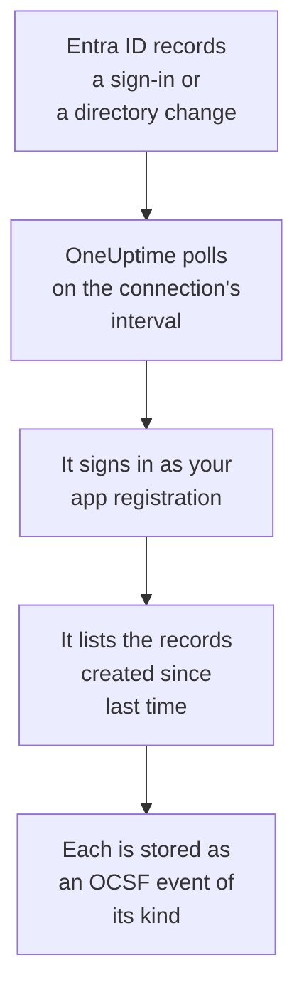

# Microsoft Entra ID

Import [Microsoft Entra ID](https://learn.microsoft.com/en-us/entra/identity/)'s sign-ins and directory changes into OneUptime's Security Events and, if you choose, the Exchange, SharePoint, OneDrive and Teams activity of the [Microsoft 365 audit log](https://learn.microsoft.com/en-us/purview/audit-log-activities). There you search them beside your logs, traces and metrics, correlate them with every other source, and page on-call for the ones that matter. OneUptime reads them with an app registration you create, and changes nothing in your tenant.

:::cards
- [Set up the connection](#set-up-the-connection): An app registration, its permissions, and the connection's form.
- [What is imported](#what-is-imported): Which records, and how each becomes a security event.
- [How polling works](#how-polling-works): The window each poll reads, and why it overlaps by 30 minutes.
- [Troubleshooting](#troubleshooting): What each error means, and what to change.
:::

## How it works

Every minute, OneUptime polls each enabled connection whose poll interval has passed. A poll signs in to Microsoft Entra ID as your app registration and reads, in this order, the directory changes ([List directoryAudits](https://learn.microsoft.com/en-us/graph/api/directoryaudit-list)) and the sign-ins ([List signIns](https://learn.microsoft.com/en-us/graph/api/signin-list)) recorded since the last poll, then, when the **Microsoft 365 audit log** option is on, the audit log's new content ([Office 365 Management Activity API](https://learn.microsoft.com/en-us/office/office-365-management-api/office-365-management-activity-api-reference)). Each record is stored as an [OCSF](https://schema.ocsf.io/) event: a sign-in as an Authentication event, a role assigned as a User Access Management event, a phishing verdict as a Detection Finding.

## Before you begin

- In OneUptime, the Project Owner, Project Admin or Security Admin role. Security Members and Security Viewers can see connections and their run history, but cannot change them.
- For sign-ins, Microsoft Entra ID P1 or P2, which Microsoft 365 E3, E5 and Business Premium include: Microsoft Graph gives sign-ins only to such tenants. Directory changes are read in any tenant.
- An Entra role that can register applications, such as Application Administrator, and a Global Administrator or Privileged Role Administrator to grant admin consent.
- For the Microsoft 365 audit log, auditing turned on for the tenant, which it is by default: in the [Microsoft Purview portal](https://purview.microsoft.com), **Audit** must not offer **Start recording user and admin activity**.
- Outbound HTTPS from the OneUptime app and workers to `login.microsoftonline.com`, `graph.microsoft.com` and `manage.office.com`, or to `login.microsoftonline.us`, `graph.microsoft.us` and `manage.office365.us` for Azure Government.

## Set up the connection

The connection signs in with the [OAuth 2.0 client credentials flow](https://learn.microsoft.com/en-us/entra/identity-platform/v2-oauth2-client-creds-grant-flow): as an application, never as a person, with read-only permissions.

:::steps
### Register an application

1. Sign in to the [Microsoft Entra admin center](https://entra.microsoft.com) and open **App registrations**.
2. Select **New registration**. Name it `OneUptime Security Events`, leave **Supported account types** on **Accounts in this organizational directory only**, leave the redirect URI empty, and select **Register**.
3. From the app's **Overview** page, copy the **Application (client) ID** and the **Directory (tenant) ID**.

### Let it read the logs

1. Go to **API permissions → Add a permission → Microsoft Graph → Application permissions**, pick `AuditLog.Read.All`, and select **Add permissions**. Microsoft documents that its sign-in list can also ask for `Directory.Read.All`: add it if sign-ins are refused with `403` once consent is granted.
2. For the Microsoft 365 audit log, add a second permission: **Add a permission → Office 365 Management APIs → Application permissions**, then `ActivityFeed.Read`.
3. To let playbooks disable, enable and sign out users (see [Containment](/docs/telemetry/security-cases#containment)), add `User.Read.All`, `User.EnableDisableAccount.All` and `User.RevokeSessions.All` the same way. Microsoft lets only an app that also holds the Privileged Authentication Administrator role change an administrator's account.
4. Select **Grant admin consent for** your tenant, and confirm. Each permission's status must read **Granted**: without consent, every read is refused with `403`.

### Create a client secret

Go to **Certificates & secrets → Client secrets → New client secret**, choose when it expires, and select **Add**. Copy the secret's **Value**, not its **Secret ID**, before you leave the page: it is never shown again. On the day it expires, polling stops with `Microsoft Entra ID token request failed (HTTP 401)` until you replace it with **Update credentials**.

### Add the connection in OneUptime

Open **Products → Security Events → Connections** (`/dashboard/{projectId}/security-events/connections`), click **Add connection**, choose **Microsoft Entra ID** under **Identity**, and click **Next**. Fill in the settings in the table below, click **Next**, and paste the secret's value into **Client secret**. On the **Polling** step, turn on **Microsoft 365 audit log** to read it too.

### Test it before you save

Click **Test these settings** under **Test before saving**. The test signs in and reads each log with the values in the form, and stores nothing, so a wrong secret or a missing consent shows up before the connection exists. Then click **Next**, give the connection a **Name**, and create it.
:::

| Setting | Where to find it |
| --- | --- |
| **Directory (tenant) ID** | The app's **Overview** page. The tenant's GUID, or a verified domain such as `contoso.onmicrosoft.com`. With **Microsoft 365 audit log** on, the GUID: the Management API names a tenant only by it. |
| **Application (client) ID** | The app's **Overview** page. The GUID of the app that has `AuditLog.Read.All`. |
| **Cloud** | **Azure public cloud**, or **Azure Government (US)** for GCC High (`login.microsoftonline.us`, `graph.microsoft.us` and `manage.office365.us`). |
| **Microsoft 365 audit log** | Optional, off by default. On, each poll also reads the Microsoft 365 audit log. The app needs `ActivityFeed.Read`. |
| **Client secret** | The secret's **Value**. It is encrypted, never returned by the API and never shown again. Replace it with **Update credentials** on the connection. |

The **Polling** step also has an optional **Description**, the **Poll Interval (Minutes)**, a whole number from `1` to `1440` that starts at `5`, and **Enabled**, which starts on.

## What is imported

Every event has vendor `Microsoft` and product `Microsoft Entra ID`. Its `entra.log` attribute says which log a sign-in or a change came from, and a Microsoft 365 record's `microsoft365.contentType` its content type.

| Record | OCSF class | Severity |
| --- | --- | --- |
| A sign-in that worked | Authentication (`3002`), status `Success` | Informational |
| A sign-in waiting on a second step, such as MFA (`50074`, `50076`) or a password change prompt | Authentication (`3002`), status `Interrupted` | Informational: a step, not a failure |
| A sign-in that failed, with Entra's reason and error code | Authentication (`3002`), status `Failure` | Low |
| A sign-in Identity Protection rated medium or high risk | Authentication (`3002`) | Medium or High |
| A user, group or role changed, by its category | Account Change (`3001`), Group Management (`3006`), User Access Management (`3005`), or Entity Management (`3004`) for the rest | Medium for a privileged role, such as Global Administrator; Low for a change that failed |

With the **Microsoft 365 audit log** on, the records a security team acts on are imported from it, and the rest, such as a file opened or a mail read, only counted:

| Microsoft 365 record | OCSF class | Severity |
| --- | --- | --- |
| An Exchange cmdlet, such as `New-InboxRule` or `Set-Mailbox`, an inbox rule made in Outlook, or mail sent as someone else | API Activity (`6003`) | Medium when it forwards mail, with `microsoft365.forwardsMail` set to `true` |
| A mailbox permission given, such as `Add-MailboxPermission` | User Access Management (`3005`) | Low |
| A file shared in SharePoint or OneDrive | File Hosting Activity (`6006`) | Low with a guest or a link anyone can open, with `microsoft365.sharedOutside` set to `true` |
| A site collection administrator added or removed | User Access Management (`3005`) | Low |
| Malware or phishing mail found by Microsoft Defender for Office 365 | Detection Finding (`2004`) | High for malware, Medium for phishing |
| An alert Microsoft 365 raised | Detection Finding (`2004`) | The alert's own |
| An app, a bot or a connector added to a team | Application Lifecycle (`6002`) | Low |

Exchange's own housekeeping, run as its system account, is left out unless it forwards mail. Every event keeps the whole record, flattened to dotted keys such as `status.errorCode` or `Parameters.ForwardTo`, so a rule reads any field by Microsoft's name for it. The rule library's rules for Entra ID read them as imported here.

The same sign-ins and directory changes can reach OneUptime as logs instead, exported by an Azure diagnostic setting and read by [Your logs](/docs/telemetry/security-events#find-security-events-in-your-logs). Each record gets the same event ID either way, but a record read both ways is stored twice: read Entra ID one way.

## How polling works

- **Records are read by when Entra ID recorded them**, `activityDateTime` for a change and `createdDateTime` for a sign-in.
- **The first poll looks back 24 hours**, so a new connection shows its recent records at once.
- **Every later poll starts 30 minutes before the saved cursor.** Microsoft documents both logs arriving minutes late, so the overlap reads a late record on the next poll, and duplicates are dropped by record ID within the project.
- **A poll reads at most 24 hours past the cursor.** A connection whose cursor fell behind catches up in a row of 24 hour windows.
- **A tenant without Microsoft Entra ID P1 or P2** imports its directory changes, and each run's **Read sign-ins** check warns that sign-ins were not read.
- **A failed run changes nothing.** After a network error, or an error status from Graph, the cursor and the window length stay as they were, and the next poll reads the same window again. The one exception is a request that timed out: the cursor stays, but the next window is half as long, since a window too heavy to answer in time would time out on every try.

The Microsoft 365 audit log is read by when Microsoft made each content blob available, a day at a time, and no further back than the 7 days Microsoft keeps it. The first poll subscribes the app to `Audit.Exchange`, `Audit.SharePoint` and `Audit.General`, and Microsoft makes the first records of a new subscription available within 12 hours. The Entra ID logs never wait on the audit log: a missing permission is a warning and the window moves on, while a failure on Microsoft's side, such as `HTTP 503`, makes the run **Partial** so the window is read again.

### When a window holds more than one poll can read

Each log has a budget of its own: 10 pages of 500 directory changes, 20 pages of 500 sign-ins and, for the Microsoft 365 audit log, 120 requests and 10,000 records. A poll stops after 4 minutes. When a budget stops a log before the end of its window, the run is **Partial**, and its warning names the log and the budget. Microsoft Graph lists records newest first, so OneUptime shortens the window instead of moving the cursor past records it never reached:

1. **Narrow.** The next poll reads a window half as long, from the same starting point, and halves again until a window reads completely, down to one minute. The run's warning says so: `This window holds more records than one poll can read; the next poll reads a {n} minute window from the same starting point.` Records already imported from the longer window are skipped as duplicates.
2. **Grow back.** After a window reads completely, the cursor moves to its end, and the next window is twice as long again, up to 24 hours.
3. **Move past a single minute.** If even one minute holds more than a poll can read, polling moves past it, so newer records keep arriving. The run stays **Partial**, and **Last Error** reads `More records were created in the one minute from {cursor} to {end} than one poll can read. Polling moved past this minute so newer records keep arriving; use Import this time range in Diagnostics on this minute to recover what one run can read.` Import that minute with **Import this time range** to recover what one run can read.

Changing the **Poll Interval (Minutes)** changes none of this: it decides how often a poll starts, not where its window begins.

### Run, preview and import on demand

Click **Diagnostics** on a connection to see its recent runs and to work with it by hand. Anyone who can change the connection can start these; everyone who can see it can read the history.

- **Run now** starts a poll at once, with the usual cursor, even while the connection is not **Enabled**.
- **Preview records** reads a time range of up to 7 days and imports nothing.
- **Import this time range** imports a range of up to 7 days, after you confirm, without moving the cursor. Records already imported are skipped. Microsoft Entra ID keeps 30 days of sign-ins and directory changes with P1 or P2, and 7 days without.
- **Copy diagnostics** on a run copies its report for support. It never includes credentials.

## Test connection

**Test connection** on a connection's row, and **Test these settings** in the form, run in the API process, not in a background worker, so a test still answers when the workers are the problem. It runs these checks, in order:

| Check | What it checks |
| --- | --- |
| **Configuration** | Every setting is present and well formed. Nothing is contacted when this fails. |
| **Authenticate with Microsoft Entra** | Entra ID issues the app a token for Microsoft Graph, in the cloud you picked. |
| **Read sign-ins** | Sign-ins of the last 24 hours can be read. A warning, not a failure, in a tenant without P1 or P2. |
| **Read directory changes** | Directory changes of the last 24 hours can be read. |
| **Read the Microsoft 365 audit log** | Only with the option on: the Management API answers, and which content types the app is subscribed to. |
| **Records available to import** | How many sign-ins and directory changes the last 24 hours hold, 500 each at most, so `500+` means more. None is a warning. |
| **Background workers**, **Poll scheduler**, **Security event storage** | OneUptime's own side: a process takes the Worker queue's jobs, the poll job runs every minute, and the store of security events answers. |
| **Scheduled polling** | For a saved connection: polling is on, no run is stuck waiting for a worker, and polls run on time. |

Every request in a test has a 20 second deadline. A test never imports anything or moves the cursor, and each failed check says what to change.

## Troubleshooting

The connection's **Last Error** keeps the complete error message, with credentials redacted. When a connection has an error, select **View Error** in its **Actions** column to read it, and **Copy Error** in the dialog to copy it. Every message starts with `Microsoft Entra ID`, then names the request that failed, and quotes Microsoft's error code when there is one.

:::details Last Error says `token request failed`
- `HTTP 401` with `invalid_client`: the client secret is wrong or expired. Create a new one, and save it with **Update credentials**.
- `HTTP 400` naming the Application (client) ID or the tenant: check both on the app's **Overview** page, and that the **Cloud** is the tenant's.
:::

:::details Last Error says `sign-ins request failed (HTTP 403)` or `audit logs request failed (HTTP 403)`
- Error code `Authorization_RequestDenied`: the app lacks `AuditLog.Read.All`, or consent was not granted. Grant admin consent, wait a few minutes, and test again. For sign-ins, also grant `Directory.Read.All`.
- Error code `Authentication_RequestFromNonPremiumTenantOrB2CTenant`: the tenant has no Microsoft Entra ID P1 or P2. Directory changes are still imported.
:::

:::details The Microsoft 365 audit log is not read
- `subscriptions request failed (HTTP 401)` or `(HTTP 403)`, with `AF10001`: the app lacks `ActivityFeed.Read` of the Office 365 Management APIs, or consent was not granted.
- `AF20010` to `AF20013`: the Management API does not know the **Directory (tenant) ID**. Use the tenant's GUID.
- `subscription start failed` with `AF20023`: an administrator turned the subscription off. A content type that cannot be subscribed to is named in the run's warnings, and the others are still read.
- No records for hours after the first poll: Microsoft makes a new subscription's first content available within 12 hours.
:::

:::details Last Error says `did not complete`
The request got no answer: a timeout, a name that does not resolve, or a refused address. Check that the OneUptime app and workers can reach the hosts in [Before you begin](#before-you-begin), through any proxy you use.
:::

:::details The test passes, but Last Polled is Never
The poll job has never run. Read the **Background workers** and **Poll scheduler** checks. On a self-hosted install, the usual cause is `DISABLE_QUEUE_WORKERS=true` on the app, with no separate worker deployment taking the jobs: set it to `false`, or run the worker deployment (Helm: `worker.enabled: true`, which is `false` by default).
:::

## Next steps

:::cards
- [Security Events](/docs/telemetry/security-events): Search, correlate and alert on what you import.
- [Okta System Log](/docs/integrations/okta): Import another identity provider's sign-ins.
- [Google Workspace](/docs/integrations/google-workspace): Import Google's sign-ins and admin changes.
- [Integrations Overview](/docs/integrations/index): The other tools you can connect.
:::
