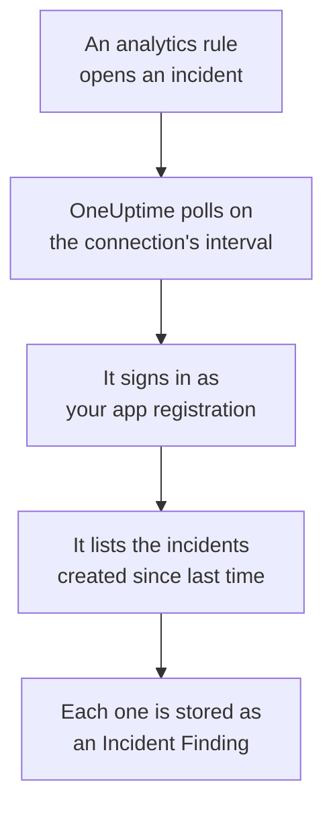

# Microsoft Sentinel

Import the incidents your [Microsoft Sentinel](https://learn.microsoft.com/en-us/azure/sentinel/overview) analytics rules open into OneUptime's Security Events. There you search them beside your logs, traces and metrics, correlate them with every other source, and page on-call for the ones that matter. OneUptime reads them with an app registration you create, and changes nothing in Azure.

:::cards
- [Set up the connection](#set-up-the-connection): An app registration, a role, and the connection's form.
- [What is imported](#what-is-imported): How each Sentinel incident becomes a security event.
- [How polling works](#how-polling-works): The window each poll reads, and what a busy workspace does to it.
- [Troubleshooting](#troubleshooting): What each error means, and what to change.
:::

## How it works



Every minute, OneUptime polls each enabled connection whose poll interval has passed. A poll signs in to Microsoft Entra ID as your app registration, asks Azure Resource Manager for the incidents created since the last poll, and stores each one as an [OCSF](https://schema.ocsf.io/) Incident Finding event (class `2005`). Detection rules, monitors and dashboards then treat it like a security event from any other source.

## Before you begin

- In OneUptime, the Project Owner, Project Admin or Security Admin role. Security Members and Security Viewers can see connections and their run history, but cannot change them.
- A Log Analytics workspace with Microsoft Sentinel enabled, in the Azure public cloud or in Azure Government (US).
- In Microsoft Entra ID, the right to create an app registration and a client secret.
- On the resource group that holds the workspace, the right to assign roles, such as Owner or User Access Administrator.

## Set up the connection

The connection signs in with the OAuth 2.0 client credentials flow: as an application, never as a person. Its access comes from an Azure role, so the app registration needs no API permissions.

:::steps
### Register an application

1. Sign in to the [Azure portal](https://portal.azure.com) and open **Microsoft Entra ID**.
2. Go to **App registrations → New registration**. Name it `OneUptime Sentinel connector`, leave **Supported account types** on **Accounts in this organizational directory only**, leave the redirect URI empty, and select **Register**.
3. From the app's **Overview** page, copy the **Application (client) ID** and the **Directory (tenant) ID**.
4. Go to **Certificates & secrets → Client secrets → New client secret**, choose when it expires, and select **Add**. Copy the secret's **Value**, not its **Secret ID**, before you leave the page: it is never shown again.

### Let it read incidents

1. In the Azure portal, open the resource group that holds your Log Analytics workspace.
2. Select **Access control (IAM) → Add → Add role assignment**.
3. On the **Role** tab, pick **Microsoft Sentinel Reader**.
4. On the **Members** tab, choose **User, group, or service principal**, click **Select members**, and pick your app registration by its name.
5. Select **Review + assign**.

The role lets the app read incidents (`Microsoft.SecurityInsights/incidents/read`) and write nothing. Microsoft recommends assigning it on the resource group rather than on the workspace, so that it also covers the `SecurityInsights` solution the incidents are served from. A new assignment can take a few minutes to apply.

### Find the workspace's details

Open the Log Analytics workspace in the Azure portal. Its **Overview** page shows the **Subscription ID**, the **Resource group** and the workspace's name. The workspace's resource ID holds the same three:

```text
/subscriptions/{Subscription ID}/resourceGroups/{Resource group}/providers/Microsoft.OperationalInsights/workspaces/{Workspace name}
```

### Add the connection in OneUptime

Open **Products → Security Events → Connections** (`/dashboard/{projectId}/security-events/connections`), click **Add connection**, choose **Microsoft Sentinel**, and click **Next**. Fill in the settings in the table below, click **Next**, and paste the secret's value into **Client secret**.

### Test it before you save

Click **Test these settings** under **Test before saving**. The test signs in and reads incidents with the values in the form, and stores nothing, so a wrong secret or a missing role shows up before the connection exists. Then click **Next**, give the connection a **Name**, and create it.
:::

| Setting | Where to find it |
| --- | --- |
| **Directory (tenant) ID** | The app's **Overview** page. The tenant's GUID, or a verified domain such as `contoso.onmicrosoft.com`. |
| **Application (client) ID** | The app's **Overview** page. A GUID. |
| **Subscription ID** | The workspace's **Overview** page. A GUID. |
| **Resource group** | The workspace's **Overview** page. 1 to 90 letters, digits, underscores, hyphens, periods or parentheses, not ending in a period. |
| **Workspace name** | The workspace's **Overview** page. 3 to 90 letters, digits or hyphens, starting and ending with a letter or a digit. |
| **Cloud** | **Azure public cloud** (`login.microsoftonline.com`, `management.azure.com`) or **Azure Government (US)** (`login.microsoftonline.us`, `management.usgovcloudapi.net`). |
| **Client secret** | The secret's **Value**. It is encrypted, never returned by the API and never shown again. Replace it with **Update credentials** on the connection. |

The **Polling** step also has an optional **Description**, the **Poll Interval (Minutes)**, a whole number from `1` to `1440` that starts at `5`, and **Enabled**, which starts on.

## What is imported

Each Sentinel incident becomes one Incident Finding event (OCSF class `2005`, activity `Create`), attributed to the `Microsoft Sentinel` telemetry service:

| OCSF column | Sentinel incident field |
| --- | --- |
| `time` | `properties.createdTimeUtc`, when Sentinel created the incident |
| `eventUid` | `name`, the incident's GUID, which is also what duplicates are dropped by |
| `message`, `ruleName` | `properties.title` |
| `ruleId` | The rule GUID at the end of the first `properties.relatedAnalyticRuleIds` entry |
| `severityName` | `properties.severity`: `High`, `Medium`, `Low` or `Informational` |
| `statusName` | `properties.status`: `New`, `Active` or `Closed` |
| `mitreTactics` | `properties.additionalData.tactics`, as ATT&CK IDs: `Persistence` becomes `TA0003` |
| `principalUser` | `properties.owner.userPrincipalName`, or `properties.owner.email` |
| `targetResource` | `properties.incidentUrl`, a link to the incident in the Azure portal |
| `observables` | The owner's UPN, email and object ID, and the name of every label |
| `attributes` | The whole incident, flattened to dotted keys such as `properties.classification` and `properties.firstActivityTimeUtc` |

Closed incidents created in a poll's window are imported too. Filter on `statusName` in the Security Events explorer to see only open ones.

## How polling works

Each poll lists the incidents created in its window, oldest first, 50 to a page, and follows the API's `nextLink` until it has read the whole window:

```text
GET https://management.azure.com/subscriptions/{sub}/resourceGroups/{rg}/providers/Microsoft.OperationalInsights/workspaces/{ws}/providers/Microsoft.SecurityInsights/incidents
    ?api-version=2024-03-01
    &$filter=(properties/createdTimeUtc ge {windowStart}) and (properties/createdTimeUtc lt {windowEnd})
    &$orderby=properties/createdTimeUtc asc
    &$top=50
```

- **Creation time is the cursor.** A scheduled analytics rule that runs hourly opens its incident long after the activity it matched, and the incident's `firstActivityTimeUtc` can be hours or days older. A cursor over activity time would skip every such incident. The activity times stay in `attributes`, and the samples in Diagnostics show both.
- **The first poll looks back 24 hours**, so a new connection shows its recent incidents at once.
- **Every later poll starts 1 minute before the saved cursor**, so an incident created on the boundary between two windows is never skipped.
- **A poll reads at most 24 hours past the cursor.** A connection whose cursor fell behind catches up in a row of 24 hour windows, and its **Health** reads **Catching up**.
- **Duplicates are dropped by the incident's GUID** (`name`) within the project, so the overlap, a retried window and an import never store an incident twice.

### When a window holds more than one poll can read

A poll reads at most 20 pages of 50 incidents: 1,000 incidents. When that limit stops it before the end of its window, the run is **Partial**, with a warning such as:

```text
Stopped after 20 incidents requests (the per-run request limit) before reading the whole window. Incidents are read oldest first; every incident created before 2026-09-14T08:12:44.000Z was read.
```

Incidents are read oldest first, so OneUptime moves the cursor to the creation time of the last incident it read, and the next poll starts there with the same window length. A busy workspace catches up about 1,000 incidents a poll, instead of reading the same ones again. The incidents created at that same instant are read twice, and the duplicate check drops the second copy.

When a run cannot get past the saved cursor at all, OneUptime shortens the window instead:

1. **Narrow.** The next poll reads a window half as long, from the same starting point, and halves again until a window reads completely, down to one minute. The run's warning says so: `This window holds more records than one poll can read; the next poll reads a {n} minute window from the same starting point.`
2. **Grow back.** After a window reads completely, the next one is twice as long again, up to 24 hours.
3. **Move past a single minute.** If even one minute holds more than a poll can read, polling moves past it, so newer incidents keep arriving. The run stays **Partial**, and **Last Error** reads `More records were created in the one minute from {cursor} to {end} than one poll can read. Polling moved past this minute so newer records keep arriving; use Import this time range in Diagnostics on this minute to recover what one run can read.` Import that minute with **Import this time range** to recover what one run can read.

A run that fails outright, with an error from Microsoft Entra ID or Azure Resource Manager, keeps the cursor and the window length, and the next poll reads the same window again. The one exception is a request that timed out: the cursor stays, but the next window is half as long, since a window too heavy to answer in time would time out on every try. Changing the **Poll Interval (Minutes)** changes none of this: it decides how often a poll starts, not where its window begins.

### Run, preview and import on demand

Click **Diagnostics** on a connection to see its recent runs and to work with it by hand. Anyone who can change the connection can start these; everyone who can see it can read the history.

- **Run now** starts a poll at once, with the usual cursor, even while the connection is not **Enabled**.
- **Preview incidents** reads a time range of up to 7 days and imports nothing.
- **Import this time range** imports a range of up to 7 days, after you confirm, without moving the cursor. Incidents already imported are skipped.
- **Copy diagnostics** on a run copies its report for support. It never includes credentials.

## Test connection

**Test connection** on a connection's row, and **Test these settings** in the form, run in the API process, not in a background worker, so a test still answers when the workers are the problem. It runs these checks, in order:

| Check | What it checks |
| --- | --- |
| **Configuration** | Every setting is present and well formed. Nothing is contacted when this fails. |
| **Authenticate with Microsoft Entra** | Microsoft Entra ID issues a token for Azure Resource Manager to your app registration. |
| **Read incidents** | One incident created in the last 24 hours can be read (`$top=1`). This proves the role and the workspace's details. |
| **Incidents available to import** | How many incidents were created in the last 24 hours and the last 7 days, one page of 50 each, so `50+` means more. None in 7 days is a warning, not a failure. |
| **Background workers**, **Poll scheduler**, **Security event storage** | OneUptime's own side: a process takes the Worker queue's jobs, the poll job runs every minute, and the store of security events answers. |
| **Scheduled polling** | For a saved connection: polling is on, no run is stuck waiting for a worker, and polls run on time. |

Every request in a test has a 20 second deadline. A test never imports anything or moves the cursor, and each failed check says what to change.

## Troubleshooting

The connection's **Last Error** keeps the complete error message, with credentials redacted, behind a prefix that names the step that failed. When a connection has an error, select **View Error** in its **Actions** column to read it, and **Copy Error** in the dialog to copy it. Read the prefix first.

:::details Last Error starts with `Microsoft Sentinel token request`
- `Microsoft Sentinel token request failed (HTTP ...)`: Microsoft Entra ID refused to issue a token, so Azure was never contacted. The message quotes Entra's code:
  - `AADSTS7000215` or `invalid_client`: the **Client secret** is wrong or expired, or it is the secret's ID rather than its value. Create a new secret, and save it with **Update credentials**.
  - `AADSTS700016` or `unauthorized_client`: the **Application (client) ID** is not in the **Directory (tenant) ID** given. Compare both with the app's **Overview** page.
  - `AADSTS90002` or `HTTP 404`: no such tenant. The **Directory (tenant) ID** is wrong, or it is in the other cloud: check **Cloud**.
  - `HTTP 429` or `HTTP 5xx`: Microsoft Entra ID is throttling or unavailable. The next poll tries again.
- `Microsoft Sentinel token request returned ...`: Microsoft Entra ID answered with something unusable, such as a body that is not JSON or has no `access_token`. That is usually a proxy or gateway in between.
- `Microsoft Sentinel token request failed:`, with no status, or `Microsoft Sentinel token request timed out after ... seconds with no response`: the request got no answer. Check DNS, TLS and outbound HTTPS from the OneUptime app and workers to `login.microsoftonline.com`.
:::

:::details Last Error starts with `Microsoft Sentinel incidents list`
- `Microsoft Sentinel incidents list failed (HTTP ...)`: Azure Resource Manager refused the request.
  - `HTTP 401`: it did not accept the token. Almost always **Cloud** does not match the tenant, or the app registration was deleted. A token that expires between two pages is renewed and retried once on its own.
  - `HTTP 403` or `AuthorizationFailed`: the app does not have **Microsoft Sentinel Reader** on the resource group yet. Assign it, and wait a few minutes.
  - `HTTP 404`: no workspace has that **Subscription ID**, **Resource group** and **Workspace name**, or Microsoft Sentinel is not enabled on it. Copy them from the workspace's **Overview** page.
  - `HTTP 429` or `HTTP 5xx`: Azure Resource Manager is throttling or unavailable. The next poll tries again.
  - `HTTP 400`: Azure Resource Manager refused the query, which OneUptime builds, not your settings. Send the message to OneUptime support.
- `Microsoft Sentinel incidents list returned ...`: Azure answered `200`, but with no readable page of incidents, or with a `nextLink` to another host, which the connector refuses so the token never leaves Azure Resource Manager. This is reported rather than taken as an empty window, so the cursor never moves past incidents nobody read.
- `Microsoft Sentinel incidents list failed:`, with no status, or `Microsoft Sentinel incidents list timed out after ... seconds with no response`: the request got no answer. Check outbound HTTPS from the OneUptime workers to `management.azure.com`, or `management.usgovcloudapi.net`.
:::

:::details Last Polled is Never and Last Error is empty
No poll has finished for this connection. Run **Test connection**: its **Background workers** and **Poll scheduler** checks name the cause. On a self-hosted install, the usual cause is `DISABLE_QUEUE_WORKERS=true` on the app, with no separate worker deployment taking the jobs: set it to `false`, or run the worker deployment (Helm: `worker.enabled: true`).
:::

:::details A run is Partial
- `Stopped after 20 incidents requests (the per-run request limit) before reading the whole window`: the window held more than the 1,000 incidents one run reads. Nothing is lost: the next poll starts after the last incident read. A connection that stays **Partial** poll after poll is catching up on a backlog, and its **Last Polled** and **Last Event Imported** keep moving.
- `Microsoft Sentinel returned incidents out of creation-time order, so this run cannot name a point to resume from.`: the API ignored the oldest-first order, so the run cannot move the cursor to its last incident, and the next poll reads a shorter window instead. If it keeps happening, send the run's report to OneUptime support.
- `More records were created in the one minute from ... than one poll can read`: polling moved past that minute. Import it with **Import this time range** in **Diagnostics**. An import reads as much as one poll.
:::

:::details The test passes, but nothing is imported
Read **Incidents available to import** in the test's report. `0` in the last 7 days means the workspace's analytics rules opened no incidents, which is not a fault of the connection. In Microsoft Sentinel, check that the rules are enabled and set to create incidents.
:::

## Azure Government

Set **Cloud** to **Azure Government (US)**. The connection then signs in at `login.microsoftonline.us` with the `https://management.usgovcloudapi.net/.default` scope, and reads incidents from `management.usgovcloudapi.net`. Everything else, the role assignment included, is the same.

## What you get

- **Search.** Filter incidents by severity, status, owner, label or tactic in the Security Events explorer, beside every other source.
- **Correlation.** Every incident's owner and labels are indexed as observables, so one search finds everything that mentions them.
- **Detection rules.** Sigma rules that run on a schedule over your security events, and open alerts that page on-call.
- **Monitors.** Security Events monitors count matching events, for example new High incidents, and open incidents or alerts past a threshold.

Security events are billed like the rest of your telemetry, per GB ingested. See [Pricing](https://oneuptime.com/pricing).

## Next steps

:::cards
- [Security Events](/docs/telemetry/security-events): Search, correlate and alert on what you import.
- [Microsoft Defender XDR](/docs/integrations/microsoft-defender-xdr): Import the alerts of every Defender workload too.
- [Roles](/docs/permissions/reference#roles): What the Security roles can see and change.
- [Integrations Overview](/docs/integrations/index): The other tools you can connect.
:::
