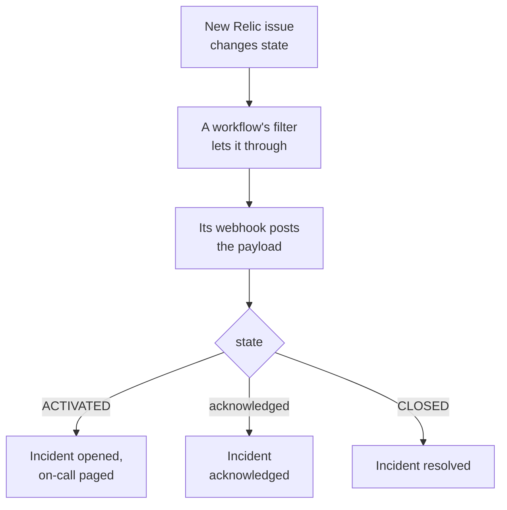

# New Relic

Send [New Relic](https://newrelic.com) issues to OneUptime, so each issue becomes an incident or an alert that pages your on-call team, is acknowledged when someone acknowledges the issue, and is resolved when the issue closes. New Relic sends its issues through a [webhook destination](https://docs.newrelic.com/docs/alerts/get-notified/notification-integrations/), so there is nothing to install on either side.

:::cards
- [Start from the template](#start-from-the-template): Pick who to page, copy the URL, and see what each issue does.
- [Configure New Relic](#configure-new-relic): A webhook destination, and the workflow that notifies it.
- [Test it](#test-it): Send an issue yourself, then one from New Relic.
- [Troubleshooting](#troubleshooting): When issues do not arrive, or incidents stay open.
:::

## How it works



A New Relic workflow picks the issues to send with its filter, and notifies a webhook destination when one is activated, acknowledged or closed, with a JSON payload New Relic fills in. The issue's ID is how OneUptime finds the incident it opened.

## Before you begin

- A New Relic account where you can create destinations and workflows.
- In OneUptime, the right to create workflows. On OneUptime Cloud, workflows need the **Growth** plan or above.

## Start from the template

Set up OneUptime first: it gives you the URL New Relic sends to. The **Create a workflow** dialog has two New Relic templates, under **New Relic** in its category list: **Declare an incident for each New Relic issue**, and **Create an alert for each New Relic issue** for alerts. Both do the same, each with its own kind of record.

:::steps
1. Go to **Workflows** and click **Create Workflow**. Under **Or start from a template**, choose **New Relic** in the category list, click **Declare an incident for each New Relic issue**, or **Create an alert for each New Relic issue**, and click **Use this template**.
2. Under **Who to page for new New Relic issues**, pick the on-call policies to page, or none to page nobody, and click **Create Workflow**. The workflow opens in the **Builder**, switched off.
3. Click the **Webhook** trigger, then **Copy URL**, and keep the URL for New Relic.
4. Switch **Enabled** on at the top of the **Builder**. A workflow that is off answers New Relic with `400`.
:::

Then [configure New Relic](#configure-new-relic) to send its issues to that URL. The workflow's `read-event-1` step opens with the same setup, for when you come back to it in the **Builder**.

### What the workflow does

After the **Webhook** trigger, the `read-event-1` **Check With JavaScript** step reads the `state` New Relic sends, and **Incident From Another Tool**, or **Alert From Another Tool** in the alert template, does what it means, by the issue's ID. The incident keeps the ID in its custom field `newRelicIssueId`.

| What New Relic sends | What the workflow does |
| --- | --- |
| `state` is `ACTIVATED` or `CREATED` | Declares an incident titled `New Relic: <issue>`, at the severity the issue's priority maps to, kept off your status pages. Its description links the issue in New Relic, and lists the priority, the entities, the policies and the conditions. It pages the on-call policies you picked. The same issue again, such as New Relic raising it to CRITICAL, opens no second incident, and pages nobody again. |
| `state` is `ACTIVATED` and `isAcknowledged` is `true` | Acknowledges the issue's incident, which stops on-call escalating it. Why is on its timeline. |
| `state` is `CLOSED` | Resolves the issue's incident, unless it is resolved already. Why is on its timeline. |

An acknowledgment or a close for an issue with no incident changes nothing. Anything else, such as a request from another tool, is left alone: `read-event-1` takes **No**, and the run's **Steps** say why. Nothing goes back to New Relic: it closes its own issues when the signal recovers, and that is what resolves the incident.

### Priorities and paging

Every new issue pages the on-call policies you picked, whatever its priority: New Relic raises an issue from HIGH to CRITICAL in place, on the same issue, so waiting for CRITICAL would never page for an issue that opened at HIGH and got worse. To page for fewer issues, narrow the filter of the workflow in New Relic: only what passes it reaches OneUptime. In a new project, the priorities map onto these incident and alert severities:

| New Relic priority | Incident | Alert | On-call |
| --- | --- | --- | --- |
| CRITICAL | Critical Incident | High | Paged |
| HIGH | Major Incident | Low | Paged |
| MEDIUM | Minor Incident | Low | Paged |
| LOW | Minor Incident | Low | Paged |

With severities of your own, CRITICAL goes to your most severe, HIGH to the middle one, and MEDIUM and LOW to your least severe. An incident keeps the severity it opened at when New Relic raises its issue.

To map a priority to one of yours by name, edit `SEVERITY_BY_NAME` in the `read-event-1` step, such as `{ HIGH: 'Critical Incident' }`.

## Configure New Relic

:::steps
### Add the webhook destination

In New Relic, go to **Alerts → Destinations** and add a **Webhook** destination. Set **Webhook name** to `OneUptime` and **Endpoint URL** to the URL you copied from OneUptime, and save it. Leave **Use authorization** off: the URL is the only credential.

### Add the workflow

Go to **Alerts → Workflows** and click **Add a workflow**. Name it `OneUptime`. Its filter decides which issues reach OneUptime, such as only CRITICAL ones, or one team's.

### Notify the destination

Add the **Webhook** destination you made to the workflow. Keep the payload New Relic fills in, and add a line for `isAcknowledged` after `state`, so the incident is acknowledged with its issue:

```json
{
  "id": {{ json issueId }},
  "issueUrl": {{ json issuePageUrl }},
  "title": {{ json annotations.title.[0] }},
  "priority": {{ json priority }},
  "impactedEntities": {{ json entitiesData.names }},
  "totalIncidents": {{ json totalIncidents }},
  "state": {{ json state }},
  "isAcknowledged": {{ json isAcknowledged }},
  "trigger": {{ json triggerEvent }},
  "isCorrelated": {{ json isCorrelated }},
  "createdAt": {{ createdAt }},
  "updatedAt": {{ updatedAt }},
  "sources": {{ json accumulations.source }},
  "alertPolicyNames": {{ json accumulations.policyName }},
  "alertConditionNames": {{ json accumulations.conditionName }},
  "workflowName": {{ json workflowName }}
}
```

The line to add is `"isAcknowledged": {{ json isAcknowledged }},`. Then click **Update message**.

### Notify it on activated, acknowledged and closed

Click the three dots on the destination and choose **Notify when**. Keep **Activated**, **Acknowledged** and **Closed** on.

### Activate the workflow

Click **Activate workflow**.
:::

The OneUptime workflow reads these fields of the payload, and leaves the others alone:

| Field | What New Relic puts in it |
| --- | --- |
| `id` | The ID of the issue. |
| `issueUrl` | A link to the issue in New Relic. |
| `title` | The title of the issue. |
| `priority` | How urgent the issue is: `CRITICAL`, `HIGH`, `MEDIUM` or `LOW`. |
| `state` | Where the issue stands: `CREATED`, `ACTIVATED` or `CLOSED`. |
| `isAcknowledged` | `true` once someone acknowledges the issue in New Relic. |
| `impactedEntities` | The names of the entities the issue is about. |
| `alertPolicyNames` | The names of the policies behind the issue. |
| `alertConditionNames` | The names of the conditions behind the issue. |

## Test it

Send an issue to the URL you copied, as New Relic would:

```bash
curl -X POST "<url>" \
  -H "Content-Type: application/json" \
  -d '{
    "id": "7d4a2e1c-3b5f-4c8e-9a1d-2f6b8c0e4a71",
    "issueUrl": "https://radar-api.service.newrelic.com/accounts/1234567/issues/7d4a2e1c-3b5f-4c8e-9a1d-2f6b8c0e4a71?notifier=WEBHOOK",
    "title": "High CPU on checkout-service",
    "priority": "CRITICAL",
    "impactedEntities": ["checkout-service"],
    "state": "ACTIVATED",
    "isAcknowledged": false,
    "alertPolicyNames": ["Production"],
    "alertConditionNames": ["CPU above 90%"]
  }'
```

An incident opens, titled `New Relic: High CPU on checkout-service`, and the on-call policies you picked are paged. Send the same request with `isAcknowledged` set to `true`, and the incident is acknowledged. Send it with `state` set to `CLOSED`, and the incident is resolved.

Then test from New Relic: open the workflow's webhook message, and click **Send test notification**. To see that it arrived, open the OneUptime workflow's **Logs → Runs**.

## Troubleshooting

:::details Nothing arrives in OneUptime
- Check that the workflow in New Relic is active, and that its filter lets the issue through.
- Check that the destination's **Endpoint URL** is the URL of the **Webhook** trigger.
- A workflow that is off answers `400`. Switch **Enabled** on at the top of its **Builder**.
:::

:::details The workflow runs, but opens nothing
Open the run in **Logs → Runs**. The `read-event-1` entry in its **Steps** says why it took **No**.

- `New Relic named no issue ID`: keep the line `"id": {{ json issueId }},` in the payload.
- `is in no state`: keep the line `"state": {{ json state }},` in the payload.
:::

:::details Incidents are not acknowledged
- The payload needs the line `"isAcknowledged": {{ json isAcknowledged }},`. Without it, an incident opens and is resolved with its issue, but is never acknowledged.
- The workflow in New Relic needs **Acknowledged** on, under **Notify when**.
:::

:::details Incidents open but are never resolved
- The workflow in New Relic needs **Closed** on, under **Notify when**.
- Open the close's run in **Logs → Runs**: its last step says why. The close's `id` must be the issue's, so keep `"id": {{ json issueId }},` as it is in the payload.
:::

:::details On-call is paged for too many issues
Every new issue that reaches OneUptime pages. Narrow the filter of the workflow in New Relic, so that only the issues that should page reach it. See [Priorities and paging](#priorities-and-paging).
:::

:::details On-call is not paged
- A notification for an issue that has its incident pages nobody again, so a raise to CRITICAL pages nobody.
- With nobody picked in the **Create a workflow** dialog, the workflow has no step that pages.
:::

## Security

- **Treat the URL like a password.** Anyone who has it can open incidents. If it leaks, click **Reset URL** in the workflow's **Webhook** trigger. Then update the destination's **Endpoint URL** in New Relic.
- **Links go to New Relic.** The template links an issue only on a New Relic site, whatever a request says, and writes what New Relic sent as text.
- **Self-hosted?** New Relic sends webhooks from the internet, so your OneUptime must be reachable from it over HTTPS.

## Next steps

:::cards
- [Workflow Templates](/docs/workflows/authoring): Create a workflow from a template, and change it in the Builder.
- [Datadog](/docs/integrations/datadog): The same template, for Datadog monitors.
- [Escalation Rules](/docs/on-call/escalation-rules): Decide who an on-call policy pages, and when.
- [Integrations Overview](/docs/integrations/index): The other tools you can connect.
:::
