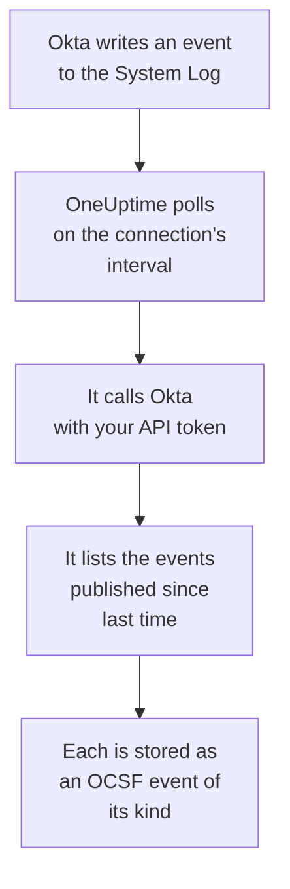

# Okta System Log

Import the [Okta System Log](https://developer.okta.com/docs/reference/system-log-query/) into OneUptime's Security Events: sign-ins, MFA challenges, account and group changes, and Okta's own threat detections. There you search them beside your logs, traces and metrics, correlate them with every other source, and page on-call for the ones that matter. OneUptime reads them with an API token you create, and changes nothing in Okta.

:::cards
- [Set up the connection](#set-up-the-connection): An API token, and the connection's form.
- [What is imported](#what-is-imported): Which events, and how each becomes a security event.
- [How polling works](#how-polling-works): The window each poll reads, and why it overlaps by 15 minutes.
- [Troubleshooting](#troubleshooting): What each error means, and what to change.
:::

## How it works



Every minute, OneUptime polls each enabled connection whose poll interval has passed. A poll asks Okta for the System Log events published since the last poll, and stores each one as an [OCSF](https://schema.ocsf.io/) event: a sign-in as an Authentication event, an account edit as an Account Change, and an Okta detection as a Detection Finding. Detection rules, monitors and dashboards then treat it like a security event from any other source. It works with every Okta cell, `okta.com`, `oktapreview.com` and `okta-emea.com`, and with an org on a custom domain.

## Before you begin

- In OneUptime, the Project Owner, Project Admin or Security Admin role. Security Members and Security Viewers can see connections and their run history, but cannot change them.
- An Okta administrator who can view the System Log, to create the token. A token can do what its administrator can, so use a Read-only Administrator: it reads the System Log and changes nothing. A read-only administrator also sees users, groups, apps and settings, so keep the token as safe as a password.
- Ideally, a service account for that administrator. Okta deactivates a token when its administrator is deactivated, and when it goes 30 days unused. Polling uses it every few minutes, so it stays in use while the connection is enabled.
- If your org only takes API calls from a network zone, a zone that holds the addresses OneUptime calls from: on OneUptime Cloud, its outbound addresses, and on a self-hosted install, the public address of your app and worker hosts.

## Set up the connection

:::steps
### Create an API token

1. Sign in to the Okta **Admin Console** as the read-only administrator.
2. Open **Security → API**, then the **Tokens** tab, and select **Create token**.
3. Name it, for example `OneUptime security events`. Leave **Any IP** under where its calls may come from, unless your org needs a zone.
4. Select **Create token**, and copy the **Token Value**. Okta shows it once.

Each token may use a share of the org's API rate limit, which its row on the **Tokens** tab shows. A poll makes at most 20 requests, so the default share is plenty unless other tools use the same token.

### Add the connection in OneUptime

Open **Products → Security Events → Connections** (`/dashboard/{projectId}/security-events/connections`), click **Add connection**, choose **Okta System Log**, and click **Next**. Fill in the settings in the table below, click **Next**, and paste the token into **API token**.

### Test it before you save

Click **Test these settings** under **Test before saving**. The test signs in and reads events with the values in the form, and stores nothing, so a wrong URL or a bad filter shows up before the connection exists. Then click **Next**, give the connection a **Name**, and create it.
:::

| Setting | What to enter |
| --- | --- |
| **Okta organization URL** | The address your users sign in at, such as `https://acme.okta.com`, `https://acme.oktapreview.com` or `https://login.example.com`. It must use `https`, with no path. Not the Admin Console's `-admin` address, which does not serve the API. |
| **Event filter** | Optional. A [System Log filter](https://developer.okta.com/docs/reference/core-okta-api/#filter) that picks the events to import, such as `eventType sw "user.session" or eventType sw "security"`. Empty imports the families below. At most 2,000 characters, on one line, and not on `published`: OneUptime sets the time range itself. |
| **API token** | The token's value, on its own: OneUptime adds the `SSWS` scheme itself. It is encrypted, never returned by the API and never shown again. Replace it with **Update credentials** on the connection. |

The **Polling** step also has an optional **Description**, the **Poll Interval (Minutes)**, a whole number from `1` to `1440` that starts at `5`, and **Enabled**, which starts on.

## What is imported

With no **Event filter**, OneUptime imports the event families a security team watches, by `eventType` prefix. A filter of your own replaces this list, rather than adding to it:

| Prefix | Events |
| --- | --- |
| `user.session` | Sign-ins and sign-outs, Admin Console access, impersonation |
| `user.authentication` | Authentication results, single sign-on included |
| `user.mfa` | Factor enrollment, challenges and resets |
| `user.account` | Password changes and resets, lockouts, profile and privilege changes |
| `user.lifecycle` | Users created, activated, suspended, deactivated and deleted |
| `security.` | ThreatInsight, suspicious activity reports and Okta's other detections |
| `policy.` | Sign-on policy evaluations, and policy changes |
| `system.api_token` | API tokens created and revoked |
| `application.user_membership` | App assignments |
| `group.user_membership` | Group membership changes |

Each event becomes one OCSF event, with vendor `Okta` and product `Okta System Log`, of the class its `eventType` calls for:

| `eventType` | OCSF class | Activity |
| --- | --- | --- |
| `user.session.start` | Authentication (`3002`) | `Logon` |
| `user.session.end` | Authentication (`3002`) | `Logoff` |
| `user.authentication.*` | Authentication (`3002`) | `Logon` |
| `user.mfa.*` | Authentication (`3002`) | `Authentication Ticket` |
| Other `user.session.*` events | Authentication (`3002`) | `Other` |
| `user.account.*`, `user.lifecycle.*` | Account Change (`3001`) | The last part of the event type, such as `Update Password` |
| `group.*` | Group Management (`3006`) | The last part of the event type, such as `Add` |
| `security.*`, and a `policy.evaluate_sign_on` that denied access | Detection Finding (`2004`) | `Create`, with the event type as the rule name |
| Anything else | `0`, named after the event type | The last part of the event type |

An event without a class of its own keeps every field, and stays searchable by any of them. Its columns:

| Okta field | OneUptime column |
| --- | --- |
| `uuid` | Event UID, which is also what duplicates are dropped by |
| `published`, when the event happened | Event time |
| `displayMessage`, else the event type and `outcome.reason` | Message |
| `severity`: `DEBUG` and `INFO` are Informational, `WARN` Medium, `ERROR` High | Severity |
| `outcome.result`, such as `SUCCESS`, `FAILURE`, `ALLOW` or `DENY` | Status |
| `actor.alternateId`, else `actor.displayName`; `client.ipAddress` | Principal user and IP |
| The `alternateId` of the `User` in `target` | Target user |
| The `alternateId` of the `AppInstance` in `target` | Target resource |
| The actor, every target and the client's IP | Observables |
| The whole event, flattened to dotted keys, such as `client.userAgent.browser` and `debugContext.debugData.requestUri` | `attributes` |

A failed or denied sign-in at `INFO` is raised to Low, so it stands out from a successful one. The System Log carries no MITRE ATT&CK references, so those columns stay empty.

## How polling works

Each poll lists the events published in its window, oldest first, 1,000 to a page, and follows the `next` link Okta sends until the last page:

```text
GET {Okta organization URL}/api/v1/logs?since={window start}&until={window end}&sortOrder=ASCENDING&limit=1000&filter={Event filter}
```

- **Publish time is the cursor.** A System Log event is the activity itself, so `published` is both when it happened and what polling reads.
- **The first poll looks back 24 hours**, so a new connection shows its recent events at once.
- **Every later poll starts 15 minutes before the saved cursor.** Okta warns that a request with an end time may leave out events that are delayed, which it calls rare. The overlap reads them on the next poll. One delayed by more than 15 minutes can fall behind the cursor: import its time range to recover it.
- **A poll reads at most 24 hours past the cursor.** A connection whose cursor fell behind catches up in a row of 24 hour windows, and its **Health** reads **Catching up**.
- **Duplicates are dropped by `uuid`** within the project, so the overlap, a retried window and an import never store an event twice.

A `next` link that points anywhere but your **Okta organization URL** is never followed, since the token goes with every request.

### When a window holds more than one poll can read

A poll reads at most 10,000 events, in at most 20 requests. When a window holds more, the run is **Partial**, with a warning such as:

```text
Stopped after collecting 10000 events; the window holds more. The last event read was published at 2026-09-14T08:12:44.000Z.
```

Events are read oldest first, so OneUptime moves the cursor to the publish time of the last event it read, and the next poll starts there, without the 15 minute overlap, with the same window length. A busy org catches up 10,000 events a poll, instead of reading the same ones again. The overlap comes back once the cursor has moved 15 minutes past that point.

When a run cannot get past the saved cursor at all, for example because the 15 minutes of overlap alone hold more than 10,000 events, OneUptime shortens the window instead:

1. **Narrow.** The next poll reads a window half as long, from the same starting point, and halves again until a window reads completely, down to one minute. The run's warning says so: `This window holds more records than one poll can read; the next poll reads a {n} minute window from the same starting point.`
2. **Grow back.** After a window reads completely, the next one is twice as long again, up to 24 hours.
3. **Move past a single minute.** If even one minute holds more than a poll can read, polling moves past it, so newer events keep arriving, and later polls' overlap no longer reaches back into it. The run stays **Partial**, and **Last Error** reads `More records were created in the one minute from {cursor} to {end} than one poll can read. Polling moved past this minute so newer records keep arriving; use Import this time range in Diagnostics on this minute to recover what one run can read.` Import that minute with **Import this time range** to recover what one run can read, or narrow the **Event filter**.

A run that fails outright, with an error from Okta, keeps the cursor and the window length, and the next poll reads the same window again. The one exception is a request that timed out: the cursor stays, but the next window is half as long, since a window too heavy to answer in time would time out on every try. Changing the **Poll Interval (Minutes)** changes none of this: it decides how often a poll starts, not where its window begins.

### Run, preview and import on demand

Click **Diagnostics** on a connection to see its recent runs and to work with it by hand. Anyone who can change the connection can start these; everyone who can see it can read the history.

- **Run now** starts a poll at once, with the usual cursor, even while the connection is not **Enabled**.
- **Preview log events** reads a time range of up to 7 days and imports nothing.
- **Import this time range** imports a range of up to 7 days, after you confirm, without moving the cursor. Events already imported are skipped. Okta keeps 90 days of System Log.
- **Copy diagnostics** on a run copies its report for support. It never includes credentials.

## Test connection

**Test connection** on a connection's row, and **Test these settings** in the form, run in the API process, not in a background worker, so a test still answers when the workers are the problem. It runs these checks, in order:

| Check | What it checks |
| --- | --- |
| **Configuration** | Every setting is present and well formed. Nothing is contacted when this fails. |
| **Authenticate with Okta** | Okta accepts the token for the System Log, with one event read and no filter. |
| **Read System Log events** | One event from the last 24 hours can be read through the filter polling uses, yours or the default, so a bad **Event filter** fails here rather than on the first poll. |
| **Events available to import** | How many events were published in the last 24 hours and the last 7 days, one page of 1,000 each, so `1000+` means more. None in 7 days is a warning, not a failure. |
| **Background workers**, **Poll scheduler**, **Security event storage** | OneUptime's own side: a process takes the Worker queue's jobs, the poll job runs every minute, and the store of security events answers. |
| **Scheduled polling** | For a saved connection: polling is on, no run is stuck waiting for a worker, and polls run on time. |

Every request in a test has a 20 second deadline. A test never imports anything or moves the cursor, and each failed check says what to change.

## Troubleshooting

The connection's **Last Error** keeps the complete error message, with credentials redacted, behind a prefix that names the step that failed. When a connection has an error, select **View Error** in its **Actions** column to read it, and **Copy Error** in the dialog to copy it. Every message starts with `Okta System Log events request`, and quotes Okta's own error code after the status; read what follows it.

:::details Last Error says `failed (HTTP 400)`
Okta refused the request's parameters, `E0000053`. When the token worked, this is almost always the **Event filter**: check its operators, `eq`, `ne`, `co`, `sw`, `ew`, `pr`, `gt`, `ge`, `lt` and `le`, its `and` and `or`, and the double quotes around its values, or clear it to use the default families. On an import, it can also mean the range starts more than 180 days ago.
:::

:::details Last Error says `failed (HTTP 401)` or `failed (HTTP 403)`
- `HTTP 401`: Okta did not accept the token, `E0000011`. It was revoked, went 30 days unused, or was deactivated with its administrator; or it was pasted with `SSWS` or a stray character. Create a new token as a read-only administrator, and save it with **Update credentials**.
- `HTTP 403`: the token signs in, but its administrator cannot read the System Log, `E0000006`. Create it as a Read-only Administrator or a Super Administrator, and check that its network zone allows the addresses OneUptime calls from.
:::

:::details Last Error says `failed (HTTP ...)` with another status
- `HTTP 404`: the URL does not serve Okta's API. Use the org's own address, such as `https://acme.okta.com`, with no path and not the `-admin` one.
- `HTTP 3xx`: Okta redirected the request, and redirects are refused, since the token goes with every request. Use the org's own address.
- `HTTP 429`: Okta is limiting the token, `E0000047`. The next poll tries again. If it keeps happening, raise the token's share of the rate limit on the **Tokens** tab, give OneUptime a token of its own, or poll less often.
- `HTTP 5xx`: Okta failed, or the query ran past Okta's 30 second limit, `E0000009`. The next poll tries again; if it keeps happening, check [status.okta.com](https://status.okta.com).
:::

:::details Last Error says `returned` or `did not complete`
- `returned a non-JSON body.` or `returned an unrecognized response shape`: something other than Okta's API answered, such as a sign-in page or a proxy, or Okta answered with an error. This is reported rather than taken as an empty window, so the cursor never moves past events nobody read.
- `returned a next link outside the Okta organization URL`: a `next` link pointed somewhere else, and was not followed. Okta itself never does this: look for a proxy that rewrites headers.
- `did not complete`: the request got no answer: a timeout, a name that does not resolve, a certificate OneUptime does not trust, or a refused address. Check that the OneUptime app and workers can reach your org over HTTPS, through any proxy you use.
:::

:::details Last Polled is Never and Last Error is empty
No poll has finished for this connection. Run **Test connection**: its **Background workers** and **Poll scheduler** checks name the cause. On a self-hosted install, the usual cause is `DISABLE_QUEUE_WORKERS=true` on the app, with no separate worker deployment taking the jobs: set it to `false`, or run the worker deployment (Helm: `worker.enabled: true`).
:::

:::details A run is Partial
- `Stopped after collecting 10000 events`: the window held more than the 10,000 events one run reads. Nothing is lost: the next poll starts after the last event read. A connection that stays **Partial** poll after poll is catching up on a backlog, and its **Last Polled** and **Last Event Imported** keep moving. If it never catches up, the org publishes more matching events than a poll interval can hold: narrow the **Event filter**, or shorten the **Poll Interval (Minutes)**.
- `More records were created in the one minute from ... than one poll can read`: polling moved past that minute. Import it with **Import this time range** in **Diagnostics**. An import reads as much as one poll.
:::

:::details The test passes, but nothing is imported
Read **Events available to import** in the test's report. With the default filter, an org with any users publishes sign-ins all the time, so `0` in the last 7 days means the URL is a sandbox or an unused org. With your own **Event filter**, it means the filter matched nothing: compare it with the event types in the Admin Console's System Log.
:::

## What you get

- **Search.** Filter sign-ins, MFA results, account changes and Okta detections by severity, status, user, IP or any observable in the Security Events explorer, beside every other source.
- **Correlation.** Every event's users, apps and IPs are indexed as observables, so one search finds everything one user did, next to their app's own logs.
- **Detection rules.** Sigma rules that run on a schedule over your security events, such as failed sign-ins per IP or MFA denials per user, and open alerts that page on-call.
- **Monitors.** Security Events monitors count matching events and open incidents or alerts past a threshold.

Security events are billed like the rest of your telemetry, per GB ingested. See [Pricing](https://oneuptime.com/pricing).

## Next steps

:::cards
- [Security Events](/docs/telemetry/security-events): Search, correlate and alert on what you import.
- [AWS Security Hub](/docs/integrations/aws-security-hub): Import your cloud's findings too.
- [Roles](/docs/permissions/reference#roles): What the Security roles can see and change.
- [Integrations Overview](/docs/integrations/index): The other tools you can connect.
:::
