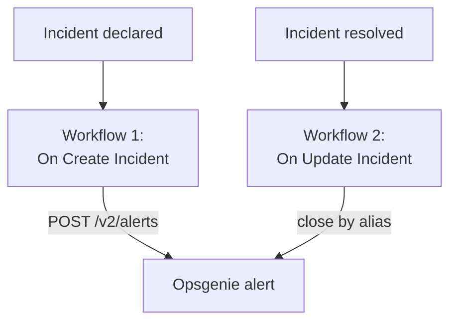

# Opsgenie

Send OneUptime incidents to [Opsgenie](https://www.atlassian.com/software/opsgenie). A workflow creates an Opsgenie alert when a OneUptime incident is declared, and a second one closes it when the OneUptime incident is resolved. Use it while Opsgenie still pages your team and OneUptime watches your systems.

:::cards
- [Store the API key](#store-the-api-key): Keep Opsgenie's key out of your workflows.
- [Create Opsgenie alerts](#create-an-opsgenie-alert-for-every-incident): One workflow, two blocks.
- [Close them](#close-the-opsgenie-alert): A second workflow that follows the incident's state.
- [Troubleshooting](#troubleshooting): When Opsgenie refuses a request.
:::

> [!IMPORTANT]
> Atlassian stopped selling Opsgenie in June 2025 and ends its support in April 2027. OneUptime pages people too, with on-call policies, schedules and escalation rules. To move your team over, see [Moving from Opsgenie](/docs/moving-to-oneuptime/opsgenie): an import brings your users, teams, schedules and escalations across.

## How it works



Both workflows call the [Opsgenie Alert API](https://docs.opsgenie.com/docs/alert-api). The first gives the alert an `alias` made from the OneUptime incident's ID, and the second closes the alert by that alias.

## Before you begin

- An Opsgenie **API** integration, and its **API Key**. Add one under **Settings → Integrations** in Opsgenie, or under a team's **Integrations** to send alerts to that team.
- Your Opsgenie region. Accounts in Europe, which sign in at `app.eu.opsgenie.com`, use `api.eu.opsgenie.com`. All others use `api.opsgenie.com`.
- In OneUptime, the right to create workflows and global variables. On OneUptime Cloud, workflows need the **Growth** plan or above.

## Store the API key

:::steps
1. Go to **Workflows → Global Variables** and click **Create Workflow Variable**.
2. Name it `OPSGENIE_KEY` and click **Next**.
3. Paste the API key into **Content**, turn on **Secret**, and click **Create Workflow Variable**.
:::

A secret variable is replaced with `[REDACTED]` in run logs, so the key never shows in a run.

## Create an Opsgenie alert for every incident

:::steps
### Create the workflow

Go to **Workflows**, click **Create Workflow**, then **Start from scratch**. Name it `Incidents to Opsgenie` and click **Create Workflow**.

### Add the trigger

Click the dashed **Choose what starts this workflow** block and pick **On Create Incident**. Click the trigger, and in **Fields to pass on** pick `title` and `description`.

### Create the alert

Click **Add Component**, add an **API Post (JSON)** block, and connect the trigger's **Success** dot to it. Set its **URL** to `https://api.opsgenie.com/v2/alerts`, or `https://api.eu.opsgenie.com/v2/alerts` in Europe. Under **More fields**, set its **Request Headers** to:

```json
{ "Authorization": "GenieKey {{global.variables.OPSGENIE_KEY}}" }
```

And its **Request Body** to:

```json
{
  "message": "{{local.components.incident-on-create-1.returnValues.model.title}}",
  "alias": "oneuptime-{{local.components.incident-on-create-1.returnValues.model._id}}",
  "description": "{{local.components.incident-on-create-1.returnValues.model.description}}",
  "priority": "P1",
  "source": "OneUptime"
}
```

### Test it, then turn it on

Click **Run Workflow**, pick a test incident under **Incident**, and run it. The **API Post (JSON)** step shows a `202` response, and the alert appears in Opsgenie a moment later. Then switch **Enabled** on at the top of the **Builder**.
:::

Opsgenie's scheme is the word `GenieKey`, a space, then the key. Opsgenie keeps `message` to 130 characters, and its priorities run from `P1` to `P5`: to send each incident's own, see [Map priorities](#map-priorities).

## Close the Opsgenie alert

A workflow has one trigger, so closing takes a second workflow, started when an incident's state changes.

:::steps
### Add the On Update Incident trigger

Create a workflow named `Close Opsgenie alerts`, and pick **On Update Incident** as its trigger. In **Fields to watch**, pick `currentIncidentStateId`, so it runs only when the state changes. In **Fields to pass on**, ask for whether the new state is a resolved one:

```json
{ "_id": true, "currentIncidentState": { "isResolvedState": true } }
```

### Check that the incident is resolved

Add an **If / Else** block after the trigger. Set **Value to check** to `{{local.components.incident-on-update-1.returnValues.model.currentIncidentState.isResolvedState}}` and **Comparison** to **is true**.

### Close the alert

Add an **API Post (JSON)** block after the **Yes** side, with the same **Request Headers**, and this **URL**:

```text
https://api.opsgenie.com/v2/alerts/oneuptime-{{local.components.incident-on-update-1.returnValues.model._id}}/close?identifierType=alias
```

Set its **Request Body** to `{ "source": "OneUptime", "note": "Resolved in OneUptime" }`.

### Turn it on

Switch **Enabled** on, then resolve a test incident in OneUptime. Opsgenie closes its alert.
:::

`identifierType=alias` tells Opsgenie that the address names the alert by its alias, not by its own ID.

## Map priorities

To send each incident's severity as an Opsgenie priority, add a **Run Custom JavaScript** block between the trigger and the **API Post (JSON)** block.

1. In the trigger's **Fields to pass on**, also pick the severity's `name`: `{ "incidentSeverity": { "name": true } }`.
2. Set the block's **Arguments** to `{ "severity": "{{local.components.incident-on-create-1.returnValues.model.incidentSeverity.name}}" }`, and its **JavaScript Code** to:

   ```javascript
   // Your incident severities, by name, to Opsgenie's priorities.
   const PRIORITY = {
     "Critical Incident": "P1",
     "Major Incident": "P2",
     "Minor Incident": "P3",
   };

   return { priority: PRIORITY[args.severity] || "P3" };
   ```

3. In the request body, set `"priority"` to `"{{local.components.javascript-1.returnValues.returnValue.priority}}"`.

The names above are the three severities a new project starts with. Use your own if you renamed them.

## Troubleshooting

:::details Opsgenie answers 401 or 403
The key is wrong, or it belongs to the other region. Check that the header reads `GenieKey`, a space and the key, that the key is an **API** integration's, and that the host matches your region: `api.opsgenie.com` or `api.eu.opsgenie.com`.
:::

:::details Closing answers 404
No alert has that alias. Both workflows must build the alias the same way, `oneuptime-` followed by the incident's `_id`, and the URL must end in `?identifierType=alias`.
:::

:::details The alert never appears, though the step shows 202
Opsgenie answers `202` before it processes the request, so a request it refuses later still shows `202`. Look for the request in Opsgenie's logs to see why it was refused, such as an integration that is turned off.
:::

:::details The workflow never runs
Check that it is on: **Enabled**, at the top of its **Builder**. Then open **Logs → Runs**: a run that took the **No** side of the **If / Else** block is an update that was not a resolve.
:::

## Next steps

:::cards
- [Moving from Opsgenie](/docs/moving-to-oneuptime/opsgenie): Bring your team, schedules and escalations over before Opsgenie ends.
- [Escalation Rules](/docs/on-call/escalation-rules): Page people from OneUptime itself.
- [PagerDuty](/docs/integrations/pagerduty): The same two workflows for PagerDuty.
- [Integrations Overview](/docs/integrations/index): The patterns behind every integration.
:::
