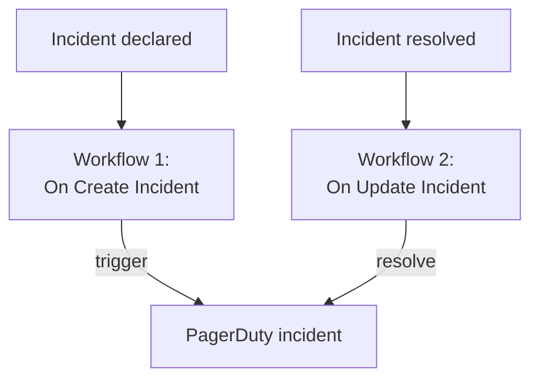

# PagerDuty

Send OneUptime incidents to [PagerDuty](https://www.pagerduty.com). A workflow triggers a PagerDuty incident when a OneUptime incident is declared, and a second one resolves it when the OneUptime incident is resolved. Use it when PagerDuty pages your team and OneUptime watches your systems.

:::cards
- [Store the routing key](#store-the-routing-key): Keep PagerDuty's key out of your workflows.
- [Trigger PagerDuty incidents](#trigger-a-pagerduty-incident-for-every-incident): One workflow, two blocks.
- [Resolve them](#resolve-the-pagerduty-incident): A second workflow that follows the incident's state.
- [Troubleshooting](#troubleshooting): When PagerDuty refuses an event.
:::

> [!TIP]
> OneUptime pages people too, with on-call policies, schedules and escalation rules. To move your team off PagerDuty, see [Moving from PagerDuty](/docs/moving-to-oneuptime/pagerduty): an import brings your users, schedules and escalation policies over.

## How it works



Both workflows call PagerDuty's [Events API v2](https://developer.pagerduty.com/docs/events-api-v2/overview/) with the same `dedup_key`, made from the OneUptime incident's ID. That key is how PagerDuty knows the resolve event closes the incident the trigger event opened.

## Before you begin

- A PagerDuty service with an Events API v2 integration. In PagerDuty, open the service, then **Integrations**, click **Add an integration** and pick **Events API V2**. Copy its **Integration Key**: the Events API calls it the routing key.
- In OneUptime, the right to create workflows and global variables. On OneUptime Cloud, workflows need the **Growth** plan or above.

## Store the routing key

:::steps
1. Go to **Workflows → Global Variables** and click **Create Workflow Variable**.
2. Name it `PAGERDUTY_ROUTING_KEY` and click **Next**.
3. Paste the integration key into **Content**, turn on **Secret**, and click **Create Workflow Variable**.
:::

A secret variable is replaced with `[REDACTED]` in run logs, so the key never shows in a run.

## Trigger a PagerDuty incident for every incident

:::steps
### Create the workflow

Go to **Workflows**, click **Create Workflow**, then **Start from scratch**. Name it `Incidents to PagerDuty` and click **Create Workflow**.

### Add the trigger

Click the dashed **Choose what starts this workflow** block and pick **On Create Incident**. Click the trigger, and in **Fields to pass on** pick `title` and `description`.

### Send the trigger event

Click **Add Component**, add an **API Post (JSON)** block, and connect the trigger's **Success** dot to it. Set its **URL** to `https://events.pagerduty.com/v2/enqueue`, and its **Request Body** to:

```json
{
  "routing_key": "{{global.variables.PAGERDUTY_ROUTING_KEY}}",
  "event_action": "trigger",
  "dedup_key": "oneuptime-{{local.components.incident-on-create-1.returnValues.model._id}}",
  "payload": {
    "summary": "{{local.components.incident-on-create-1.returnValues.model.title}}",
    "source": "OneUptime",
    "severity": "critical",
    "custom_details": {
      "description": "{{local.components.incident-on-create-1.returnValues.model.description}}"
    }
  }
}
```

### Test it, then turn it on

Click **Run Workflow**, pick a test incident under **Incident**, and run it. The **API Post (JSON)** step shows a `202` response with `"status": "success"`, and PagerDuty opens an incident. Then switch **Enabled** on at the top of the **Builder**.
:::

The block sends JSON, so it needs no `Content-Type` header. PagerDuty's `severity` is one of `critical`, `error`, `warning` and `info`: to send each incident's own, see [Map severities](#map-severities).

## Resolve the PagerDuty incident

A workflow has one trigger, so resolving takes a second workflow, started when an incident's state changes.

:::steps
### Add the On Update Incident trigger

Create a workflow named `Resolve PagerDuty incidents`, and pick **On Update Incident** as its trigger. In **Fields to watch**, pick `currentIncidentStateId`, so it runs only when the state changes. In **Fields to pass on**, ask for whether the new state is a resolved one:

```json
{ "_id": true, "currentIncidentState": { "isResolvedState": true } }
```

### Check that the incident is resolved

Add an **If / Else** block after the trigger. Set **Value to check** to `{{local.components.incident-on-update-1.returnValues.model.currentIncidentState.isResolvedState}}` and **Comparison** to **is true**.

### Send the resolve event

Add an **API Post (JSON)** block after the **Yes** side, with the same **URL** and this **Request Body**:

```json
{
  "routing_key": "{{global.variables.PAGERDUTY_ROUTING_KEY}}",
  "event_action": "resolve",
  "dedup_key": "oneuptime-{{local.components.incident-on-update-1.returnValues.model._id}}"
}
```

### Turn it on

Switch **Enabled** on, then resolve a test incident in OneUptime. PagerDuty resolves its incident.
:::

Checking `isResolvedState` rather than a state's name keeps working when you rename your states. See [Incident States & Severities](/docs/incidents/states-and-severities).

## Map severities

To send each incident's severity, add a **Run Custom JavaScript** block between the trigger and the **API Post (JSON)** block, and read its answer in the body.

1. In the trigger's **Fields to pass on**, also pick the severity's `name`: `{ "incidentSeverity": { "name": true } }`.
2. Set the block's **Arguments** to `{ "severity": "{{local.components.incident-on-create-1.returnValues.model.incidentSeverity.name}}" }`, and its **JavaScript Code** to:

   ```javascript
   // Your incident severities, by name, to PagerDuty's.
   const SEVERITY = {
     "Critical Incident": "critical",
     "Major Incident": "error",
     "Minor Incident": "warning",
   };

   return { severity: SEVERITY[args.severity] || "info" };
   ```

3. In the request body, set `"severity"` to `"{{local.components.javascript-1.returnValues.returnValue.severity}}"`.

The names above are the three severities a new project starts with. Use your own if you renamed them.

## Troubleshooting

:::details PagerDuty answers 400
The response body says what PagerDuty refused, and the run's **API Post (JSON)** step shows it. Usually the routing key is not an Events API v2 integration key: copy it again from the service's **Integrations**. An event without a `summary`, a `source` or a `severity` is refused too.
:::

:::details The resolve event does not close anything
Both events must carry exactly the same `dedup_key`. Check that both bodies build it as `oneuptime-` followed by the incident's `_id`, and that the resolve workflow is on.
:::

:::details The workflow never runs
Check that it is on: **Enabled**, at the top of its **Builder**. Then open **Logs → Runs**: a run that took the **No** side of the **If / Else** block is an update that was not a resolve.
:::

:::details PagerDuty shows a reference instead of a value
A reference that does not resolve is sent as written, braces and all. Check the block's identifier, the field name, and the variable's name, which is case-sensitive. On the run's **Steps** tab, a setting with such a reference is marked **Did not resolve**.
:::

## Next steps

:::cards
- [Moving from PagerDuty](/docs/moving-to-oneuptime/pagerduty): Bring your team, schedules and escalation policies over.
- [Escalation Rules](/docs/on-call/escalation-rules): Page people from OneUptime itself.
- [Opsgenie](/docs/integrations/opsgenie): The same two workflows for Opsgenie.
- [Integrations Overview](/docs/integrations/index): The patterns behind every integration.
:::
