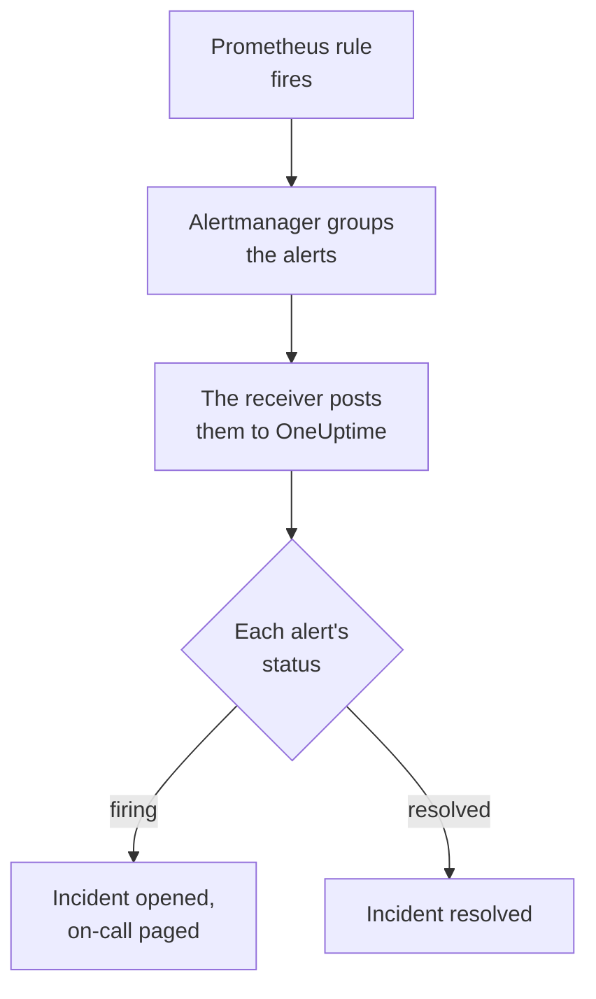

# Prometheus Alertmanager

Send [Prometheus Alertmanager](https://prometheus.io/docs/alerting/latest/alertmanager/) alerts to OneUptime, so each firing alert becomes an incident that pages your on-call team, and is resolved when the alert recovers. Alertmanager posts its notifications to a webhook receiver, so there is nothing to install on either side.

:::cards
- [Choose how OneUptime receives alerts](#choose-how-oneuptime-receives-alerts): An Incoming Request monitor, or a workflow of your own.
- [Receive alerts with a monitor](#receive-alerts-with-a-monitor): One incident per alert, resolved on recovery.
- [Configure Alertmanager](#configure-alertmanager): A webhook receiver, and the route that uses it.
- [Troubleshooting](#troubleshooting): When alerts do not arrive, or incidents stay open.
:::

## How it works



Prometheus evaluates your alerting rules and sends the alerts that fire to Alertmanager. Alertmanager groups them by the labels in your route's `group_by`, and posts each group to the webhook receiver as one JSON notification. The notification's `alerts` list holds every alert of the group, each with its own `status`, `firing` or `resolved`, its labels and annotations, and a `fingerprint` that identifies it.

## Before you begin

- An Alertmanager whose `alertmanager.yml` you can edit, and that can reach your OneUptime over HTTPS.
- In OneUptime, the right to create monitors, or workflows if you take that way.

## Choose how OneUptime receives alerts

Set up OneUptime first: it gives you the URL Alertmanager sends to.

| Way | Use it when |
| --- | --- |
| An Incoming Request monitor (recommended) | You want every alert to be an incident that pages on-call, and is resolved when the alert recovers. There is nothing to build. |
| A workflow with a Webhook trigger | You need logic of your own: filter alerts, reshape them, or call other systems first. A workflow opens one incident per notification, not per alert, and does not resolve it on recovery. |

Both get the same JSON from the same receiver, so you can start with one and switch later by changing one URL in `alertmanager.yml`.

## Receive alerts with a monitor

An [Incoming Request monitor](/docs/monitor/incoming-request-monitor) gives you a URL, and its criteria decide what each notification does.

:::steps
### Create the monitor

Go to **Monitors** and click **Create Monitor**. Pick **Incoming Request** under **Monitor Type**, name it `Alertmanager`, and click **Next**.

### Declare an incident for each firing alert

On the **Criteria** step, open the first criteria, the one that marks the monitor offline. Set its filter to **Request Body**, **Contains**, `"status":"firing"`. This criteria already declares an incident when its filter matches. Fill the incident in:

- **Incident Title**: `{{requestBody.commonLabels.alertname}} on {{requestBody.commonLabels.instance}}`.
- **Severity**: the incident severity these alerts should have.
- **On-Call Policies**, under **On-Call**: the policies to page.
- **Auto Resolve Incident**, under **More fields**: leave it on, as it starts. Without it, recoveries are ignored and incidents stay open.

### Open one incident per alert

In the same criteria, open **Settings** and turn on **Group incidents and alerts by a payload field**. Fill it in as below, so each alert gets its own incident, and its recovery resolves it:

| Field | Value |
| --- | --- |
| **Open a separate incident for each…** | `requestBody.alerts[*].fingerprint` |
| **Field that signals recovery** | `requestBody.alerts[*].status` |
| **Value that means recovered** | `resolved` |

### Bring the monitor back online

Open the second criteria, the one that marks the monitor online, and set its filter to **Request Body**, **Contains**, `"status":"resolved"`.

### Copy the URL

Click **Create Monitor**. The monitor's **Overview** page shows its **Heartbeat URL**. Copy it for Alertmanager:

```text
https://oneuptime.com/heartbeat/<secret key>
```

A self-hosted install has its own host in place of `oneuptime.com`.
:::

`[*]` reads every alert of a notification, so a notification of three alerts can open three incidents, up to **Max incidents per request** of them (`100` unless you change it). Each alert's own `status` decides what happens to its incident: when one alert of a notification is resolved and two still fire, only the resolved alert's incident is closed. See [Receiving alerts from another system](/docs/monitor/incoming-request-monitor#receiving-alerts-from-another-system) for what each setting does.

> [!WARNING]
> Group by a value that differs from alert to alert inside one notification. Alertmanager's `fingerprint` is a hash of an alert's whole label set, so it always does. A label in your route's `group_by` never does: it is what puts the alerts in one notification. Grouping by `requestBody.alerts[*].labels.alertname` with the route below folds every alert of a notification into one incident, which takes the first alert's status.

## Name the incidents

The title above reads labels every alert of the notification shares: `commonLabels` holds those labels, and `commonAnnotations` the annotations they share. With the route below, which groups by `alertname` and `instance`, both are there. Under **Description**, give the incident an **Incident Description** such as:

```text
{{requestBody.commonAnnotations.summary}}

{{requestBody.commonAnnotations.description}}
Severity: {{requestBody.commonLabels.severity}}
Alertmanager: {{requestBody.externalURL}}
```

- The grouping key is a variable too, named after the last segment of its path: `{{fingerprint}}`. It is a hash, so it tells a responder nothing.
- `{{requestBody.alerts[0].annotations.summary}}` reads the first alert of the notification, which is not always the alert the incident was opened for.
- A reference to a field the notification does not have is left as written, braces and all, rather than being emptied.

See [Incident & Alert Dynamic Templating](/docs/monitor/incident-alert-templating) for every variable you can use.

## Configure Alertmanager

:::steps
### Add a webhook receiver

In `alertmanager.yml`, add a receiver that posts to the URL you copied, and make it the route's receiver:

```yaml title="alertmanager.yml"
route:
  receiver: oneuptime
  group_by: ["alertname", "instance"]

receivers:
  - name: oneuptime
    webhook_configs:
      - url: "https://oneuptime.com/heartbeat/<secret key>"
        send_resolved: true
```

`send_resolved: true` is Alertmanager's default, written out so it stays on: without it, OneUptime is never told that an alert recovered. Alertmanager sends `Content-Type: application/json`, which the monitor needs to read the fields of a notification.

### Reload Alertmanager

Reload the configuration, or restart Alertmanager:

```bash
curl -X POST http://localhost:9093/-/reload
```
:::

The route keeps Alertmanager's timing defaults. It waits `30s` before it sends a new group (`group_wait`), `5m` before it sends a group again with new alerts in it (`group_interval`), and `4h` before it repeats a notification that has not changed (`repeat_interval`).

## Test it

Send OneUptime a notification of two firing alerts, as Alertmanager would:

```bash
curl -X POST "https://oneuptime.com/heartbeat/<secret key>" \
  -H "Content-Type: application/json" \
  -d '{
    "version": "4",
    "status": "firing",
    "receiver": "oneuptime",
    "groupLabels": { "alertname": "DiskFull", "instance": "web-1" },
    "commonLabels": { "alertname": "DiskFull", "instance": "web-1", "severity": "critical" },
    "commonAnnotations": { "summary": "Disk almost full on web-1" },
    "externalURL": "http://alertmanager:9093",
    "alerts": [
      {
        "status": "firing",
        "labels": { "alertname": "DiskFull", "instance": "web-1", "severity": "critical", "device": "/dev/sda1" },
        "fingerprint": "a1b2c3d4e5f60001"
      },
      {
        "status": "firing",
        "labels": { "alertname": "DiskFull", "instance": "web-1", "severity": "critical", "device": "/dev/sdb1" },
        "fingerprint": "a1b2c3d4e5f60002"
      }
    ]
  }'
```

Two incidents open, one per `fingerprint`, each titled `DiskFull on web-1`. Send the same request with every `status` set to `resolved`, and both are resolved.

To test the whole path from Alertmanager, fire an alert with `amtool`. Alertmanager sends it after `group_wait`, and sends its recovery when the alert expires a few minutes later:

```bash
amtool alert add test_alert severity=warning \
  --annotation=summary="Test from Alertmanager" \
  --alertmanager.url=http://localhost:9093
```

## Receive alerts with a workflow

Use a [workflow](/docs/workflows/index) when you need steps of your own between Alertmanager and the incident.

:::steps
### Create the workflow

Go to **Workflows**, click **Create Workflow**, then **Start from scratch**. Name it `Alertmanager alerts` and click **Create Workflow**.

### Add the Webhook trigger

Click the dashed **Choose what starts this workflow** block and pick **Webhook**. Click the trigger, then **Copy URL**, and use that URL in the receiver in `alertmanager.yml`.

### Check that the notification fires

Click **Add Component**, add an **If / Else** block, and connect the trigger's **Out** dot to it. Set **Value to check** to `{{local.components.webhook-1.returnValues.request-body.status}}`, **Comparison** to **is equal to**, and **Compare with** to `firing`.

### Declare the incident

Add a **Create One Incident** block, and connect the **Yes** side of the **If / Else** block to it. In **Incident Template**, pick a template that sets the severity and the on-call policies to page (see [Incident templates](/docs/incidents/settings#incident-templates)). In **JSON Object**, set what comes from Alertmanager:

```json
{
  "title": "{{local.components.webhook-1.returnValues.request-body.commonLabels.alertname}}",
  "description": "{{local.components.webhook-1.returnValues.request-body.commonAnnotations.summary}}\nAlertmanager: {{local.components.webhook-1.returnValues.request-body.externalURL}}"
}
```

Without a template, **JSON Object** also needs `incidentSeverityId`, the ID of one of the project's incident severities.

### Turn the workflow on

Switch **Enabled** on at the top of the **Builder**. A workflow that is off answers Alertmanager with `400`.
:::

A run handles one notification, so it declares one incident however many alerts the notification holds. A notification that is `resolved` takes the **No** side of the **If / Else** block, where nothing is connected, so the run ends there. For one incident per alert, resolved on recovery, use the monitor.

## Watch Alertmanager itself

Neither way notices when Prometheus or Alertmanager stops working: no alerts arriving looks exactly like nothing being wrong. So route an alert that always fires to a second monitor, which declares an incident when that alert stops arriving. [kube-prometheus-stack](https://github.com/prometheus-community/helm-charts/tree/main/charts/kube-prometheus-stack) ships such an alert, called `Watchdog`. On a plain Prometheus, add an alerting rule named `Watchdog` whose expression is always true, such as `vector(1)`.

:::steps
### Create the watchdog monitor

Create a second Incoming Request monitor, named `Alertmanager watchdog`. Set the filter of its first criteria, the one that marks the monitor offline, to **Incoming Request**, **Not Recieved In Minutes**, `10`, and the filter of its second criteria to **Incoming Request**, **Recieved In Minutes**, `10`. The dashboard spells both this way. Copy the new monitor's **Heartbeat URL**.

### Route the watchdog alert to it

Add a receiver for the watchdog monitor's URL, and a route that sends `Watchdog` to it every five minutes. A child route is matched before its parent's receiver, so `Watchdog` goes to the watchdog monitor and every other alert still goes to the first one:

```yaml title="alertmanager.yml"
route:
  receiver: oneuptime
  group_by: ["alertname", "instance"]
  routes:
    - receiver: oneuptime-watchdog
      matchers:
        - alertname = "Watchdog"
      group_wait: 0s
      group_interval: 5m
      repeat_interval: 5m

receivers:
  - name: oneuptime
    webhook_configs:
      - url: "https://oneuptime.com/heartbeat/<secret key>"
        send_resolved: true
  - name: oneuptime-watchdog
    webhook_configs:
      - url: "https://oneuptime.com/heartbeat/<watchdog secret key>"
```
:::

When the watchdog alert has not arrived for ten minutes, the watchdog monitor goes offline and declares an incident. The next watchdog notification brings the monitor back online and resolves the incident.

## Troubleshooting

:::details Nothing arrives in OneUptime
- Check Alertmanager's log for errors delivering to the receiver.
- The monitor answers `200` at once, before it checks anything, even for a wrong secret key. Check the monitor's timeline to see whether notifications land.
- A workflow that is off answers `400`. Switch **Enabled** on at the top of its **Builder**.
:::

:::details Incidents open but are never resolved
- Check that no receiver sets `send_resolved: false`: Alertmanager then never sends a recovery.
- The criteria's incident needs **Auto Resolve Incident**, under **More fields**.
- **Field that signals recovery** must be `requestBody.alerts[*].status`, and **Value that means recovered** exactly `resolved`. The comparison is case-sensitive.
- The alerts of a notification past **Max incidents per request** are not read at all, so their recoveries are missed too.
- A recovery skipped in a burst (see below) leaves its incident open for good: Alertmanager repeats firing alerts, but never a recovery. Resolve such an incident by hand.
:::

:::details No incident opens at all
The grouping paths must start with `requestBody.`, and only the first `[*]` of a path reads a list. A path that breaks either rule matches nothing, without an error.
:::

:::details One incident for a notification full of alerts
You grouped by a label that is the same for every alert of a notification, most often one in your route's `group_by`. Group by `requestBody.alerts[*].fingerprint` instead.
:::

:::details The incident shows a reference instead of a value
A reference to a field the notification does not have is left as written, braces and all. Different rules set different annotations, so use the fields your rules set: in `commonAnnotations`, or in each alert's `annotations`.
:::

:::details Too many incidents
Group your route by fewer labels, or raise `group_interval`, so Alertmanager sends related alerts together. Lowering **Max incidents per request** caps the incidents of one notification, but the alerts past the cap are not read, so their recoveries are missed too.
:::

:::details Some notifications are skipped in a burst
When a newer request reaches a monitor before an earlier one is evaluated, OneUptime evaluates only the newer one, so that one sender cannot overwhelm a monitor. The last notification of a burst is always evaluated, but an earlier one about other alerts can be skipped, because Alertmanager sends every group to the same URL. Raise `group_wait` and `group_interval` to space notifications out. On a self-hosted install, set `INCOMING_REQUEST_INGEST_COALESCE_ENABLED=false` in the OneUptime app's environment to evaluate every request.
:::

## Security

- **Treat the URL like a password.** Anyone who has it can open incidents. If it leaks, reset it: **Reset Incoming Request Secret Key** on the monitor's **Settings** page, or **Reset URL** in the workflow's **Webhook** trigger. Then update the receiver's `url` in `alertmanager.yml`.
- **Self-hosted?** Let Alertmanager reach your OneUptime over HTTPS through your firewall.

## Next steps

:::cards
- [Incoming Request Monitor](/docs/monitor/incoming-request-monitor): Every setting of the monitor that receives your alerts.
- [Grafana](/docs/integrations/grafana): The same setup, for Grafana alerting.
- [Escalation Rules](/docs/on-call/escalation-rules): Decide who an on-call policy pages, and when.
- [Integrations Overview](/docs/integrations/index): The other tools you can connect.
:::
