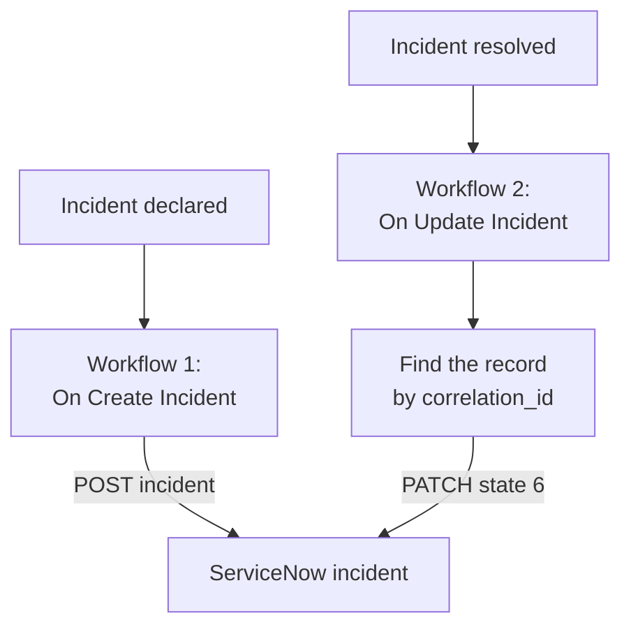

# ServiceNow

Open a [ServiceNow](https://www.servicenow.com) incident for every OneUptime incident, and resolve it when the OneUptime incident is resolved, so your service desk follows what your monitoring sees. Two workflows call ServiceNow's [Table API](https://developer.servicenow.com/dev.do#!/reference/api/latest/rest/c_TableAPI).

:::cards
- [Store the credentials](#store-the-credentials): Keep the ServiceNow password out of your workflows.
- [Open ServiceNow incidents](#open-a-servicenow-incident-for-every-incident): One workflow, two blocks.
- [Resolve them](#resolve-the-servicenow-incident): Find the record, then close it.
- [Troubleshooting](#troubleshooting): When ServiceNow refuses a request.
:::

## How it works



The first workflow writes the OneUptime incident's ID into the record's `correlation_id`. The second looks the record up by it, then resolves the record.

## Before you begin

- A ServiceNow instance, such as `https://your-instance.service-now.com`.
- A ServiceNow user for the integration that can create and update records in the `incident` table, usually with the `itil` role. Its name and password sign the requests.
- In OneUptime, the right to create workflows and global variables. On OneUptime Cloud, workflows need the **Growth** plan or above.

## Store the credentials

The Table API takes Basic auth: the user's name and password, encoded together.

:::steps
1. Encode them once, on macOS or Linux:

   ```bash
   printf '%s' 'integration.user:password' | base64 | tr -d '\n'
   ```

   Use `printf`, not `echo`: `echo` adds a newline, which is encoded with the rest and breaks the credentials.

2. In OneUptime, go to **Workflows → Global Variables** and click **Create Workflow Variable**. Name it `SERVICENOW_AUTH` and click **Next**.
3. Paste the encoded value into **Content**, turn on **Secret**, and click **Create Workflow Variable**.
:::

## Open a ServiceNow incident for every incident

:::steps
### Create the workflow

Go to **Workflows**, click **Create Workflow**, then **Start from scratch**. Name it `Incidents to ServiceNow` and click **Create Workflow**.

### Add the trigger

Click the dashed **Choose what starts this workflow** block and pick **On Create Incident**. Click the trigger: its **Fields to pass on** starts with **Title**, so click **Add field** and pick **Description**.

### Create the record

Click **Add Component**, add an **API Post (JSON)** block, and connect the trigger's **Success** dot to it. Set its **URL** to `https://your-instance.service-now.com/api/now/table/incident`. Under **More fields**, set its **Request Headers** to:

```json
{
  "Authorization": "Basic {{global.variables.SERVICENOW_AUTH}}",
  "Accept": "application/json"
}
```

And its **Request Body** to:

```json
{
  "short_description": "OneUptime: {{local.components.incident-on-create-1.returnValues.model.title}}",
  "description": "{{local.components.incident-on-create-1.returnValues.model.description}}",
  "urgency": "1",
  "impact": "1",
  "correlation_id": "oneuptime-{{local.components.incident-on-create-1.returnValues.model._id}}"
}
```

### Test it, then turn it on

Click **Run Workflow**, pick a test incident under **Incident**, and run it. The **API Post (JSON)** step shows a `201` response holding the new record, with its `sys_id` and its `number`, such as `INC0012345`. Then switch **Enabled** on at the top of the **Builder**.
:::

`urgency` and `impact` take `1` for high, `2` for medium and `3` for low, and ServiceNow works out the priority from the two. Any other column of the `incident` table can go in the body, under its column name.

## Resolve the ServiceNow incident

A workflow has one trigger, so resolving takes a second workflow, started when an incident's state changes.

:::steps
### Add the On Update Incident trigger

Create a workflow named `Resolve ServiceNow incidents`, and pick **On Update Incident** as its trigger. In **Fields to watch**, click **Add field** and pick **Current Incident State**, so it runs only when the state changes. In **Fields to pass on**, ask for whether the new state is a resolved one: click **Add field**, open **Current Incident State** and pick **Is Resolved State**. Or click **Edit as JSON** and replace the JSON with:

```json
{ "_id": true, "currentIncidentState": { "isResolvedState": true } }
```

### Check that the incident is resolved

Add an **If / Else** block after the trigger. Set **Value to check** to `{{local.components.incident-on-update-1.returnValues.model.currentIncidentState.isResolvedState}}` and **Comparison** to **is true**.

### Find the record

Add an **API Get (JSON)** block after the **Yes** side, with the same **Request Headers**, and this **URL**:

```text
https://your-instance.service-now.com/api/now/table/incident?sysparm_query=correlation_id=oneuptime-{{local.components.incident-on-update-1.returnValues.model._id}}&sysparm_fields=sys_id&sysparm_limit=1
```

### Resolve the record

Add an **API Patch (JSON)** block after the find block's **Success**, with the same **Request Headers**, and this **URL**:

```text
https://your-instance.service-now.com/api/now/table/incident/{{local.components.api-get-1.returnValues.response-body.result[0].sys_id}}
```

Set its **Request Body** to:

```json
{
  "state": "6",
  "close_code": "Solution provided",
  "close_notes": "Resolved in OneUptime"
}
```

### Turn it on

Switch **Enabled** on, then resolve a test incident in OneUptime. Its ServiceNow incident moves to Resolved.
:::

`state` `6` is Resolved in ServiceNow's default incident states. `close_code` must be one of your instance's resolution codes. Many instances will not resolve an incident without a resolution code and notes, so send both.

## Troubleshooting

:::details ServiceNow answers 401
The credentials are wrong. Encode `username:password` again with `printf`, not `echo`, and replace the content of `SERVICENOW_AUTH`.
:::

:::details ServiceNow answers 403
The user cannot write to the `incident` table. Give it the `itil` role, or a role with the same rights, and check that no access control rule blocks the Table API for it.
:::

:::details ServiceNow answers 400, or resolving changes nothing
A column name or a value does not fit your instance: a customized `state` list, or a `close_code` your instance does not have. Compare with the `incident` table under **System Definition → Tables** in ServiceNow, and with the record's own form.
:::

:::details Resolving answers 404
The find step found no record, so the URL kept the reference as written. Check that the first workflow wrote `correlation_id`, and that both workflows build it the same way: `oneuptime-` followed by the incident's `_id`.
:::

## Next steps

:::cards
- [Jira](/docs/integrations/jira): A two-way integration, kept in step by ready-made templates.
- [Workflow Components](/docs/workflows/components#api): Every setting of the API blocks.
- [Workflow Runs](/docs/workflows/runs-and-logs): Read what each request sent and got back.
- [Integrations Overview](/docs/integrations/index): The patterns behind every integration.
:::
