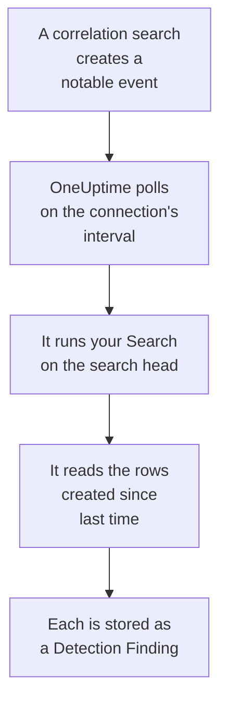

# Splunk Enterprise Security

Import the notable events your [Splunk Enterprise Security](https://www.splunk.com/en_us/products/enterprise-security.html) correlation searches create into OneUptime's Security Events. There you search them beside your logs, traces and metrics, correlate them with every other source, and page on-call for the ones that matter. OneUptime reads them by running a search on your search head, as a Splunk user you create, and changes nothing in Splunk. Since it is only a search, it imports any index or saved search output, not just notable events.

:::cards
- [Set up the connection](#set-up-the-connection): A token, a role, and the connection's form.
- [What is imported](#what-is-imported): How each row of the search becomes a security event.
- [How polling works](#how-polling-works): The window each poll reads, and what a busy search head does to it.
- [Troubleshooting](#troubleshooting): What each error means, and what to change.
:::

## How it works



Every minute, OneUptime polls each enabled connection whose poll interval has passed. A poll runs your search through the search head's REST API, over the rows created since the last poll, and stores each row as an [OCSF](https://schema.ocsf.io/) Detection Finding event (class `2004`). Detection rules, monitors and dashboards then treat it like a security event from any other source.

## Before you begin

- In OneUptime, the Project Owner, Project Admin or Security Admin role. Security Members and Security Viewers can see connections and their run history, but cannot change them.
- A search head running Splunk Enterprise 9.0.1 or later, or Splunk Cloud Platform. OneUptime talks to its REST API on the management port, usually `8089`. Splunk Web, on port `8000`, does not serve the REST API.
- A Splunk user for OneUptime, whose role has the `search` capability and can read the index the search reads: `notable` for notable events. The Enterprise Security roles `ess_analyst` and `ess_user` grant both. The connection only reads, so the role needs nothing else.
- A search head OneUptime can reach over HTTPS. OneUptime Cloud connects from the internet, so the search head needs a public address: private addresses are refused. A self-hosted OneUptime connects from its app and worker containers, and can reach a search head on your private network unless `DATA_SOURCE_BLOCK_PRIVATE_ADDRESSES` is `true`.

## Set up the connection

The connection signs in with a Splunk authentication token, or with a username and a password.

:::steps
### Create an authentication token

1. In Splunk Web, open **Settings → Tokens**. If Splunk says token authentication is disabled, select **Enable Token Authentication** first.
2. Select **New Token**. In **User**, enter the Splunk user you made for OneUptime, and in **Audience**, write what the token is for, such as `OneUptime security events`.
3. Choose an **Expiration**, or none. A token that expires stops the connection until you replace it.
4. Select **Create**, and copy the token. Splunk shows it once.

To sign in with a password instead, skip this step and keep the user's name and password at hand.

### Add the connection in OneUptime

Open **Products → Security Events → Connections** (`/dashboard/{projectId}/security-events/connections`), click **Add connection**, choose **Splunk Enterprise Security**, and click **Next**. Fill in the settings in the table below, click **Next**, and paste the token into **Authentication token**, or the password into **Password**.

### Test it before you save

Click **Test these settings** under **Test before saving**. The test signs in and runs your search with the values in the form, and stores nothing, so a wrong port or a missing role shows up before the connection exists. Then click **Next**, give the connection a **Name**, and create it.
:::

| Setting | What to enter |
| --- | --- |
| **Splunk management URL** | The search head's REST API, such as `https://splunk.example.com:8089`. It must use `https`, with no query string. A path is kept, for a reverse proxy that serves the API under one. |
| **Search** | The search that selects what to import, `index=notable` unless you change it. Narrow it, such as `index=notable urgency IN (high, critical)`. OneUptime adds the time range itself, so the search cannot set `earliest` or `latest`, and it cannot start with a pipe. A leading `search` is dropped. |
| **Username** | The Splunk user's name, only when it signs in with a password. |
| **Authentication token** | The token from the first step. When a token is stored, it is used, and the username and password are not. |
| **Password** | The Splunk user's password, only when no token is used. |

**Authentication token** and **Password** are encrypted, never returned by the API and never shown again. Replace one with **Update credentials** on the connection. To switch from one sign-in to the other, fill in the new one there and turn on **Remove the stored Authentication token**, or **Remove the stored Password**.

The **Polling** step also has an optional **Description**, the **Poll Interval (Minutes)**, a whole number from `1` to `1440` that starts at `5`, and **Enabled**, which starts on.

## What is imported

Each row the search returns becomes one Detection Finding event (OCSF class `2004`), with vendor `Splunk` and product `Splunk Enterprise Security`. For a notable event:

| Splunk field | OneUptime column |
| --- | --- |
| `event_id`, else `_bkt` and `_cd`, else a hash of the row | Event UID, which is also what duplicates are dropped by |
| `_time`, when the correlation search created the notable event | Event time |
| `rule_name`, else `search_name`, else `source` | Rule name |
| `search_name`, else `source`, else `rule_name` | Rule ID |
| `rule_title`, else `rule_description`, else the rule name | Message |
| `urgency`, else `severity` | Severity |
| `status_label`, else `status_description`, else the name of the review status `status` holds | Status |
| `annotations.mitre_attack`, and fields such as `mitre_technique_id` and `mitre_tactic` | MITRE ATT&CK tactics and techniques |
| `user` or `src_user`; `src`, `src_ip` or `src_host`; `process`, `process_name` or `parent_process` | Principal user, IP, host and process |
| `process_name` or `process_exec`, `process_path` and `process`; `parent_process_name` or `parent_process_exec`, `parent_process_path` and `parent_process` | Process name, path and command line; parent process name, path and command line |
| `dest_user`; `dest`, `dest_ip` or `dest_host`; `dest_port` | Target user, IP, host and port |
| `file_path`, `url` or `risk_object` | Target resource |
| Every user, host and IP, and `dvc`, `host`, `file_hash`, `file_name`, `url`, `domain`, `query` and `risk_object` | Observables |
| Every field of the row, such as `security_domain`, `owner`, `orig_sid` and `_raw` | `attributes`, under the field's own name |

A row from another index is imported the same way. The columns its fields do not fill stay empty, and every field is still searchable in `attributes`.

## How polling works

Each poll runs one export search over its window, oldest first:

```text
POST {Splunk management URL}/services/search/v2/jobs/export
    search=search index=notable | fields * | sort 0 _time | head 10001
    earliest_time={window start}
    latest_time={window end}
    output_mode=json
```

- **Creation time is the cursor.** The window is on `_time`, which for a notable event is when the correlation search created it, not when the activity it matched happened. A search that runs hourly stamps its notable events with the time it ran, so none of them falls behind the cursor.
- **The first poll looks back 24 hours**, so a new connection shows its recent notable events at once.
- **Every later poll starts 1 minute before the saved cursor**, so a row created on the boundary between two windows is never skipped.
- **A poll reads at most 24 hours past the cursor.** A connection whose cursor fell behind catches up in a row of 24 hour windows, and its **Health** reads **Catching up**.
- **Duplicates are dropped by `event_id`**, or by Splunk's own `_bkt` and `_cd`, within the project, so the overlap, a retried window and an import never store a row twice.

A search head older than 9.0.1 answers the `search/v2/jobs/export` request with `404`. OneUptime then sends it to the deprecated `search/jobs/export`, and the run says so in a warning. Upgrade the search head: current releases turn that endpoint off.

### When a window holds more than one poll can read

A poll reads at most 10,000 rows. When a window holds more, the run is **Partial**, with a warning such as:

```text
Stopped after collecting 10000 records; the window holds more. Records are read oldest first, and the last one read was created at 2026-09-14T08:12:44.000Z, where the next poll can resume.
```

The search sorts the window by `_time`, oldest first, so OneUptime moves the cursor to the creation time of the last row it read, and the next poll starts there with the same window length. A busy search head catches up 10,000 rows a poll, instead of reading the same ones again. The rows created at that same instant are read twice, and the duplicate check drops the second copy. Splunk sorts the whole window before it returns a row, so a **Search** that matches far more than you need makes every poll slower: keep it selective.

When a run cannot get past the saved cursor at all, OneUptime shortens the window instead:

1. **Narrow.** The next poll reads a window half as long, from the same starting point, and halves again until a window reads completely, down to one minute. The run's warning says so: `This window holds more records than one poll can read; the next poll reads a {n} minute window from the same starting point.`
2. **Grow back.** After a window reads completely, the next one is twice as long again, up to 24 hours.
3. **Move past a single minute.** If even one minute holds more than a poll can read, polling moves past it, so newer notable events keep arriving. The run stays **Partial**, and **Last Error** reads `More records were created in the one minute from {cursor} to {end} than one poll can read. Polling moved past this minute so newer records keep arriving; use Import this time range in Diagnostics on this minute to recover what one run can read.` Import that minute with **Import this time range** to recover what one run can read.

A run that fails outright, with an error from Splunk, keeps the cursor and the window length, and the next poll reads the same window again. The one exception is a request that timed out: the cursor stays, but the next window is half as long, since a window too heavy to answer in time would time out on every try. Changing the **Poll Interval (Minutes)** changes none of this: it decides how often a poll starts, not where its window begins.

### Run, preview and import on demand

Click **Diagnostics** on a connection to see its recent runs and to work with it by hand. Anyone who can change the connection can start these; everyone who can see it can read the history.

- **Run now** starts a poll at once, with the usual cursor, even while the connection is not **Enabled**.
- **Preview notable events** reads a time range of up to 7 days and imports nothing.
- **Import this time range** imports a range of up to 7 days, after you confirm, without moving the cursor. Rows already imported are skipped.
- **Copy diagnostics** on a run copies its report for support. It never includes credentials.

## Test connection

**Test connection** on a connection's row, and **Test these settings** in the form, run in the API process, not in a background worker, so a test still answers when the workers are the problem. It runs these checks, in order:

| Check | What it checks |
| --- | --- |
| **Configuration** | Every setting is present and well formed. Nothing is contacted when this fails. |
| **Authenticate with Splunk** | Splunk accepts the token, or the username and password, and names the user and its roles, for you to compare with the role you meant to grant. |
| **Run the search on Splunk** | Your **Search** runs over the last 24 hours, for one row, and says which export endpoint answered. |
| **Notable events available to import** | How many rows your **Search** matches in the last 24 hours and the last 7 days. None in 7 days is a warning, not a failure. |
| **Background workers**, **Poll scheduler**, **Security event storage** | OneUptime's own side: a process takes the Worker queue's jobs, the poll job runs every minute, and the store of security events answers. |
| **Scheduled polling** | For a saved connection: polling is on, no run is stuck waiting for a worker, and polls run on time. |

Every request in a test has a 20 second deadline. A test never imports anything or moves the cursor, and each failed check says what to change.

## Send security events to Splunk

OneUptime can also send what it finds to Splunk, through its HTTP Event Collector (HEC), so your searches and dashboards see OneUptime's detections next to your own. Each security event is one HEC event with the sourcetype `oneuptime:security`, its fields named as Splunk's Common Information Model names them: `src`, `src_ip`, `src_user`, `dest`, `dest_ip`, `dest_port`, `user`, `signature` and `severity`.

:::steps
### Create an HEC token

In Splunk Web, open **Settings → Data inputs → HTTP Event Collector** and click **New Token**. Name it, choose the indexes it may write and its default index, and copy the token value. On Splunk Cloud, HEC listens on `https://http-inputs-<stack>.splunkcloud.com`; on Splunk Enterprise, on port `8088` once **Global Settings** turns tokens on.

### Add the destination

Open **Products → Security Events → Connections**. Under **Send to your SIEM**, click **Add destination**, choose Splunk under **SIEM** and click **Next**. Fill in the **HEC URL** and paste the token into **HEC token**. **Index** and **Source type** are optional: left empty, events go to the token's default index with the sourcetype `oneuptime:security`.

### Send a test event and start sending

Click **Send a test event**: one informational event goes to Splunk with the settings on the form, and nothing is saved. Search for it with `sourcetype="oneuptime:security"`. Then under **What to send** keep **Detections only** or choose **All security events**, and click **Start sending**.
:::

- The **HEC URL** must use `https`, with a certificate OneUptime trusts: certificate checks are never skipped.
- Events go in batches of up to 500. An event Splunk refuses is left out and named in **View Error**, a busy collector (`503`) is tried again, and a refused token or index stops sending until you fix it.
- Notable events OneUptime imported from Splunk are never sent back to it.

## Troubleshooting

The connection's **Last Error** keeps the complete error message, with credentials redacted, behind a prefix that names the step that failed. When a connection has an error, select **View Error** in its **Actions** column to read it, and **Copy Error** in the dialog to copy it. Read the prefix first.

:::details Last Error starts with `Splunk Enterprise Security authentication request`
- `Splunk Enterprise Security authentication request failed (HTTP ...)`: Splunk refused to say who the caller is.
  - `HTTP 401`: Splunk did not accept the credentials. The token is wrong, expired or deleted, token authentication is disabled on the search head, or the username or the password is wrong. Create a new token, and save it with **Update credentials**.
  - `HTTP 404`: the **Splunk management URL** is not the REST API. It points at Splunk Web on port `8000`, or it has a path the search head does not serve.
- `Splunk Enterprise Security authentication request returned ...`: something other than the search head's REST API answered, such as Splunk Web's HTML on port `8000`, or a proxy's page. Point the URL at the management port.
:::

:::details Last Error starts with `Splunk Enterprise Security search export` or `Splunk Enterprise Security count search`
- `Splunk Enterprise Security search export failed (HTTP ...)`: Splunk refused to run the search.
  - `HTTP 400`: Splunk cannot parse the search. Run your **Search** in Splunk Web to read its error.
  - `HTTP 403`: the user's role lacks the `search` capability, or cannot read the index. Add `notable`, or your index, to the indexes the role may search.
  - `HTTP 404`: neither export endpoint exists at that URL, so it is not a search head's management port.
  - `HTTP 429` or `HTTP 5xx`: Splunk is throttling the user, busy, or the search hit one of its limits. The next poll tries again.
- `Splunk Enterprise Security search export was rejected by Splunk on an HTTP 200`: Splunk answered, but stopped the search with an error. The message quotes it.
- `Splunk Enterprise Security search export returned a body that is not newline-delimited JSON.`: something other than the REST API answered, such as Splunk Web, or a proxy's sign-in page. This is reported rather than taken as an empty window, so the cursor never moves past rows nobody read.
- `Splunk Enterprise Security count search ...`: the same failures, from the count of **Notable events available to import**, which only a test runs.
:::

:::details Last Error ends with `did not complete`
`Splunk Enterprise Security search export did not complete`, and the same for the other steps, means the request got no answer: a timeout, a name that does not resolve, a certificate OneUptime does not trust, or a private address refused. Check that the OneUptime app and workers can open an HTTPS connection to the management port. A search head that answers other requests but times out on the search is sorting too much: the next poll reads a window half as long, and a narrower **Search** fixes it for good.
:::

:::details Last Polled is Never and Last Error is empty
No poll has finished for this connection. Run **Test connection**: its **Background workers** and **Poll scheduler** checks name the cause. On a self-hosted install, the usual cause is `DISABLE_QUEUE_WORKERS=true` on the app, with no separate worker deployment taking the jobs: set it to `false`, or run the worker deployment (Helm: `worker.enabled: true`).
:::

:::details A run is Partial
- `Stopped after collecting 10000 records; the window holds more`: the window held more than the 10,000 rows one run reads. Nothing is lost: the next poll starts after the last row read. A connection that stays **Partial** poll after poll is catching up on a backlog, and its **Last Polled** and **Last Event Imported** keep moving. If it never catches up, your **Search** matches more than 10,000 rows per poll interval: narrow it, or shorten the **Poll Interval (Minutes)**.
- `More records were created in the one minute from ... than one poll can read`: polling moved past that minute. Import it with **Import this time range** in **Diagnostics**. An import reads as much as one poll.
:::

:::details The test passes, but nothing is imported
Read **Notable events available to import** in the test's report. `0` in the last 7 days means your **Search** matched nothing in Splunk: check in Incident Review that the correlation searches are enabled and create notable events, and that the **Search** is not narrower than you meant.
:::

## What you get

- **Search.** Filter notable events by urgency, status, rule, user, host or any observable in the Security Events explorer, beside every other source.
- **Correlation.** Every row's users, hosts, IPs and domains are indexed as observables, so one search finds everything that mentions them.
- **Detection rules.** Sigma rules that run on a schedule over your security events, and open alerts that page on-call.
- **Monitors.** Security Events monitors count matching events, for example new critical notable events, and open incidents or alerts past a threshold.

Security events are billed like the rest of your telemetry, per GB ingested. See [Pricing](https://oneuptime.com/pricing).

## Next steps

:::cards
- [Security Events](/docs/telemetry/security-events): Search, correlate and alert on what you import.
- [Elastic Security](/docs/integrations/elastic-security): Import the detection alerts of an Elastic stack too.
- [Roles](/docs/permissions/reference#roles): What the Security roles can see and change.
- [Integrations Overview](/docs/integrations/index): The other tools you can connect.
:::
