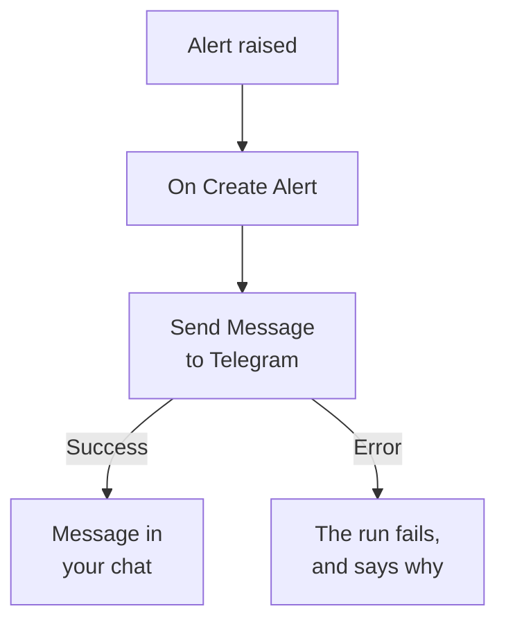

# Telegram

Send a message to a [Telegram](https://telegram.org) chat, group or channel when an alert fires or an incident opens. OneUptime's **Send Message to Telegram** workflow step sends it as a bot you create, and a ready-made template builds the workflow for alerts. This integration is **outbound**: the bot sends messages, and doesn't read what's said in the chat.

:::cards
- [How it works](#how-it-works): What the workflow does when an alert fires.
- [Set it up](#set-up-the-integration): A bot, its chat, then the workflow: from the template or from scratch.
- [Tips](#tips): Plain text, long messages, and incidents.
- [Troubleshooting](#troubleshooting): What Telegram's errors mean, and what to change.
:::

## How it works



The step sends the **Message Text** to the chat, as your bot, through Telegram's Bot API. It takes its **Success** output when Telegram takes the message, and its **Error** output, with Telegram's reason, when Telegram refuses it. With nothing connected to **Error**, as in the template, a run that could not send fails, and its **Steps** say why.

## Before you begin

- A Telegram account, to create the bot and add it to the chat.
- In OneUptime, the right to create workflows and variables. On OneUptime Cloud, workflows need the **Growth** plan or above.

## Set up the integration

:::steps
### Create a bot

In Telegram, send `/newbot` to [@BotFather](https://t.me/BotFather) and answer its questions. It gives you the bot's token, such as `123456789:ABCdefGhIJKlmnoPQRstuVWxyz`. Anyone who has the token can send messages as your bot, so keep it as safe as a password.

### Find the chat's ID

1. Add the bot to the group, or make it an administrator of the channel. To message a person, they start a chat with the bot first.
2. Send a message in the group that mentions the bot, such as `/start@your_bot`, so the bot sees it.
3. Open `https://api.telegram.org/bot<token>/getUpdates` in a browser, with the bot's token in place of `<token>`.
4. Find `"chat":{"id":` in the answer. The number after it is the chat's ID. A group's ID starts with `-`, and a large group's with `-100`.

A public channel can be named by its `@username` instead of an ID.

### Build the workflow

Start from the template, which builds the whole workflow for alerts, or from scratch.

:::tabs
@tab From the template
1. Open **Workflows** and click **Create Workflow**.
2. Type `Telegram` in **Search templates…**, click **Tell Telegram when an alert fires**, then click **Use this template**.
3. Keep the name, **Notify Telegram on new alert**, or change it, and click **Next**.
4. Paste the token into **Telegram Bot Token** and the ID into **Telegram Chat ID**, and click **Create Workflow**.

The workflow opens in the **Builder** with two steps: **On Create Alert**, and **Send Message to Telegram**, which sends the alert's number, title, severity and state. The token is saved as the workflow's secret variable `telegramBotToken`, and the ID as `telegramChatId`.
@tab From scratch
1. Save the token as a secret global variable: go to **Workflows → Global Variables**, click **Create Workflow Variable**, name it `TELEGRAM_BOT_TOKEN`, and click **Next**. Paste the token into **Content**, turn on **Secret**, and click **Create Workflow Variable**.
2. Go to **Workflows**, click **Create Workflow**, choose **Start from scratch**, name the workflow, and click **Create Workflow**.
3. In the **Builder**, click **Choose what starts this workflow** and pick **On Create Alert** under **Popular**. Click the trigger: its **Fields to pass on** starts with **Title**, so click **Add field** and pick the other fields your message shows, such as **Alert Number With Prefix**.
4. Click **Add Component**, search for `telegram`, and click **Send Message to Telegram**. Connect the trigger's **Success** output to it.
5. Click the new step. In **Telegram Bot Token**, click **{ }** and pick `TELEGRAM_BOT_TOKEN` under **Global variables**. Enter the chat's ID in **Chat ID**, write the message in **Message Text**, and insert the alert's fields with **{ }**.
:::

A message from scratch reads the alert's fields with references such as these:

```text
🚨 Alert {{local.components.alert-on-create-1.returnValues.model.alertNumberWithPrefix}} fired
Title: {{local.components.alert-on-create-1.returnValues.model.title}}
```

### Turn it on and test it

Switch **Enabled** on at the top of the **Builder**. From now on, every new alert is sent to the chat.

To test it without raising an alert, click **Run Workflow** and pick an alert you already have under **Alert**: the most recent ones are listed, and typing its number or part of its title finds another. Click **Run Workflow Manually** and confirm with **Run**. The **Workflow Run** panel follows the run, and the message shows up in the chat. If the step takes **Error** instead, the run fails, and the step's entry in **Steps** says why: see [Troubleshooting](#troubleshooting).
:::

## Tips

- **Plain text.** The step sends the text as typed, without Telegram's formatting, so `*` and `_` show as they are.
- **Mind the 4,096-character limit.** Telegram takes messages of up to 4,096 characters. A longer one is cut, and ends with "… (truncated — see OneUptime for the full text)", rather than refused.
- **Incidents too.** Build the same workflow on **On Create Incident**, or on **On Update Incident** for state changes. To send only some alerts, put an **If / Else** block before the step.
- **The token's shape is checked.** A token that is not shaped like `123456789:ABCdef…` stops the run before anything is sent, and the token is never written to the log.

## Troubleshooting

When the step takes **Error**, the run fails, and the step's entry in the run's **Steps** gives Telegram's reason. The bot has to be in the chat, so check that first.

:::details "Bad Request: chat not found"
The **Chat ID** is wrong, or the bot can't see the chat: add the bot to the group, make it an administrator of the channel, or ask the person to start a chat with the bot. A group's ID starts with `-`.
:::

:::details "Forbidden: bot was blocked by the user" or "bot is not a member"
The person blocked the bot, or the bot was removed from the group or the channel. Add it back, or send to another chat.
:::

:::details "Unauthorized"
Telegram did not accept the token: it was revoked in @BotFather, or copied wrong. Copy the bot's current token from @BotFather, and replace the variable's value.
:::

:::details "Too Many Requests: retry after"
Telegram limits how fast one bot sends, especially to a group. A burst of alerts can hit it: send fewer messages, for example only for some severities.
:::

## Next steps

:::cards
- [Workflow Components](/docs/workflows/components#telegram): Every setting of the step, and what its outputs mean.
- [Discord](/docs/integrations/discord): The same idea, in a Discord channel.
- [Workflow Runs](/docs/workflows/runs-and-logs): Read what each run of the workflow did.
- [Integrations Overview](/docs/integrations/index): The outbound pattern, and the other tools you can connect.
:::
