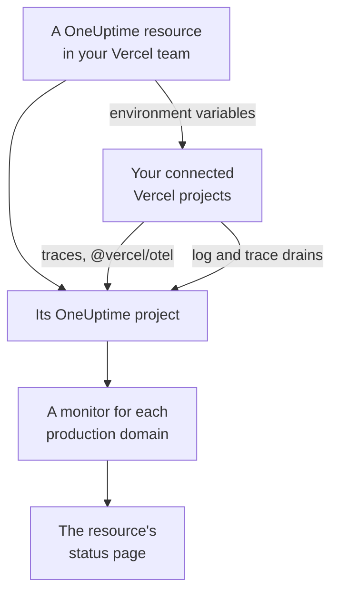

# Vercel

Add OneUptime to your Vercel team from the [Vercel Marketplace](https://vercel.com/marketplace). You sign in with your Vercel account and pay on your Vercel bill, and your Vercel projects get traces, logs, uptime monitoring and a status page in OneUptime, with nothing to set up by hand.

:::cards
- [Add OneUptime to your Vercel team](#add-oneuptime-to-your-vercel-team): A resource, a plan and your projects, in the Vercel dashboard.
- [Send traces with @vercel/otel](#send-traces-with-vercelotel): The environment variables are there already.
- [Send logs and traces with drains](#send-logs-and-traces-with-drains): Vercel's own logs and spans, on Pro and Enterprise.
- [Plans and billing](#plans-and-billing): OneUptime's plans, on your Vercel invoice.
:::

## How it works

Each OneUptime resource you add in Vercel is a OneUptime project of its own. Vercel gives every Vercel project you connect to the resource its environment variables, which send the project's traces to OneUptime. Drains send Vercel's logs and spans, and each connected project's production domain gets an uptime monitor on the resource's status page.



The integration is for OneUptime Cloud (`oneuptime.com`). A self-hosted OneUptime cannot be added from the Vercel Marketplace: see [Self-hosted OneUptime](#self-hosted-oneuptime).

## Before you begin

- **A Vercel team**, on any plan. Log and trace drains need Vercel's Pro or Enterprise plan; traces from `@vercel/otel` work on every plan.
- **A verified email address** on your Vercel account. OneUptime signs you in with it, and makes your OneUptime account with it if you do not have one.
- **A payment method in Vercel**, for every plan: monitors and telemetry are billed as you use them, the Free plan included. See [Plans and billing](#plans-and-billing).

## Add OneUptime to your Vercel team

:::steps
### Open OneUptime on the Vercel Marketplace

In the Vercel dashboard, open **Integrations**, then **Browse Marketplace**, and find OneUptime under **Observability**. Click **Install**, and accept OneUptime's terms.

### Choose a plan

Pick **Free**, **Growth** or **Scale**. The plans are OneUptime's own, at the prices on [oneuptime.com/pricing](https://oneuptime.com/pricing).

### Name the resource and choose its settings

Name the resource after what it watches, such as `storefront`: its OneUptime project and its status page are named after it. Two settings start on:

- **Monitor production domains**: a website monitor for the production domain of each Vercel project you connect.
- **Create a status page**: a public status page for the resource, which shows those monitors.

### Connect your projects

Choose the Vercel projects that send to this resource, and the environments that get its environment variables. Don't give the connection a custom prefix: `@vercel/otel` reads the variables by their own names.
:::

The resource is ready in a few seconds. Click **Open in OneUptime** to see its project.

## What each resource gives you

| What | Where to find it |
| --- | --- |
| A OneUptime project, named after the resource | You own it. Your teammates join it when they open it from Vercel. |
| An ingestion key named `Vercel` | **Project Settings → Telemetry & APM → Ingestion Keys** |
| Environment variables in each connected Vercel project | The project's **Settings → Environment Variables** in Vercel |
| A website monitor for each connected project | **Monitors**, named after the Vercel project |
| A public status page | **Status Pages**, named after the resource |

The environment variables are the same in every connected project:

| Variable | Value |
| --- | --- |
| `OTEL_EXPORTER_OTLP_ENDPOINT` | `https://oneuptime.com/otlp` |
| `OTEL_EXPORTER_OTLP_HEADERS` | `x-oneuptime-token=` and the resource's ingestion key |
| `OTEL_EXPORTER_OTLP_PROTOCOL` | `http/protobuf` |
| `ONEUPTIME_TELEMETRY_INGESTION_KEY` | The ingestion key on its own, which the drains send |

A deployment gets the variables when it is built: deploy again after you connect a project.

## Send traces with @vercel/otel

`@vercel/otel` is Vercel's OpenTelemetry package for Next.js and the other frameworks Vercel runs. It reads the `OTEL_EXPORTER_OTLP_*` variables, so a project connected to the resource only needs the package.

:::steps
### Install the package

```bash
npm install @vercel/otel @opentelemetry/api @opentelemetry/api-logs
```

### Register it

Create `instrumentation.ts` at the root of the project, or in `src` if the project has one, and name the service:

```ts title="instrumentation.ts"
import { registerOTel } from "@vercel/otel";

export function register(): void {
  registerOTel({ serviceName: "storefront" });
}
```

### Deploy

Deploy the project. Its traces appear in **Traces**, under the service name.
:::

On Vercel's Pro and Enterprise plans, add a trace drain too: Vercel then sends OneUptime its own spans for each request, with your application's, and `@vercel/otel` leaves them to the drain, so nothing arrives twice.

## Send logs and traces with drains

A drain sends what Vercel records about your projects to OneUptime: a log drain their build, function, edge and request logs, and a trace drain their spans. Drains need Vercel's Pro or Enterprise plan, and Vercel bills the data they send on your Vercel bill.

:::steps
### Add a drain

In Vercel, open **Team Settings → Drains** and click **Add Drain**. Pick **Logs** or **Traces**, and then OneUptime under **Native Integrations**.

### Pick the projects

Choose the projects, and for logs the sources and environments. The drain sends with the resource's ingestion key: there is nothing to type.
:::

Each Vercel project is a service in OneUptime, named after the project. A log keeps its time, level and message, and its request under OpenTelemetry's names:

| Vercel field | In OneUptime |
| --- | --- |
| `projectName` | The service, `service.name` |
| `timestamp`, `level`, `message` | The log's time, severity and body |
| `deploymentId`, `environment` | `vercel.deployment.id`, `deployment.environment.name` |
| `proxy.method`, `proxy.path`, `proxy.statusCode` | `http.request.method`, `url.path`, `vercel.proxy.status_code` |
| `traceId`, `spanId` | The log's trace, linked to the trace in **Traces** |
| Every other field | An attribute under `vercel.`, such as `vercel.source` |

## Uptime monitors and the status page

When you connect a Vercel project, OneUptime makes a website monitor for its production domain, checked from OneUptime's probes, and adds it to the resource's status page. A project connected before its first production deployment has no domain yet: its monitor is made at that deployment. Disconnecting the project deletes its monitor.

Each monitor is an active monitor, billed as any other, and works like one you made yourself: see [Website Monitor](/docs/monitor/website-monitor). To make none, turn off **Monitor production domains** in the resource's settings in Vercel. Turning it on again makes the monitors still missing.

## Open OneUptime from Vercel

Click **Open in OneUptime** on the resource, or any of its links in Vercel, and you are signed in to OneUptime with your Vercel account's email address. You join the resource's project the first time: as an admin if you are an owner or member of the Vercel team, and as a member if you have one of its read-only roles.

An existing OneUptime account with that email address is the one you sign in to. One that has two-factor authentication turned on, or that belongs to a OneUptime admin, signs in with its password instead. You are in the project all the same.

## Plans and billing

| | How it works |
| --- | --- |
| Plans | **Free**, **Growth** and **Scale**, at the prices on oneuptime.com: the plan's price per user, active monitors at $1 per monitor per month, and telemetry per GB. |
| Where you pay | On your Vercel invoice, once a month, for each resource. Vercel shows the month's usage so far on the resource, updated every hour. |
| Trials | No charge while the plan's trial lasts: not its users, its monitors or its telemetry. |
| Changing plan | In Vercel, on the resource, or in OneUptime under **Project Settings → Billing and Invoices → Billing**. Either place changes both. |
| Unpaid invoices | Vercel retries the payment for 15 days. After that the project stops being served until the invoice is paid: its data is kept, and nothing is deleted. |

On the invoice, each resource has a line for its users, its active monitors, its telemetry and any balance top-ups, in usage units of $0.01.

## Remove OneUptime

| You | What happens |
| --- | --- |
| Delete a resource in Vercel | Its project is deleted, after its usage up to then is billed. The connected Vercel projects lose its environment variables at their next deployment. |
| Uninstall OneUptime from the team | Every resource's project is deleted, and the final invoice is sent. |
| Delete the project in OneUptime | The resource is deleted in Vercel too. |

> [!CAUTION]
> Deleting a project deletes its monitors, status page, incidents and telemetry for good. Export anything you want to keep first.

## Self-hosted OneUptime

A self-hosted OneUptime cannot be added from the Vercel Marketplace, which provisions OneUptime Cloud only. Your Vercel projects can still send to it:

- **Traces**: in the Vercel project's **Settings → Environment Variables**, set the variables in [What each resource gives you](#what-each-resource-gives-you), with `https://YOUR-ONEUPTIME-HOST/otlp` as the endpoint and an ingestion key of your project.
- **Logs**: add a custom log drain in **Team Settings → Drains**, to `https://YOUR-ONEUPTIME-HOST/telemetry/vercel/v1/logs`, in JSON or NDJSON. Add the header `x-oneuptime-token` with your ingestion key, and set the drain's signing secret to the same key: OneUptime takes only deliveries Vercel signed with it.

The same custom drain works on OneUptime Cloud, with `oneuptime.com` as the host.

## Troubleshooting

:::details No traces arrive
- Deploy the project again: a deployment built before the project was connected has no `OTEL_EXPORTER_OTLP_*` variables.
- Check the variables' names in the project's **Settings → Environment Variables**. A connection made with a custom prefix renames them, and `@vercel/otel` no longer reads them: connect the project again without one.
- Check that `instrumentation.ts` calls `registerOTel`, and, on Next.js 14 and older, that `experimental.instrumentationHook` is on in `next.config.js`.
:::

:::details Vercel shows the drain as errored
Vercel shows OneUptime's answer to the drain's deliveries:

- `403` with `x-vercel-signature` in the message: Vercel did not sign the delivery with the key it sends. For a custom drain, check its `x-oneuptime-token` header, and set its signing secret to the same key.
- `401`: OneUptime knows no project with the key the drain sends: it was deleted, or mistyped in both places. Use a key from **Project Settings → Telemetry & APM → Ingestion Keys**.
- `422`: the key was turned off. Turn it on again on the same page, or use another.
:::

:::details A connected project has no monitor
- **Monitor production domains** is off in the resource's settings in Vercel.
- The project has no production domain yet: its monitor is made at its first production deployment.
- The project's plan has as many active monitors as it allows: upgrade the plan, then turn **Monitor production domains** off and on again.
:::

:::details Vercel says to verify your email address
OneUptime needs an email address Vercel has verified, and an existing OneUptime account with that address needs its own address verified too. Verify the address, then add the resource or open OneUptime again.
:::

## Next steps

:::cards
- [Traces Explorer](/docs/telemetry/traces-explorer): Find a slow request and its spans.
- [Logs Explorer](/docs/telemetry/logs-explorer): Search your Vercel logs.
- [Status Pages](/docs/status-pages/index): Brand the resource's status page, and add subscribers.
- [Ingestion Keys](/docs/telemetry/ingestion-keys): Rotate or turn off the resource's key.
:::
