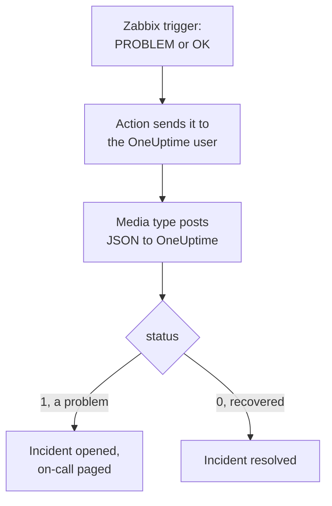

# Zabbix

Send [Zabbix](https://www.zabbix.com) problems to OneUptime, so each problem becomes an incident that pages your on-call team, and is resolved when Zabbix recovers. Zabbix sends every problem through a webhook media type, so there is nothing to install on either side.

:::cards
- [Choose how OneUptime receives problems](#choose-how-oneuptime-receives-problems): An Incoming Request monitor, or a workflow of your own.
- [Receive problems with a monitor](#receive-problems-with-a-monitor): One incident per problem, resolved on recovery.
- [Configure Zabbix](#configure-zabbix): A media type, a user and an action.
- [Troubleshooting](#troubleshooting): When problems do not arrive, or incidents stay open.
:::

## How it works



Zabbix sends a problem to a user, through that user's media. Here the media is a webhook media type called **OneUptime**: its script posts a small JSON document to OneUptime with the problem's event ID, name, host, severity and status. The status is `1` for a problem and `0` for its recovery.

## Before you begin

- A Zabbix server you administer. This guide is written for Zabbix 6.0 LTS and 7.0 LTS. Webhook media types work the same way from Zabbix 5.0.
- A Zabbix server that can reach your OneUptime over HTTPS.
- In OneUptime, the right to create monitors, or workflows if you take that way.

## Choose how OneUptime receives problems

Set up OneUptime first: it gives you the URL Zabbix sends to.

| Way | Use it when |
| --- | --- |
| An Incoming Request monitor (recommended) | You want every Zabbix problem to be an incident that pages on-call, and is resolved when Zabbix recovers. There is nothing to build. |
| A workflow with a Webhook trigger | You need logic of your own: filter problems, reshape them, or call other systems first. A workflow does not resolve the incident on recovery by itself. |

Both get the same JSON from the same media type, so you can start with one and switch later by changing one URL in Zabbix.

## Receive problems with a monitor

An [Incoming Request monitor](/docs/monitor/incoming-request-monitor) gives you a URL, and its criteria decide what each request does.

:::steps
### Create the monitor

Go to **Monitors** and click **Create Monitor**. Pick **Incoming Request** under **Monitor Type**, name it `Zabbix`, and click **Next**.

### Declare an incident for each problem

On the **Criteria** step, open the first criteria, the one that marks the monitor offline. Set its filter to **Request Body**, **Contains**, `"status":"1"`. This criteria already declares an incident when its filter matches. Fill the incident in:

- **Incident Title**: `Zabbix: {{requestBody.name}} on {{requestBody.host}}`.
- **Severity**: the incident severity Zabbix problems should have.
- **On-Call Policies**, under **On-Call**: the policies to page.
- **Auto Resolve Incident**, under **More fields**: leave it on, as it starts. Without it, recoveries are ignored and incidents stay open.

### Open one incident per problem

In the same criteria, open **Settings** and turn on **Group incidents and alerts by a payload field**. Fill it in as below, so each problem gets its own incident, and its recovery resolves it:

| Field | Value |
| --- | --- |
| **Open a separate incident for each…** | `requestBody.event_id` |
| **Field that signals recovery** | `requestBody.status` |
| **Value that means recovered** | `0` |

### Bring the monitor back online

Open the second criteria, the one that marks the monitor online, and set its filter to **Request Body**, **Contains**, `"status":"0"`.

### Copy the URL

Click **Create Monitor**. The monitor's **Overview** page shows its **Heartbeat URL**. Copy it for Zabbix:

```text
https://oneuptime.com/heartbeat/<secret key>
```

A self-hosted install has its own host in place of `oneuptime.com`.
:::

The monitor reads the request's JSON as written: `"status":"1"`, with no spaces. See [Receiving alerts from another system](/docs/monitor/incoming-request-monitor#receiving-alerts-from-another-system) for what each setting does.

## Receive problems with a workflow

Use a [workflow](/docs/workflows/index) when you need steps of your own between Zabbix and the incident.

:::steps
### Create the workflow

Go to **Workflows**, click **Create Workflow**, then **Start from scratch**. Name it `Zabbix problems` and click **Create Workflow**.

### Add the Webhook trigger

Click the dashed **Choose what starts this workflow** block and pick **Webhook**. Click the trigger, then **Copy URL**, and keep the URL for Zabbix.

### Check that it is a problem

Click **Add Component**, add an **If / Else** block, and connect the trigger's **Out** dot to it. Set **Value to check** to `{{local.components.webhook-1.returnValues.request-body.status}}`, **Comparison** to **is equal to**, and **Compare with** to `1`.

### Declare the incident

Add a **Create One Incident** block, and connect the **Yes** side of the **If / Else** block to it. In **Incident Template**, pick a template that sets the severity and the on-call policies to page (see [Incident templates](/docs/incidents/settings#incident-templates)). In **JSON Object**, set what comes from Zabbix:

```json
{
  "title": "Zabbix: {{local.components.webhook-1.returnValues.request-body.name}}",
  "description": "Host: {{local.components.webhook-1.returnValues.request-body.host}}\nSeverity: {{local.components.webhook-1.returnValues.request-body.severity}}\nZabbix event: {{local.components.webhook-1.returnValues.request-body.event_id}}"
}
```

Without a template, **JSON Object** also needs `incidentSeverityId`, the ID of one of the project's incident severities.

### Turn it on

Switch **Enabled** on at the top of the **Builder**. A workflow that is off answers Zabbix with `400`.
:::

A recovery takes the **No** side of the **If / Else** block, where nothing is connected, so the run ends there. To resolve incidents on recovery, use the monitor.

## Configure Zabbix

Zabbix needs three things: a media type that posts to OneUptime, a user to send it to, and an action that sends problems to that user.

:::steps
### Create the OneUptime media type

1. Go to **Alerts → Media types**, or **Administration → Media types** on Zabbix 6.0, and click **Create media type**.
2. Set **Name** to `OneUptime` and **Type** to **Webhook**.
3. Add these **Parameters**. Each one maps a Zabbix [macro](https://www.zabbix.com/documentation/current/en/manual/appendix/macros/supported_by_location) into the request:

   | Name | Value |
   | --- | --- |
   | `url` | `{ALERT.SENDTO}` |
   | `event_id` | `{EVENT.ID}` |
   | `event_name` | `{EVENT.NAME}` |
   | `event_value` | `{EVENT.VALUE}` |
   | `event_severity` | `{EVENT.SEVERITY}` |
   | `host` | `{HOST.NAME}` |
   | `event_date` | `{EVENT.DATE}` |
   | `event_time` | `{EVENT.TIME}` |

4. Paste this into **Script**:

   ```javascript
   var params = JSON.parse(value);
   var request = new HttpRequest();
   request.addHeader("Content-Type: application/json");

   var payload = {
     source: "zabbix",
     event_id: params.event_id,
     name: params.event_name,
     host: params.host,
     severity: params.event_severity,
     // "1" for a problem, "0" for its recovery.
     status: params.event_value,
     date: params.event_date,
     time: params.event_time,
   };

   var response = request.post(params.url, JSON.stringify(payload));

   if (request.getStatus() < 200 || request.getStatus() >= 300) {
     throw (
       "OneUptime responded with HTTP " + request.getStatus() + ": " + response
     );
   }

   return "OK";
   ```

5. On the **Message templates** tab, add a template for **Problem** and one for **Problem recovery**. Leave their text empty: the script builds the request. Zabbix only uses a media type for the kinds of event it has a template for.
6. Click **Add**.

### Create a user to receive problems

1. Go to **Users → Users**, or **Administration → Users** on Zabbix 6.0, and click **Create user**. Name it `OneUptime`, and give it a user group and a role that can receive notifications, such as **User role**.
2. On the **Media** tab, click **Add**. Set **Type** to `OneUptime`, and **Send to** to the URL you copied from OneUptime. Leave **When active** and the severities as they are, or untick the severities OneUptime should not get.
3. Click **Add**, then **Add** again to save the user.

### Send problems to OneUptime with an action

1. Go to **Alerts → Actions → Trigger actions**, or **Configuration → Actions** on Zabbix 6.0, and click **Create action**. Name it `Notify OneUptime`.
2. Under **Conditions**, narrow it down if you like, such as **Trigger severity is greater than or equals Warning**. With no conditions, every problem is sent.
3. On the **Operations** tab, add an operation that sends to the `OneUptime` user through the `OneUptime` media type.
4. Add the same operation under **Recovery operations**, so recoveries are sent too.
5. Click **Add**, and check that the action is enabled.
:::

## Test it

1. In Zabbix, open **Alerts → Media types** and click **Test** beside `OneUptime`. Fill in the URL you copied, and sample values such as `event_id` `12345`, `event_name` `Test problem`, `host` `web-1` and `event_value` `1`. Click **Test**: Zabbix shows the script's answer, `OK`, or the error it threw.
2. In OneUptime, open the monitor and check that an incident opened, or open the workflow's **Logs → Runs** and check the run.
3. Test again with `event_value` `0` and the same `event_id`. With the monitor, the incident is resolved.

Then let a real trigger fire, for example by lowering a threshold for a moment, and watch the problem arrive.

## Map Zabbix severities

Zabbix sends its severity as text: `Not classified`, `Information`, `Warning`, `Average`, `High` or `Disaster`.

- **With the monitor**, click **Add Criteria** for each group of severities, and drag the new criteria above the first one: criteria are checked from the top, and the first that matches decides. Give each two filters, `"status":"1"` and a severity such as `"severity":"Disaster"`, with **Match Condition** on **All**. Give each an incident with its own **Severity** and **Auto Resolve Incident**, and the same grouping settings.
- **With the workflow**, add a [Switch / Case](/docs/workflows/components#switch-case) block on `{{local.components.webhook-1.returnValues.request-body.severity}}`, with a case for each severity, and a **Create One Incident** block, with its own template, after each case.

## Troubleshooting

:::details Nothing arrives in OneUptime
- In Zabbix, open **Reports → Action log** and check that the action sent the problem, and what came back.
- From the Zabbix server, send a request yourself: `curl -i -X POST <url> -H 'Content-Type: application/json' -d '{"status":"1","event_id":"1","name":"Test","host":"test"}'`.
- The monitor answers `200` at once, before it checks anything, even for a wrong secret key. Check the monitor's timeline to see whether requests land.
- A workflow that is off answers `400`. Switch **Enabled** on at the top of its **Builder**.
:::

:::details Zabbix reports a script error
Open the media type and use **Test**: Zabbix shows the script's result or the error it threw. A response other than `2xx` from OneUptime is thrown by the script with its status, so check the URL first.
:::

:::details Incidents open but are never resolved
- The action needs **Recovery operations**, or Zabbix never sends the recovery.
- The criteria's incident needs **Auto Resolve Incident**, under **More fields**.
- **Field that signals recovery** must be `requestBody.status`, and **Value that means recovered** exactly `0`.
- A workflow does not resolve incidents on recovery. Use the monitor.
:::

:::details The incident shows a reference instead of a value
A reference to a field the request does not have is left as written, braces and all, rather than being emptied. Check that Zabbix sends `Content-Type: application/json`, and that the field names you use (`name`, `host`, `severity`, `status`, `event_id`) match the script's payload. For a workflow, open the run in **Logs → Runs** and compare with what the trigger received. See [Gotchas](/docs/workflows/variables#gotchas).
:::

:::details Every problem arrives twice
The action probably has two operations that send to the same user, such as a first step and an escalation step. Check the action's **Operations**.
:::

## Security

- **Treat the URL like a password.** Anyone who has it can open incidents. If it leaks, reset it: **Reset Incoming Request Secret Key** on the monitor's **Settings** page, or **Reset URL** in the workflow's **Webhook** trigger. Then update **Send to** on the Zabbix user's media.
- **Send only what needs an incident.** Use the action's conditions, or the user's media severities, to keep low-severity problems in Zabbix.
- **Self-hosted?** Let your Zabbix server reach your OneUptime over HTTPS through your firewall.

## Next steps

:::cards
- [Incoming Request Monitor](/docs/monitor/incoming-request-monitor): Every setting of the monitor that receives Zabbix problems.
- [Escalation Rules](/docs/on-call/escalation-rules): Decide who an on-call policy pages, and when.
- [Workflow Triggers](/docs/workflows/triggers#webhook): How a workflow's webhook URL works.
- [Integrations Overview](/docs/integrations/index): The other tools you can connect.
:::
