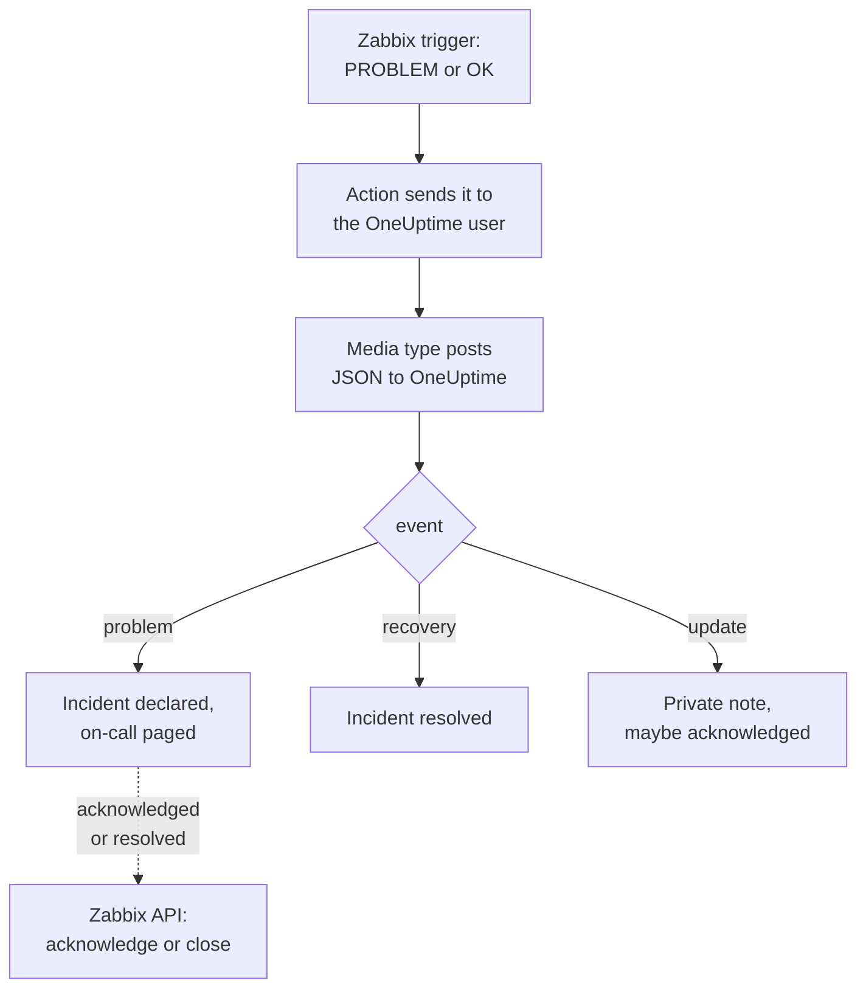

# Zabbix

Send [Zabbix](https://www.zabbix.com) problems to OneUptime, so each problem becomes an incident that pages your on-call team, and is resolved when Zabbix recovers. Ready-made workflow templates keep both sides in step: what people do in Zabbix is noted on the incident, and acknowledging or resolving the incident acknowledges or closes the problem in Zabbix. Zabbix sends every problem through a webhook media type, so there is nothing to install on either side.

:::cards
- [Choose how OneUptime receives problems](#choose-how-oneuptime-receives-problems): Workflow templates, or an Incoming Request monitor.
- [Start from the templates](#start-from-the-templates): Six templates, what they do and what they ask for.
- [Configure Zabbix](#configure-zabbix): A media type, a user and an action.
- [Troubleshooting](#troubleshooting): When problems do not arrive, or incidents stay open.
:::

## How it works



Zabbix sends a problem to a user, through that user's media. Here the media is a webhook media type called **OneUptime**: its script posts a small JSON document to OneUptime for each problem, for its recovery, and for each update someone makes to it in Zabbix, with the problem's event ID, name, host and severity. The event ID is how OneUptime finds the incident a problem opened.

## Before you begin

- A Zabbix server you administer. This guide is written for Zabbix 6.0 LTS and 7.0 LTS. Webhook media types work the same way from Zabbix 5.0. The templates that call Zabbix's API need Zabbix 6.4 or later, or [one change on Zabbix 6.0](#on-zabbix-60).
- A Zabbix server that can reach your OneUptime over HTTPS, and for the templates that call Zabbix, a OneUptime that can reach Zabbix.
- In OneUptime, the right to create workflows, or monitors if you take that way. On OneUptime Cloud, workflows need the **Growth** plan or above.

## Choose how OneUptime receives problems

Set up OneUptime first: it gives you the URL Zabbix sends to.

| Way | Use it when |
| --- | --- |
| The workflow templates (recommended) | You want each problem as an incident or an alert at its Zabbix severity, paged to on-call for High and Disaster, resolved on recovery, with what people do in Zabbix noted on it, and Zabbix acknowledged or closed from OneUptime. |
| An Incoming Request monitor | You want incidents without a workflow, on any plan, and a monitor whose status follows Zabbix. Nothing goes back to Zabbix. |

Both get the same JSON from the same media type, so you can start with one and switch later by changing one URL in Zabbix.

## Start from the templates

The **Create a workflow** dialog has six Zabbix templates, under **Zabbix** in its category list: three for incidents, then the same three for alerts.

| Template | What it does | What it asks for |
| --- | --- | --- |
| **Incidents** | | |
| Declare an incident for each Zabbix problem | The workflow Zabbix sends every event to. It declares an incident for each problem, pages on-call for High and Disaster, notes updates made in Zabbix, and resolves the incident on recovery. | Zabbix URL |
| Acknowledge or close the Zabbix problem with the incident | When the incident is acknowledged, acknowledges its problem. When it is resolved, closes the problem, or acknowledges it where Zabbix does not allow closing it by hand. | Zabbix URL, Zabbix API Token |
| Copy incident private notes to the Zabbix problem | Adds each private note on the incident to its problem as a message. | Zabbix URL, Zabbix API Token |
| **Alerts** | | |
| Create an alert for each Zabbix problem | The same as for incidents, with an alert for each problem. | Zabbix URL |
| Acknowledge or close the Zabbix problem with the alert | The same as for incidents, from the alert's state. | Zabbix URL, Zabbix API Token |
| Copy alert private notes to the Zabbix problem | Adds each private note on the alert to its problem as a message. | Zabbix URL, Zabbix API Token |

Start with **Declare an incident for each Zabbix problem**, or **Create an alert for each Zabbix problem** for alerts: the incident or alert it opens keeps the problem's event ID, in its custom field `zabbixEventId`, and the other two templates find the problem by it.

### What the templates ask for

- **Zabbix URL**: the address you open Zabbix at, such as `https://zabbix.example.com`, or `https://example.com/zabbix` when Zabbix runs under a path. Links to a problem go there, and the templates that call Zabbix send their requests to its `api_jsonrpc.php`. The field refuses the address of a page in Zabbix.
- **Zabbix API Token**: an API token of the Zabbix user the workflow acts as. [Create the API token](#create-the-api-token) shows how. It is saved as a secret variable, and sent only to Zabbix: in the `Authorization` header, or in the request's body on Zabbix 6.0.

### Receive problems with the template

:::steps
1. Go to **Workflows** and click **Create Workflow**. Under **Or start from a template**, choose **Zabbix** in the category list, click **Declare an incident for each Zabbix problem**, and click **Use this template**.
2. Fill in **Zabbix URL**. Under **Who to page for High and Disaster problems**, pick the on-call policies to page, or none to page nobody, and click **Create Workflow**. The workflow opens in the **Builder**, switched off.
3. Click the **Webhook** trigger, then **Copy URL**, and keep the URL for Zabbix.
4. Switch **Enabled** on at the top of the **Builder**. A workflow that is off answers Zabbix with `400`.
:::

Then [configure Zabbix](#configure-zabbix) to send its problems to that URL.

### What the workflow does

After the **Webhook** trigger, the `read-event-1` **Check With JavaScript** step reads the `event` the media type sends, and **Incident From Another Tool**, or **Alert From Another Tool** in the alert template, does what it means, by the problem's event ID:

| Event | What the workflow does |
| --- | --- |
| `problem` | Declares an incident titled `Zabbix: <problem> on <host>`, at the severity the Zabbix severity maps to, kept off your status pages. Its description links the problem in Zabbix, and lists the host, the severity, when it started, its operational data and its tags. For a High or Disaster problem, it pages the on-call policy you picked. A problem Zabbix sends again, with the same event ID, opens no second incident. |
| `recovery` | Resolves the problem's incident, unless it is resolved already. Why is on its timeline. |
| `update` | Adds what was done in Zabbix to the incident as a private note: who did it, what they did, and what they wrote. When the update acknowledged the problem, it also acknowledges the incident, which stops on-call escalating it. |

Anything else, such as a request from another tool, is left alone: `read-event-1` takes **No**, and the run's **Steps** say why. A step that fails fails the run, and its entry in **Steps** says why.

### Severities

In a new project, the template maps Zabbix's six severities onto these incident and alert severities:

| Zabbix severity | Incident | Alert | On-call |
| --- | --- | --- | --- |
| Disaster | Critical Incident | High | Paged |
| High | Critical Incident | High | Paged |
| Average | Major Incident | Low | Not paged |
| Warning | Major Incident | Low | Not paged |
| Information | Minor Incident | Low | Not paged |
| Not classified | Minor Incident | Low | Not paged |

With severities of your own, Disaster and High go to your most severe, Average and Warning to the middle one, and Information and Not classified to your least severe. Zabbix numbers its severities 0 (Not classified) to 5 (Disaster), and the template reads the number, so renaming a severity in Zabbix changes nothing.

- To map a severity to one of yours by name, edit `SEVERITY_BY_NAME` in the `read-event-1` step, such as `{ 2: 'Minor Incident' }` for Warning.
- To page for Average problems too, set **Compare with** of the `if-page-1` **If / Else** step to `3`.

### Send acknowledgments and notes back to Zabbix

:::steps
1. [Create the API token](#create-the-api-token).
2. Create a workflow from **Acknowledge or close the Zabbix problem with the incident**. Fill in **Zabbix URL** and **Zabbix API Token**, click **Create Workflow**, and switch **Enabled** on.
3. If you want notes in Zabbix too, do the same with **Copy incident private notes to the Zabbix problem**.
:::

The state template asks Zabbix about the problem first, so a problem Zabbix acknowledged or resolved already is left as it is. To close a problem, its trigger needs **Allow manual close** in Zabbix. Without it, the problem is acknowledged instead, with a message saying the incident was resolved, and Zabbix closes it when it recovers. Incidents that no Zabbix problem opened, and incidents marked **Private Incident**, are never sent to Zabbix.

### Create the API token

:::steps
1. Use the `OneUptime` user that [receives problems](#create-a-user-to-receive-problems). Zabbix does not send a user its own updates, so with this user's token, OneUptime's acknowledgments and messages never come back to OneUptime as updates.
2. Check the user's role in **Users → User roles**. It needs **Access to API** enabled, and **Acknowledge problems**, **Add problem comments** and **Close problems** allowed. The **User role** allows them unless someone has changed it.
3. Check the user's group in **Users → User groups**. **Read** permission on the host groups is enough to acknowledge problems and add messages. To close problems, it needs **Read-write**.
4. Go to **Users → API tokens** and click **Create API token**. Pick the `OneUptime` user, untick **Set expiration date and time** or note the date, and click **Add**.
5. Copy the **Auth token**: Zabbix shows it only once. Paste it into **Zabbix API Token**.
:::

### On Zabbix 6.0

Zabbix 6.0 reads the API token from the request's body, not from its `Authorization` header. In the **Update Zabbix Problem** step of each template that calls Zabbix, turn on **Zabbix 6.0**, under **More fields**. Zabbix 7.2 and later refuse a token in the body, so turn it off again when you upgrade.

## Receive problems with a monitor

An [Incoming Request monitor](/docs/monitor/incoming-request-monitor) gives you a URL, and its criteria decide what each request does.

:::steps
### Create the monitor

Go to **Monitors** and click **Create Monitor**. Pick **Incoming Request** under **Monitor Type**, name it `Zabbix`, and click **Next**.

### Declare an incident for each problem

On the **Criteria** step, open the first criteria, the one that marks the monitor offline. Set its filter to **Request Body**, **Contains**, `"status":"1"`. This criteria already declares an incident when its filter matches. Fill the incident in:

- **Incident Title**: `Zabbix: {{requestBody.name}} on {{requestBody.host}}`.
- **Severity**: the incident severity Zabbix problems should have.
- **On-Call Policies**, under **On-Call**: the policies to page.
- **Auto Resolve Incident**, under **More fields**: leave it on, as it starts. Without it, recoveries are ignored and incidents stay open.

### Open one incident per problem

In the same criteria, open **Settings** and turn on **Group incidents and alerts by a payload field**. Fill it in as below, so each problem gets its own incident, and its recovery resolves it:

| Field | Value |
| --- | --- |
| **Open a separate incident for each…** | `requestBody.event_id` |
| **Field that signals recovery** | `requestBody.status` |
| **Value that means recovered** | `0` |

### Bring the monitor back online

Open the second criteria, the one that marks the monitor online, and set its filter to **Request Body**, **Contains**, `"status":"0"`.

### Copy the URL

Click **Create Monitor**. The monitor's **Overview** page shows its **Heartbeat URL**. Copy it for Zabbix:

```text
https://oneuptime.com/heartbeat/<secret key>
```

A self-hosted install has its own host in place of `oneuptime.com`.
:::

The monitor reads the request's JSON as written: `"status":"1"`, with no spaces. See [Receiving alerts from another system](/docs/monitor/incoming-request-monitor#receiving-alerts-from-another-system) for what each setting does. An update made in Zabbix is sent with `"status":"1"` too, which the monitor reads as the problem again and opens no second incident for.

## Configure Zabbix

Zabbix needs three things: a media type that posts to OneUptime, a user to send it to, and an action that sends problems to that user.

:::steps
### Create the OneUptime media type

1. Go to **Alerts → Media types**, or **Administration → Media types** on Zabbix 6.0, and click **Create media type**.
2. Set **Name** to `OneUptime` and **Type** to **Webhook**.
3. Add these **Parameters**. Each one maps a Zabbix [macro](https://www.zabbix.com/documentation/current/en/manual/appendix/macros/supported_by_location) into the request:

   | Name | Value |
   | --- | --- |
   | `url` | `{ALERT.SENDTO}` |
   | `event_id` | `{EVENT.ID}` |
   | `event_name` | `{EVENT.NAME}` |
   | `event_value` | `{EVENT.VALUE}` |
   | `event_severity` | `{EVENT.SEVERITY}` |
   | `event_nseverity` | `{EVENT.NSEVERITY}` |
   | `host` | `{HOST.NAME}` |
   | `event_date` | `{EVENT.DATE}` |
   | `event_time` | `{EVENT.TIME}` |
   | `event_opdata` | `{EVENT.OPDATA}` |
   | `event_tags` | `{EVENT.TAGSJSON}` |
   | `trigger_id` | `{TRIGGER.ID}` |
   | `event_update_status` | `{EVENT.UPDATE.STATUS}` |
   | `event_update_action` | `{EVENT.UPDATE.ACTION}` |
   | `event_update_message` | `{EVENT.UPDATE.MESSAGE}` |
   | `event_update_user` | `{USER.FULLNAME}` |

4. Paste this into **Script**:

   ```javascript
   var params = JSON.parse(value);

   // Zabbix leaves a macro it has no value for as it is written, such as
   // {EVENT.UPDATE.MESSAGE} on a problem: it is sent as nothing.
   function given(text) {
     var written = String(text === undefined || text === null ? "" : text);
     return /^\{[A-Z0-9_.]+\}$/.test(written) || written === "*UNKNOWN*"
       ? ""
       : written;
   }

   var isUpdate = given(params.event_update_status) === "1";
   var payload = {
     source: "zabbix",
     // "problem", "recovery" or "update".
     event: isUpdate
       ? "update"
       : params.event_value === "0"
         ? "recovery"
         : "problem",
     event_id: params.event_id,
     name: params.event_name,
     host: params.host,
     severity: params.event_severity,
     // 0 Not classified, 1 Information, 2 Warning, 3 Average, 4 High, 5 Disaster.
     severity_number: params.event_nseverity,
     // "1" for a problem, "0" for its recovery.
     status: params.event_value,
     date: params.event_date,
     time: params.event_time,
     opdata: given(params.event_opdata),
     tags: [],
     trigger_id: params.trigger_id,
   };

   try {
     var tags = JSON.parse(given(params.event_tags) || "[]");
     payload.tags = Array.isArray(tags) ? tags : [];
   } catch (error) {
     payload.tags = [];
   }

   if (isUpdate) {
     payload.update = {
       action: given(params.event_update_action),
       message: given(params.event_update_message),
       user: given(params.event_update_user),
     };
   }

   var request = new HttpRequest();
   request.addHeader("Content-Type: application/json");

   var response = request.post(params.url, JSON.stringify(payload));

   if (request.getStatus() < 200 || request.getStatus() >= 300) {
     throw (
       "OneUptime responded with HTTP " + request.getStatus() + ": " + response
     );
   }

   return "OK";
   ```

5. On the **Message templates** tab, add a template for **Problem**, one for **Problem recovery** and one for **Problem update**. Leave their text empty: the script builds the request. Zabbix only uses a media type for the kinds of event it has a template for.
6. Click **Add**.

### Create a user to receive problems

1. Go to **Users → Users**, or **Administration → Users** on Zabbix 6.0, and click **Create user**. Name it `OneUptime`, and give it a user group and a role that can receive notifications, such as **User role**.
2. On the **Media** tab, click **Add**. Set **Type** to `OneUptime`, and **Send to** to the URL you copied from OneUptime. Leave **When active** and the severities as they are, or untick the severities OneUptime should not get.
3. Click **Add**, then **Add** again to save the user.

### Send problems to OneUptime with an action

1. Go to **Alerts → Actions → Trigger actions**, or **Configuration → Actions** on Zabbix 6.0, and click **Create action**. Name it `Notify OneUptime`.
2. Under **Conditions**, narrow it down if you like, such as **Trigger severity is greater than or equals Warning**. With no conditions, every problem is sent.
3. On the **Operations** tab, add an operation that sends to the `OneUptime` user through the `OneUptime` media type.
4. Add the same operation under **Recovery operations**, so recoveries are sent too, and under **Update operations**, so acknowledgments and comments made in Zabbix are sent.
5. Click **Add**, and check that the action is enabled.
:::

To send some problems to the incident template and others to the alert template, give the `OneUptime` user two media of type `OneUptime`: one sending to each workflow's URL, each with the severities it should get.

## Test it

1. In Zabbix, open **Alerts → Media types** and click **Test** beside `OneUptime`. Fill in the URL you copied, and sample values such as `event_id` `12345`, `event_name` `Test problem`, `host` `web-1`, `event_nseverity` `4` and `event_value` `1`. Click **Test**: Zabbix shows the script's answer, `OK`, or the error it threw.
2. In OneUptime, open the workflow's **Logs → Runs** and check the run, or open the monitor and check that an incident opened.
3. Test again with `event_value` `0` and the same `event_id`. The incident is resolved.

Then let a real trigger fire, for example by lowering a threshold for a moment, and watch the problem arrive. To try an update, acknowledge the problem in Zabbix with a message: the incident gets a private note, and is acknowledged.

## Map Zabbix severities

Zabbix sends its severity as text: `Not classified`, `Information`, `Warning`, `Average`, `High` or `Disaster`.

- **With the templates**, severities are mapped for you: see [Severities](#severities).
- **With the monitor**, click **Add Criteria** for each group of severities, and drag the new criteria above the first one: criteria are checked from the top, and the first that matches decides. Give each two filters, `"status":"1"` and a severity such as `"severity":"Disaster"`, with **Match Condition** on **All**. Give each an incident with its own **Severity** and **Auto Resolve Incident**, and the same grouping settings.

## Troubleshooting

:::details Nothing arrives in OneUptime
- In Zabbix, open **Reports → Action log** and check that the action sent the problem, and what came back.
- From the Zabbix server, send a request yourself: `curl -i -X POST <url> -H 'Content-Type: application/json' -d '{"source":"zabbix","event":"problem","event_id":"1","name":"Test","host":"test","severity_number":"4","status":"1"}'`.
- The monitor answers `200` at once, before it checks anything, even for a wrong secret key. Check the monitor's timeline to see whether requests land.
- A workflow that is off answers `400`. Switch **Enabled** on at the top of its **Builder**.
:::

:::details Zabbix reports a script error
Open the media type and use **Test**: Zabbix shows the script's result or the error it threw. A response other than `2xx` from OneUptime is thrown by the script with its status, so check the URL first.
:::

:::details Incidents open but are never resolved
- The action needs **Recovery operations**, or Zabbix never sends the recovery.
- With the template, open the workflow's **Logs → Runs** and the recovery's run: its last step says why. A recovery for a problem that opened no incident changes nothing.
- With the monitor, the criteria's incident needs **Auto Resolve Incident**, under **More fields**. **Field that signals recovery** must be `requestBody.status`, and **Value that means recovered** exactly `0`.
:::

:::details Zabbix is not acknowledged or closed
Open the run of the state template in **Logs → Runs**: its last step says what Zabbix answered.

- `Not authorized`: the API token is wrong, expired or disabled, or Zabbix is older than 6.4 (see [On Zabbix 6.0](#on-zabbix-60)).
- `Cannot close problem: trigger does not allow manual closing`: turn on **Allow manual close** on the trigger. The template already acknowledges such problems instead of closing them.
- `No permissions to referred object or it does not exist!`: the user can see the problem, but needs **Read-write** permission to close it.
- `Zabbix has no problem with event ID`: the user cannot see the problem's host. Give its user group **Read** permission on the host group.
:::

:::details The incident shows a reference instead of a value
A reference to a field the request does not have is left as written, braces and all, rather than being emptied. Check that Zabbix sends `Content-Type: application/json`, and that the field names you use (`name`, `host`, `severity`, `status`, `event_id`) match the script's payload. For a workflow, open the run in **Logs → Runs** and compare with what the trigger received. See [Gotchas](/docs/workflows/variables#gotchas).
:::

:::details Every problem arrives twice
The action probably has two operations that send to the same user, such as a first step and an escalation step. The template opens one incident per event ID whatever arrives, but each delivery is a run. Check the action's **Operations**.
:::

## Security

- **Treat the URL like a password.** Anyone who has it can open incidents. If it leaks, reset it: **Reset URL** in the workflow's **Webhook** trigger, or **Reset Incoming Request Secret Key** on the monitor's **Settings** page. Then update **Send to** on the Zabbix user's media.
- **Links go to your Zabbix.** The template links a problem on the site its **Zabbix URL** names, whatever a request says, and writes what Zabbix sent as text.
- **Keep the API token to what the workflow does.** It is a secret variable, redacted from run logs, and sent only to Zabbix, in the `Authorization` header unless **Zabbix 6.0** is on. Give its user a role with nothing more than the actions above, and delete the token in **Users → API tokens** if it leaks.
- **Send only what needs an incident.** Use the action's conditions, or the user's media severities, to keep low-severity problems in Zabbix.
- **Self-hosted?** Let your Zabbix server reach your OneUptime over HTTPS through your firewall. To call a Zabbix on a private network, the workflow needs [outbound network access](/docs/workflows/configuration#outbound-network-access).

## Next steps

:::cards
- [Workflow Templates](/docs/workflows/authoring): Create a workflow from a template, and change it in the Builder.
- [Incoming Request Monitor](/docs/monitor/incoming-request-monitor): Every setting of the monitor that receives Zabbix problems.
- [Escalation Rules](/docs/on-call/escalation-rules): Decide who an on-call policy pages, and when.
- [Integrations Overview](/docs/integrations/index): The other tools you can connect.
:::
