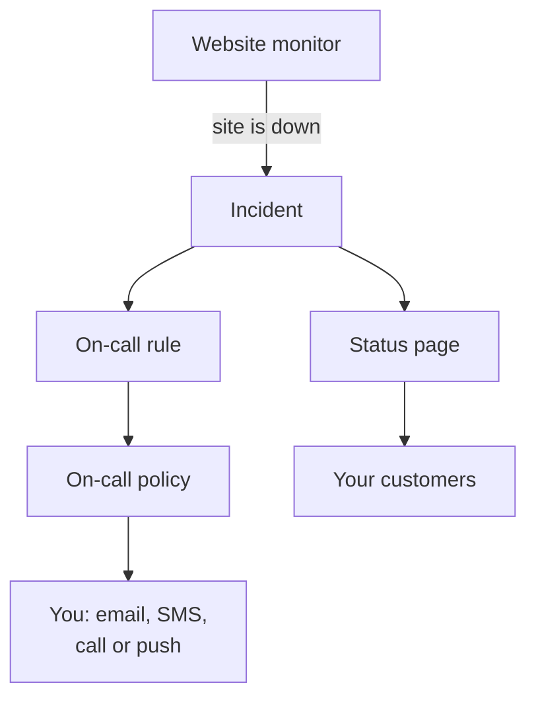

# Quickstart

This guide takes you from a new account to a working setup in about fifteen minutes: a monitor that checks your website every five minutes, an on-call policy that pages you when the site goes down, and a status page that tells your customers. It follows the **Welcome to OneUptime 👋** checklist on your project's Home page, and the guided setups its steps open.

Coming from another tool? [Import it](/docs/introduction/getting-started#coming-from-another-tool) first: your monitors, on-call schedules and status pages come with you.

## Before you begin

- **An account.** On OneUptime Cloud, sign up at [oneuptime.com](https://oneuptime.com/accounts/register) and open the link in the email it sends you. On your own installation, open it in your browser and sign up: the first account becomes the master admin. To install one, see [Docker Compose](/docs/installation/docker-compose).
- **A website to watch.** Any address that answers over HTTP or HTTPS, such as your company's home page.

## Create a project

Everything in OneUptime lives in a project: your monitors, incidents, on-call policies, status pages and the people who work on them.

:::steps
### Start a new project

The first time you sign in, OneUptime shows **No projects**. Click **Create New Project**. If someone already invited you to a project, accept the invitation on the same page instead.

### Name it

Enter a **Project Name**, such as your company's name. On OneUptime Cloud, pick a plan below it as well: Free is already picked, and the paid plans start with a free trial.

### Create it

Click **Create Project**. Your project's Home page opens, with the **Welcome to OneUptime 👋** checklist at the top. It first asks **What do you want to do first?**: tick **Know when my website or API is down**, **Page the right person when something breaks** and **Tell my customers with a status page**, and click **Continue**.
:::

## Monitor your website

:::steps
### Open the website setup

In the checklist, click **Create your first monitor**. It opens the guided setup **Know when my website or API is down**, which checks your site, chooses who is told and sends a test, on one page. Someone who may not create monitors gets the **Monitors** list instead.

### Enter the address

Under **What should we check?**, type the full address of your site in **Website or API address**, such as `https://example.com`, and click **Start checking**. The probes check it at once, then every 5 minutes: when the site does not answer, or answers with an error, the monitor goes **Offline** and declares an incident. Click **Continue**.

On OneUptime Cloud's Free plan, monitors are billed as they are used, so the project needs a payment method before it can check your site: without one, the step asks you to [add a payment method](/docs/configuration/billing#payment-methods).

### Choose who is told

Under **Who should be told?**, you are already in **Who is paged**. Click **Save and continue**: this makes `Default on-call policy`, which pages you for every new incident and alert in the project, by email to start with. To page teammates who are already in the project as well, click **Add teammates** first.

### Send yourself a test

Under **Send a test**, click **Send me a test page**, pick a **Severity** and click **Send test page**. Open the link in the email, which says TEST, and acknowledge the page there. Then click **Done** in the dialog, and **Continue**: the setup ends on a summary of what it set up.
:::

To set every option yourself, or to check something other than a website, open **Monitors** from the **Products** menu and click **Create Monitor**. [Creating a Monitor](/docs/monitor/create-monitor) describes the form and every monitor type.

To check an API too, and to see what to do when the first check never comes back, follow [Know When Your Website or API Is Down](/docs/guides/website-down).

## Get paged when it goes down

The website setup already made `Default on-call policy`, which pages you by email for every new incident and alert, so the checklist ticks **Set up an on-call policy** as done. Its guided setup still adds your phone, the people paged with you and what happens when nobody answers.

:::steps
### Open the on-call setup

Press `Ctrl+K` (`Cmd+K` on a Mac), type `get paged` and choose **Page the right person when something breaks**. While the checklist has not ticked **Set up an on-call policy**, that step opens the same guided setup.

### Choose how you are reached

Under **How should we reach you?**, your sign-in email is listed already. For push notifications, install the OneUptime On-Call app from the App Store or Google Play, sign in, and click **Recheck**. To be texted and called too, click **Turn on SMS and phone calls**, type your number in **Your phone number** and click **Text me a code**: on OneUptime Cloud, texts and calls are paid from the project's balance, so the step asks you to add some first. Click **Continue**.

### Choose who else is paged

Under **Who else is on call?**, keep `Default on-call policy` under **On-call policy**. To page teammates with you, add them under **Add to the first escalation rule**. Click **Save and continue**.

### Decide what happens if nobody answers

Under **What if nobody answers?**, pick **Page the same people again** while you are the only person in the project. Once teammates are in, **Page someone else** pages the person you pick under **Paged next**. On OneUptime Cloud, only paid plans offer that choice. Click **Save and continue**.

### Send a test page

Under **Send a test page**, click **Test this policy**, pick a **Severity** and click **Send test page**. Acknowledge the page from the email, the text message or the call, then click **Done** in the dialog, and **Continue**. The setup ends on **Paging is set up**.
:::

> [!NOTE]
> SMS and phone calls are off in a new project. A project owner, a Billing Admin or someone with Manage Billing turns them on in the **Notification Channels** card, under **Project Settings → Notifications → Notification Channels**.

Two on-call rules run the policy: one for every new incident and one for every new alert. To see the first, open **Incidents** from the **Products** menu, expand **Rules** in the side menu and choose **On-Call Rules**: it matches **All incidents**. To page the policy for only some incidents, such as critical ones, edit the rule there, or click **Create Incident On-Call Rule** to add one of your own.

To build a policy field by field instead, open **On-Call** from the **Products** menu and click **Create On-Call Policy**. For more levels, rotations and how long each level waits, see [Escalation Rules](/docs/on-call/escalation-rules) and [On-Call Schedules](/docs/on-call/schedules).

For every screen of the setup, and what to do when a page does not arrive, follow [Get Paged by Phone, SMS or Push](/docs/guides/paging).

## Publish a status page

:::steps
### Open the status page setup

In the checklist, click **Publish a status page**. It opens the guided setup **Publish a status page**, which names the page, puts your monitor on it and shows what your customers see. Someone who may not create status pages gets the **Status Pages** list instead. The website setup's summary opens the same setup, as **Show it on a status page**.

### Name it and pick your monitor

Under **Name it, and pick what it shows**, keep the **Status page name** it suggests, or type your own. Under **What it shows**, tick your website monitor, and click **Create the status page**. The page is public at its link from this moment: anyone with its address can open it.

### Open the page

Under **This is what your customers see**, open the address under **Public link**: your website is listed as operational. Back in the setup, click **Looks good**. The setup ends on a summary with what to do next.
:::

To make a page by hand instead, open **Status Pages** from the **Products** menu and click **Create Status Page**, then add your monitor with **Add Monitors** on its **Overview**. To give the page your own logo and colors, see [Status Page Branding & Domains](/docs/status-pages/branding-and-domains).

To put the status page on your own domain, over HTTPS, follow [Publish a Status Page](/docs/guides/status-page).

## Invite your team

In the checklist, click **Invite your team**, or open **Users** from the **Products** menu, under **Settings**. Click **Invite User**, enter their **Email**, and pick a **Team**: the members team is picked to start with. Click **Invite**. OneUptime emails them the invitation, and the team decides what they can do. See [Users, Teams & Permissions](/docs/permissions/index).

## Try it out

Declare a test incident to see the whole chain work.

:::steps
### Declare a test incident

Open **Incidents** and click **Declare Incident**. Enter a **Title**, such as `Test incident`, pick an **Incident Severity** and click **Next**. Under **Monitors**, pick your website monitor, so the incident shows on your status page. Click **Next** until you reach the summary, then click **Declare Incident**.

### Watch it happen

Within a minute or two, your on-call policy pages you, and the incident shows on your status page.

### Resolve it

On the incident's page, click **Resolve**. The paging stops, and the incident leaves your status page.
:::

> [!WARNING]
> Anyone who opens your status page sees the test incident until you resolve it. Run the test before you share the page's address.

## Troubleshooting

:::details I was not paged
Open the incident and choose **On-Call Executions** in its side menu: it shows whether your policy ran, and whom it paged. If it did not run, check that your on-call rule is enabled and names the policy. If it ran, check that your methods under **User Settings → Notification Methods** are verified.
:::

:::details The incident is not on my status page
A status page shows an incident when one of the incident's monitors is on the page. Check that the incident lists your monitor under its affected resources, and that the monitor is on the status page.
:::

:::details The monitor says it is offline, but my site works
Open the monitor and check what the probes received. See the troubleshooting section of [Website Monitor](/docs/monitor/website-monitor).
:::

## Next steps

:::cards
- [Core Concepts](/docs/introduction/core-concepts): The ideas behind what you just set up.
- [Glossary](/docs/introduction/glossary): Every word you met on the way, in a sentence or two.
- [On-Call Schedules](/docs/on-call/schedules): Share being on call with your team.
- [Status Page Branding & Domains](/docs/status-pages/branding-and-domains): Make the status page your own.
- [OpenTelemetry](/docs/telemetry/open-telemetry): Send logs, metrics and traces from your apps.
:::
