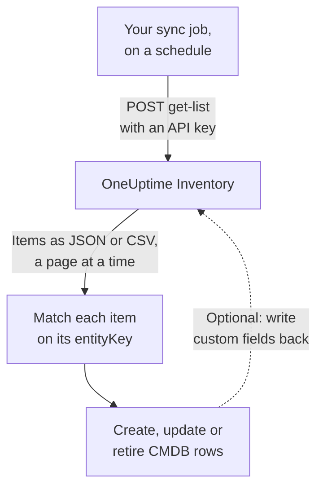

# Exporting to a CMDB

If you already run a CMDB or an asset register, OneUptime is not trying to replace it. What it has that a CMDB usually lacks is a picture of what is actually running, kept up to date without anyone maintaining it: discovered from telemetry, and from the pollers that already watch your network and cloud accounts. This page is the recipe for pulling that picture into your own system of record.

:::cards
- [How a sync works](#how-a-sync-works): A scheduled job that reads the list and matches on a stable key.
- [Pull the catalog](#pull-the-catalog): The request, page by page, as JSON or CSV.
- [Asset Details](#asset-details): The same facts and keys for hosts and network devices.
- [Write back](#write-back): Push your asset tags into OneUptime, and add what it cannot see.
:::

## How a sync works

A sync is a job you run on a schedule. It reads the Inventory list through the REST API with an API key, matches each item to a row of your CMDB by its identity key, and creates, updates or retires rows to match. It can also write values back into the items' custom fields.



## What you can pull

Three REST resources, each with the standard endpoints of the [OneUptime API](/docs/api-reference/api-reference):

| Resource | Endpoint | What it holds |
| --- | --- | --- |
| Inventory Item | `/api/inventory-item` | One row per thing in the estate |
| Custom field definitions | `/api/inventory-item-custom-field` | Your project's own field vocabulary |
| Relationships | `/api/inventory-item-relationship` | The directed links between items |

The useful columns of an inventory item:

| Column | Meaning |
| --- | --- |
| `_id` | OneUptime's ID: use it as your external reference |
| `entityType` | `host`, `k8s.pod`, `network.device`, `appliance`, … |
| `entityKey` | A stable identity hash. It survives renames, so it is the better key to match on |
| `displayName` | The name people read |
| `source` | `discovered`, `inventory` or `manual` |
| `description` | Free text |
| `identifyingAttributes` | The attributes that make the item what it is, which never change |
| `descriptiveAttributes` | Everything else observed on it: see [Asset Details](#asset-details), [Host Asset Attributes](#host-asset-attributes) and [Network device asset attributes](#network-device-asset-attributes) below |
| `customFields` | Your own fields, keyed by field name |
| `resourceType` / `resourceId` | A pointer to the richer OneUptime record, when there is one |
| `firstSeenAt` / `lastSeenAt` | When it was first and last observed |
| `isArchived` | Whether it has been taken out of the live list |

## Before you begin

A sync needs an API key that may read the inventory. On OneUptime Cloud, API keys need the **Growth** plan or above.

:::steps
### Create an API key

Open **Project Settings → Advanced → API Keys** and click **Create API Key**. Give it a **Name**, and under **Access** pick **Viewer** to read everything in the project, or **Choose permissions later** to give it only what a sync needs.

### Give it only what it needs

A read-only export needs one permission, **Read Telemetry Service**: Inventory shares the telemetry permissions rather than having its own. On the key's page, click **Add Permission** and pick it. To write values back, add **Edit Telemetry Service** too.

### Copy the key

Copy the **API Key** from the key's page, and make it available to your job:

```bash
export ONEUPTIME_API_KEY="your-api-key"
```
:::

The key is sent in the `ApiKey` header of each request, and it reads its own project's inventory, so a request names no project.

## Pull the catalog

`POST` to the list endpoint with the columns you want. `select` is required: the API returns only what you ask for.

```bash
curl -X POST 'https://oneuptime.com/api/inventory-item/get-list' \
  -H "ApiKey: $ONEUPTIME_API_KEY" \
  -H 'Content-Type: application/json' \
  -d '{
    "query": { "isArchived": false },
    "select": {
      "_id": true,
      "entityType": true,
      "entityKey": true,
      "displayName": true,
      "source": true,
      "customFields": true,
      "descriptiveAttributes": true,
      "lastSeenAt": true
    },
    "sort": { "displayName": "ASC" },
    "limit": 100,
    "skip": 0
  }'
```

On a self-hosted install, use your own OneUptime address in place of `https://oneuptime.com`. The answer is `{ "data": [...], "count": ... }`, where `count` is how many items match in all. Page by raising `skip` by your `limit` until you have them all; `limit` goes up to 10,000. Dates and IDs other than `_id` come back wrapped, as `{ "_type": "DateTime", "value": "..." }` and `{ "_type": "ObjectID", "value": "..." }`: read them from `value`.

### Just the network devices

Narrow the list by `entityType`:

```bash
curl -X POST 'https://oneuptime.com/api/inventory-item/get-list' \
  -H "ApiKey: $ONEUPTIME_API_KEY" \
  -H 'Content-Type: application/json' \
  -d '{
    "query": { "entityType": "network.device", "isArchived": false },
    "select": { "_id": true, "entityKey": true, "displayName": true, "customFields": true },
    "limit": 100,
    "skip": 0
  }'
```

Each network device's `descriptiveAttributes` carries its hostname, IP address, serial number, MAC address, make, model, firmware, operating system, role, site and location: see [Network device asset attributes](#network-device-asset-attributes) below. What else the poller knows, such as interfaces and neighbours, is on the Network Device record itself: follow `resourceId` to `/api/network-device/:id/get-item`, or pull `/api/network-device/get-list` directly.

### As CSV

Any list endpoint answers in CSV instead of JSON with `?output-type=csv`:

```bash
curl -X POST 'https://oneuptime.com/api/inventory-item/get-list?output-type=csv' \
  -H "ApiKey: $ONEUPTIME_API_KEY" \
  -H 'Content-Type: application/json' \
  -d '{ "query": {}, "select": { "displayName": true, "entityType": true, "customFields": true }, "limit": 500, "skip": 0 }' \
  -o inventory.csv
```

The **All Items** list in the dashboard exports the same way, with whichever custom field columns you have turned on. Each [asset detail](#asset-details) is a column there too: **Hostname**, **IP Address**, **Serial Number**, **Model** and the rest start hidden, so turn them on from the column picker, and the export carries one column per fact, whether a row is a host or a network device.

## Asset Details

Hosts and network devices are described by the same facts, stored under the same keys. One CMDB column holds the serial number whether a row is a server or a switch, and an item's **Asset Details** card in the dashboard shows every fact in the same order for both. A fact nothing has reported reads **Unknown** rather than being left out, so a gap is visible.

| Fact | Key | On a host | On a network device |
| --- | --- | --- | --- |
| Hostname | `host.name` | The host's name. It is the host's identity, so it is in `identifyingAttributes` | The device's own name: its SNMP `sysName`, else the NetBIOS or DNS name discovery found. Never its IP address |
| IP address | `host.ip` | Every address the collector reports | The address OneUptime polls, when it is an IP address, else the address its probe resolved that DNS name to |
| MAC address | `host.mac` | Detected | Typed on the device, or learned from a walked router's ARP table |
| Serial number | `host.serial_number` | Stamped | ENTITY-MIB |
| Manufacturer | `device.manufacturer` | Stamped | ENTITY-MIB, else what `sysDescr` or `sysObjectID` names |
| Model | `device.model.name` | Stamped | ENTITY-MIB, else what `sysDescr` names |
| Firmware version | `device.firmware.version` | Stamped | ENTITY-MIB, else what `sysDescr` names |
| Operating system | `os.name` | `os.description` (or `os.type`) | What `sysDescr` names: Cisco IOS, Junos OS, Arista EOS, Linux |
| OS version | `os.version` | Detected | ENTITY-MIB, else what `sysDescr` names |
| Device type | `device.type` | Stamped. Otherwise the card classifies it from its OS and name (Server, Firewall, ...) | Its role: the one you assigned, else the one the topology map draws it as |
| Location | `device.location` | Stamped. Otherwise the card shows its cloud zone | `sysLocation`. The card shows its site first |

The [host table](#host-asset-attributes) and the [network device table](#network-device-asset-attributes) below say where each value comes from in detail.

## Host Asset Attributes

`descriptiveAttributes` on a host carries the asset facts a CMDB row usually wants, keyed by their OpenTelemetry attribute name:

| Field | Key | Collected by default? |
| --- | --- | --- |
| IP addresses | `host.ip` | Yes: comma-separated when the machine has several |
| MAC addresses | `host.mac` | Yes: comma-separated, one per interface that is up, as `AC-DE-48-23-45-67` |
| Architecture | `host.arch` | Yes |
| Machine ID | `host.id` | Yes: the machine GUID on Windows, `/etc/machine-id` on Linux |
| Operating system | `os.type`, `os.description`, `os.version` | Yes |
| Cloud placement | `cloud.provider`, `cloud.region`, `cloud.availability_zone` | Only with a cloud detector |
| Serial number | `host.serial_number` | Needs one config step |
| Make | `device.manufacturer` | Needs one config step |
| Model | `device.model.name` | Needs one config step |
| Firmware (BIOS or UEFI) version | `device.firmware.version` | Needs one config step |
| Operating system name | `os.name` | Only from SDKs that report it: `os.description` names the OS otherwise |
| Device type | `device.type` | Optional: stamp it the same way (`Hypervisor`, `Workstation`) |
| Location | `device.location` | Optional: stamp it the same way (`Frankfurt DC, Rack B4`) |

Everything marked Yes comes from the collector's `resourcedetection` processor, and is already in the configuration OneUptime generates for you.

The `cloud.*` keys need a cloud detector in that processor: `detectors: [system, env, ec2]`, or `gcp` or `azure` for the others. The shipped configuration runs `[system, env]` only, so those three stay empty until you add one.

The serial number, make, model and firmware have no resource detector: they live in the machine's firmware, read through WMI on Windows and DMI on Linux, so they are stamped onto the resource once, when the machine is provisioned. A device type or a location you want on the row is stamped the same way. [Inventory attributes](/docs/telemetry/host-otel-collector#inventory-attributes-ip-mac-serial-number-make-model-firmware) has the exact snippet for each operating system. `host.manufacturer`, `host.model.name`, `host.firmware.version` and `host.bios.version` are accepted as other spellings and stored under the `device.*` keys (and `device.serial_number` under `host.serial_number`), so a sync only ever reads one key per fact.

`host.id` is worth a look as a key to match on if your CMDB already keys on a hardware identifier: unlike `entityKey`, it is the machine's own ID, so it matches what an endpoint management tool reports for the same box.

Attributes are added, never blanked: one that stops being reported stays on the row, so a value your sync has already read never silently disappears.

## Network Device Asset Attributes

A network device (`entityType: network.device`) is mirrored from its Network Device record, and its `descriptiveAttributes` use the same keys a host uses for the same facts, so one CMDB column holds the serial number whether the row is a server or a switch:

| Field | Key | Where it comes from |
| --- | --- | --- |
| Hostname | `host.name` | The device's own name: its SNMP `sysName`, else the NetBIOS or reverse-DNS name discovery found. Left out when only its IP address names it |
| IP address | `host.ip` | The address OneUptime polls, when it is an IP address. For a device polled at a DNS name, the address its probe last resolved that name to |
| DNS name | `net.device.dns_name` | The reverse-DNS name found at discovery, or the DNS name OneUptime polls |
| MAC address | `host.mac` | Typed on the device, or learned from a walked router's ARP table |
| Make | `device.manufacturer` | ENTITY-MIB `entPhysicalMfgName`, else the maker `sysDescr` names, else the vendor of the `sysObjectID` |
| Model | `device.model.name` | ENTITY-MIB `entPhysicalModelName`, else the model `sysDescr` names |
| Serial number | `host.serial_number` | ENTITY-MIB `entPhysicalSerialNum` |
| Firmware version | `device.firmware.version` | ENTITY-MIB `entPhysicalFirmwareRev`, else the firmware `sysDescr` names on Ubiquiti, HPE and Aruba devices |
| Operating system | `os.name` | The operating system `sysDescr` names |
| Software or OS version | `os.version` | ENTITY-MIB `entPhysicalSoftwareRev`, else the release `sysDescr` names |
| System description | `os.description` | `sysDescr` |
| Device type | `device.type` | The role you assigned the device, else the role the topology map classifies it as, by your project's name for it |
| Location | `device.location` | `sysLocation`, unless it is an agent's default such as Net-SNMP's "Sitting on the Dock of the Bay" |
| Site | `oneuptime.site.name` | The Network Site the device is assigned to |
| Polled address | `net.device.hostname` | The address OneUptime polls: an IP address or a DNS name. Kept for syncs written before `host.name` and `host.ip` existed |

The ENTITY-MIB rows fill in after the device's first SNMP walk. A device that is not walked, because it is monitored by ping alone or not yet polled, still gets its name, make, operating system and location from what the last discovery scan of its address read over SNMP, and its MAC address from a walked router's ARP table. A device that does not implement ENTITY-MIB has no serial number or firmware to report. Its `sysDescr` still names the model and operating system for many platforms: a Cisco Meraki MX reports `Meraki MX85`, which fills in the make and model. A platform whose `sysDescr` has no known shape adds nothing, rather than a guess.

A Meraki device takes what its own poll leaves empty from the Meraki dashboard, when a [Meraki connection](/docs/monitor/network-traffic#cisco-meraki-without-netflow) reads its organization: its serial number, model, firmware and make, its MAC address, its name, its management address, the street address it is filed under and its type. A device is one of the organization's devices when its serial number or MAC address is the Meraki device's, or when OneUptime polls it at the Meraki device's management address and it has the same name. A value saved on the device, and what its own poll reads, come first.

A value saved on the device, typed or set through the API, is never replaced by what discovery reads. Of a value the device's own walk read and one a scan read, the newer is used. A scan's reading is used only when the scan found the same machine at the address: when the system name, `sysObjectID` or NetBIOS name it read contradicts the device's, nothing it read there is used. The item's **Asset Details** card says where each value came from and when.

The hostname is never the IP address. A device that only its address names has `host.ip` and no `host.name`. Once its SNMP walk reports a system name, `host.name` follows on the next pass.

These values are copied from the Network Device record every fifteen minutes, and they **replace** the previous values rather than adding to them, so a value cleared on the device (a MAC address removed, say) also leaves the inventory item.

There is no *available upgrade* version: SNMP has no standard object for one, so OneUptime records the version the device is running.

## Match items to CMDB rows

Match on `entityKey`, not on `displayName`. It is a hash of the item's identifying attributes, so it survives renames and new tags: a host that gets relabelled keeps the same key while its display name changes. `_id` is just as stable, and is the simplest foreign key if you only ever talk to one project.

Dates in `customFields` are ISO-8601 UTC strings, and the CSV export writes them that way rather than in the friendlier form the dashboard shows, so they import without parsing surprises.

## Keep it fresh

There is no change feed. Poll the list endpoint at whatever interval suits you, and compare on `entityKey`. `lastSeenAt` says when an item was last observed, which is usually the cheapest way to spot what has gone quiet since your last run.

To read a network device again now, without waiting for its next poll and the next copy, press **Refresh** on its item's **Asset Details** card, or send `POST /api/network-device/{id}/refresh` with a key that has **Edit Network Device**. Its probe polls it within a minute, its Meraki connection reads the organization again, and its item is copied as soon as the new reading lands.

An item that disappears between runs has either aged out (a discovered item that stayed silent past its window) or had its owning record deleted. A mirrored item that carries custom field values is archived rather than deleted when its record goes, so query with `"isArchived": true` to see what has been retired without losing the asset data attached to it.

## Write back

The same endpoints take writes, so a sync can push values into `customFields`: the asset tag your CMDB already owns, stamped onto the matching OneUptime item, for example. The key needs **Edit Telemetry Service** for that.

You can also add items for things OneUptime cannot see, with `POST /api/inventory-item`, an `entityType` of `external.service`, `external.database` or `appliance`, and a `displayName`. OneUptime works out the identity key for you, and those items never expire. The key needs **Create Telemetry Service** for that.

## Troubleshooting

:::details Every request is refused with 402 Payment Required
On OneUptime Cloud, API keys work only while the project is on the **Growth** plan or above. Nothing is deleted: the key works again as it is once the project is back on the plan. See [API keys and SCIM below their plan](/docs/api-reference/api-reference#api-keys-and-scim-below-their-plan).
:::

:::details Every request answers 422 You do not have permissions
The key has no permission that reads the inventory. A key made with **Choose permissions later** can do nothing until it gets one: add **Read Telemetry Service** on its page, as in [Before you begin](#before-you-begin).
:::

:::details The list comes back without the columns I need
The list answers only the columns `select` names, and `_id`. Add each column you read to `select`, `descriptiveAttributes` and `customFields` included.
:::

:::details An item I expected is missing
Archived items are left out when you send `"isArchived": false`. A discovered item is removed once it has been silent past its window, and a mirrored one leaves with its record. Ask for `"isArchived": true` to see the archived ones.
:::

## Next steps

:::cards
- [Inventory Overview](/docs/inventory/overview): Where items come from, and how long each stays.
- [Inventory Custom Fields](/docs/inventory/custom-fields): Define the fields your sync reads and writes.
- [OneUptime API Reference](/docs/api-reference/api-reference): Requests, status codes and the rules every write follows.
:::
