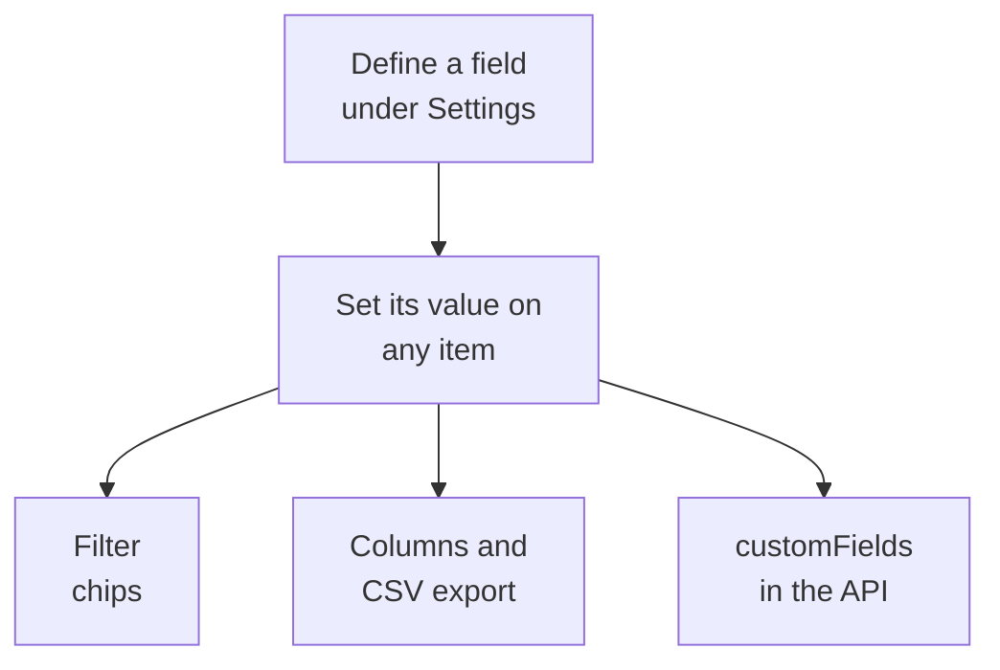

# Inventory Custom Fields

OneUptime discovers what is in your estate. Custom fields record what no amount of watching can tell it: the serial number on the sticker, the date the warranty runs out, which team owns a thing, whether it is in service or in a drawer of spare parts. Define the fields once for the project, then fill them in on each item.

:::cards
- [How custom fields work](#how-custom-fields-work): One vocabulary, on every item, whatever its source.
- [Defining Fields](#defining-fields): Create a field, pick its type, list a dropdown's options.
- [Filter the list](#filter-the-list): Find what expires next quarter in two clicks.
- [Notes and limits](#notes-and-limits): Renames, duplicates, dates and deleted fields.
:::

## How custom fields work

A field is defined once for the project, and every item can carry a value for it: the ones OneUptime discovered, the ones it mirrors and the ones you added by hand. A field becomes a filter chip above the list, an optional column, and a column of the CSV export. The API reads and writes the same values, under each item's `customFields`.

> [!NOTE]
> On OneUptime Cloud, custom fields are part of the **Growth** plan and above. Below it, fields cannot be defined, listed or changed: the API answers `402 Payment Required`, and the list shows no custom field chips or columns.

## Defining Fields

:::steps
### Open the custom fields page

Go to **Products → Resources → Inventory**, open **Settings** in the side menu, then **Custom Fields**.

### Create a field

Click **Create Inventory Item Custom Field**. Give it a **Field Name**, an optional **Field Description**, and a **Field Type** from the table below.

### List a dropdown's options

For a dropdown type, add its options under **Dropdown Options**. Each option can carry a colour, used the same way in the table cell and in the filter chip: pick one of the named colours, **No color**, or **Custom color** for an exact colour code. Drag an option by its handle to change where it is listed.
:::

| Type | Use it for |
| --- | --- |
| **Text** | Serial number, asset tag, rack position, purchase order number |
| **Number** | Cost, rack unit, port count |
| **Boolean** | Under support, in PCI scope |
| **Dropdown (single select)** | Lifecycle status, environment, criticality: one answer from a fixed list |
| **Dropdown (multi-select)** | Compliance scopes, tags: several answers from a fixed list |
| **Date** | Purchase date, warranty expiry, end-of-life date |
| **Date and time** | Last audited at, decommissioned at |
| **Long text** | Access instructions, notes: several lines of plain text |
| **Rich text (Markdown)** | Notes with formatting and links, written in the Markdown editor |
| **File** | A warranty certificate, a signed purchase order, a photo of the rack label: one file |
| **Multiple files** | Manuals, invoices and photos: up to 10 files |

## A worked asset vocabulary

A typical hardware asset register maps onto these fields directly:

| Field name | Type | Example |
| --- | --- | --- |
| `Serial Number` | Text | `FDO24160ABC` |
| `Asset Tag` | Text | `IT-004821` |
| `Purchase Date` | Date | 2024-03-11 |
| `Warranty Expiry` | Date | 2027-03-10 |
| `Lifecycle Status` | Dropdown | In Service, Spare, In Repair, Retired |
| `Assigned Site` | Dropdown | London DC, Frankfurt DC, Office HQ |
| `Owner Team` | Dropdown | Network, Platform, Security |
| `Cost Centre` | Text | `CC-4410` |

Set the values on an item's **Custom Fields** page. Any item takes them, whatever its source, so the switches OneUptime discovered and the network devices it mirrors carry the same asset vocabulary as the appliances you added by hand.

## Filter the list

Every custom field becomes a filter chip above the **All Items** list, and the chip offers the comparisons that suit its type:

| Field type | Comparisons |
| --- | --- |
| **Text**, **Long text**, **Rich text (Markdown)** | is, is not, contains, does not contain, starts with, ends with, is empty, is not empty |
| **Number** | is, is not, is greater than, is greater than or equal to, is less than, is less than or equal to, is empty, is not empty |
| **Boolean**, **Dropdown (single select)**, **Dropdown (multi-select)** | is, is not, is empty, is not empty |
| **Date**, **Date and time** | is, is before, is after, is between, is empty, is not empty |
| **File**, **Multiple files** | is |

A **File** or **Multiple files** chip asks one thing: whether the field **Has files** or has **No files**.

Chips combine with AND, so "Warranty Expiry is before 2026-10-01 AND Lifecycle Status is In Service" is one view of the list. That is the question an asset register exists to answer, and the reason to use the date types instead of a date in a text field: a text field happily stores `2026-10-01`, then cannot tell you what expires next quarter.

Custom field columns start hidden: turn them on from the column picker. They cannot be sorted, because the values live together in one JSON column that the list cannot order by.

## Notes and limits

- Values are stored on each item under the field's name. Renaming a field does not move the values already stored under the old name. Incident custom fields are the exception: renaming one moves its values (see [Renaming a field](/docs/incidents/settings#renaming-a-field)).
- A dropdown's options can be added, renamed, dragged into a new order and taken out after items have values. Renaming an option moves it on every item that has it; an option taken out stays on the items that have it, shown as no longer an option, unless you pick another for them (see [Changing a dropdown's options](/docs/incidents/settings#changing-a-dropdowns-options)).
- Nothing makes a value unique. Two items can carry the same serial number, and nothing stops you.
- Dates are stored as ISO-8601 UTC timestamps and shown in your own time zone.
- Deleting a field removes it from the list and from the filter bar. The values already written stay on the items.
- A **File** or **Multiple files** field takes files of up to 10 MB each, of the kinds listed under [File fields](/docs/incidents/settings#file-fields), uploaded in the project. Only someone who may see the item can download them, and a file is deleted once nothing holds it.

## Next steps

:::cards
- [Inventory Overview](/docs/inventory/overview): Where items come from, and what each page shows.
- [Exporting to a CMDB](/docs/inventory/cmdb-sync): Pull the items and their custom fields into another system.
- [Incident custom fields](/docs/incidents/settings#custom-fields): The same field types on incidents, with a few extras.
:::
