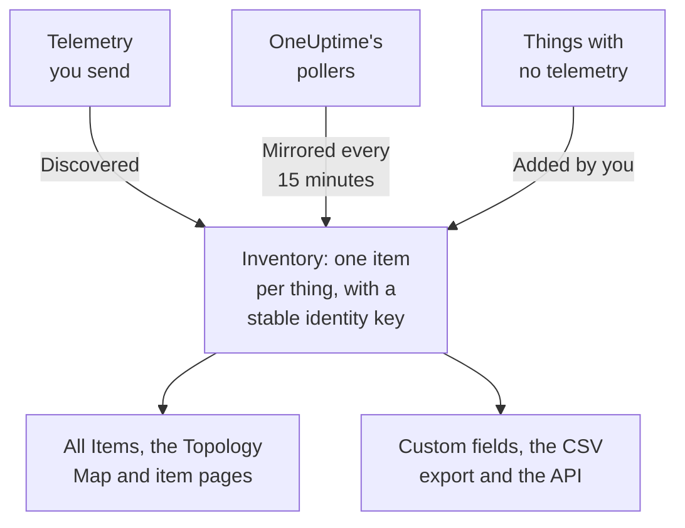

# Inventory Overview

Inventory is one list of everything OneUptime knows about your estate: services, hosts, Kubernetes objects, virtual machines, network devices, cloud resources, IoT devices, serverless functions, and the things that send no telemetry at all. Most of it fills itself in from what OneUptime already watches. You add what watching cannot tell it: what a thing is for, who owns it, when its warranty runs out. The [Glossary](/docs/introduction/glossary#what-you-watch) says what each kind of record in it is.

:::cards
- [How items get into Inventory](#how-items-get-into-inventory): Discovered, mirrored, or added by you.
- [Find your way around](#find-your-way-around): The Inventory pages, and each item's own pages.
- [Import devices from Esper](#import-devices-from-esper): Every Android and Apple device your Esper tenant enrolls, kept current.
- [Import devices from Microsoft Intune](#import-devices-from-microsoft-intune): Every Windows PC, Mac, iPhone, iPad and Android device Intune manages, kept current.
- [Add something by hand](#add-something-by-hand): A third-party API, an external database or an appliance.
- [Archive instead of deleting](#archive-instead-of-deleting): The way to tidy the list that sticks.
:::

## How items get into Inventory

OneUptime is already watching your estate to monitor it, so the catalog is built from what it observes rather than from what someone remembered to type. Every item has a source, and the source decides who owns the item: whether you can edit it, and whether it can go away on its own.

| Source | In the API | Where it comes from | How long it stays |
| --- | --- | --- | --- |
| **Discovered** | `discovered` | OpenTelemetry resource attributes, read as telemetry arrives: a service, host, Kubernetes object or virtual machine that sends telemetry. | Registered again with each batch. Removed once it has been silent for longer than its kind's window (see below). |
| **Mirrored** | `inventory` | A record a OneUptime poller keeps: network devices, cloud resources, IoT devices, serverless functions, RUM applications, Docker hosts, Podman hosts and the devices an Esper or Microsoft Intune connection imports. Copied every 15 minutes. An Esper device, each time its connection is read. | As long as its record. Delete the record, and the item goes with it. |
| **Added by you** | `manual` | Added by you, for something OneUptime cannot see: a third-party API, a vendor-managed database, an appliance in a rack. | Until you delete it. Nothing expires it. |

A discovered or mirrored item cannot be renamed or given another type: its source would overwrite the change on its next pass. The item's **Settings** page says where to make a lasting change instead. What you can always add to any item, whatever its source, is custom field values: see [Inventory Custom Fields](/docs/inventory/custom-fields).

### How long a silent item stays

A discovered item has a heartbeat. Each time telemetry arrives for it, its last-seen time moves forward, and the **Status** column of the list says how recent that is. So does a device from Esper or Intune: each time it checks in with its device manager. Other mirrored items and the ones you added have no heartbeat, so their status stays blank rather than alarming.

| Status | What it means |
| --- | --- |
| **Live** | Seen in the last 30 minutes. |
| **Recent** | Seen within the last day. |
| **Stale** | Not seen for more than a day. The **Gone Quiet** page lists these. |

Every three hours, OneUptime removes the discovered items that have been silent for longer than their kind's window, archived ones included, and their custom field values go with them. Mirrored items and the ones you added are never removed this way.

| Kind of item | Removed after this long without telemetry |
| --- | --- |
| Pods, deployments, Proxmox guests, OpenStack instances and VMware virtual machines | 1 day |
| Kubernetes nodes and namespaces, Proxmox nodes, OpenStack hypervisors, VMware hosts, clusters and datastores, and the databases and remote services your traces call | 7 days |
| Services, hosts, Kubernetes, Proxmox and Ceph clusters, OpenStack clouds, storage arrays, vCenters and Docker Swarm clusters | 30 days |

A relationship OneUptime discovered is removed once it has not been seen again for 30 days.

## Find your way around

Open **Products → Resources → Inventory**. Its side menu has these pages. **By Source**, **Settings**, **Help** and **Advanced** start folded: click a section's title to open it.

| Page | What you find there |
| --- | --- |
| **Overview** | How many items you have, what they are, how many have gone quiet, and what was added most recently. |
| **All Items** | Every item. Search by name, description or identity key, narrow the list by type, source, status or custom field, and add an item by hand. |
| **Managed Devices** | Your Esper and Microsoft Intune connections, and every device they import with its status, group, model and operating system. |
| **Topology Map** | How the items connect: services, what they call, and the hosts, pods and devices they run on. |
| **Gone Quiet** | The items not heard from for more than a day: discovered items that sent no telemetry, and devices that stopped checking in with Esper. |
| **By Source** | The items of one source: **Discovered**, **Mirrored** or **Added by You**. |
| **Settings → Custom Fields** | The fields your project keeps on every item. |
| **Help → Documentation** | A short guide to Inventory, with the kinds of item it recognises. |
| **Advanced → Archived** | The items you archived. Unarchive them from here. |

Open an item, and its own side menu has its **Overview** (its type, source and status, and every attribute observed on it), its **Connections** and its **Custom Fields**; its **Logs**, **Traces**, **Metrics**, **Profiles** and **Exceptions**; and its **Incidents**, **Alerts** and **Scheduled Maintenance**. Under **Advanced** are its **Settings**, its **Audit Logs** and **Delete Item**. The telemetry pages show what the item itself sent. The incidents, alerts and maintenance events are those of the service, host or Kubernetes cluster the item stands for; on any other item, those pages say which resource to look at instead.

### Asset details

A host or a network device has an **Asset Details** card that describes both the same way: hostname, IP address, MAC address, serial number, manufacturer, model, firmware version, operating system, OS version, device type and location. An Android device's card also has its security patch level, from the Android agent or Esper. A fact nothing has reported reads **Unknown**, and the card says why and how the unknown ones get filled in: a device that does not report them over SNMP, a device not read yet, or a Meraki device whose dashboard holds them.

- A host's facts come from the resource attributes on its telemetry: its IP and MAC addresses, architecture and operating system out of the box, and its serial number, make, model and firmware once you stamp them on.
- A network device's facts come from its SNMP poll, its role and its site. What its poll has not read comes from discovery: the last scan of its address, a router's ARP table, or its probe's DNS lookup. A device without ENTITY-MIB, such as a Meraki MX, still gets its make, model and operating system from its system description, and its MAC address from its own ports. Its IP address is never shown as its hostname.
- A Meraki device also takes what its poll leaves empty from the Meraki dashboard, its serial number, model and firmware among them, when a [Meraki connection](/docs/monitor/network-traffic#cisco-meraki-without-netflow) reads its organization.

**All Items** finds the Android devices to act on. Its **Security Patch Level** filter lists the devices **Out of Date**, whose security patch level is more than 90 days old, the rule the Security Patch Out of Date alert of the [Host Monitor](/docs/monitor/host-monitor) reads. Its **Agent Permissions** filter lists the devices on which the [Android agent](/docs/telemetry/android-agent) still lacks READ_LOGS, READ_DROPBOX_DATA or usage access. Each has a column of the same name, hidden until you turn it on, and the CSV export carries it.

The card says where each fact came from and when. The source most facts share, such as a host's collector, a network device's own SNMP poll or the discovery scan that read it, is named once, below the facts. Any other source, such as a router's ARP table or a value saved on the device, is named under its fact. A value saved on a network device is never replaced by what discovery reads, and when the two differ, the card shows both.

A network device's card has a **Refresh** button for whoever may edit network devices. It reads the device again now: its probe polls it within a minute, and its Meraki connection reads the organization again. The card says when the new reading has landed, or that the probe could not reach the device, and the item is copied from the device as soon as the reading lands.

The same facts are columns of the **All Items** list, hidden until you turn them on, and they go into its CSV export. [Exporting to a CMDB](/docs/inventory/cmdb-sync#asset-details) lists their keys.

### Connections

An item's **Connections** page lists its neighbours in both directions, grouped into **Calls**, **Called by**, **Runs on** and **Related**. Each group shows its total (a group with more than 100,000 connections shows "100,000+"), and **Show more** pages through the rest, so a busy cluster, namespace or node shows every connection rather than the first few. The page is not limited to a time range: it includes relationships added by hand through the API, and neighbours that have been archived. A neighbour that is no longer in Inventory is shown by its key.

## Import devices from Esper

Connect an Esper tenant, and every device it enrolls is in Inventory: its Android devices, including the ones whose app never started, and its iPhones, iPads and Apple TVs. Each device is one host, with what only Esper knows about it: its group, its operating system and build, its serial number and IMEI, its battery and storage, and an Android device's security patch level and installed apps. Esper sends nothing on its own, so OneUptime reads it on a schedule: the devices every 15 minutes, and each Android device's apps every 6 hours.

:::steps
### Make an API key in Esper

In the Esper console, create a key under API Key Management. OneUptime only reads, so the key of a user whose Esper role can read devices, groups and apps is enough. A key stops working once it is replaced, or once its user is deleted.

### Connect the tenant

Go to **Products → Resources → Inventory**, then **Managed Devices**, click **Connect device manager**, and pick **Esper**. Enter the **Tenant**, the name before `.esper.cloud` in your Esper console's address (`acme` for `acme.esper.cloud`), and the **API Key**. **More fields** holds the connection's name and how often it is read.

### Check the first read

**Connect** tests the key before it saves anything: it says how many devices a read will import, or what is wrong and how to fix it. The first read starts within a minute, and the connection's row says how it went.
:::

| What Esper reports | Where it shows |
| --- | --- |
| Model, manufacturer, serial number, operating system and its version, build, and IP and MAC addresses | The device's **Asset Details** card, and the columns of **All Items** |
| Status, last check-in, group, security patch level, IMEI, battery, storage and Esper agent | The device's **Esper** card, and the **Devices** list of **Managed Devices** |
| Apps and their versions | The device's **Installed Apps** list |

### One device, not two

An app or the Android Agent that sends telemetry from a device joins the device Esper imports as one item when it names the device the way Esper does. Set these resource attributes from the managed configuration Esper fills in on each device:

| Resource attribute | Managed configuration value | What it is |
| --- | --- | --- |
| `host.name` | `${esper.deviceName}` | The device's name in Esper, like `ESP-ID-AAAAW`. Needed. |
| `host.serial_number` | `${esper.serialNumber}` | The device's serial number. Optional. |

OneUptime finds a device's item by its name in Esper, then by its serial number, and makes one only when none matches. The Android Agent sets both from its `device_name` and `device_serial` settings, and [Android Setup](/docs/rum/android-setup#import-the-fleet-from-esper) shows an app's managed configuration.

### When a device goes quiet, or leaves Esper

An Android device that has not checked in for 30 minutes is **Offline**, and says how long ago it last did; an iPhone, iPad or Apple TV, which checks in when Apple's push service wakes it, often hours apart, is **Offline** after a day. Its item's **Status** follows its last check-in, or its telemetry when that is newer, so a device silent for a day is on the **Gone Quiet** page.

A device removed from Esper is marked **Removed**, and its item is archived: it leaves the list, and waits under **Advanced → Archived**. A device that comes back to Esper comes back to the list. 30 days after it left, the device is deleted, and so is its item, unless telemetry or you added something to it.

### Get an alert when a device stops checking in

On **Managed Devices**, click **Set up alerts** on the connection's row, and create **Esper Android Device Stopped Checking In** and **Esper Apple Device Stopped Checking In**. The first opens one alert for each Android device that has not checked in with Esper for more than an hour, and the second for each Apple device that has not for more than a day, each named after the device and resolved once it checks in again.

Each read of the connection records how many minutes ago each device last checked in, as the metric `oneuptime.managed_device.check_in.age`, and the monitor checks each device's latest reading every 5 minutes. A device that also runs the Android Agent is left to **Host Stopped Reporting**, so it never alerts twice, and a device removed from Esper resolves its alert. A read that fails records nothing, so no alert opens or resolves until the next one. For a fleet that is switched off at night, raise the monitor's threshold.

## Import devices from Microsoft Intune

Connect a Microsoft Intune tenant, and every device Intune manages is in Inventory: its Windows PCs, Macs, iPhones, iPads, Android devices and Linux machines. Each device is one host, with what Intune knows about it: its category, its operating system and version, its serial number and IMEI, its compliance, ownership and enrollment, its storage, and the apps Intune discovered on it. Intune sends nothing on its own, so OneUptime reads it on a schedule: the devices every 15 minutes, and each device's apps every 6 hours.

:::steps
### Register an app in Microsoft Entra

In the Microsoft Entra admin center, open `App registrations` and click `New registration`. Give it a name, keep `Accounts in this organizational directory only`, and register it. Its `Overview` shows the two IDs OneUptime asks for: the `Application (client) ID` and the `Directory (tenant) ID`.

### Let it read Intune's devices

Under `API permissions`, click `Add a permission`, then `Microsoft Graph`, then `Application permissions`, and add `DeviceManagementManagedDevices.Read.All`. Then click `Grant admin consent`, which only an administrator of the tenant can do. That one permission is all OneUptime needs: it lists the devices and the apps Intune discovered on them, and can change nothing.

### Make a client secret

Under `Certificates & secrets`, click `New client secret`, and copy its `Value`, not its `Secret ID`: Microsoft shows the value once. A secret stops working when it expires, so before it does, make a new one and enter it when you edit the connection.

### Connect the Intune tenant

Go to **Products → Resources → Inventory**, then **Managed Devices**, click **Connect device manager**, and pick **Microsoft Intune**. Enter the **Tenant ID**, the **Application (Client) ID** and the **Client Secret**. If the tenant is in a US government cloud, pick it as the **Cloud** under **More fields**. **Connect** tests the app registration before it saves anything: it says how many devices a read will import, or what is wrong and how to fix it.
:::

A device checks in with Intune about every eight hours, and its last check-in is when it last did: a device that has not for a day is **Offline**. Its apps are the ones Intune discovered on it, which Microsoft Graph lists on its beta version only: for a personal device, the apps Intune manages. Intune's groups are Microsoft Entra groups, which this permission does not read, so a device's group is its device category. Nothing about a device's user is read.

Intune names a device what its owner called it, so two devices can share a name: every iPhone nobody renamed is `iPhone`. A name two devices of a connection share is neither one's in Inventory: each is named by its serial number instead, and takes its name back once no other device has it.

To get an alert when a device stops checking in, click **Set up alerts** on the connection's row and create **Intune Device Stopped Checking In**. It opens one alert for each device that has not checked in with Intune for more than a day, named after the device. A laptop left off over a weekend reads the same, so raise the monitor's threshold if a day is too soon for yours.

## Add something by hand

Add an item for something OneUptime will never see on its own, so that a dependency ends somewhere real and the thing can carry your custom fields.

:::steps
### Open All Items

Go to **Products → Resources → Inventory**, then **All Items**.

### Add the item

Click **Add Item**. Pick its **Type**, give it a **Name**, and optionally a **Description**. The name and the type together are the item's identity, so two items of the same type cannot share a name.

### Fill in its custom fields

Open the new item. Its source reads **Added by you**, and its **Custom Fields** page takes the values your project tracks.
:::

You can add three types by hand:

- `external.service` (**External Service**): a third-party API or a software-as-a-service dependency.
- `external.database` (**External Database**): a database that is not a server OneUptime can model. A database server, self-hosted or managed, from PostgreSQL to Snowflake, belongs under **Databases → Create Database** instead ([Databases](/docs/telemetry/databases)): that record joins the traces, containers and engine metrics that name the same address, which an inventory item never does, and adding the same server both ways leaves two unlinked records.
- `appliance` (**Appliance**): hardware or software with no agent.

The restriction stops duplicates. A hand-made item of a type OneUptime can observe, such as a host, would be keyed on the name you typed, while the discovered item for the same machine is keyed on the attributes it reports. The two would never merge, so the same host would sit in your list twice, for good.

## Archive instead of deleting

Archiving takes an item out of the list while it keeps its identity, its history and its custom field values. It says: I have seen this, and I do not want it in my list. An archived item keeps collecting telemetry.

| Source | Archive | Delete |
| --- | --- | --- |
| **Discovered** | Stays archived. | Comes back with the next batch of its telemetry. |
| **Mirrored** | Stays archived. | Comes back with the next copy. Delete the original record instead. |
| **Added by you** | Stays archived. | Gone for good. |

To archive items, select them in **All Items** and archive them in one go, or open an item and use the **Archive** card on its **Settings** page. Archived items are under **Inventory → Advanced → Archived**, where you can select them and unarchive them.

> [!NOTE]
> When a mirrored device is removed from its owning record, OneUptime removes its item too, unless the item carries custom field values you entered. Those values are the only copy and there is no undo, so the item is archived instead of deleted. You will find it under **Advanced → Archived** with everything you typed intact.

## Relationships and topology

OneUptime links items with directed relationships as it observes them. **Inventory → Topology Map** draws them, and an item's **Connections** page lists its own. See [Topology](/docs/telemetry/topology).

| Relationship | For example |
| --- | --- |
| `runs-on` | A pod runs on a node; a virtual machine runs on its host. |
| `member-of` | A pod, node or namespace is a member of a cluster. |
| `hosted-on` | A service is hosted on a host. |
| `part-of` | A pod is part of its deployment. |
| `depends-on` | A service calls another service, from the spans that cross between them. |

## Next steps

:::cards
- [Inventory Custom Fields](/docs/inventory/custom-fields): Track serial numbers, warranty dates, owners and lifecycle status.
- [Exporting to a CMDB](/docs/inventory/cmdb-sync): Pull the catalog into your own system of record.
- [Databases](/docs/telemetry/databases): Monitor the database servers your services use.
:::
