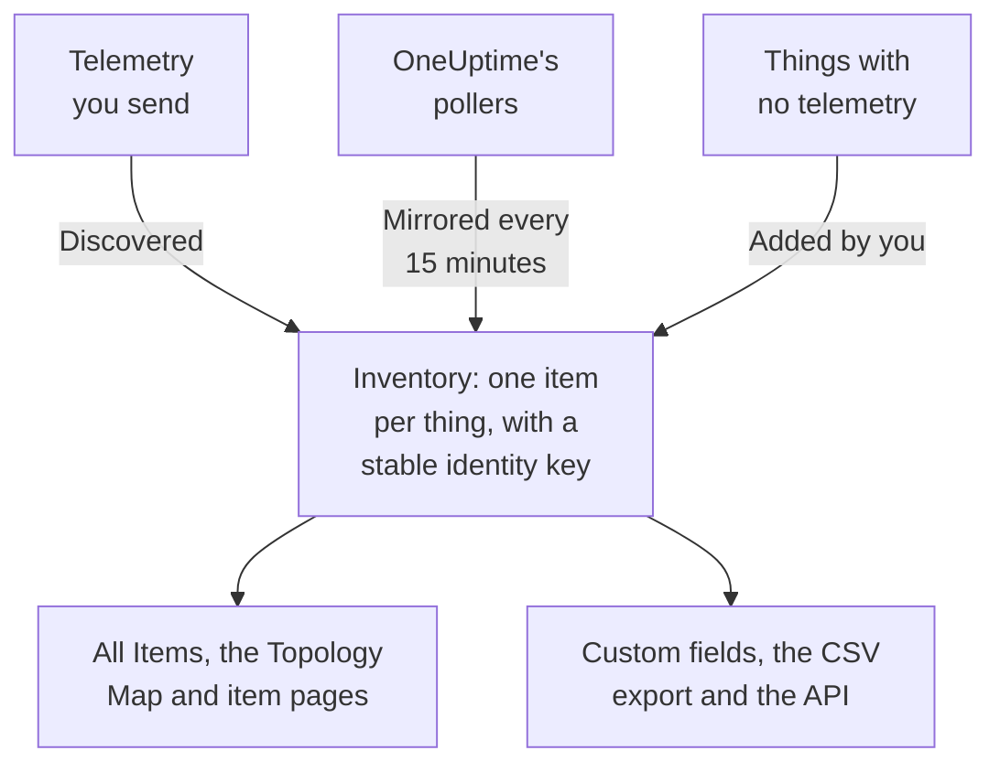

# Inventory Overview

Inventory is one list of everything OneUptime knows about your estate: services, hosts, Kubernetes objects, virtual machines, network devices, cloud resources, IoT devices, serverless functions, and the things that send no telemetry at all. Most of it fills itself in from what OneUptime already watches. You add what watching cannot tell it: what a thing is for, who owns it, when its warranty runs out.

:::cards
- [How items get into Inventory](#how-items-get-into-inventory): Discovered, mirrored, or added by you.
- [Find your way around](#find-your-way-around): The Inventory pages, and each item's own pages.
- [Add something by hand](#add-something-by-hand): A third-party API, an external database or an appliance.
- [Archive instead of deleting](#archive-instead-of-deleting): The way to tidy the list that sticks.
:::

## How items get into Inventory

OneUptime is already watching your estate to monitor it, so the catalog is built from what it observes rather than from what someone remembered to type. Every item has a source, and the source decides who owns the item: whether you can edit it, and whether it can go away on its own.

| Source | In the API | Where it comes from | How long it stays |
| --- | --- | --- | --- |
| **Discovered** | `discovered` | OpenTelemetry resource attributes, read as telemetry arrives: a service, host, Kubernetes object or virtual machine that sends telemetry. | Registered again with each batch. Removed once it has been silent for longer than its kind's window (see below). |
| **Mirrored** | `inventory` | A record a OneUptime poller keeps: network devices, cloud resources, IoT devices, serverless functions, RUM applications, Docker hosts and Podman hosts. Copied every 15 minutes. | As long as its record. Delete the record, and the item goes with it. |
| **Added by you** | `manual` | Added by you, for something OneUptime cannot see: a third-party API, a vendor-managed database, an appliance in a rack. | Until you delete it. Nothing expires it. |

A discovered or mirrored item cannot be renamed or given another type: its source would overwrite the change on its next pass. The item's **Settings** page says where to make a lasting change instead. What you can always add to any item, whatever its source, is custom field values: see [Inventory Custom Fields](/docs/inventory/custom-fields).

### How long a silent item stays

A discovered item has a heartbeat. Each time telemetry arrives for it, its last-seen time moves forward, and the **Status** column of the list says how recent that is. Mirrored items and the ones you added have no heartbeat, so their status stays blank rather than alarming.

| Status | What it means |
| --- | --- |
| **Live** | Seen in the last 30 minutes. |
| **Recent** | Seen within the last day. |
| **Stale** | Not seen for more than a day. The **Gone Quiet** page lists these. |

Every three hours, OneUptime removes the discovered items that have been silent for longer than their kind's window, archived ones included, and their custom field values go with them. Mirrored items and the ones you added are never removed this way.

| Kind of item | Removed after this long without telemetry |
| --- | --- |
| Pods, deployments, Proxmox guests and VMware virtual machines | 1 day |
| Kubernetes nodes and namespaces, Proxmox nodes, VMware hosts, clusters and datastores, and the databases and remote services your traces call | 7 days |
| Services, hosts, Kubernetes, Proxmox and Ceph clusters, storage arrays, vCenters and Docker Swarm clusters | 30 days |

A relationship OneUptime discovered is removed once it has not been seen again for 30 days.

## Find your way around

Open **Products → Resources → Inventory**. Its side menu has these pages. **By Source**, **Settings**, **Help** and **Advanced** start folded: click a section's title to open it.

| Page | What you find there |
| --- | --- |
| **Overview** | How many items you have, what they are, how many have gone quiet, and what was added most recently. |
| **All Items** | Every item. Search by name, description or identity key, narrow the list by type, source, status or custom field, and add an item by hand. |
| **Topology Map** | How the items connect: services, what they call, and the hosts, pods and devices they run on. |
| **Gone Quiet** | The discovered items that have not sent telemetry for more than a day. |
| **By Source** | The items of one source: **Discovered**, **Mirrored** or **Added by You**. |
| **Settings → Custom Fields** | The fields your project keeps on every item. |
| **Help → Documentation** | A short guide to Inventory, with the kinds of item it recognises. |
| **Advanced → Archived** | The items you archived. Unarchive them from here. |

Open an item, and its own side menu has its **Overview** (its type, source and status, and every attribute observed on it), its **Connections** and its **Custom Fields**; its **Logs**, **Traces**, **Metrics**, **Performance Profiles** and **Exceptions**; and its **Incidents**, **Alerts** and **Scheduled Maintenance**. Under **Advanced** are its **Settings**, its **Audit Logs** and **Delete Item**. The telemetry pages show what the item itself sent. The incidents, alerts and maintenance events are those of the service, host or Kubernetes cluster the item stands for; on any other item, those pages say which resource to look at instead.

### Asset details

A host or a network device has an **Asset Details** card that describes both the same way: hostname, IP address, MAC address, serial number, manufacturer, model, firmware version, operating system, OS version, device type and location. A fact nothing has reported reads **Unknown**, and the card says how the unknown ones get filled in.

- A host's facts come from the resource attributes on its telemetry: its IP and MAC addresses, architecture and operating system out of the box, and its serial number, make, model and firmware once you stamp them on.
- A network device's facts come from its SNMP poll, its role and its site. What its poll has not read comes from discovery: the last scan of its address, a router's ARP table, or its probe's DNS lookup. A device without ENTITY-MIB, such as a Meraki MX, still gets its make and model from its system description. Its IP address is never shown as its hostname.

The card says where each fact came from and when. The source most facts share, such as a host's collector, a network device's own SNMP poll or the discovery scan that read it, is named once, below the facts. Any other source, such as a router's ARP table or a value saved on the device, is named under its fact. A value saved on a network device is never replaced by what discovery reads, and when the two differ, the card shows both.

The same facts are columns of the **All Items** list, hidden until you turn them on, and they go into its CSV export. [Exporting to a CMDB](/docs/inventory/cmdb-sync#asset-details) lists their keys.

### Connections

An item's **Connections** page lists its neighbours in both directions, grouped into **Calls**, **Called by**, **Runs on** and **Related**. Each group shows its total (a group with more than 100,000 connections shows "100,000+"), and **Show more** pages through the rest, so a busy cluster, namespace or node shows every connection rather than the first few. The page is not limited to a time range: it includes relationships added by hand through the API, and neighbours that have been archived. A neighbour that is no longer in Inventory is shown by its key.

## Add something by hand

Add an item for something OneUptime will never see on its own, so that a dependency ends somewhere real and the thing can carry your custom fields.

:::steps
### Open All Items

Go to **Products → Resources → Inventory**, then **All Items**.

### Add the item

Click **Add Item**. Pick its **Type**, give it a **Name**, and optionally a **Description**. The name and the type together are the item's identity, so two items of the same type cannot share a name.

### Fill in its custom fields

Open the new item. Its source reads **Added by you**, and its **Custom Fields** page takes the values your project tracks.
:::

You can add three types by hand:

- `external.service` (**External Service**): a third-party API or a software-as-a-service dependency.
- `external.database` (**External Database**): a database that is not a server OneUptime can model. A database server, self-hosted or managed, from PostgreSQL to Snowflake, belongs under **Databases → Create Database** instead ([Databases](/docs/telemetry/databases)): that record joins the traces, containers and engine metrics that name the same address, which an inventory item never does, and adding the same server both ways leaves two unlinked records.
- `appliance` (**Appliance**): hardware or software with no agent.

The restriction stops duplicates. A hand-made item of a type OneUptime can observe, such as a host, would be keyed on the name you typed, while the discovered item for the same machine is keyed on the attributes it reports. The two would never merge, so the same host would sit in your list twice, for good.

## Archive instead of deleting

Archiving takes an item out of the list while it keeps its identity, its history and its custom field values. It says: I have seen this, and I do not want it in my list. An archived item keeps collecting telemetry.

| Source | Archive | Delete |
| --- | --- | --- |
| **Discovered** | Stays archived. | Comes back with the next batch of its telemetry. |
| **Mirrored** | Stays archived. | Comes back with the next copy. Delete the original record instead. |
| **Added by you** | Stays archived. | Gone for good. |

To archive items, select them in **All Items** and archive them in one go, or open an item and use the **Archive** card on its **Settings** page. Archived items are under **Inventory → Advanced → Archived**, where you can select them and unarchive them.

> [!NOTE]
> When a mirrored device is removed from its owning record, OneUptime removes its item too, unless the item carries custom field values you entered. Those values are the only copy and there is no undo, so the item is archived instead of deleted. You will find it under **Advanced → Archived** with everything you typed intact.

## Relationships and topology

OneUptime links items with directed relationships as it observes them. **Inventory → Topology Map** draws them, and an item's **Connections** page lists its own. See [Topology](/docs/telemetry/topology).

| Relationship | For example |
| --- | --- |
| `runs-on` | A pod runs on a node; a virtual machine runs on its host. |
| `member-of` | A pod, node or namespace is a member of a cluster. |
| `hosted-on` | A service is hosted on a host. |
| `part-of` | A pod is part of its deployment. |
| `depends-on` | A service calls another service, from the spans that cross between them. |

## Next steps

:::cards
- [Inventory Custom Fields](/docs/inventory/custom-fields): Track serial numbers, warranty dates, owners and lifecycle status.
- [Exporting to a CMDB](/docs/inventory/cmdb-sync): Pull the catalog into your own system of record.
- [Databases](/docs/telemetry/databases): Monitor the database servers your services use.
:::
