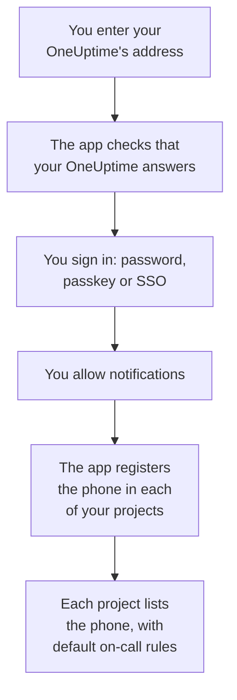
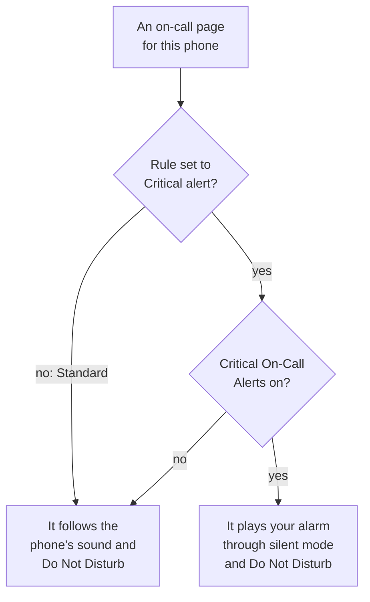

# Android Installation

Install **OneUptime On-Call** on an Android phone or tablet, connect it to your OneUptime and sign in. Then send yourself a test notification, and let urgent on-call pages ring through silent mode and Do Not Disturb.

:::cards
- [Install the app](#install-the-app): From Google Play, or the APK on a phone without it.
- [Sign in](#sign-in): Your OneUptime's address, then your account.
- [Check that pages reach the phone](#check-that-pages-reach-the-phone): Find the phone in the dashboard and test it.
- [Ring through silent mode](#ring-through-silent-mode): Critical alerts and the alarm sound.
- [Troubleshooting](#troubleshooting): Sign-in, notification and install problems.
:::

## Before you begin

- A phone or tablet with Android 7.0 or later.
- An account in a OneUptime project. To be paged, you must also be on call: see [Escalation Rules](/docs/on-call/escalation-rules).
- Your OneUptime's address: `https://oneuptime.com` on OneUptime Cloud, or your own, such as `https://oneuptime.example.com`. The app connects over HTTPS only.

## Install the app

:::tabs
@tab Google Play
1. On the phone, open [OneUptime On-Call on Google Play](https://play.google.com/store/apps/details?id=com.oneuptime.oncall), or search Google Play for OneUptime On-Call.
2. Tap **Install**, then **Open**.

Google Play keeps the app up to date.
@tab APK
For a phone without Google Play. The APK is built from the same code for every OneUptime release and attached to the release on GitHub.

1. On the phone, open [the newest APK](https://github.com/OneUptime/oneuptime/releases/latest/download/oneuptime-on-call-android-app.apk).
2. Open the downloaded file. If Android asks, let your browser install unknown apps, then tap **Install**.
3. Open OneUptime On-Call from your apps.

An APK does not update itself: install the newest one over it from time to time. Your sign-in and settings stay.
:::

## Sign in

:::steps
### Enter your OneUptime's address
Open the app. On **Connect your workspace**, keep `https://oneuptime.com` for OneUptime Cloud, or enter your own OneUptime's address, and tap **Connect**. The app goes on once `https://<your-oneuptime>/api/status` answers.

### Sign in to your account
Use whichever way your account signs in:

- Your email and password, then **Sign In**. **Forgot password?** emails you a link to set a new one.
- **Sign in with a passkey**, once you have added one in the dashboard: see [Add a passkey](/docs/introduction/your-account#add-a-passkey). Your browser opens to confirm it, then brings you back.
- **Sign in with SSO**, if your organization uses single sign-on. Choose your provider, or enter your work email and tap **Continue**. A secure browser opens, and you are back in the app once you have signed in.

With two-factor authentication on, enter the six-digit code from your authenticator app, or one of your backup codes. A security key cannot be used in the app. If your administrator requires two-factor authentication and you have not set it up yet, the app sets up an authenticator app with you first.

### Allow notifications
When Android asks whether OneUptime On-Call may send notifications, tap **Allow**. Android 13 and later ask; earlier versions allow them unless you turn them off.

The app then registers the phone in each of your projects. Every project lists it among your push devices with the default on-call rules, so your pages reach it from now on.
:::

The app shows one project at a time: tap the project's name at the top of a screen to switch. A project that requires single sign-on says **SSO Required** under **Settings → Manage Projects** until you tap **Authenticate with SSO** there.

## Check that pages reach the phone

:::steps
### Find the phone in the dashboard
In the dashboard, open **User Settings → Notification Methods** and the **Push Notifications** tab. The phone is listed under **Push Notification Devices** by its model name. Each project keeps its own list.

### Send a test
Click **Test Notification** on the phone's row. A notification arrives on the phone; tap it to open the app.
:::

Your on-call rules decide which pages go to the phone, and how soon: see **User Settings → On-Call Rules**. A new phone gets the same default rules as any other method you add.

## Ring through silent mode

By default an on-call page follows the phone's sound settings: a muted phone stays quiet, and Do Not Disturb holds the page back. Critical alerts let on-call pages ring through both. They are off until you turn them on, for each phone.

:::steps
### Turn on Critical On-Call Alerts
In the app, open **Settings** and turn on **Critical On-Call Alerts** under **Notifications**.

### Allow Do Not Disturb access
Android opens its **Do Not Disturb access** list. Turn the access on for OneUptime On-Call, then go back to the app: it checks the access and says under the switch whether pages will ring through.

### Choose an alarm sound
Tap **Alarm sound** under the switch. Besides the phone's own sound, it offers Klaxon, Siren, Digital alarm, Smoke alarm and Rising alarm, which starts soft and gets louder. Press play beside a sound to hear it. A critical page plays at the phone's alarm volume, so keep that turned up.
:::

Only on-call pages ring through, and only from on-call rules set to **Critical alert**, the default. A rule set to **Standard** follows the phone's settings whatever the switch says, so you can be woken for a critical incident and paged quietly for a minor one. Send a **Test Notification** with the phone muted to hear what a page will do.

## Keep pages from arriving late

OneUptime sends on-call pages at high priority, which Android delivers even to a phone that has been idle for hours. A phone that restricts the app's battery use can still hold them back:

- Open **Settings → Apps → OneUptime On-Call → Battery** and choose **Unrestricted**. Some phones name it **App battery usage**.
- Check that the app's notifications are on, under **Settings → Apps → OneUptime On-Call → Notifications**.
- Leave OneUptime On-Call out of any battery saver or sleeping-apps list your phone keeps.

## Lock the app

Turn on **Biometrics Login** under **Settings** in the app, and the app asks for your fingerprint, your face or the phone's screen lock each time it starts. The switch is there once the phone has a fingerprint or face unlock set up. **Appearance**, on the same screen, picks the light or dark look, or follows the phone.

## Update, sign out or uninstall

- **Update.** Google Play updates the app. For the APK, install the newest one over it. The app's version is at the bottom of its **Settings** screen.
- **Sign out.** **Settings → Log Out** signs you out and removes the phone from your push devices in every project, together with its on-call rules. Signing in again adds it back with the default rules.
- **Uninstall.** Remove the app as you remove any other. If you were still signed in, the phone stays on your list until a push to it fails: OneUptime then marks it **Not receiving notifications**. Delete that entry with **Delete**: installing the app again and signing in adds the phone as a new entry, with the default rules.

## Troubleshooting

:::details "Could not connect to the server"
The app could not reach `https://<your-oneuptime>/api/status`. Check the address, including `https://`. If your OneUptime is on a private network, connect the phone to it first, through your VPN for example. Open that address in the phone's browser: it shows `{"status":"ok"}` when the phone can reach OneUptime.
:::

:::details No notifications arrive
- Check that notifications are on for the app in Android's settings, and that Do Not Disturb is off or critical alerts are on.
- Check that the phone is listed under **Push Notifications** in **User Settings → Notification Methods**, and send it a **Test Notification**.
- If the phone is marked **Not receiving notifications**, open the app while signed in. It registers the phone again; see [When a phone has to register again](/docs/mobile-desktop-apps/faq-troubleshooting#when-a-phone-has-to-register-again).
- Check your on-call rules under **User Settings → On-Call Rules**.
- On a self-hosted OneUptime, check that your server can reach its push relay: see [Push Notifications](/docs/self-hosted/push-notifications#network-access).
:::

:::details Critical alerts stay quiet in Do Not Disturb
Open the app's **Settings**: the line under **Critical On-Call Alerts** says what is missing. Usually Do Not Disturb access was not allowed: allow it under **Settings → Notifications → Do Not Disturb access**, then go back to the app. If you chose an alarm sound, that sound's notification channel must be allowed to override Do Not Disturb too.
:::

:::details "App not installed" when you install the APK
OneUptime On-Call is already on the phone from another source, such as Google Play, and Android does not install one over the other. Uninstall it, install the APK, and sign in again.
:::

:::details No Biometrics Login switch
The switch appears once the phone has a fingerprint or face unlock set up in Android's settings.
:::

## Next steps

:::cards
- [FAQ & Troubleshooting](/docs/mobile-desktop-apps/faq-troubleshooting): What to do when a phone stops getting pages.
- [iOS Installation](/docs/mobile-desktop-apps/ios-installation): The same app on an iPhone or iPad.
- [Escalation Rules](/docs/on-call/escalation-rules): Decide who is paged, and when.
- [Push Notifications](/docs/self-hosted/push-notifications): How a self-hosted OneUptime sends pages to phones.
:::
