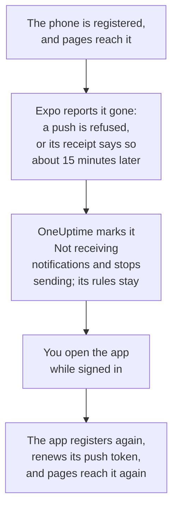

# FAQ & Troubleshooting

Answers to common questions about OneUptime's mobile and desktop apps, and fixes for what goes wrong most often: signing in, notifications that do not arrive, and a phone that has to register again.

:::cards
- [Mobile app questions](#mobile-app-questions): Devices, projects, self-hosting and security.
- [Desktop app questions](#desktop-app-questions): What the desktop app is, and what it cannot do.
- [When a phone has to register again](#when-a-phone-has-to-register-again): Why a phone stops getting pages, and how it comes back.
- [Troubleshooting](#troubleshooting): Sign-in, notification and install problems.
:::

## Mobile app questions

:::details Is the app free?
Yes. OneUptime On-Call is free on the App Store, on Google Play and as an APK on GitHub. You sign in with your OneUptime account.
:::

:::details Which phones and tablets does it run on?
iPhones and iPads with iOS or iPadOS 16.4 or later, and Android phones and tablets with Android 7.0 or later.
:::

:::details Does it work with a self-hosted OneUptime?
Yes. Enter your OneUptime's `https://` address when the app starts, or tap **Change Server** on the sign-in screen. By default your server sends pages to phones through OneUptime's push relay, so it needs no Apple, Google or Expo account: see [Push Notifications](/docs/self-hosted/push-notifications).
:::

:::details Can I use it with several projects?
Yes. The app registers the phone in every project you belong to, so each project can page you. It shows one project at a time: tap the project's name at the top of a screen to switch.
:::

:::details Can I sign in on more than one phone?
Yes. Each phone or tablet is a push device of its own, with its own on-call rules and its own critical alerts setting.
:::

:::details What can I do in the app?
- **Home**: what needs attention in the project: active incidents and alerts, open security cases if your role lets you see them, monitors with issues, and grouped events.
- **Monitors**: every monitor, filtered by health, with its details.
- **Inbox**: incidents and alerts, and the episodes that group them. Open one to **Acknowledge**, **Resolve** or **Add Note**. If your role lets you see the project's security cases, **Security** lists the open ones: open one to **Approve** or **Reject** a playbook step waiting for approval, take it on with **Assign to me**, or **Close case**.
- **On-Call**: whether you are on call and until when, who else is, the pages sent to you, and **Cover for me**, which hands your pages to a teammate for a while.
- **Settings**: your projects and single sign-on, appearance, critical alerts and the alarm sound, **Biometrics Login**, your on-call calendar feed, and **Log Out**.

Everything else is in the dashboard.
:::

:::details Can I acknowledge a page from the notification?
No. Tap the notification: the app opens the incident, alert, episode or security case it is about, in the right project, and you acknowledge it there. If the app is locked or you are signed out, it opens the page once you are in.
:::

:::details Is my sign-in safe on the phone?
The app talks to your OneUptime over HTTPS only. Your sign-in is kept in the app's own storage on the phone, and **Log Out** deletes it and signs the session out on the server. Turn on **Biometrics Login** to have the app ask for your face, fingerprint or passcode each time it starts.
:::

:::details Does the app work offline?
No. It shows **No internet connection** at the top of the screen while it has no connection, and picks up again when it is back.
:::

## Desktop app questions

:::details What is the desktop app?
The OneUptime dashboard, installed from your browser as an app: a window of its own, an icon in the Start menu, the Dock or your launcher, and notifications. It does everything the dashboard does, because it is the dashboard.
:::

:::details Why is it not in an app store?
It does not need to be. The app loads the dashboard from your OneUptime each time it opens, so it is always the version your OneUptime runs, on Windows, macOS and Linux alike, with nothing to update.
:::

:::details Can it wake me up like the phone?
No. Browsers cannot override Do Not Disturb or a Focus, so a desktop notification is only as loud as the computer allows. For pages that must wake you, use the mobile app with critical alerts.
:::

:::details Does it work offline?
No. It needs a connection to your OneUptime, like the dashboard in a browser tab.
:::

## When a phone has to register again

OneUptime sends a phone's pages through Expo, which hands them to Apple or Google. When Expo says the phone can no longer be reached, OneUptime stops sending to it, until the app registers it again.

Expo reports a phone gone when the app was removed from it, or when its push token is no longer valid. The phone is not deleted: **User Settings → Notification Methods**, on the **Push Notifications** tab, shows it as **Not receiving notifications**, and the on-call timeline of a page that did not reach it says why. Your other phones and notification methods are paged as usual.

The app registers the phone each time it starts, when you sign in, and when you come back to it, at most once every five minutes. Registering asks Expo for the push token again, which renews it, and the phone receives pages again with the rules it had.

| What happened | What to do | What OneUptime does |
| --- | --- | --- |
| The app is still installed | Open it while signed in | The phone receives notifications again, with its rules |
| You reinstalled the app on an iPhone or iPad | Install it and sign in | Usually the same entry comes back, with its rules |
| You reinstalled the app on Android | Install it, sign in, and delete the old entry | A new entry with the default rules; the old one stays marked |
| A new phone, set up from a backup of the old one | Open the app on the new phone | If the old phone's entry is marked, the new phone takes it over, with its rules; if not, the new phone gets an entry of its own |
| A new phone, set up from scratch | Sign in, and delete the old entry | A new entry with the default rules |
| You signed out of the app | Sign in again | Signing out removed the phone and its rules; it comes back with the default rules |

A browser can stop receiving notifications too, when its push subscription expires. The dashboard renews it when it can; if the browser stays marked, register it again with **Register Device** in that browser.

## Troubleshooting

### Signing in

:::details "Could not connect to the server"
The app could not reach `https://<your-oneuptime>/api/status`. Check the address, including `https://`: the app does not connect over plain HTTP. If your OneUptime is on a private network, connect the phone to it first, through your VPN for example. Opening that address in the phone's browser shows `{"status":"ok"}` when the phone can reach OneUptime.
:::

:::details "No SSO configuration found for the email"
None of the projects that email belongs to has single sign-on set up, or the email has no account on this OneUptime. Check the email, or sign in with your password. Providers your administrator set up for the whole installation are listed before the email field.
:::

:::details A security key is your only second factor
The app cannot use a security key. Sign in with one of your backup codes, or add an authenticator app to your account in the dashboard: see [Turn on two-factor authentication](/docs/introduction/your-account#turn-on-two-factor-authentication).
:::

:::details Passkey sign-in fails
Passkeys need your OneUptime's address to start with `https://`, and a passkey you added for this OneUptime: see [Add a passkey](/docs/introduction/your-account#add-a-passkey). To use another server, tap **Change Server** on the sign-in screen.
:::

### Notifications

:::details No notifications on the phone
- Check that the phone allows notifications from OneUptime On-Call, and that Do Not Disturb or a Focus is not holding them back.
- In **User Settings → Notification Methods**, on the **Push Notifications** tab, check that the phone is listed, and send it a **Test Notification**.
- If it is marked **Not receiving notifications**, open the app while signed in: see [When a phone has to register again](#when-a-phone-has-to-register-again).
- Check your on-call rules under **User Settings → On-Call Rules**: they decide which pages reach which method.
- On a self-hosted OneUptime, check that the server can reach its push relay: see [Push Notifications](/docs/self-hosted/push-notifications#network-access).
:::

:::details Pages arrive late on Android
Set the app's battery use to **Unrestricted** in Android's settings for OneUptime On-Call, and leave the app out of any battery saver list: see [Keep pages from arriving late](/docs/mobile-desktop-apps/android-installation#keep-pages-from-arriving-late).
:::

:::details Critical alerts do not ring through silent mode
Open the app's **Settings**: the line under **Critical On-Call Alerts** says what is missing on that phone. Then check that the on-call rule that sent the page is set to **Critical alert**, not **Standard**, under **User Settings → On-Call Rules**. Each phone has its own switch.
:::

### Desktop app

:::details No install icon in the address bar
Install from a dashboard page after signing in, over `https://`, in Edge or Chrome, or in Safari on macOS Sonoma 14 or later. If the icon does not show, the browser's menu installs it too: see [Windows Installation](/docs/mobile-desktop-apps/windows-installation#install-the-app).
:::

:::details No desktop notifications
Register the browser under **User Settings → Notification Methods**, on the **Push Notifications** tab, with **Register Device**, allow notifications when asked, and check the computer's own notification settings. A self-hosted OneUptime needs its VAPID keys for browser notifications.
:::

## Get help

If something here does not match what you see, [open an issue on GitHub](https://github.com/OneUptime/oneuptime/issues) with your app's version, from the bottom of its **Settings** screen, and the platform you use.

## Next steps

:::cards
- [Apps Overview](/docs/mobile-desktop-apps/index): Which app to use, and how they reach OneUptime.
- [Android Installation](/docs/mobile-desktop-apps/android-installation): Install and set up the app on Android.
- [iOS Installation](/docs/mobile-desktop-apps/ios-installation): Install and set up the app on an iPhone or iPad.
- [Push Notifications](/docs/self-hosted/push-notifications): How a self-hosted OneUptime sends pages, and Expo's errors.
:::
