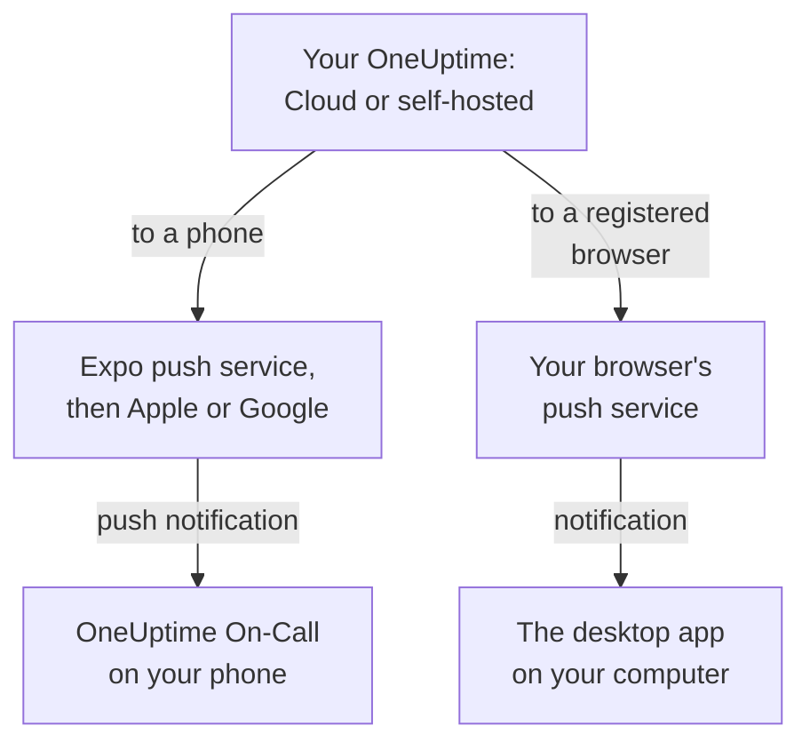

# Apps Overview

OneUptime has an app for your phone and one for your computer. **OneUptime On-Call**, for iPhone, iPad and Android, pages you when you are on call and lets you acknowledge and resolve from wherever you are. On Windows, macOS and Linux, the OneUptime dashboard installs from your browser as a desktop app with a window of its own. Both work with OneUptime Cloud and with a OneUptime you host yourself.

:::cards
- [Choose an app](#choose-an-app): What each app is for, side by side.
- [How the apps reach OneUptime](#how-the-apps-reach-oneuptime): Where sign-in and on-call pages travel.
- [Get the mobile app](#get-the-mobile-app): From the App Store, Google Play or GitHub.
- [Get the desktop app](#get-the-desktop-app): Install the dashboard from Edge, Chrome or Safari.
:::

## Choose an app

|  | Mobile app | Desktop app |
| --- | --- | --- |
| What it is | OneUptime On-Call, a native app for iPhone, iPad and Android | The OneUptime dashboard, installed from your browser |
| Where you get it | The App Store, Google Play, or an APK from GitHub | Your own OneUptime: there is nothing to download |
| On-call pages | Push notifications, which can ring through silent mode and Do Not Disturb | Browser notifications, once you register the browser |
| What you can do | Incidents, alerts, security cases, monitors and who is on call; acknowledge, resolve, approve playbook steps and add notes | Everything the dashboard does |
| Updates | From the store, or by installing a newer APK | Every time it opens, it loads the dashboard from your OneUptime |
| Runs on | iOS 16.4 or later, Android 7.0 or later | Windows, macOS and Linux, with Edge or Chrome, or Safari on macOS Sonoma 14 or later |

You can use both: keep the desktop app open at work, and let the phone wake you at night.

## How the apps reach OneUptime

The mobile app signs in to your OneUptime and registers the phone in each project you belong to. From then on OneUptime sends the phone's push notifications, on-call pages among them, through Expo's push service, which hands them to Apple or Google to deliver. By default a self-hosted OneUptime sends them through OneUptime's push relay, so it needs no Apple, Google or Expo account of its own: see [Push Notifications](/docs/self-hosted/push-notifications).

The desktop app is the dashboard itself, in a window of its own. It shows notifications once you register its browser for push notifications: the Windows, macOS and Linux pages show how.

## Before you begin

- An account in a OneUptime project. To be paged, you must also be on call: see [Escalation Rules](/docs/on-call/escalation-rules).
- Your OneUptime's address. On OneUptime Cloud it is `https://oneuptime.com`; a self-hosted OneUptime has its own, such as `https://oneuptime.example.com`.
- Your OneUptime served over HTTPS. The mobile app does not connect over plain HTTP, and browsers show notifications, and Edge and Chrome install apps, only for HTTPS sites.

## Get the mobile app

:::steps
### Install OneUptime On-Call
Get it from the [App Store](https://apps.apple.com/us/app/oneuptime-on-call/id6759615391) on an iPhone or iPad, or from [Google Play](https://play.google.com/store/apps/details?id=com.oneuptime.oncall) on Android. For an Android phone without Google Play, install the [APK](https://github.com/OneUptime/oneuptime/releases/latest/download/oneuptime-on-call-android-app.apk) instead. The same links are in the dashboard, under **Project Settings → Notifications → Mobile Apps**.

### Connect it to your OneUptime
Open the app, keep `https://oneuptime.com` for OneUptime Cloud or enter your own OneUptime's address, and sign in with your password, a passkey or single sign-on.

### Allow notifications
Allow them when the phone asks. The app registers the phone in each of your projects, and your on-call pages start reaching it.
:::

Each step in detail, with what to check afterwards: [Android Installation](/docs/mobile-desktop-apps/android-installation) and [iOS Installation](/docs/mobile-desktop-apps/ios-installation).

## Get the desktop app

:::steps
### Open your dashboard
Sign in to your OneUptime in Microsoft Edge or Google Chrome, or in Safari on a Mac.

### Install it
In Edge or Chrome, click the install icon at the right of the address bar. In Safari, choose **File → Add to Dock**.

### Open it like any other app
It opens in a window of its own, from the Start menu, the Dock or your app launcher.
:::

Each browser step by step: [Windows Installation](/docs/mobile-desktop-apps/windows-installation), [macOS Installation](/docs/mobile-desktop-apps/macos-installation) and [Linux Installation](/docs/mobile-desktop-apps/linux-installation).

## Next steps

:::cards
- [Android Installation](/docs/mobile-desktop-apps/android-installation): Install the app on Android, sign in and check that pages arrive.
- [iOS Installation](/docs/mobile-desktop-apps/ios-installation): Install the app on an iPhone or iPad and turn on critical alerts.
- [Windows Installation](/docs/mobile-desktop-apps/windows-installation): Install the dashboard from Edge or Chrome.
- [macOS Installation](/docs/mobile-desktop-apps/macos-installation): Add the dashboard to the Dock from Safari, Chrome or Edge.
- [Linux Installation](/docs/mobile-desktop-apps/linux-installation): Install the dashboard from Chrome, Chromium or Edge.
- [FAQ & Troubleshooting](/docs/mobile-desktop-apps/faq-troubleshooting): Answers, fixes, and what to do when a phone stops getting pages.
:::
