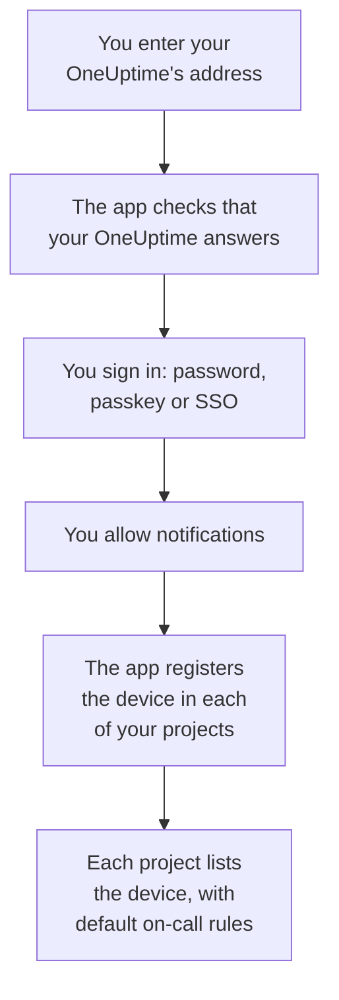

# iOS Installation

Install **OneUptime On-Call** on an iPhone or iPad from the App Store, connect it to your OneUptime and sign in. Then send yourself a test notification, and let urgent on-call pages ring through silent mode and Focus.

:::cards
- [Install the app](#install-the-app): From the App Store.
- [Sign in](#sign-in): Your OneUptime's address, then your account.
- [Check that pages reach the device](#check-that-pages-reach-the-device): Find it in the dashboard and test it.
- [Ring through silent mode](#ring-through-silent-mode): Critical alerts, the alarm sound and its volume.
- [Troubleshooting](#troubleshooting): Sign-in, notification and critical alert problems.
:::

## Before you begin

- An iPhone or iPad with iOS 16.4 or later, or iPadOS 16.4 or later.
- An account in a OneUptime project. To be paged, you must also be on call: see [Escalation Rules](/docs/on-call/escalation-rules).
- Your OneUptime's address: `https://oneuptime.com` on OneUptime Cloud, or your own, such as `https://oneuptime.example.com`. The app connects over HTTPS only.

## Install the app

1. On the iPhone or iPad, open [OneUptime On-Call on the App Store](https://apps.apple.com/us/app/oneuptime-on-call/id6759615391), or search the App Store for OneUptime On-Call.
2. Tap **Get**, and confirm with Face ID, Touch ID or your Apple Account password.
3. Tap **Open**, or open OneUptime On-Call from the Home Screen.

The App Store keeps the app up to date while **App Updates** is on, under **Settings → App Store**.

## Sign in



:::steps
### Enter your OneUptime's address
Open the app. On **Connect your workspace**, keep `https://oneuptime.com` for OneUptime Cloud, or enter your own OneUptime's address, and tap **Connect**. The app goes on once `https://<your-oneuptime>/api/status` answers.

### Sign in to your account
Use whichever way your account signs in:

- Your email and password, then **Sign In**. **Forgot password?** emails you a link to set a new one.
- **Sign in with a passkey**, once you have added one in the dashboard: see [Add a passkey](/docs/introduction/your-account#add-a-passkey). A browser sheet opens to confirm it, then brings you back.
- **Sign in with SSO**, if your organization uses single sign-on. Choose your provider, or enter your work email and tap **Continue**. A secure browser opens, and you are back in the app once you have signed in.

With two-factor authentication on, enter the six-digit code from your authenticator app, or one of your backup codes. A security key cannot be used in the app. If your administrator requires two-factor authentication and you have not set it up yet, the app sets up an authenticator app with you first.

### Allow notifications
When iOS asks whether OneUptime On-Call may send you notifications, tap **Allow**.

The app then registers the iPhone or iPad in each of your projects. Every project lists it among your push devices with the default on-call rules, so your pages reach it from now on.
:::

The app shows one project at a time: tap the project's name at the top of a screen to switch. A project that requires single sign-on says **SSO Required** under **Settings → Manage Projects** until you tap **Authenticate with SSO** there.

## Check that pages reach the device

:::steps
### Find the device in the dashboard
In the dashboard, open **User Settings → Notification Methods** and the **Push Notifications** tab. The iPhone or iPad is listed under **Push Notification Devices** by its model name. Each project keeps its own list.

### Send a test
Click **Test Notification** on the device's row. A notification arrives on the device; tap it to open the app.
:::

Your on-call rules decide which pages go to the device, and how soon: see **User Settings → On-Call Rules**. A new device gets the same default rules as any other method you add.

## Ring through silent mode

By default an on-call page follows the device's sound settings: silent mode keeps it quiet, and a Focus such as Do Not Disturb holds it back. Critical alerts let on-call pages ring through both. They are off until you turn them on, for each device.

```mermaid title="Whether an on-call page rings through on an iPhone or iPad"
flowchart TB
    Page["An on-call page<br/>for this device"]
    Rule{"Rule set to<br/>Critical alert?"}
    Device{"Critical On-Call<br/>Alerts on?"}
    Quiet["It follows the<br/>device's sound<br/>and Focus"]
    Loud["It plays your alarm,<br/>at your volume,<br/>through silent mode<br/>and Focus"]
    Page --> Rule
    Rule -->|"no: Standard"| Quiet
    Rule -->|"yes"| Device
    Device -->|"no"| Quiet
    Device -->|"yes"| Loud
```

:::steps
### Turn on Critical On-Call Alerts
In the app, open **Settings** and turn on **Critical On-Call Alerts** under **Notifications**.

### Allow critical alerts
When iOS asks whether OneUptime On-Call may send critical alerts, tap **Allow**. iOS then adds a **Critical Alerts** switch for the app under **Settings → Notifications → OneUptime On-Call**, where you can change your mind later. The line under the app's switch says whether pages will ring through.

### Choose an alarm sound and its volume
Tap **Alarm sound** under the switch. Besides the device's own critical alert sound, it offers Klaxon, Siren, Digital alarm, Smoke alarm and Rising alarm, which starts soft and gets louder. Press play beside a sound to hear it. Then pick the volume a page plays at: 25%, 50%, 75% or 100%, the default.
:::

Only on-call pages ring through, and only from on-call rules set to **Critical alert**, the default. A rule set to **Standard** follows the device's settings whatever the switch says, so you can be woken for a critical incident and paged quietly for a minor one. Send a **Test Notification** with the device on silent to hear what a page will do. The preview on the **Alarm sound** screen plays at the ringer volume, and not at all on silent; a real page rings through silent mode at the volume you chose.

> [!NOTE]
> Critical alerts need OneUptime On-Call 1.5.0 or later from the App Store. Earlier versions were built without Apple's permission for critical alerts, so iOS never offered them the switch.

## Keep pages from being held back

Without critical alerts, a Focus or a summary can hold pages back:

- **Focus.** Add OneUptime On-Call to the apps each Focus allows, under **Settings → Focus**.
- **Scheduled Summary.** Leave OneUptime On-Call out of it, under **Settings → Notifications → Scheduled Summary**: a notification in the summary waits for the summary's next time.
- **Notifications.** Keep **Allow Notifications** on, under **Settings → Notifications → OneUptime On-Call**.

## Lock the app

Turn on **Biometrics Login** under **Settings** in the app, and the app asks for Face ID, Touch ID or your passcode each time it starts. The switch is there once Face ID or Touch ID is set up on the device. **Appearance**, on the same screen, picks the light or dark look, or follows the device.

## Update, sign out or delete the app

- **Update.** The App Store updates the app; you can also update it from your account in the App Store. The app's version is at the bottom of its **Settings** screen.
- **Sign out.** **Settings → Log Out** signs you out and removes the device from your push devices in every project, together with its on-call rules. Signing in again adds it back with the default rules.
- **Delete.** Touch and hold the app's icon, then tap **Remove App** and **Delete App**. If you were still signed in, the device stays on your list until a push to it fails: OneUptime then marks it **Not receiving notifications**. Installing the app again and signing in usually brings that entry back, with its rules; if you are done with the device, delete the entry with **Delete**.

## Troubleshooting

:::details "Could not connect to the server"
The app could not reach `https://<your-oneuptime>/api/status`. Check the address, including `https://`. If your OneUptime is on a private network, connect the device to it first, through your VPN for example. Open that address in Safari on the device: it shows `{"status":"ok"}` when the device can reach OneUptime.
:::

:::details No notifications arrive
- Check that **Allow Notifications** is on under **Settings → Notifications → OneUptime On-Call**, and that no Focus is holding pages back.
- Check that the device is listed under **Push Notifications** in **User Settings → Notification Methods**, and send it a **Test Notification**.
- If the device is marked **Not receiving notifications**, open the app while signed in. It registers the device again; see [When a phone has to register again](/docs/mobile-desktop-apps/faq-troubleshooting#when-a-phone-has-to-register-again).
- Check your on-call rules under **User Settings → On-Call Rules**.
- On a self-hosted OneUptime, check that your server can reach its push relay: see [Push Notifications](/docs/self-hosted/push-notifications#network-access).
:::

:::details No Critical Alerts switch in iOS Settings
Turn on **Critical On-Call Alerts** in the app first: iOS adds its switch only after the app has asked for critical alerts. If the app says this version cannot receive critical alerts, update OneUptime On-Call from the App Store.
:::

:::details Critical alerts stay quiet
Open the app's **Settings**: the line under **Critical On-Call Alerts** says what is missing. Check that **Critical Alerts** is on under **Settings → Notifications → OneUptime On-Call**, and that the volume on the app's **Alarm sound** screen is not set low.
:::

:::details No Biometrics Login switch
The switch appears once Face ID or Touch ID is set up under **Settings → Face ID & Passcode** or **Settings → Touch ID & Passcode**.
:::

## Next steps

:::cards
- [FAQ & Troubleshooting](/docs/mobile-desktop-apps/faq-troubleshooting): What to do when a phone stops getting pages.
- [Android Installation](/docs/mobile-desktop-apps/android-installation): The same app on Android.
- [Escalation Rules](/docs/on-call/escalation-rules): Decide who is paged, and when.
- [Push Notifications](/docs/self-hosted/push-notifications): How a self-hosted OneUptime sends pages to phones.
:::
