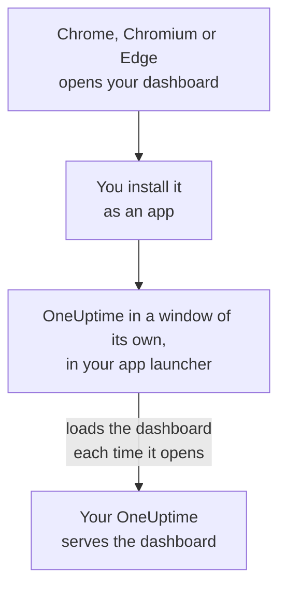

# Linux Installation

The OneUptime dashboard installs on Linux as an app, from Google Chrome, Chromium or Microsoft Edge. It opens in a window of its own, with its own entry in your desktop's app launcher, and can show notifications. There is nothing to download: the app is the dashboard of your OneUptime, and it is up to date whenever your OneUptime is.

:::cards
- [Install the app](#install-the-app): From Chrome, Chromium or Edge.
- [Open it from your launcher](#open-it-from-your-launcher): Like any other desktop app.
- [Get notifications on this computer](#get-notifications-on-this-computer): Register the browser for push notifications.
- [Troubleshooting](#troubleshooting): No install icon, no notifications, no launcher entry.
:::

## How the desktop app works

The installed app shares its browser's sign-in, settings and notification permission. Close the browser and the app keeps running in its own window.

## Before you begin

- A Linux desktop with a recent Google Chrome, Chromium or Microsoft Edge.
- Your OneUptime's address, over HTTPS: `https://oneuptime.com` on OneUptime Cloud, or your own, such as `https://oneuptime.example.com`.
- An account you can sign in to the dashboard with.

## Install the app

:::tabs
@tab Chrome
1. Open your OneUptime in Chrome or Chromium, and sign in.
2. On any dashboard page, click the install icon at the right of the address bar, then **Install**. Or open **⋮ → Cast, save, and share → Install page as app…**.
3. Chrome opens OneUptime in its own window, and adds it to your app launcher.
@tab Edge
1. Open your OneUptime in Edge, and sign in.
2. On any dashboard page, click the install icon at the right of the address bar, then **Install**. Or open **Settings and more (…) → More tools → Apps → Install this site as an app**.
3. Edge opens OneUptime in its own window, and adds it to your app launcher.
:::

Install from a dashboard page, after you sign in: the sign-in page is not the app.

## Open it from your launcher

The browser adds a desktop entry for the app, a `.desktop` file in `~/.local/share/applications`, so OneUptime appears in GNOME, KDE Plasma and other launchers. Pin it to your dock or panel there as you would any other app.

## Get notifications on this computer

The app shows notifications through its browser, once you register the browser for push notifications in each project you want them from.

:::steps
### Open your push devices
In the app, open **User Settings → Notification Methods** and the **Push Notifications** tab.

### Register this browser
Click **Register Device**, keep the suggested **Device Name**, such as `Chrome on Linux`, or change it, and click **Register Device** again. When the browser asks whether OneUptime may show notifications, choose **Allow**.

### Send a test
In the **Browser Registered** dialog, click **Send Test Notification**. Your desktop shows it through its notification service; if nothing appears, see [Troubleshooting](#troubleshooting).
:::

A browser cannot ring through your desktop's Do Not Disturb. For pages that must wake you, use the mobile app with critical alerts: see [Android Installation](/docs/mobile-desktop-apps/android-installation#ring-through-silent-mode).

On a self-hosted OneUptime, browser notifications need the server's VAPID keys: see [Push Notifications](/docs/self-hosted/push-notifications#self-hosted-setup).

## Updates

There is nothing to update. The app loads the dashboard from your OneUptime each time it opens, so it changes when your OneUptime is upgraded. If a window has been open since the upgrade, reload it with Ctrl+R.

## Uninstall

:::tabs
@tab Chrome
In the app's window, open the **⋮** menu, choose the item that uninstalls the app, then **Remove**.
@tab Edge
Open `edge://apps` in Edge, choose **Details** on OneUptime, then **Uninstall**.
:::

Uninstalling the app does not unregister its browser: it still receives notifications. To stop them, delete the browser under **User Settings → Notification Methods**, on the **Push Notifications** tab, with **Delete**.

## Troubleshooting

:::details No install icon in the address bar
Open a dashboard page after signing in, not the sign-in page, and check that the address starts with `https://`: browsers install apps only from secure sites. If the icon still does not show, use the browser's menu as above. Other browsers may not install sites as apps; use Chrome, Chromium or Edge.
:::

:::details No notifications appear
- In **User Settings → Notification Methods**, on the **Push Notifications** tab, check that this browser is listed, and send it a **Test Notification**.
- Check that your desktop's Do Not Disturb is off, and that its notification settings allow the browser.
- If the browser blocks notifications for OneUptime, click the icon at the left of the address bar, allow notifications for the site, and register the browser again.
- On a self-hosted OneUptime, the **Register Device** dialog says when the server has no VAPID keys.
:::

:::details The app is missing from the launcher
Open it from the browser instead: `chrome://apps` in Chrome or Chromium, `edge://apps` in Edge. A launcher that reads desktop entries only when you sign in shows it after you sign out and in again.
:::

## Next steps

:::cards
- [Android Installation](/docs/mobile-desktop-apps/android-installation): Get paged on your phone, with critical alerts.
- [Windows Installation](/docs/mobile-desktop-apps/windows-installation): The same app on Windows.
- [FAQ & Troubleshooting](/docs/mobile-desktop-apps/faq-troubleshooting): Answers about both apps.
- [Your Account](/docs/introduction/your-account): How OneUptime reaches you in each project.
:::
