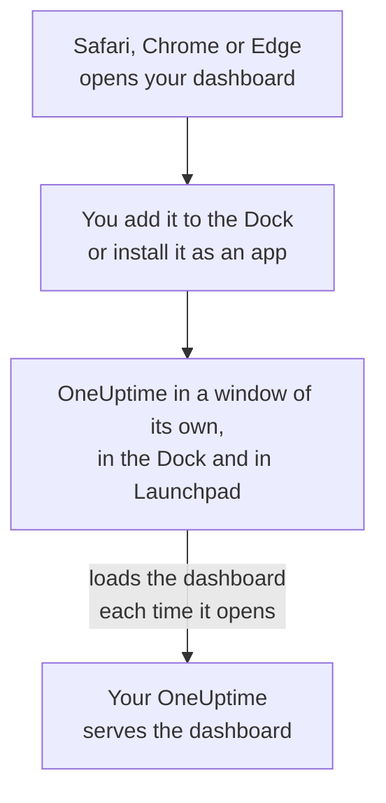

# macOS Installation

The OneUptime dashboard installs on a Mac as an app: add it to the Dock from Safari, or install it from Google Chrome or Microsoft Edge. It opens in a window of its own, with its own icon in the Dock and in Launchpad, and can show notifications. There is nothing to download: the app is the dashboard of your OneUptime, and it is up to date whenever your OneUptime is.

:::cards
- [Install the app](#install-the-app): From Safari, Chrome or Edge.
- [Keep it in the Dock](#keep-it-in-the-dock): Open it with one click, or at login.
- [Get notifications on this Mac](#get-notifications-on-this-mac): Register the app for push notifications.
- [Troubleshooting](#troubleshooting): No Add to Dock, no notifications, signing in again.
:::

## How the desktop app works

A Safari web app keeps its own sign-in, cookies and settings, apart from Safari. An app installed from Chrome or Edge shares them with that browser.

## Before you begin

- macOS Sonoma 14 or later for Safari. Chrome and Edge install apps on any macOS they run on.
- Your OneUptime's address, over HTTPS: `https://oneuptime.com` on OneUptime Cloud, or your own, such as `https://oneuptime.example.com`.
- An account you can sign in to the dashboard with.

## Install the app

:::tabs
@tab Safari
1. Open your OneUptime in Safari, and sign in.
2. On any dashboard page, choose **File → Add to Dock**, or click the share button in the toolbar and then **Add to Dock**.
3. Keep the name or change it, and click **Add**.
4. Open OneUptime from the Dock, and sign in once more: the web app does not share Safari's sign-in.
@tab Chrome
1. Open your OneUptime in Chrome, and sign in.
2. On any dashboard page, click the install icon at the right of the address bar, then **Install**. Or open **⋮ → Cast, save, and share → Install page as app…**.
3. Chrome opens OneUptime in its own window, and adds it to Launchpad.
@tab Edge
1. Open your OneUptime in Edge, and sign in.
2. On any dashboard page, click the install icon at the right of the address bar, then **Install**. Or open **Settings and more (…) → More tools → Apps → Install this site as an app**.
3. Edge opens OneUptime in its own window, and adds it to Launchpad.
:::

Install from a dashboard page, after you sign in: the sign-in page is not the app. Safari saves the web app in the Applications folder of your home folder.

## Keep it in the Dock

- **Dock.** While the app is open, Control-click its Dock icon and choose **Options → Keep in Dock**. A Safari web app is in the Dock already.
- **Open at login.** Control-click the Dock icon and choose **Options → Open at Login**.
- **Spotlight.** Press Command-Space and type OneUptime.

## Get notifications on this Mac

The app shows notifications once you register it for push notifications, in each project you want them from. Register the Safari web app from inside the web app: it is a browser of its own. An app installed from Chrome or Edge is registered with its browser.

:::steps
### Open your push devices
In the app, open **User Settings → Notification Methods** and the **Push Notifications** tab.

### Register this app
Click **Register Device**, keep the suggested **Device Name**, such as `Safari on macOS`, or change it, and click **Register Device** again. When macOS or the browser asks whether OneUptime may send notifications, choose **Allow**.

### Send a test
In the **Browser Registered** dialog, click **Send Test Notification**. If nothing appears, look at the Mac's notification settings: see [Troubleshooting](#troubleshooting).
:::

A browser cannot ring through a Focus such as Do Not Disturb. For pages that must wake you, use the mobile app with critical alerts: see [iOS Installation](/docs/mobile-desktop-apps/ios-installation#ring-through-silent-mode).

On a self-hosted OneUptime, browser notifications need the server's VAPID keys: see [Push Notifications](/docs/self-hosted/push-notifications#self-hosted-setup).

## Updates

There is nothing to update. The app loads the dashboard from your OneUptime each time it opens, so it changes when your OneUptime is upgraded. If a window has been open since the upgrade, reload it with Command-R.

## Uninstall

:::tabs
@tab Safari
In the Finder, open your home folder, then its Applications folder, and drag OneUptime to the Trash.
@tab Chrome
In the app's window, open the **⋮** menu, choose the item that uninstalls the app, then **Remove**.
@tab Edge
Open `edge://apps` in Edge, choose **Details** on OneUptime, then **Uninstall**.
:::

Uninstalling the app does not unregister it: its browser still receives notifications. To stop them, delete it under **User Settings → Notification Methods**, on the **Push Notifications** tab, with **Delete**.

## Troubleshooting

:::details No Add to Dock in Safari
Safari adds web apps to the Dock from macOS Sonoma 14 onwards. Update macOS, or install the app from Chrome or Edge instead.
:::

:::details No notifications appear
- In **User Settings → Notification Methods**, on the **Push Notifications** tab, check that the app or its browser is listed, and send it a **Test Notification**.
- On the Mac, open **System Settings → Notifications** and check that OneUptime, or the browser it was installed from, may send notifications, and that no Focus is holding them back.
- If the browser blocks notifications for OneUptime, allow them in its settings for the site, and register again.
- On a self-hosted OneUptime, the **Register Device** dialog says when the server has no VAPID keys.
:::

:::details The app asks you to sign in again
A Safari web app keeps its own sign-in: sign in inside the app. An app installed from Chrome or Edge shares its browser's sign-in, so signing out in the browser, or clearing its cookies, signs it out too.
:::

## Next steps

:::cards
- [iOS Installation](/docs/mobile-desktop-apps/ios-installation): Get paged on your iPhone, with critical alerts.
- [Windows Installation](/docs/mobile-desktop-apps/windows-installation): The same app on Windows.
- [FAQ & Troubleshooting](/docs/mobile-desktop-apps/faq-troubleshooting): Answers about both apps.
- [Your Account](/docs/introduction/your-account): How OneUptime reaches you in each project.
:::
