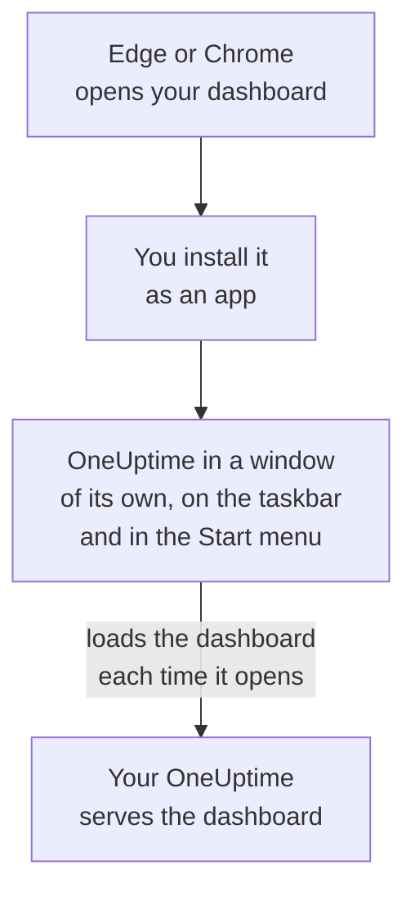

# Windows Installation

The OneUptime dashboard installs on Windows as an app, from Microsoft Edge or Google Chrome. It opens in a window of its own, with its own icon on the taskbar and in the Start menu, and can show notifications. There is nothing to download: the app is the dashboard of your OneUptime, and it is up to date whenever your OneUptime is.

:::cards
- [Install the app](#install-the-app): From Edge or Chrome, in a few clicks.
- [Pin it and start it with Windows](#pin-it-and-start-it-with-windows): Keep it one click away.
- [Get notifications on this computer](#get-notifications-on-this-computer): Register the browser for push notifications.
- [Troubleshooting](#troubleshooting): No install icon, no notifications, signing in again.
:::

## How the desktop app works

The installed app shares its browser's sign-in, settings and notification permission. Close the browser and the app keeps running in its own window.

## Before you begin

- Windows 10 or Windows 11, with a recent Microsoft Edge or Google Chrome.
- Your OneUptime's address, over HTTPS: `https://oneuptime.com` on OneUptime Cloud, or your own, such as `https://oneuptime.example.com`.
- An account you can sign in to the dashboard with.

## Install the app

:::tabs
@tab Edge
1. Open your OneUptime in Edge, and sign in.
2. On any dashboard page, click the install icon at the right of the address bar, then **Install**. Or open **Settings and more (…) → More tools → Apps → Install this site as an app**.
3. Edge opens OneUptime in its own window, and may offer to pin it to the taskbar or Start.
@tab Chrome
1. Open your OneUptime in Chrome, and sign in.
2. On any dashboard page, click the install icon at the right of the address bar, then **Install**. Or open **⋮ → Cast, save, and share → Install page as app…**.
3. Chrome opens OneUptime in its own window and adds it to the Start menu.
:::

Install from a dashboard page, after you sign in: the sign-in page is not the app. Search the Start menu for OneUptime to open it later.

## Pin it and start it with Windows

- **Taskbar.** While the app is open, right-click its taskbar icon and choose **Pin to taskbar**.
- **Start with Windows.** In Edge, open `edge://apps`, choose **Details** on OneUptime and turn on **Auto-start on device login**. The same page pins the app to the taskbar or Start, or puts a shortcut on the desktop.

## Get notifications on this computer

The app shows notifications through its browser, once you register the browser for push notifications in each project you want them from.

:::steps
### Open your push devices
In the app, open **User Settings → Notification Methods** and the **Push Notifications** tab.

### Register this browser
Click **Register Device**, keep the suggested **Device Name**, such as `Edge on Windows`, or change it, and click **Register Device** again. When the browser asks whether OneUptime may show notifications, choose **Allow**.

### Send a test
In the **Browser Registered** dialog, click **Send Test Notification**. If nothing appears, look at Windows' own notification settings: see [Troubleshooting](#troubleshooting).
:::

A browser rings no louder than Windows lets it: it cannot override Do Not Disturb. For pages that must wake you, use the mobile app with critical alerts: see [Android Installation](/docs/mobile-desktop-apps/android-installation#ring-through-silent-mode) or [iOS Installation](/docs/mobile-desktop-apps/ios-installation#ring-through-silent-mode).

On a self-hosted OneUptime, browser notifications need the server's VAPID keys: see [Push Notifications](/docs/self-hosted/push-notifications#self-hosted-setup).

## Updates

There is nothing to update. The app loads the dashboard from your OneUptime each time it opens, so it changes when your OneUptime is upgraded. If a window has been open since the upgrade, reload it with Ctrl+R.

## Uninstall

:::tabs
@tab Edge
Open `edge://apps`, choose **Details** on OneUptime, then **Uninstall**.
@tab Chrome
In the app's window, open the **⋮** menu, choose the item that uninstalls the app, then **Remove**.
:::

Windows lists the app under **Settings → Apps → Installed apps** as well, where **Uninstall** removes it too.

Uninstalling the app does not unregister its browser: it still receives notifications. To stop them, delete the browser under **User Settings → Notification Methods**, on the **Push Notifications** tab, with **Delete**.

## Troubleshooting

:::details No install icon in the address bar
Open a dashboard page after signing in, not the sign-in page, and check that the address starts with `https://`: browsers install apps only from secure sites. If the icon still does not show, use the browser's menu as above. Other browsers may not install sites as apps; use Edge or Chrome.
:::

:::details No notifications appear
- In **User Settings → Notification Methods**, on the **Push Notifications** tab, check that this browser is listed, and send it a **Test Notification**.
- In Windows, open **Settings → System → Notifications**: notifications must be on, for the browser too, and Do not disturb off. Windows 10 names the page Notifications & actions.
- If the browser blocks notifications for OneUptime, click the icon at the left of the address bar, allow notifications for the site, and register the browser again.
- On a self-hosted OneUptime, the **Register Device** dialog says when the server has no VAPID keys.
:::

:::details The app asks you to sign in again
The app shares its browser's sign-in. Signing out in the browser, or clearing its cookies, signs the app out too.
:::

## Next steps

:::cards
- [macOS Installation](/docs/mobile-desktop-apps/macos-installation): The same app on a Mac.
- [Android Installation](/docs/mobile-desktop-apps/android-installation): Get paged on your phone.
- [FAQ & Troubleshooting](/docs/mobile-desktop-apps/faq-troubleshooting): Answers about both apps.
- [Your Account](/docs/introduction/your-account): How OneUptime reaches you in each project.
:::
