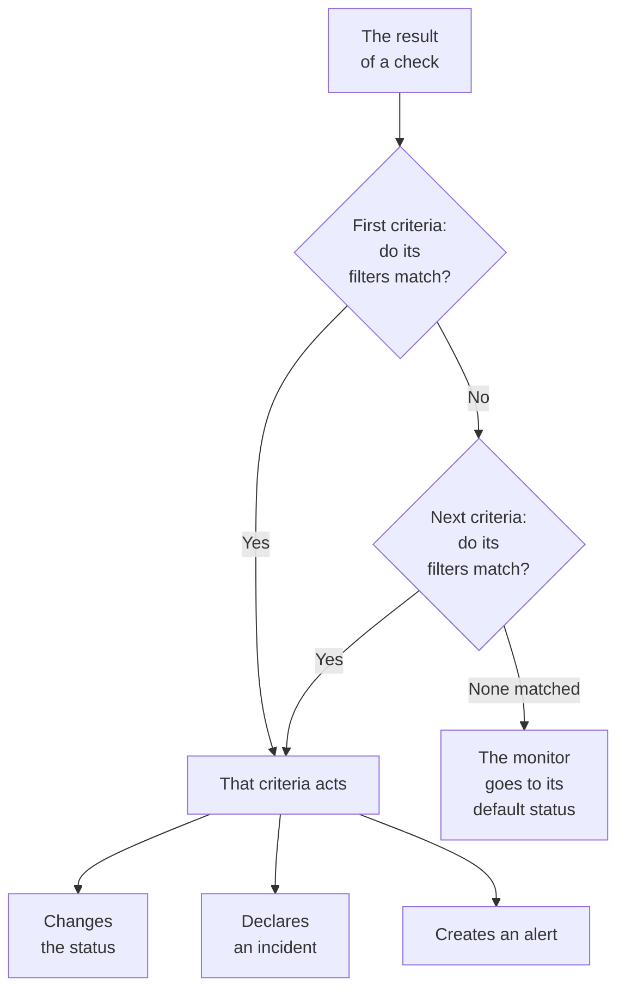
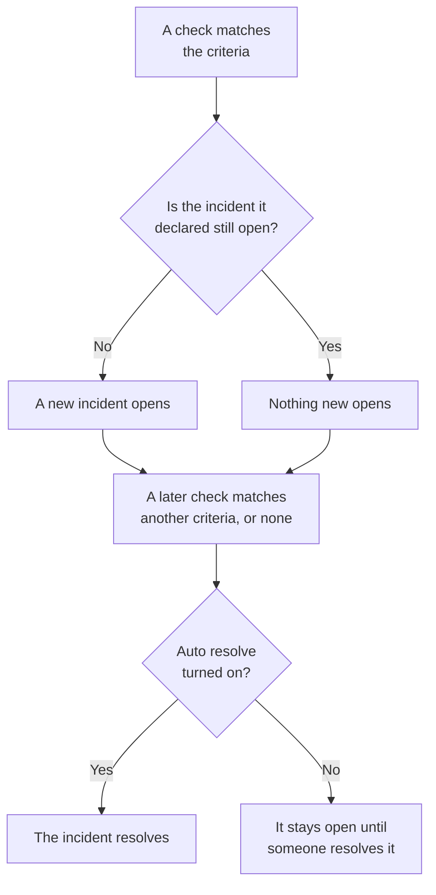

# Criteria & Statuses

A monitor's criteria decide what each check means: whether the monitor is up or down, and whether OneUptime declares an incident or creates an alert. Statuses are your project's list of what a monitor can be, from **Operational** to **Offline**. This page explains both for every monitor type; each type's own page lists the filters it offers.

:::cards
- [How criteria decide](#how-criteria-decide): Top to bottom, and the first match wins.
- [What a criteria holds](#what-a-criteria-holds): Filters, a match condition, actions and settings.
- [Change a monitor's criteria](#change-a-monitors-criteria): Edit, add, reorder and test criteria.
- [Monitor statuses](#monitor-statuses): The built-in statuses, and statuses of your own.
:::

## How criteria decide

Each time a monitor is checked, its criteria judge the result from the top of the list down. The first criteria whose filters match decides what happens, and the criteria below it are not looked at for that check. When none matches, the monitor goes to its **Default Monitor Status**.

The order is part of the rule. A new monitor lists its criteria worst first: offline, then a warning where its type has one (a certificate or a domain that expires soon), then online. A broad healthy criteria, such as **Is Online** set to **True**, matches almost every check, so it goes last: above the others, it would match first every time and they would never act.

A criteria that matches but changes no status still decides the check: the monitor keeps the status it has, and the criteria below it wait for the next check. The **Default Monitor Status** applies only when no criteria matches. A new monitor's default is **Operational**; change it under **More fields**, below the criteria.

> [!NOTE]
> A monitor that raises one incident or alert per host, container, disk or interface judges every criteria on each check, so two hosts can match two different criteria at once. That is a monitor whose query has a **Group By**, such as a Metrics or Logs monitor, or a criteria that names `*` for every disk or interface. So is a Metrics monitor that watches a PromQL expression: each series the expression returns is judged on its own. An Incoming Request monitor that groups incidents by a payload field still stops at the first match.

## What a criteria holds

Open a criteria and it has a name and three sections, each of which folds to a one-line summary.

| Part | What it holds |
| --- | --- |
| **Criteria Name** | The name in the criteria list, and in the root cause of every incident and alert the criteria opens. **Add Criteria** names a new criteria after its filters, and the name follows them until you type one of your own. |
| **Filters** | What the check must show, as one or more filters. Kubernetes and Metrics monitors call them **Alert Rules**. |
| **Actions** | What happens when the filters match: change the status, create an alert, declare an incident, or any of these. |
| **Settings** | **Enable this criteria**, an optional **Description** and, on Incoming Request monitors, **Group incidents and alerts by a payload field**. |

### Filters

A filter reads one thing from the check and compares it: a **Filter Type** (what to read, such as **Response Status Code**), a **Filter Condition** (how to compare, such as **Greater Than**) and a **Value**. Monitors that compare metrics, such as Kubernetes and Metrics monitors, ask for a **Condition** and a **Threshold** instead. Each monitor type offers its own filter types, listed on its page, such as [Website Monitor](/docs/monitor/website-monitor#criteria).

With two filters or more, **Match Condition** appears below them: **All** means every filter must match, **Any** means one is enough. A new criteria starts on **All**.

Filters that measure every check, such as **Is Online**, **Response Status Code** and **Response Time (in ms)**, offer **Evaluate this criteria over a period of time**. It judges a window of recent checks instead of the latest one, and starts on the last 5 minutes with **All Values**, which matches only once every check in the window did. See [Evaluating over a period of time](/docs/monitor/website-monitor#evaluating-over-a-period-of-time).

### Actions

Each action is a switch under **Actions**:

| Switch | What it does |
| --- | --- |
| **When filters match, change monitor status.** | Moves the monitor to the status picked in **Change monitor status to**. |
| **When filters match, create an alert.** | Creates the alerts set up under **Create Alert**. An alert tells your team and never shows on a status page. |
| **When filters match, declare an incident.** | Declares the incidents set up under **Create Incident**. Your status pages can show them. |

An incident or an alert asks for a title, a **Severity** and, folded away, a description, owners, labels and on-call policies. Titles and descriptions can hold values from the check, such as `{{monitorName}}`: see [Incident & Alert Templating](/docs/monitor/incident-alert-templating). To page someone when the criteria matches, pick a policy under **On-Call**: see [On-Call Policies](/docs/on-call/policies).

### Settings

**Enable this criteria** is on for every new criteria. Turn it off to keep a criteria without using it: it is skipped on every check, changes no status, opens nothing, and its header shows **Disabled**.

**Group incidents and alerts by a payload field** opens one incident per value found in an incoming request, so one webhook address can keep several incidents open. See [Turning on incident grouping](/docs/monitor/incoming-request-monitor#turning-on-incident-grouping).

## When incidents and alerts open and close

A criteria that declares incidents opens one when it matches. Once the monitor recovers, the incident closes on its own if the criteria says so.

- **One at a time.** While an incident a criteria declared is still open, the same criteria matching again declares no other. Alerts work the same way. A monitor that groups by host or by payload field keeps one open per host or value, and an Incoming Email criteria with **Open a new incident for every email** opens one per email.
- **Closing.** On a later check where another criteria matches, or none, an incident whose criteria has **Auto Resolve Incident** on is resolved, and so is an alert with **Auto Resolve Alert**. Both sit under **More fields** in the incident or alert, and the criteria a new monitor starts with have them on.
- **Several probes.** A monitor checked by more than one probe changes only when its probes agree. See [How criteria are evaluated](/docs/monitor/create-monitor#how-criteria-are-evaluated).
- **A parent monitor that is down.** On a monitor's **Configuration → Dependencies** page, **Depends On Monitors** names the monitors it relies on. While one of them is in a status listed in **Suppress When Parent Status Is** (any offline status, when that is left empty), the monitor opens no incidents or alerts. Its status still changes, and what is open still resolves.
- **Scheduled maintenance.** A monitor on a maintenance event that is in progress is not checked, so its criteria do not run. See [Scheduled Maintenance Overview](/docs/scheduled-maintenance/index).

To see how a check was judged, open the monitor's **Overview**: the **Monitor Summary** card shows which criteria matched and what each one did, including an incident it skipped because one was already open. On a monitor that checks metrics (a Metrics monitor, or a Host, Kubernetes, Docker, Proxmox or other infrastructure monitor), the card at the top of its overview charts those metrics with each criteria's value drawn as a line, so you can see how close they are to matching.

## Who is told when it goes down

**When this goes down** says in a few sentences what happens when the monitor fails and who is told: the status it sets, the incident or alert it opens, who that emails and who it pages, by name. Each thing that would stop someone being told is a line of its own, with a link to the page that puts it right. It is on a monitor's **Overview**, under its criteria on its **Criteria** page, on the criteria step of **Create Monitor** for the monitor you are setting up, and in the website guided setup.

It works the chain out as a real incident or alert does: with the owner rules, privacy rules, label rules and on-call rules of your project, the alert incident rule that turns an alert into an incident, and who each on-call policy's first escalation rule reaches right now. An alert's on-call rule that asks who owns it (**Alert Owner**) is matched on the owners the alert will have: the people and teams its criteria names, the owners of the network device the monitor watches, and whom owner rules add. A title placeholder that only a check fills is shown as written. **Show the chain** opens it row by row:

| Row | What it says |
| --- | --- |
| **Status** | The status the criteria sets. |
| **Opens** | The incident or alert, its severity in brackets, and its title. |
| **Emails** | Who its Created email reaches: its owners, the owners owner rules add, or the Project Owners when it has none. Someone the on-call page reaches first is not emailed as an owner too. |
| **Owner Rules** | The owner rules that add its owners. |
| **Private** | Why it is private: a privacy rule, or the criteria. A private incident shows on no status page and tells no subscriber, and only its owners, the Project Owners and the Project Admins can see it. |
| **Label Rules** | The label rules whose labels change which on-call rules page it. |
| **On-call rules** | The on-call rules that match it. A rule that matches who owns an alert says which owner made it match. |
| **On-call policy** | Each policy those rules run: who its first escalation rule reaches right now and by what, and who it can't reach, and why. |
| **Status pages** | The status pages that show it, each with the monitor group it shows the monitor through. |
| **Incident Rule** | For an alert: the alert incident rule that declares an incident from it, right away or once the alert has stayed open, and that incident, told as any incident is. |

### What stops people being told

| What stops it | Link |
| --- | --- |
| No criteria changes the status or opens an incident or alert. | **Open Criteria** |
| Nobody is paged: no on-call rule matches, or the project has no on-call policy yet. | **Set Up Paging** |
| The monitor opens alerts, and only incidents have on-call rules. | **Set Up Paging** |
| An on-call policy has no escalation rules. | **Open On-Call Policy** |
| An on-call policy reaches nobody right now. | **Open On-Call Policy** |
| Someone a policy pages can't be reached: they opted out, have no verified method, or have no rule for the severity in a project that doesn't fall back. | **Open Readiness** |
| SMS, calls, WhatsApp or Telegram are off in the project. | **Open Notification Channels** |
| The project has no balance left for SMS and calls (OneUptime Cloud). | **Open Billing** |
| The server can't send email, SMS or calls yet. | **Open Admin Dashboard**, for the server's admins |

An alert that an alert incident rule turns into an incident that pages someone is not a break: the incident's own policies are checked instead.

Owners who aren't emailed are listed after the breaks, each with why and where they are named: someone who isn't a member of the project, a team with nobody in it who is (**Open Team**), or a team of another project, named in the criteria (**Open Criteria**), on the network device the monitor watches (**Open Network Device**) or by an owner rule (**Open Owner Rules**). The email still goes out, to the owners it reaches or to the Project Owners, so they are not breaks. Setup Health lists them too, as worth fixing.

### Recheck, and what you can see

The answer is at most a minute old, and **Recheck** works it out again. When a recheck fails, the card keeps the last answer and says why under it.

The card names only what you can read. An on-call policy, a rule, a status page or a monitor group you can't see keeps its place without its name, and a private incident or alert you won't be able to see says only that it opens and that it is private.

## What an incident or alert keeps of the check

An incident or an alert a monitor opens keeps the check that opened it, so you can see why long after the monitor's own logs are gone. Under its root cause, **Evaluation details** names the criteria that matched and, for each filter that matched, what the check found. **Show details** adds the rest of the evidence, the filters that did not match, and the check itself: the request, when it ran, from which probe and what came back. What a filter found can be:

- **The field.** Where a **Response Body** filter matched in a JSON body, such as `checks[1].status`, or the header a **Response Header Value** filter matched.
- **The values.** What each value a **JavaScript Expression** reads held when it ran, such as `responseBody.status = "down"`.
- **An excerpt.** A short piece of the response around the match, with the match marked: never the whole body.

Secrets and personal data are masked before anything is kept: headers such as `Authorization`, `Cookie` and `Set-Cookie`, fields whose names say `password`, `token`, `key`, `session` or `email`, and text that looks like a bearer token, a JWT, a card number or an email address. The request's URL is the one the monitor was set up with, so `{{monitorSecrets.NAME}}` stays a name, and a secret query value is masked. The monitor's **Monitoring Logs**, and any value a root cause quotes, are masked the same way. An incident or alert opened by hand, or before evaluation details were kept, has none.

> [!TIP]
> When a Website or API monitor's responses are sensitive in themselves, turn off **Keep response content** in the **Response content** card on its **Advanced → Settings** page. Its monitoring logs, incidents and alerts then keep which filters matched, the status code and the response time, and no part of the response. An Incoming Request monitor has the same switch for the requests it receives: **Keep request content**, in the **Request content** card. The switch applies to the checks that run, and the incidents and alerts that open, after you change it. The latest request on an Incoming Request monitor's overview follows the switch at once.

## Change a monitor's criteria

:::steps
### Open the criteria page

Go to **Monitors** and open the monitor. Expand **Configuration** in its side menu and click **Criteria**. The **Criteria** card shows each criteria, what it checks and what it does.

### Click Edit Criteria

The editor shows every criteria open. Click a criteria's header to fold it to one line: its name, how many filters it has and what it does.

### Add, change or reorder criteria

**Add Criteria** adds one at the bottom, open and named after its filter. Drag a criteria by the handle on its left to move it: the first match wins, so put the worst case first. **Delete Criteria** removes one; a monitor keeps at least one criteria.

### Save the criteria

Click **Save Changes**. The next check is judged by the new criteria.

### Test the monitor

On a monitor that probes check, click **Test Monitor** on the card: the test starts on a probe the monitor is checked from. Pick another under **Select Probe** if you like, then click **Run Test**. **Monitor Test Result** shows what the check found. It also says which criteria the answer matches and what would follow: the status, the incident or alert, and who is told.
:::

A Manual monitor has no criteria: you set its status yourself. See [Updating Status](/docs/monitor/manual-monitor#updating-status).

## Monitor statuses

A monitor is always in one of your project's statuses. A new project has three, from the healthiest to the worst:

| Status | Place | Color | What OneUptime does with it |
| --- | --- | --- | --- |
| **Operational** | 1 | Green | New monitors start in it, and it is a new monitor's **Default Monitor Status**. Built-in. |
| **Degraded** | 2 | Yellow | Nothing on its own: a criteria of yours moves a monitor here. |
| **Offline** | 3 | Red | A new monitor's offline criteria moves it here, and OneUptime treats a monitor in it as down. Built-in. |

The list is an order. Where monitors are shown together, the status lowest in the list wins: a monitor group, a status page group and a status page's overall status each show the worst status among their monitors.

### Where a status counts

| Where | What the status decides |
| --- | --- |
| The **Monitors** list | Every monitor's current status. **Not Operational** lists the monitors in any status but the operational one, with a red count beside it. Monitors with monitoring turned off are left out: nothing checks them, and **Disabled** lists them. **Disabled** sits under **All Monitors** in the side menu, with a grey count: turning monitoring off is a choice, not a fault. Beside **Not Operational**, under **Attention Required**, **Probes Disconnected** lists the monitors whose enabled probes are all disconnected, and **No Probe Enabled** the monitors no enabled probe checks: their probes are all disabled, or they have none. |
| Status pages | The color of each row, and its uptime: only the statuses in the page's **Counts as downtime** count against it. A new status page starts with every status but the operational one. See [Choosing what shows on the page](/docs/status-pages/index#choosing-what-shows-on-the-page). |
| Monitor groups | The group's status: the worst among its monitors. See [Monitor Groups](/docs/monitor/monitor-groups). |
| SLOs | The downtime an SLO counts, from its own list of statuses. See [Which statuses count as downtime](/docs/slo/introduction#which-statuses-count-as-downtime). |
| Dependencies | Whether a parent monitor holds back its children's incidents and alerts: by default, while it is in an offline status. |

A status you add later is not added to the **Counts as downtime** list of an existing status page: add it there yourself.

### Add a status of your own

:::steps
### Open Monitor Status

Go to **Monitors → Settings → Monitor Status**. **Settings** starts collapsed in the side menu: expand it first. The **Monitor Statuses** card lists the statuses from the healthiest to the worst.

### Create the status

Click **Create Monitor Status** and fill in **Name**, **Description** and **Color**. The new status goes in just above the offline status, so an outage still reads as the worst.

### Put it in its place

Drag the status by its handle. A status lower in the list reads as worse than every status above it.

### Use it in a criteria

A status does nothing until a criteria moves monitors into it. Pick it in **Change monitor status to** on the criteria that should set it.
:::

The operational and offline statuses are marked **Built-in**: you can rename them and change their color, but not delete them. On OneUptime Cloud, creating a status or changing one needs the Growth plan. Managing statuses takes the Project Owner, Project Admin or Monitor Admin role, or a custom role with the matching monitor status permission.

### The status timeline

Every status change is kept on the monitor's **Status Timeline**: when it started, how long it lasted, and **View Cause** for the criteria that set it. **Create Monitor Status Event** adds a status by hand. On a monitor that probes check, the next check that matches a criteria with a status sets that status again.

Changing a monitor's status notifies its owners only when they have turned on **Monitor status changed** in their notification settings: it starts off. A monitor that goes back to its **Default Monitor Status** because no criteria matched notifies nobody. See [What is on for a new member](/docs/notifications/notification-settings#what-is-on-for-a-new-member).

## Archiving a monitor status

Archive a status that your team should stop using, instead of deleting it. Archiving changes no monitor: a monitor in the status stays in it until its status changes, and its status timeline still shows it.

- **Archive** is in the row's **⋯** menu. It asks first, and lists the monitor criteria, templates and status pages set up to use the status: they keep using it until you change them.
- **Nobody can pick it again.** A criteria, a monitor's status menu, an incident's or a maintenance event's monitor status and a status page's downtime statuses leave it out. The API, Terraform and MCP refuse it.
- **Archived statuses are listed apart**, in the folded **Archived Monitor Statuses** section under the table. **Unarchive** puts one back as it was.
- **The built-in statuses can't be archived.** New monitors start in the operational one, and OneUptime treats a monitor in the offline one as down. Their **Archive** is locked, with the reason.

## Troubleshooting

:::details The site is down, but the monitor stays Operational
A criteria higher in the list matched first. Open **Configuration → Criteria** and check the order: the healthy criteria goes last. Also check that the offline criteria has **Enable this criteria** on, and that its action **When filters match, change monitor status.** is on with a status picked.
:::

:::details No incident opened when the monitor went down
Check the criteria that matched: **When filters match, declare an incident.** must be on. An incident is not declared while the same criteria's incident is still open, while a parent monitor in **Depends On Monitors** is down, or while the monitor is in scheduled maintenance. The **Monitor Summary** card on the monitor's **Overview** says which one it was.
:::

:::details The incident stays open after the monitor recovered
Open the incident's criteria and expand **More fields** in its incident: **Auto Resolve Incident** must be on. An incident from a criteria you have since deleted is not resolved by the monitor: resolve it by hand.
:::

:::details The Delete button of Offline is locked
**Operational** and **Offline** are built-in: OneUptime moves monitors into them, so they can be renamed but not deleted. Delete a status of your own instead, or rename the built-in one.
:::

## Next steps

:::cards
- [Creating a Monitor](/docs/monitor/create-monitor): The three steps of a new monitor.
- [Incident & Alert Templating](/docs/monitor/incident-alert-templating): Put values from the check into titles and descriptions.
- [Monitor Groups](/docs/monitor/monitor-groups): Roll several monitors up into one status.
- [Incidents Overview](/docs/incidents/index): What happens after a criteria declares an incident.
:::
