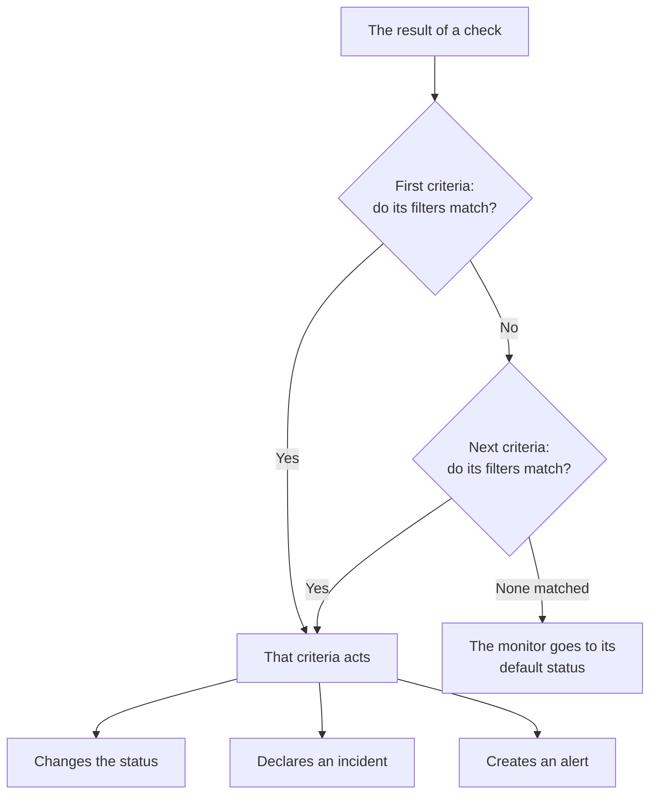
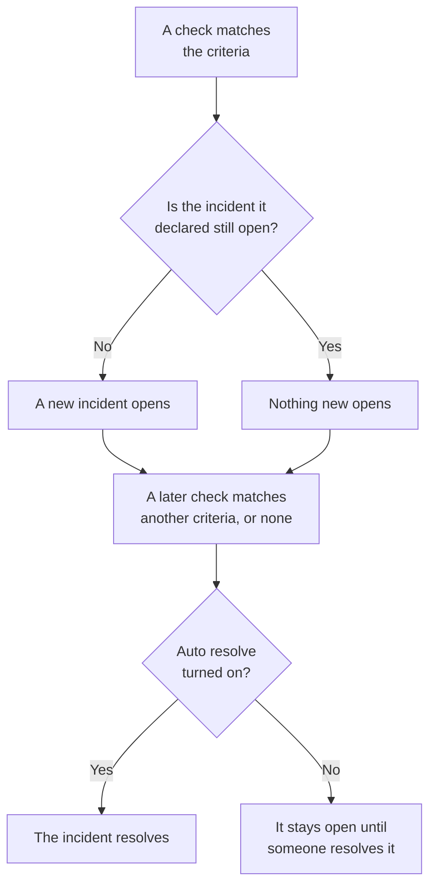

# Monitor Criteria & Statuses

A monitor's criteria decide what each check means: whether the monitor is up or down, and whether OneUptime declares an incident or creates an alert. Statuses are your project's list of what a monitor can be, from **Operational** to **Offline**. This page explains both for every monitor type; each type's own page lists the filters it offers.

:::cards
- [How criteria decide](#how-criteria-decide): Top to bottom, and the first match wins.
- [What a criteria holds](#what-a-criteria-holds): Filters, a match condition, actions and settings.
- [Change a monitor's criteria](#change-a-monitors-criteria): Edit, add, reorder and test criteria.
- [Monitor statuses](#monitor-statuses): The built-in statuses, and statuses of your own.
:::

## How criteria decide

Each time a monitor is checked, its criteria judge the result from the top of the list down. The first criteria whose filters match decides what happens, and the criteria below it are not looked at for that check. When none matches, the monitor goes to its **Default Monitor Status**.

The order is part of the rule. A new monitor lists its criteria worst first: offline, then a warning where its type has one (a certificate or a domain that expires soon), then online. A broad healthy criteria, such as **Is Online** set to **True**, matches almost every check, so it goes last: above the others, it would match first every time and they would never act.

A criteria that matches but changes no status still decides the check: the monitor keeps the status it has, and the criteria below it wait for the next check. The **Default Monitor Status** applies only when no criteria matches. A new monitor's default is **Operational**; change it under **More fields**, below the criteria.

> [!NOTE]
> A monitor that raises one incident or alert per host, container, disk or interface judges every criteria on each check, so two hosts can match two different criteria at once. That is a monitor whose query has a **Group By**, such as a Metrics or Logs monitor, or a criteria that names `*` for every disk or interface. An Incoming Request monitor that groups incidents by a payload field still stops at the first match.

## What a criteria holds

Open a criteria and it has a name and three folded sections, each with a one-line summary.

| Part | What it holds |
| --- | --- |
| **Criteria Name** | The name in the criteria list, and in the root cause of every incident and alert the criteria opens. **Add Criteria** names a new criteria after its filters, and the name follows them until you type one of your own. |
| **Filters** | What the check must show, as one or more filters. Kubernetes and Metrics monitors call them **Alert Rules**. |
| **Actions** | What happens when the filters match: change the status, create an alert, declare an incident, or any of these. |
| **Settings** | **Enable this criteria**, an optional **Description** and, on Incoming Request monitors, **Group incidents and alerts by a payload field**. |

### Filters

A filter reads one thing from the check and compares it: a **Filter Type** (what to read, such as **Response Status Code**), a **Filter Condition** (how to compare, such as **Greater Than**) and a **Value**. Monitors that compare metrics, such as Kubernetes and Metrics monitors, ask for a **Condition** and a **Threshold** instead. Each monitor type offers its own filter types, listed on its page, such as [Website Monitor](/docs/monitor/website-monitor#monitoring-criteria).

With two filters or more, **Match Condition** appears below them: **All** means every filter must match, **Any** means one is enough. A new criteria starts on **All**.

Filters that measure every check, such as **Is Online**, **Response Status Code** and **Response Time (in ms)**, offer **Evaluate this criteria over a period of time**. It judges a window of recent checks instead of the latest one, and starts on the last 5 minutes with **All Values**, which matches only once every check in the window did. See [Evaluating over a period of time](/docs/monitor/website-monitor#evaluating-over-a-period-of-time).

### Actions

Each action is a switch under **Actions**:

| Switch | What it does |
| --- | --- |
| **When filters match, change monitor status.** | Moves the monitor to the status picked in **Change monitor status to**. |
| **When filters match, create an alert.** | Creates the alerts set up under **Create Alert**. An alert tells your team and never shows on a status page. |
| **When filters match, declare an incident.** | Declares the incidents set up under **Create Incident**. Your status pages can show them. |

An incident or an alert asks for a title, a **Severity** and, folded away, a description, owners, labels and on-call policies. Titles and descriptions can hold values from the check, such as `{{monitorName}}`: see [Incident & Alert Templating](/docs/monitor/incident-alert-templating). To page someone when the criteria matches, pick a policy under **On-Call**: see [On-Call Policies](/docs/on-call/policies).

### Settings

**Enable this criteria** is on for every new criteria. Turn it off to keep a criteria without using it: it is skipped on every check, changes no status, opens nothing, and its header shows **Disabled**.

**Group incidents and alerts by a payload field** opens one incident per value found in an incoming request, so one webhook address can keep several incidents open. See [Turning on incident grouping](/docs/monitor/incoming-request-monitor#turning-on-incident-grouping).

## When incidents and alerts open and close

A criteria that declares incidents opens one when it matches. Once the monitor recovers, the incident closes on its own if the criteria says so.

- **One at a time.** While an incident a criteria declared is still open, the same criteria matching again declares no other. Alerts work the same way. A monitor that groups by host or by payload field keeps one open per host or value, and an Incoming Email criteria with **Open a new incident for every email** opens one per email.
- **Closing.** On a later check where another criteria matches, or none, an incident whose criteria has **Auto Resolve Incident** on is resolved, and so is an alert with **Auto Resolve Alert**. Both sit under **More fields** in the incident or alert, and the criteria a new monitor starts with have them on.
- **Several probes.** A monitor checked by more than one probe changes only when its probes agree. See [How criteria are evaluated](/docs/monitor/create-monitor#how-criteria-are-evaluated).
- **A parent monitor that is down.** On a monitor's **Configuration → Dependencies** page, **Depends On Monitors** names the monitors it relies on. While one of them is in a status listed in **Suppress When Parent Status Is** (any offline status, when that is left empty), the monitor opens no incidents or alerts. Its status still changes, and what is open still resolves.
- **Scheduled maintenance.** A monitor on a maintenance event that is in progress is not checked, so its criteria do not run. See [Scheduled Maintenance Overview](/docs/scheduled-maintenance/index).

To see how a check was judged, open the monitor's **Overview**: the **Monitor Summary** card shows which criteria matched and what each one did, including an incident it skipped because one was already open.

## Change a monitor's criteria

:::steps
### Open the criteria page

Go to **Monitors** and open the monitor. Expand **Configuration** in its side menu and click **Criteria**. The **Monitoring Criteria** card shows each criteria, what it checks and what it does.

### Click Edit Monitoring Criteria

The editor shows every criteria open. Click a criteria's header to fold it to one line: its name, how many filters it has and what it does.

### Add, change or reorder criteria

**Add Criteria** adds one at the bottom, open and named after its filter. Drag a criteria by the handle on its left to move it: the first match wins, so put the worst case first. **Delete Criteria** removes one; a monitor keeps at least one criteria.

### Save the criteria

Click **Save Changes**. The next check is judged by the new criteria.

### Test the monitor

On a monitor that probes check, click **Test Monitor** on the card, pick a probe under **Select Probe** and click **Run Test**. **Monitor Test Result** shows what the check found.
:::

A Manual monitor has no criteria: you set its status yourself. See [Updating Status](/docs/monitor/manual-monitor#updating-status).

## Monitor statuses

A monitor is always in one of your project's statuses. A new project has three, from the healthiest to the worst:

| Status | Place | Color | What OneUptime does with it |
| --- | --- | --- | --- |
| **Operational** | 1 | Green | New monitors start in it, and it is a new monitor's **Default Monitor Status**. Built-in. |
| **Degraded** | 2 | Yellow | Nothing on its own: a criteria of yours moves a monitor here. |
| **Offline** | 3 | Red | A new monitor's offline criteria moves it here, and OneUptime treats a monitor in it as down. Built-in. |

The list is an order. Where monitors are shown together, the status lowest in the list wins: a monitor group, a status page group and a status page's overall status each show the worst status among their monitors.

### Where a status counts

| Where | What the status decides |
| --- | --- |
| The **Monitors** list | Every monitor's current status. **Not Operational** lists the monitors in any status but the operational one, with a red count beside it. |
| Status pages | The color of each row, and its uptime: only the statuses in the page's **Counts as downtime** count against it. A new status page starts with every status but the operational one. See [Choosing what shows on the page](/docs/status-pages/index#choosing-what-shows-on-the-page). |
| Monitor groups | The group's status: the worst among its monitors. See [Monitor Groups](/docs/monitor/monitor-groups). |
| SLOs | The downtime an SLO counts, from its own list of statuses. See [Which statuses count as downtime](/docs/slo/introduction#which-statuses-count-as-downtime). |
| Dependencies | Whether a parent monitor holds back its children's incidents and alerts: by default, while it is in an offline status. |

A status you add later is not added to the **Counts as downtime** list of an existing status page: add it there yourself.

### Add a status of your own

:::steps
### Open Monitor Status

Go to **Monitors → Settings → Monitor Status**. **Settings** starts collapsed in the side menu: expand it first. The **Monitor Statuses** card lists the statuses from the healthiest to the worst.

### Create the status

Click **Create Monitor Status** and fill in **Name**, **Description** and **Color**. The new status goes in just above the offline status, so an outage still reads as the worst.

### Put it in its place

Drag the status by its handle. A status lower in the list reads as worse than every status above it.

### Use it in a criteria

A status does nothing until a criteria moves monitors into it. Pick it in **Change monitor status to** on the criteria that should set it.
:::

The operational and offline statuses are marked **Built-in**: you can rename them and change their color, but not delete them. On OneUptime Cloud, creating a status or changing one needs the Growth plan. Managing statuses takes the Project Owner, Project Admin or Monitor Admin role, or a custom role with the matching monitor status permission.

### The status timeline

Every status change is kept on the monitor's **Status Timeline**: when it started, how long it lasted, and **View Cause** for the criteria that set it. **Create Monitor Status Event** adds a status by hand. On a monitor that probes check, the next check that matches a criteria with a status sets that status again.

Changing a monitor's status notifies its owners only when they have turned on **Monitor status changed** in their notification settings: it starts off. A monitor that goes back to its **Default Monitor Status** because no criteria matched notifies nobody. See [What is on for a new member](/docs/notifications/notification-settings#what-is-on-for-a-new-member).

## Troubleshooting

:::details The site is down, but the monitor stays Operational
A criteria higher in the list matched first. Open **Configuration → Criteria** and check the order: the healthy criteria goes last. Also check that the offline criteria has **Enable this criteria** on, and that its action **When filters match, change monitor status.** is on with a status picked.
:::

:::details No incident opened when the monitor went down
Check the criteria that matched: **When filters match, declare an incident.** must be on. An incident is not declared while the same criteria's incident is still open, while a parent monitor in **Depends On Monitors** is down, or while the monitor is in scheduled maintenance. The **Monitor Summary** card on the monitor's **Overview** says which one it was.
:::

:::details The incident stays open after the monitor recovered
Open the incident's criteria and expand **More fields** in its incident: **Auto Resolve Incident** must be on. An incident from a criteria you have since deleted is not resolved by the monitor: resolve it by hand.
:::

:::details The Delete button of Offline is locked
**Operational** and **Offline** are built-in: OneUptime moves monitors into them, so they can be renamed but not deleted. Delete a status of your own instead, or rename the built-in one.
:::

## Next steps

:::cards
- [Creating a Monitor](/docs/monitor/create-monitor): The three steps of a new monitor.
- [Incident & Alert Templating](/docs/monitor/incident-alert-templating): Put values from the check into titles and descriptions.
- [Monitor Groups](/docs/monitor/monitor-groups): Roll several monitors up into one status.
- [Incidents Overview](/docs/incidents/index): What happens after a criteria declares an incident.
:::
