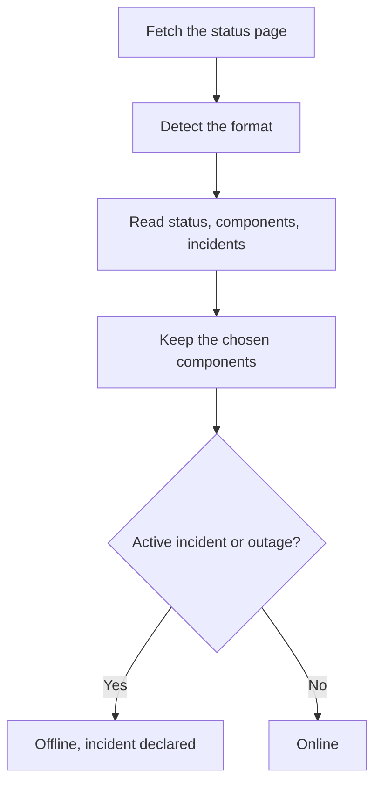

# External Status Page Monitor

An External Status Page monitor watches the public status page of a service you depend on — AWS, GCP, Azure, GitHub, OpenAI, Anthropic and many more — and alerts you when that provider reports an outage or degraded performance. Use it to learn about upstream problems as soon as the provider reports them, and to tell them apart from your own.

It reads status pages made with OneUptime too, resource by resource, and tells planned maintenance from an outage: watch another team's project, or a vendor whose status page runs on OneUptime.

:::cards
- [Create the monitor](#creating-an-external-status-page-monitor): Paste a status page URL and pick what to watch.
- [Choose components](#components): Watch only the components you depend on.
- [Criteria](#monitoring-criteria): What counts as down, out of the box.
- [OneUptime status pages](#oneuptime-status-pages): Another project's resources, and its maintenance.
- [Popular status pages](#popular-status-page-urls): URLs for the services most teams depend on.
:::

## How it works

On every check, a probe fetches the status page, works out which format it uses, and reads the overall status, the components and the active incidents. If you chose components, or a component group, only those count. The criteria then decide whether the monitor is online or offline.

You can use it to:

- Monitor the availability of third-party services your application depends on
- Get alerted when upstream providers experience outages
- Track individual component statuses
- Watch only the components you depend on (e.g., GitHub's Git Operations and Pull Requests, or OpenAI's "APIs" group), so unrelated incidents elsewhere on the page do not trip your monitor
- Detect degraded performance before it impacts your users
- Correlate your own incidents with upstream provider issues

## Supported Providers

| Provider                 | Description                                                            |
| ------------------------ | ---------------------------------------------------------------------- |
| **Auto** (default)       | Automatically detects the status page format                           |
| **Atlassian Statuspage** | Status pages powered by Atlassian Statuspage (JSON API)                |
| **incident.io**          | Status pages powered by incident.io (e.g. `https://status.openai.com`) |
| **OneUptime Status Page** | Status pages made with OneUptime: each resource's status, and what is under maintenance |
| **RSS**                  | Status pages that provide an RSS feed                                  |
| **Atom**                 | Status pages that provide an Atom feed                                 |

### Auto-Detection

When set to **Auto**, OneUptime detects the status page format automatically, in this order:

1. First, it tries the incident.io status page API (`/proxy/<host>`).
2. Next, it tries the Atlassian Statuspage JSON API (`/api/v2/status.json`, `/api/v2/components.json`, and `/api/v2/incidents/unresolved.json`).
3. Then it asks for a OneUptime status page's summary (`/status-page-api/summary/<page>`).
4. If those fail, it attempts to parse the page as an RSS or Atom feed.
5. As a final fallback, it performs a basic HTTP reachability check.

> [!NOTE]
> incident.io is checked first because some incident.io status pages (such as `https://status.openai.com`) also expose a limited Atlassian-compatible endpoint that omits component groups and active incidents. Checking incident.io first ensures the richer, group-aware data is used.

The reachability check is also the fallback when a provider you chose explicitly fails. It only tells you whether the page answers — online on a `2xx` or `3xx` response — and reports no components or incidents.

## Creating an External Status Page Monitor

:::steps
### Start a new monitor

Go to **Monitors** and click **Create Monitor**. Under **Monitor Type**, click **More monitor types** and pick **External Status Page** under **Basic Monitoring**, or type `statuspage` in the search box. Enter a **Name**, then click **Next**.

### Enter the status page URL

Enter the **Status Page URL**. Leave the **Provider** on **Auto** unless you know the format.

### Choose components, if you need to

Open **Components** and pick the components you depend on from the page's own list, such as `Git Operations` and `Pull Requests` on GitHub's; leave it empty to watch the whole page. To watch one group instead, open **More fields** and enter a **Component Group Filter**, such as `APIs`.

### Test it

Click **Test Monitor** to fetch the page once, and check the provider, components and incidents it found.

### Review the criteria

The criteria step starts with [the default criteria](#default-criteria), which mark the monitor offline when the provider reports an active incident or an outage in scope. Change them if you need to, then click **Next**.

### Pick probes and create

Select the **Probes** and a **Monitoring Interval** — it starts at **Every 5 Minutes** — then click **Create Monitor**.
:::

## Configuration Options

| Option | What to enter | Default |
| --- | --- | --- |
| **Status Page URL** | The URL of the status page. For Atlassian Statuspage and incident.io-powered sites, this is typically the root URL (e.g., `https://status.example.com`). For RSS/Atom feeds, enter the feed URL directly. | — |
| **Provider** | **Auto** to detect the format, or **Atlassian Statuspage**, **incident.io**, **OneUptime Status Page**, **RSS** or **Atom** if you know it. | **Auto** |
| **Components** | The components to watch, picked from the page's own list or typed. | The whole page |
| **Component Group Filter** | The group to scope the monitor to. Under **More fields**. | All groups |
| **Timeout (ms)** | The maximum time to wait for the status page. Under **More fields**. | `10000` (10 seconds) |
| **Retries** | How many times to retry, a second apart, after the first attempt fails; `0` means a single attempt. Under **More fields**. | `3` (up to 4 attempts) |

### Components

Pick the components you depend on, and the monitor watches only them: **External Status Page Component Status** compares their statuses alone, the overall status is the worst of theirs, and **External Status Page Active Incidents** counts only the incidents that affect at least one of them. It is still one check of the page, however many you pick.

When you open **Components**, your browser reads the page's own list from an Atlassian Statuspage, an incident.io page or a OneUptime status page, and shows it in the page's groups, each component that is not operational saying how it is. A name you pick watches the component of exactly that name, ignoring case: `Copilot` on GitHub's page is not `Copilot AI Model Providers`.

When the list cannot be read (an internal page, a page that does not share its list with your browser, an RSS or Atom feed), type a name and press Enter. A `*` stands for any text: `*us-east-1*` watches every component with `us-east-1` in its name. On an RSS or Atom feed, an item counts when its title contains one of the names.

An incident that names no component is not counted while you watch chosen components: nothing says it affects them. With nothing chosen, the monitor watches the whole page, and every incident counts.

A monitor saved with the old Component Name Filter keeps watching what it watched: the filter shows in **Components** as that name between stars, such as `*API*`, which matches every component whose name contains it.

> [!WARNING]
> A name that matches nothing watches nothing, and looks healthy. **Components** and **Test Monitor** both name the chosen components the page does not list.

### Component Group Filter

If the status page organizes its components into groups, you can scope the monitor to a single group. For example, on `https://status.openai.com`, entering `APIs` scopes the monitor to OpenAI's API services.

When a component group is set, the **active incident count** and **overall status** are computed using only the components in that group — an incident affecting an unrelated group (for example, ChatGPT) will not trip a monitor scoped to the "APIs" group. With components chosen too, only the chosen components of the group count.

Component group filtering is supported for **Atlassian Statuspage**, **incident.io** and **OneUptime Status Page** providers. RSS and Atom feeds do not expose component groups.

## Monitoring Criteria

You can configure criteria to decide when the external service is considered online or offline, based on:

| Filter type | What it checks | Filter conditions |
| --- | --- | --- |
| **External Status Page Is Online** | Whether the status page is reachable and returning status data | True or False |
| **External Status Page Overall Status** | The overall status the page reports | Equal To, Not Equal To, Contains, Not Contains, Starts With, Ends With |
| **External Status Page Component Status** | The status of each component in scope (the chosen components, or the group's, when set): Operational, Under Maintenance, Degraded Performance, Partial Outage, Major Outage or Full Outage | Equal To, Not Equal To, Contains, Not Contains, Starts With, Ends With |
| **External Status Page Active Incidents** | The number of currently active incidents reported on the status page (only those that affect a component in scope, when components or a group are chosen) | Equal To, Not Equal To, and the numeric comparisons |
| **External Status Page Response Time (in ms)** | How long it takes to fetch the status page data | Greater Than, Less Than, Greater Than Or Equal To, Less Than Or Equal To |

The overall status is whatever the page says, so its values vary by provider: an Atlassian Statuspage reports its own description, such as `All Systems Operational`; a OneUptime status page, the worst status among its components in scope, such as `under_maintenance`; a feed reports `operational` or `degraded_performance`; the reachability check reports `reachable` or `unreachable`. With components or a group chosen, it is the worst status among them, on any page. These comparisons are case-sensitive. To alert on outages, **External Status Page Active Incidents** and **External Status Page Component Status** are usually more reliable.

On an RSS or Atom feed, the items of the last 24 hours count as active incidents: an RSS item by its publication date, an Atom entry by its update date. An item dated ahead does not count until its date.

### Default Criteria

By default, OneUptime seeds criteria based on what actually matters for a status page — its active incidents and component health, rather than mere reachability:

| Criteria | Filters | Effect |
| --- | --- | --- |
| Offline | **Any** of: the page is not online; there is at least one active incident in scope; a component in scope reports Degraded Performance, Partial Outage, Major Outage or Full Outage | Marks the monitor offline and declares an incident, which resolves itself when the criteria stops matching |
| Online | **All** of: the page is online; there are no active incidents in scope | Marks the monitor online |

Because the active incident count and component statuses respect the chosen components and group, these default criteria automatically target only the components you care about.

## OneUptime status pages

Choose **OneUptime Status Page** as the provider, or leave **Auto**, to watch a status page made with OneUptime: another team's project, or a vendor's page on OneUptime Cloud or a self-hosted OneUptime. Enter the page's own address in **Status Page URL**: its domain, such as `https://status.example.com`, or `https://oneuptime.com/status-page/<status-page-id>` for a page without one.

The monitor reads the page's summary, `/status-page-api/summary/<page>` (see [Read the summary](/docs/status-pages/public-api#read-the-summary)): only what the page shows its visitors, and nothing else of the other project. Each resource on the page, a monitor or a monitor group, is a component, by the name the page gives it, in the page's group; a group inside another reads `Core / Databases`. Pick resources in **Components**, or watch one group with **Component Group Filter**.

A component's status is the value its status on the page stands for, so the Component Status criteria work as on any status page:

| On the page | Component status |
| --- | --- |
| The project's operational status | `operational` |
| A status named `Degraded` | `degraded_performance` |
| A status named `Offline`, `Down` or `Major Outage` | `major_outage` |
| A status named `Partial Outage` | `partial_outage` |
| A status named `Full Outage` | `full_outage` |
| A status named `Maintenance` | `under_maintenance` |
| Any other status | `degraded_performance` |
| A status the page hides, with **Show current status** off | `unknown` |

While a scheduled maintenance event in progress affects a resource, because it names one of the resource's monitors or a monitor in its monitor group, the component is `under_maintenance`, whatever status its monitors are in: a monitor is not checked while an event holds it. An event still to come, or over, changes nothing. The page's active incidents count for the resources they affect.

The [default criteria](#default-criteria) never take maintenance for an outage: the monitor stays online through the other project's planned work.

### Show upstream maintenance on your monitor

:::steps
### Add the criteria

On the monitor's criteria, click **Add Criteria**. Give it the filter **External Status Page Component Status**, **Equal To**, **Under Maintenance**, and pick your maintenance status in **Change monitor status to**.

### Move it to the top

Drag the new criteria above the others: the first criteria that matches wins.

### Check it with Test Monitor

Click **Test Monitor** while the other project has maintenance in progress: the component it affects reads **Under Maintenance**.
:::

### What a OneUptime status page lets the monitor read

A page anyone can open is read as its visitors see it. A private page, one that asks for a sign-in, SSO or a password, cannot be read: with **OneUptime Status Page** chosen, the check fails and says so. A page with an IP allowlist must let in the probe's address: watch it from a probe inside that network.

## Template variables

When creating incidents or alerts from External Status Page monitors, you can use these variables in titles, descriptions and remediation notes (see [Incident & Alert Dynamic Templating](/docs/monitor/incident-alert-templating)):

| Variable                  | Description                                                                     |
| ------------------------- | ------------------------------------------------------------------------------- |
| `{{isOnline}}`            | Whether the status page is online (true/false)                                  |
| `{{responseTimeInMs}}`    | Response time in milliseconds                                                   |
| `{{failureCause}}`        | Reason for failure, if any                                                      |
| `{{overallStatus}}`       | The overall status indicator value                                              |
| `{{activeIncidentCount}}` | Number of active incidents (of the chosen components, if any are chosen)       |
| `{{componentStatuses}}`   | JSON array of component statuses (`name`, `status`, `description`, `groupName`) |
| `{{provider}}`            | Detected provider (Atlassian Statuspage, incident.io, OneUptime Status Page, RSS, Atom); empty after a reachability check |
| `{{componentGroup}}`      | Component group the monitor is scoped to, if any                                |
| `{{componentName}}`       | The components the monitor watches, separated by commas, if any are chosen     |

## Popular Status Page URLs

Here is a list of popular service status pages. Many of these use Atlassian Statuspage or incident.io, so the **Auto** provider detects them automatically. A page built on neither, and that is not a feed, only gets the reachability check — for those, monitor the provider's RSS or Atom feed instead, if it publishes one.

| Service                      | Status Page URL                               |
| ---------------------------- | --------------------------------------------- |
| AWS                          | `https://health.aws.amazon.com/health/status` |
| Google Cloud Platform        | `https://status.cloud.google.com`             |
| Microsoft Azure              | `https://status.azure.com`                    |
| GitHub                       | `https://www.githubstatus.com`                |
| OpenAI                       | `https://status.openai.com`                   |
| Anthropic                    | `https://status.anthropic.com`                |
| Cloudflare                   | `https://www.cloudflarestatus.com`            |
| Datadog                      | `https://status.datadoghq.com`                |
| PagerDuty                    | `https://status.pagerduty.com`                |
| Twilio                       | `https://status.twilio.com`                   |
| Stripe                       | `https://status.stripe.com`                   |
| Slack                        | `https://status.slack.com`                    |
| Atlassian (Jira, Confluence) | `https://status.atlassian.com`                |
| Vercel                       | `https://www.vercel-status.com`               |
| Netlify                      | `https://www.netlifystatus.com`               |
| DigitalOcean                 | `https://status.digitalocean.com`             |
| Heroku                       | `https://status.heroku.com`                   |
| MongoDB Atlas                | `https://status.cloud.mongodb.com`            |
| Fastly                       | `https://status.fastly.com`                   |
| New Relic                    | `https://status.newrelic.com`                 |
| Sentry                       | `https://status.sentry.io`                    |
| CircleCI                     | `https://status.circleci.com`                 |

## Best Practices

- **Use the Auto provider** unless you know the exact format — auto-detection works well for most status pages.
- **Choose the components you depend on** (e.g. GitHub's Git Operations and Pull Requests), so unrelated incidents don't create noise.
- **Watch a whole group** when you depend on all of it (e.g. OpenAI's "APIs"), so the components it gains later are watched too.
- **Combine with your own monitors** — pair External Status Page monitors with your own API and Website monitors. When both go down at once, the upstream status page points you at the root cause faster.

## Troubleshooting

:::details The monitor is offline, but the incident is for a part of the service I do not use
Choose the components you depend on in **Components**, or one group in **Component Group Filter**. The active incident count and the component statuses then only count those; an incident that names no component is not counted.
:::

:::details The monitor never goes offline, even during an outage
A chosen name may match nothing on the page, which looks healthy, or the page may only get the reachability check. Run **Test Monitor**: it shows the provider and the components it found, and names any chosen component the page does not list.
:::

:::details Auto picks the wrong format, or finds no components
Set the **Provider** to the one you know the page uses. For an RSS or Atom feed, enter the feed's own URL rather than the status page's.
:::

:::details The Components list does not load
Your browser reads the list straight from the status page. An internal page your browser cannot reach, a page that does not share its list with other sites, and an RSS or Atom feed have no list to pick from: type each component's name as the page shows it, and press Enter. The probes read the page as before.
:::

:::details A OneUptime status page shows no components
Choose **OneUptime Status Page** as the **Provider** and click **Test Monitor**: the result says when the page is private, or when its IP allowlist keeps the probe out. A self-hosted OneUptime that has not been upgraded for a while serves no summary yet: until it is, the page gets the reachability check, or is read as a feed.
:::

:::details An internal status page cannot be reached
A probe refuses private network addresses unless it is allowed to reach them. Set `PROBE_ALLOW_PRIVATE_NETWORK_MONITORS=true` on a probe inside your network — see [Private Network Access](/docs/self-hosted/private-network-access).
:::

## Next steps

:::cards
- [Incident & Alert Dynamic Templating](/docs/monitor/incident-alert-templating): Put the provider's status into your incident titles.
- [API Monitor](/docs/monitor/api-monitor): Check your own endpoints next to your provider's status.
- [Creating a Monitor](/docs/monitor/create-monitor): The steps every monitor type shares.
:::
