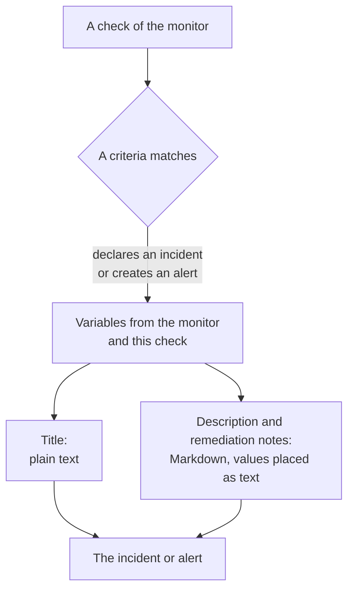

# Incident & Alert Templating

When a monitor's criteria declares an incident or creates an alert, it fills in the title, the description and the remediation notes from a template you write. Put `{{variable}}` placeholders in them, such as `{{monitorName}}` or `{{responseStatusCode}}`, and each incident says what went wrong, with the values from the check that opened it.

:::cards
- [Where you write a template](#where-you-write-a-template): The title, description and remediation notes of a criteria's incident or alert.
- [Basic usage](#basic-usage): Placeholders, paths into objects, and lists.
- [Variables every monitor has](#variables-every-monitor-has): The monitor's name, and the resource that breached.
- [Variables by monitor type](#variables-by-monitor-type): What each kind of check reports.
:::

## How templating works

A template is filled in once, when the criteria creates the incident or the alert. OneUptime collects the variables from the monitor and from the check that matched, puts each value where its placeholder is, and saves the result. Changing the template later changes the incidents and alerts created after that, not the ones already open.



- **The title is plain text.** Wherever it is shown, it reads exactly as the template rendered it.
- **The description and remediation notes are Markdown.** The Markdown you write renders, and every value the monitored system sent is placed as text, so nothing in it can add a link, an image or a mention. See [Values in descriptions and remediation notes](#values-in-descriptions-and-remediation-notes).
- **A grouped monitor fills in each incident for its own series.** A monitor that opens one incident per host, pod or device fills in each template with that series' values, and adds the series' name to the title when your template does not already say it.

## Where you write a template

:::steps
### Open the monitor's criteria

Go to **Monitors**, open the monitor, and click **Criteria** in its side menu. Click **Edit Monitoring Criteria**.

### Turn on the incident or the alert

In a criteria, under **Actions**, turn on **When filters match, declare an incident.** or **When filters match, create an alert.** The incident's or the alert's form opens under it.

### Write the title

Type the title in **Incident Title** or **Alert Title**, for example `{{monitorName}} is down`. **Learn about dynamic templates**, next to it, opens **Dynamic Template Variables**: every variable this monitor's type has, with what it holds. Click a variable to copy it.

### Write the description and the remediation notes

Open **Description** for **Incident Description** or **Alert Description**, and **More fields** for **Remediation Notes**. These editors offer the variables themselves: **Template variables** lists them under the editor, **Insert variable** in its toolbar opens the same list, and typing `{{` opens it at the cursor.

### Save the criteria

Click **Save Changes**. The next incident or alert this criteria creates uses the new templates.
:::

## Basic usage

A placeholder is a variable's name in double braces. When the incident is created, OneUptime replaces it with the variable's value, and leaves the text around it as you wrote it.

```text title="Title template"
{{monitorName}} returned {{responseStatusCode}} in {{responseTimeInMs}} ms
```

If the monitor is called `Checkout API`, the response status code is `502` and the response took `842` milliseconds, the incident is titled:

```text title="Title as created"
Checkout API returned 502 in 842 ms
```

### Paths into objects and lists

A variable that holds an object or a list is read with a path, the same way as in [JavaScript expressions](/docs/monitor/javascript-expression):

| Write | To read | Example |
| --- | --- | --- |
| `{{object.field}}` | A field of an object, at any depth | `{{responseBody.error.message}}` |
| `{{list[0]}}` or `{{list.0}}` | An item of a list, counting from 0 | `{{diskMetrics[0].usagePercent}}` |
| `{{list[last]}}` | The last item of a list | `{{processes[last].name}}` |
| `{{object}}` | The whole object or list, as JSON | `{{responseBody}}` |

A field name can hold a hyphen, as in `{{responseHeaders.content-type}}`. A negative index, such as `[-1]`, reads nothing: use `[last]`.

### When a value is missing

A placeholder whose path leads nowhere is left in the text as you wrote it, braces and all: if the response has no `error` field, `{{responseBody.error.id}}` appears as it is in the title. So does a variable this check did not report, such as `failureCause` on a check that did not fail. A value the check reported as empty text is replaced by nothing.

To write one template that works whether the monitor is grouped or not, use the [affected resource](#affected-resource) variables: they always exist, and are empty when the monitor is not grouped.

### Values in descriptions and remediation notes

A description and remediation notes are Markdown: they are shown on the incident's or alert's page, in email, and in its Slack and Microsoft Teams channels. The values a template places there are what the monitored system sent - a response body or header, an incoming request or email, a device's or a series' labels - so each one is placed as text. It reads exactly as it was sent, wherever the template puts it, and a link, an image, an HTML tag or a Slack mention such as `<!channel>` in it shows as text instead of acting. A bare web address in a value is still made a link, one that shows where it goes. The Markdown you write in the template itself renders as you wrote it.

A value can be of any size - a response body or a log of many megabytes - and the notification still goes out with it. Each channel carries what it takes, and a description too long for it is cut, at a line break where there is one, ending with "… (truncated — see OneUptime for the full text)":

- **Email**: each description, note or root cause carries up to about 256 KB of the email's text, and the note at the end of a longer one links to the incident or alert. A whole email - its text and its screenshots - stays under 3 MB, which every mail server and Microsoft Graph take: a screenshot that does not fit beside the text is left out, with a note in its place.
- **The incident's or alert's page** shows all of it. A description with more than 128 KB that would take long to lay out is shown as plain text, line by line.
- **Slack** carries at most what Slack shows of a message (about 30,000 characters). **Microsoft Teams** carries about 40,000 characters in a message from the OneUptime app, and about 12,000 through an incoming webhook (status page subscribers, workflows) - measured as the message is sent, so a table counts as the HTML it becomes.
- **SMS, phone calls, push notifications, WhatsApp and Telegram** carry what their providers take: see [How the levels page people](/docs/on-call/escalation-rules#how-the-levels-page-people).

Every channel renders the text in time that grows with its length. A part that would take a renderer far longer - a line longer than 64 KB, a long paragraph of plain lines, a paragraph full of `*`, `_` or `[` that never close, quotes or lists nested more than sixteen deep, and on the incident's or alert's page a table or list of more than a thousand lines - reads as plain text where it is, and the rest of the description renders as usual.

## Advanced usage

### Looping over a list

`{{#each path}}` repeats the text up to `{{/each}}` once for every item of the list at `path`:

```text title="Loop syntax"
{{#each arrayPath}}
  ...text with {{field}} placeholders for each item...
{{/each}}
```

Inside the loop:

- `{{field}}` and `{{field.nested}}` read the current item. A name the item does not have is looked up in the enclosing item, then in the variables of the whole template.
- `{{@index}}` is the item's position, counting from 0.
- `{{this}}` is the item itself, for a list of plain values such as strings.
- A loop over a path that is not a list, or over an empty list, writes nothing.
- Loops nest: a `{{#each}}` inside another one reads the inner list of each outer item.

For example, an [Incoming Request monitor](/docs/monitor/incoming-request-monitor) that receives this alert notification:

```json title="Request body"
{
  "receiver": "payments",
  "alerts": [
    { "status": "firing", "labels": { "alertname": "HighLatency" } },
    { "status": "resolved", "labels": { "alertname": "DiskFull" } }
  ]
}
```

and has this description template:

```text title="Description template"
Alerts for {{requestBody.receiver}}:
{{#each requestBody.alerts}}
- {{@index}}: {{labels.alertname}} ({{status}})
{{/each}}
```

creates an incident whose description reads as below. Each item keeps the line breaks around it, so a blank line separates the items, and the description still shows one list:

```text title="Description as created"
Alerts for payments:

- 0: HighLatency (firing)

- 1: DiskFull (resolved)
```

### Values from a grouped monitor

A metric-based monitor with **Group by** attributes opens one incident per series, and each attribute's value is a variable under the attribute's name. Grouping by `host.name` gives `{{host.name}}`, and grouping by `resource.k8s.pod.name` gives `{{resource.k8s.pod.name}}`. `{{seriesLabels}}` holds all of them, as an object.

A grouped [Logs monitor](/docs/monitor/logs-monitor) works the same way: each group-by attribute's value is a variable under its key.

## Variables every monitor has

### Monitor

| Variable | What it holds | Example |
| --- | --- | --- |
| `monitorName` | The monitor's name. | `Checkout API` |
| `monitorId` | The monitor's ID. | `a0f78958-da0a-4775-9fd9-c9fc63d3456f` |
| `monitorType` | The monitor's type. | `Website`, `Synthetic Monitor` |

### Affected resource

These describe the series a grouped monitor opened the incident for: a pod, a container, a host, a disk. They are empty for a monitor that is not grouped, so a template can use them on any monitor.

| Variable | What it holds |
| --- | --- |
| `seriesResourceSuffix` | The series' identity, starting with a separator, to put at the end of a title. |
| `seriesResourceSummary` | The same identity without the separator, to put in a sentence. |
| `seriesResourceBlock` | Every label of the series, as a Markdown list. Best in a description. |
| `seriesDebugCommands` | Read-only commands for this exact resource, such as `kubectl` or `docker`, as a Markdown list. |

## Variables by monitor type

### Website and API Monitors

| Variable | What it holds | Type |
| --- | --- | --- |
| `responseBody` | The response body: an object when it is JSON, otherwise the text. | `JSON` or `string` |
| `responseHeaders` | The response headers, by lower-case name. | `Dictionary<string>` |
| `responseStatusCode` | The HTTP status code. | `number` |
| `responseTimeInMs` | The response time, in milliseconds. | `number` |
| `isOnline` | Whether the monitor counted the response as online. | `boolean` |

### Incoming Request Monitors

| Variable | What it holds | Type |
| --- | --- | --- |
| `requestBody` | The request body: an object when it is JSON. | `JSON` or `string` |
| `requestHeaders` | The request headers, by lower-case name. | `Dictionary<string>` |
| `requestMethod` | The HTTP method, such as `POST`. | `string` |
| `incomingRequestReceivedAt` | When the request was received, as an ISO 8601 timestamp. | `string` |

When the criteria has **Group incidents and alerts by a payload field** turned on, the grouping key is a variable too, named after the **last segment** of the grouping path: grouping by `requestBody.alerts[*].labels.alertname` gives `{{alertname}}`, and grouping by `requestBody.alerts[*].fingerprint` gives `{{fingerprint}}`. The whole `requestBody` is still there beside it.

> [!NOTE]
> `[*]` works only in the grouping path fields. In a template it reads nothing, so the placeholder is left as written. `{{requestBody.alerts[0].annotations.summary}}` always reads the first alert of the payload, not the one the incident was opened for: use the grouping variable and the payload's shared fields, such as `commonLabels` and `commonAnnotations`. See [Incoming Request Monitor](/docs/monitor/incoming-request-monitor).

### Incoming Email Monitors

| Variable | What it holds | Type |
| --- | --- | --- |
| `emailSubject` | The subject of the email. | `string` |
| `emailFrom` | The sender's email address. | `string` |
| `emailTo` | Who the email was sent to, with the monitor's own address masked. | `string` |
| `emailBody` | The plain text body of the email. | `string` |
| `emailReceivedAt` | When the email was received, as an ISO 8601 timestamp in UTC. | `string` |

In a title, each of these is cut to one line of at most 150 characters. Descriptions and remediation notes get the full value. See [Incoming Email Monitor](/docs/monitor/incoming-email-monitor#template-variables).

### Ping, IP and Port Monitors

| Variable | What it holds | Type |
| --- | --- | --- |
| `isOnline` | Whether the target answered. | `boolean` |
| `responseTimeInMs` | The response time, in milliseconds. For a port, the DNS lookup and the TCP connection together. | `number` |
| `failureCause` | Why the check failed, when it did. | `string` |
| `isTimeout` | Whether the check timed out. | `boolean` |

### NTP Monitors

| Variable | What it holds | Type |
| --- | --- | --- |
| `isOnline` | Whether the time server answered the probe's request. | `boolean` |
| `isSynchronized` | Whether it answered at stratum 1 to 15, without the leap alarm and with real timestamps. | `boolean` |
| `stratum` | The stratum the server reported: 1 for a primary server, 16 when not synchronized, 0 for a kiss-o'-death. | `number` |
| `clockOffsetInMs` | How far the server's clock is from the probe's, in milliseconds. Positive means the server is ahead. | `number` |
| `referenceId` | What the server synchronizes to: a source such as `GPS` at stratum 1, or its upstream server's address. | `string` |
| `leapIndicator` | 0 to 2 when all is well, 3 when the server says its clock is not synchronized. | `number` |
| `kissCode` | With stratum 0, the four-letter code the server sent instead of the time, such as `RATE`. | `string` |
| `responseTimeInMs` | The time from the request to the reply, in milliseconds. | `number` |
| `roundTripDelayInMs` | The network round trip of the exchange, without the server's own processing time. | `number` |
| `rootDelayInMs` | The round trip from the server to its reference clock, in milliseconds. | `number` |
| `rootDispersionInMs` | The server's own estimate of its maximum error, in milliseconds. | `number` |
| `serverTime` | The server's clock when it sent the reply, as an ISO 8601 timestamp. | `string` |
| `referenceTime` | When the server's clock was last set or corrected, as an ISO 8601 timestamp. | `string` |
| `serverAddress` | The address the request went to. | `string` |
| `port` | The UDP port the request went to. | `number` |
| `failureCause` | Why the server did not answer, or why it is not synchronized. | `string` |
| `isTimeout` | Whether the server did not answer in time. | `boolean` |

### SSL Certificate Monitors

| Variable | What it holds | Type |
| --- | --- | --- |
| `isOnline` | Whether the certificate check succeeded. | `boolean` |
| `isSelfSigned` | Whether the certificate is self-signed. | `boolean` |
| `createdAt` | When the certificate was issued, as an ISO 8601 timestamp. | `string` |
| `expiresAt` | When the certificate expires, as an ISO 8601 timestamp. | `string` |
| `commonName` | The certificate's common name (CN). | `string` |
| `organizationalUnit` | Its organizational unit (OU). | `string` |
| `organization` | Its organization (O). | `string` |
| `locality` | Its locality (L). | `string` |
| `state` | Its state or province (ST). | `string` |
| `country` | Its country (C). | `string` |
| `serialNumber` | Its serial number. | `string` |
| `fingerprint` | Its SHA-1 fingerprint. | `string` |
| `fingerprint256` | Its SHA-256 fingerprint. | `string` |
| `failureCause` | Why the check failed, when it did. | `string` |

### DNS Monitors

| Variable | What it holds | Type |
| --- | --- | --- |
| `isOnline` | Whether the query was answered. | `boolean` |
| `responseTimeInMs` | The query time, in milliseconds. | `number` |
| `isTimeout` | Whether the query timed out. | `boolean` |
| `isDnssecValid` | The DNSSEC validation result. | `boolean` |
| `records` | The records returned, each as `{type, value, ttl}`. | `Array<Object>` |
| `recordValues` | Just the records' values. | `Array<string>` |
| `failureCause` | Why the query failed, when it did. | `string` |

### DNSSEC Monitors

| Variable | What it holds | Type |
| --- | --- | --- |
| `isOnline` | Whether the check completed. | `boolean` |
| `domainName` | The zone checked. | `string` |
| `isZoneSigned` | Whether the zone has DNSKEY records. | `boolean` |
| `isParentDsPresent` | Whether the parent zone has DS records for it. | `boolean` |
| `isChainValid` | Whether the chain of trust validates. | `boolean` |
| `resolverConsensusAd` | Whether every resolver returned the AD flag. | `boolean` |
| `isNameserverConsistent` | Whether every authoritative nameserver returned the same SOA serial. | `boolean` |
| `earliestSignatureExpiration` | When the first RRSIG signature expires, as an ISO 8601 timestamp. | `string` |
| `daysUntilSignatureExpiry` | Days until that signature expires. | `number` |
| `dnskeyCount` | The number of DNSKEY records. | `number` |
| `dsRecordCount` | The number of DS records at the parent. | `number` |
| `rrsigCount` | The number of RRSIG records seen. | `number` |
| `responseTimeInMs` | How long the check took, in milliseconds. | `number` |
| `failureCause` | Why the check failed, when it did. | `string` |

### Domain Monitors

| Variable | What it holds | Type |
| --- | --- | --- |
| `isOnline` | Whether the registration lookup succeeded. | `boolean` |
| `domainName` | The domain looked up. | `string` |
| `lookupMethod` | The protocol that answered: RDAP or WHOIS. | `string` |
| `registrar` | The registrar. | `string` |
| `createdDate` | When the domain was registered. | `string` |
| `updatedDate` | When the registration last changed. | `string` |
| `expiresDate` | When the registration expires. | `string` |
| `nameServers` | The domain's nameservers. | `Array<string>` |
| `domainStatus` | The registry's status codes, such as `clientTransferProhibited`. | `Array<string>` |
| `dnssec` | The registry's DNSSEC status. | `string` |
| `responseTimeInMs` | How long the lookup took, in milliseconds. | `number` |
| `failureCause` | Why the lookup failed, when it did. | `string` |

### Server / VM Monitors

| Variable | What it holds | Type |
| --- | --- | --- |
| `hostname` | The server's host name. | `string` |
| `requestReceivedAt` | When the server's report was received, as an ISO 8601 timestamp. | `string` |
| `cpuUsagePercent` | CPU in use, 0 to 100. | `number` |
| `cpuCores` | The number of CPU cores. | `number` |
| `memoryUsagePercent` | Memory in use, 0 to 100. | `number` |
| `memoryFreePercent` | Memory free, 0 to 100. | `number` |
| `memoryTotalBytes` | Total memory, in bytes. | `number` |
| `diskMetrics` | One entry per mounted disk. | `Array<Object>` |
| `diskMetrics[].diskPath` | The disk's mount point. | `string` |
| `diskMetrics[].usagePercent` | Space in use on the disk, 0 to 100. | `number` |
| `diskMetrics[].freePercent` | Space free on the disk, 0 to 100. | `number` |
| `diskMetrics[].totalBytes` | The disk's size, in bytes. | `number` |
| `processes` | The running processes the agent reported. | `Array<Object>` |
| `processes[].pid` | The process ID. | `number` |
| `processes[].name` | The process name. | `string` |
| `processes[].command` | The command the process was started with. | `string` |
| `failureCause` | Why the check failed, when it did. | `string` |

### Synthetic Monitors

A synthetic monitor runs its script once for every browser and screen size it is set to use, such as Chromium on a desktop screen and Firefox on a mobile one. `syntheticResponses` holds one entry per run: read one run by its position, as in `{{syntheticResponses[0].browserType}}`, or every run with `{{#each syntheticResponses}}`.

| Variable | What it holds | Type |
| --- | --- | --- |
| `failureCause` | Why the check failed, when it did. | `string` |
| `syntheticResponses` | One entry per browser and screen size the script ran on. | `Array<Object>` |
| `syntheticResponses[].executionTimeInMs` | How long the run took, in milliseconds. | `number` |
| `syntheticResponses[].result` | What the script returned. | `string`, `number`, `boolean` or `JSON` |
| `syntheticResponses[].scriptError` | The error the run ended with, if any. | `string` |
| `syntheticResponses[].logMessages` | What the run logged. | `Array<string>` |
| `syntheticResponses[].screenshots` | The screenshots the run took, by name, each as base64 text. See [Showing a screenshot](#showing-a-screenshot). | `Object` |
| `syntheticResponses[].browserType` | The browser of the run. | `string` |
| `syntheticResponses[].screenSizeType` | The screen size of the run. | `string` |

#### Showing a screenshot

Each entry of `screenshots` is a screenshot the script took, under the name the script gave it (`screenshots["login-page"] = await page.screenshot()`), as base64 text. To show one in an incident's or alert's description or remediation notes, write an image around it:

```text title="Description template"
{{syntheticResponses[0].scriptError}}


```

The screenshot then appears on the incident's or alert's page, on the status pages that show the incident, in the email notifications about it, and in the Slack and Microsoft Teams messages about it. In an email it is attached and shown in the body, which Gmail, Outlook and Apple Mail all display, so whoever is on call can see what the page looked like without opening OneUptime.

- PNG, JPEG, GIF and WebP screenshots are shown. `image/png` works for a JPEG screenshot (`page.screenshot({ type: "jpeg" })`) too.
- One email carries at most 2 MB of images, and at most 20. An image that does not fit is replaced by a note with its alt text, so give each image alt text. A JPEG screenshot is much smaller than a PNG one, and one screenshot of the failing run usually says more than every screenshot of every run.
- In Slack and Microsoft Teams the screenshot is shown where the description has it: an image on a line of its own takes that line's place, and an image in the middle of a sentence, a list or a table leaves its alt text there and is shown after it. Slack shows PNG, JPEG and GIF screenshots, at most 10 and 10 MB per message; the OneUptime app uploads each one to your Slack workspace, privately, and shows it in the message. Teams shows PNG, JPEG and GIF screenshots of up to 1 MB each inside the message's card, at most 10 and 2 MB per message.
- Uploading to Slack needs the app's `files:write` permission. If your workspace connected Slack before OneUptime asked for it, connect Slack again in **Project Settings → Workspace → Slack** (on a self-hosted server, add the permission to your Slack app first - see [Slack Integration](/docs/self-hosted/slack-integration#images-in-messages)).
- A screenshot a chat cannot show - a WebP, one past those limits, one Slack or Teams refuses, or any screenshot in a message sent through an incoming webhook - is shown as its alt text, or "[image]" when it has none, so give each image alt text. The image's base64 never reaches the chat.
- Only an image you write in the template is shown. An image in a value the monitored page or script reported - an error message, a log line - still shows as text (see [Values in descriptions and remediation notes](#values-in-descriptions-and-remediation-notes)).
- OneUptime AI reads the text around a screenshot, not the screenshot. What an investigation, a drafted postmortem or note, a runbook's AI step or a workflow's AI step gives the model has a short note in the image's place, such as `[image omitted: PNG, 340 KB]`: a model reads text, not images, and a screenshot's base64 would be hundreds of thousands of tokens on every call. The investigation's activity says what was left out.

To show the screenshot of every failed run, put the image in a loop. Here the script saves each screenshot as `screenshots["failure"]`:

```text title="Description template"
### What the page looked like
{{#each syntheticResponses}}
**{{browserType}} / {{screenSizeType}}**: {{scriptError}}


{{/each}}
```

### Custom JavaScript Code Monitors

| Variable | What it holds | Type |
| --- | --- | --- |
| `result` | What the script returned. Read a field with a path, as in `{{result.status}}`. | `string`, `number`, `boolean` or `JSON` |
| `executionTimeInMs` | How long the script ran, in milliseconds. | `number` |
| `scriptError` | The error the script ended with, if any. | `string` |
| `logMessages` | What the script logged with `console.log`. | `Array<string>` |
| `failureCause` | Why the check failed, when it did. | `string` |

### Network Device Monitors

| Variable | What it holds | Type |
| --- | --- | --- |
| `isOnline` | Whether the device is reachable, by ping **or** SNMP. Set on every poll. | `boolean` |
| `responseTimeInMs` | The SNMP **walk's** response time, in milliseconds. Never the ping's round trip. | `number` |
| `failureCause` | Why the SNMP walk failed, when it did. | `string` |
| `isTimeout` | Whether the SNMP walk timed out. | `boolean` |
| `oidResponses` | The OIDs queried, each as `{oid, name, value, type}`. | `Array<Object>` |
| `{{OID_NAME}}` | A named OID's value, by its name, as in `{{sysUpTime}}`. | `string` or `number` |
| `sysName` | The device's name, from the SNMP system group. | `string` |
| `sysDescr` | The device's description, from the SNMP system group. | `string` |
| `sysObjectId` | The vendor's registered enterprise OID: the device's fingerprint. | `string` |
| `sysLocation` | The device's location, from the SNMP system group. | `string` |
| `downInterfaces` | Interfaces that are administratively up but operationally down, each as `{name, alias, interfaceIndex}`. Needs interface monitoring. | `Array<Object>` |
| `interfacesTotal` | The number of interfaces walked. | `number` |
| `interfacesUp` | Interfaces that are administratively and operationally up. | `number` |
| `interfacesDown` | Interfaces that are administratively up but operationally down. | `number` |
| `interfaceWalkFailure` | The error, when the interface walk failed. | `string` |
| `tables` | The device's SNMP tables, by key: `rowCount`, `rows`, `unhealthyRowCount` and `unhealthyRows` of each, as in `{{tables.ipsec_tunnels.unhealthyRowCount}}`. | `Object` |
| `snmpTable` | The SNMP table a per-row alert is about. | `string` |
| `snmpTableRow` | The row a per-row alert is about: a tunnel, a radio, a neighbour. | `string` |
| `trapOid` | The trap's OID. Only when an SNMP trap triggered the check. | `string` |
| `trapSourceIp` | The address the trap came from. Only when an SNMP trap triggered the check. | `string` |
| `trapVarbinds` | The trap's varbinds, each as `{oid, value}`. Only when an SNMP trap triggered the check. | `Array<Object>` |

A network device is pinged on every poll and walked over SNMP only when it has credentials, so **`isOnline` is the only variable above that a ping-only device fills in**: every other one comes from the SNMP walk and is left as written without one. Lead with `{{isOnline}}` and the device's name in templates that may be used for devices without credentials. See [Network Device Monitor](/docs/monitor/network-device-monitor#what-a-poll-actually-does) for what each kind of poll collects.

### Database Health Monitors

| Variable | What it holds | Type |
| --- | --- | --- |
| `isOnline` | Whether the probe could connect and run the baseline query. Missing metrics never make this false. | `boolean` |
| `responseTimeInMs` | The time to connect and run the baseline query, in milliseconds. | `number` |
| `failureCause` | Why the check failed, when it did. | `string` |
| `connectionError` | The connection error, without credentials or the connection string. | `string` |
| `engineVersion` | The version the database server reported. | `string` |
| `collectedGroups` | The metric groups that produced values on this check. | `Array<string>` |
| `unavailableGroups` | The groups that could not be collected, each as `{group, reason, message, remediation}`. | `Array<Object>` |
| `collectionIssueSummary` | One line about every unavailable group, ready for a title. Empty when everything was collected. | `string` |
| `metrics` | The collected values, by series name. | `Object` |

The series names in `metrics` contain dots, such as `oneuptime.monitor.database.connections.used.percent`, and a path reads each dot as a step into an object, so a template cannot pick one value out of `metrics`. Place `{{metrics}}` whole, as JSON, or use `{{collectionIssueSummary}}`. A metric that was not collected is absent from `metrics`, not zero. To act on one value, compare it in the criteria with a [JavaScript expression](/docs/monitor/javascript-expression).

### External Status Page Monitors

| Variable | What it holds | Type |
| --- | --- | --- |
| `overallStatus` | The status page's overall status, such as `major_outage`. | `string` |
| `activeIncidentCount` | The number of incidents open on the status page. | `number` |
| `componentStatuses` | Its components, each as `{name, status, description, groupName}`. | `Array<Object>` |
| `provider` | The kind of status page: Atlassian Statuspage, incident.io, RSS or Atom. | `string` |
| `componentGroup` | The component group the monitor watches, if it watches one. | `string` |
| `componentName` | The component the monitor watches, if it watches one. | `string` |
| `isOnline` | Whether the status page answered. | `boolean` |
| `responseTimeInMs` | How long the status page took to answer, in milliseconds. | `number` |
| `failureCause` | Why the check failed, when it did. | `string` |

### Metric and Infrastructure Monitors

Metrics, Kubernetes, Docker, Host, Podman, Docker Swarm, Proxmox, VMware, Ceph and Storage Array monitors have one variable of their own:

| Variable | What it holds | Type |
| --- | --- | --- |
| `metricName` | The name of the metric the monitor's first query reads, such as `container.cpu.time`. | `string` |

Grouped, they also have the value of each **Group by** attribute, and `seriesLabels`: see [Values from a grouped monitor](#values-from-a-grouped-monitor). An IoT Device monitor has no `metricName`, but a grouped one, as its templates are, has `{{device.id}}`.

### Other Monitor Types

Logs, Traces, Exceptions, Security Events, AI / LLM and SQL Query monitors have no variables of their own. Use the [variables every monitor has](#variables-every-monitor-has), and on a grouped Logs monitor the [group values](#values-from-a-grouped-monitor).

## Examples

### A slow API

```text title="Title"
{{monitorName}} is slow: {{responseTimeInMs}} ms
```

```text title="Description"
### API error
Status: **{{responseStatusCode}}**
Latency: **{{responseTimeInMs}} ms**
Message: `{{responseBody.error.message}}`
```

### A certificate about to expire

```text title="Title"
Certificate for {{commonName}} expires {{expiresAt}}
```

### A server that is running out of room

```text title="Description"
### {{hostname}}
CPU: **{{cpuUsagePercent}}%**
Memory: **{{memoryUsagePercent}}%**

**Disks:**
{{#each diskMetrics}}
- {{diskPath}}: {{usagePercent}}% used ({{freePercent}}% free)
{{/each}}

**Processes:**
{{#each processes}}
- [{{pid}}] {{name}}: {{command}}
{{/each}}
```

### A ping, IP or port check that failed

```text title="Description"
{{monitorName}} could not be reached: {{failureCause}}
Timed out: {{isTimeout}}
Response time: {{responseTimeInMs}} ms
```

### Every run of a synthetic monitor

```text title="Description"
### Synthetic monitor results
{{#each syntheticResponses}}
- **{{browserType}} / {{screenSizeType}}**: {{result}} in {{executionTimeInMs}} ms
  - Script error: {{scriptError}}
  - First log line: {{logMessages[0]}}
{{/each}}
```

### A custom code check

```text title="Description"
The script ran for {{executionTimeInMs}} ms and returned {{result}}.
Last log line: {{logMessages[last]}}
```

### A network device

These assume the device has SNMP credentials: on a ping-only device, everything but `{{isOnline}}` is left as written.

```text title="Title"
{{sysName}}: {{interfacesDown}} interfaces down
```

```text title="Description"
### {{sysName}} ({{sysLocation}})
Online: {{isOnline}}
SNMP walk: {{responseTimeInMs}} ms

{{#each downInterfaces}}
- {{name}} ({{alias}}) is down
{{/each}}
```

### Alertmanager or Grafana alerts

```text title="Title"
[{{requestBody.status}}] {{requestBody.receiver}}
```

```text title="Description"
### Alerts from {{requestBody.receiver}}
{{#each requestBody.alerts}}
**Alert {{@index}}**: {{labels.alertname}}
- Status: {{status}}
- Summary: {{annotations.summary}}
- Source: {{generatorURL}}
{{/each}}
```

## Troubleshooting

:::details The title shows the placeholder, braces and all
The path does not lead to a value in this check. Check the variable's name and case against the tables above, or open **Learn about dynamic templates** in the criteria: it lists the variables of this monitor's type. A path into a response or a request body has to match the body as it was sent, and `[*]` and negative indexes such as `[-1]` read nothing: use `[0]` or `[last]`.
:::

:::details A value shows as JSON
The path stops at an object or a list, so the whole of it is placed as JSON. Add the field you want to the path, as in `{{responseBody.error.message}}`, or loop over a list with `{{#each}}`.
:::

:::details A loop writes nothing
The path after `#each` is not a list in this check, or the list is empty. Check the path against the payload, and that every `{{#each}}` has its `{{/each}}`.
:::

:::details Markdown in a value shows as text
That is on purpose: a value the monitored system sent is placed as text, so it can never add a link, an image or a mention to the description. Write the formatting in the template around the value instead. See [Values in descriptions and remediation notes](#values-in-descriptions-and-remediation-notes).
:::

:::details A screenshot does not show in Slack, Microsoft Teams or email
Check the image's format and size against [Showing a screenshot](#showing-a-screenshot). In Slack, the OneUptime app needs the `files:write` permission: connect Slack again in **Project Settings → Workspace → Slack** if your workspace connected it before OneUptime asked for it.
:::

## Next steps

:::cards
- [JavaScript Expressions](/docs/monitor/javascript-expression): The same placeholders, in a criteria's conditions.
- [Declaring an Incident](/docs/incidents/declaring-incidents): What happens after a criteria declares one.
- [Synthetic Monitor](/docs/monitor/synthetic-monitor): Take the screenshots a description can show.
- [Incoming Request Monitor](/docs/monitor/incoming-request-monitor): Turn webhooks into incidents named after each alert.
:::
