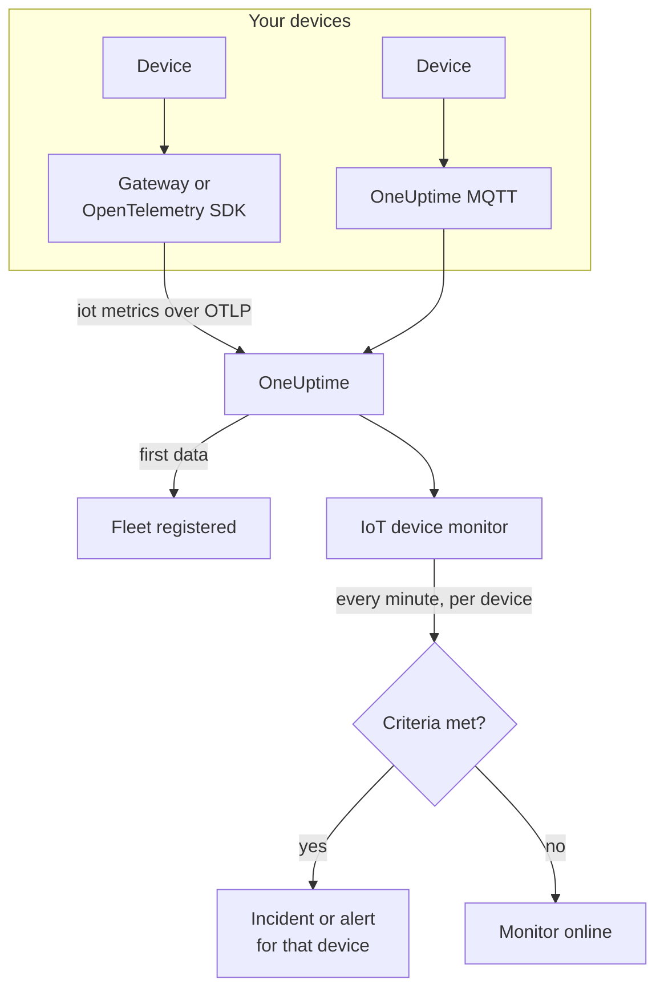

# IoT Device Monitor

An IoT device monitor watches one fleet of devices and tells you when a device goes offline, its battery runs low, its signal weakens, it overheats, or its CPU stays busy. It reads the `iot_*` metrics your devices send to OneUptime, over OpenTelemetry or MQTT, so nothing is checked from outside and no probe is involved.

:::cards
- [Create the monitor](#create-an-iot-device-monitor): Six steps in the dashboard.
- [Templates](#pre-built-alert-templates): Five ready-made alerts, one incident per device.
- [Offline detection](#offline-detection): How a dead or silent device is noticed.
- [Metrics](#collected-metrics): The `iot_*` series the monitor reads.
:::

## How it works

Your devices, or the gateway they talk to, send their readings to OneUptime: over OpenTelemetry, or straight to OneUptime's MQTT endpoint. Every reading carries the fleet's name, `iot.fleet.name`, and the device's own ID, `device.id`. The first data registers the fleet.

An IoT device monitor is tied to one fleet. Every minute it runs its query over that fleet's metrics and compares the result with its criteria. The templates group by `device.id`, so 30 offline sensors open 30 incidents, each naming its device, and each resolves itself when its device recovers.



## Before you begin

- **Get your devices reporting.** The [IoT Devices guide](/docs/telemetry/iot-devices) shows how to send metrics with an OpenTelemetry SDK or Collector, or over MQTT.
- **Check the fleet is registered.** It appears under **Products → Infrastructure → IoT → All Fleets**, named after the `iot.fleet.name` the devices send.
- **Register the devices you expect**, under the fleet's **Device Registry**, to be told when one goes silent: see [Offline detection](#offline-detection).

## Create an IoT device monitor

:::steps
### Start a new monitor

Go to **Monitors** and click **Create Monitor**.

### Pick IoT Device

Under **Monitor Type**, click **More monitor types** and pick **IoT Device** under **Infrastructure**, or type `iot` in the search box. Enter a **Name** - it is used in incident and alert titles - and click **Next**.

### Choose the fleet

Under **IoT Monitor Configuration**, pick the fleet from **IoT Fleet**. Every fleet that has sent data is in the list.

### Choose what to watch

Pick one of the three tabs:

- **Quick Setup** - click a [template](#pre-built-alert-templates). It sets the metric, the aggregation, the time range, a group-by on `device.id` and the thresholds, and replaces the criteria below with its own. You can still change the **Time Range**.
- **Custom Metric** - pick one metric from **IoT Metric**, then set **Aggregation** and **Time Range**. The [filters](#monitor-settings) narrow it to one device or one type of device. A custom metric is not grouped: it judges the fleet as a whole.
- **Advanced** - build queries and formulas yourself under **Select Metrics**, including over metric names of your own, for example memory in use as a percentage of a device's memory size. Use **Group by** `device.id` to judge each device on its own.

### Check the criteria

Open each criteria under **Monitor Criteria** and check its **Select Metric Variable**, **Aggregation**, **Condition** and **Threshold**. A template fills these in. With **Custom Metric** or **Advanced**, the monitor starts with the [default criteria](#default-criteria), which only notice a metric dropping to zero, so set your own threshold.

### Create the monitor

Click **Create Monitor**. OneUptime opens the monitor's page and evaluates it every minute. Incidents and alerts it raises reach your on-call policies, Slack, Microsoft Teams, email, SMS and webhooks like those of any other monitor.
:::

> [!TIP]
> To set up several templates at once, open the fleet from **Products → Infrastructure → IoT** and go to **Recommendations**. Pick the templates you want, choose who is paged, and OneUptime creates one monitor per template.

## Monitor settings

| Field | Tab | What it does |
| --- | --- | --- |
| **IoT Fleet** | All | Required. Scopes every query to `resource.iot.fleet.name`. |
| **Resource Scope** | Custom Metric, Advanced | Optional. **Device** or **Fleet**: an exact match on the `iot.scope` attribute. Picking a metric sets it to **Device**. |
| **Device ID** | Custom Metric, Advanced | Optional. One device, by its `device.id`, such as `sensor-001`. |
| **Device Type** | Custom Metric, Advanced | Optional. The devices that report this `iot.device.type`, such as `sensor` or `gateway`. |
| **IoT Metric** | Custom Metric | One metric from the [catalog](#collected-metrics). |
| **Aggregation** | Custom Metric | How samples are combined: **Average**, **Maximum**, **Minimum**, **Sum** or **Count**. Starts at the metric's usual aggregation. |
| **Time Range** | All | The rolling window the query reads, from **Past 1 Minute** to **Past 365 Days**. A new monitor starts at **Past 1 Minute**; templates set their own. |
| **Select Metrics** | Advanced | The query builder: **Metric**, **Aggregate by**, **Filter by attributes**, **Group by**, plus **Add Metric** and **Add Formula** to combine queries. |

The filters work together: with a **Device ID** and a **Device Type**, a device of another type matches nothing.

## Pre-built Alert Templates

**Quick Setup** offers 5 templates. Each builds a complete monitor: the metric query, a group-by on `device.id`, a criteria that fires and one that recovers. Thresholds are starting points you can edit.

A criteria fires only when the condition holds for every minute of its window - except **Device Offline**, which fires on the first reading below 1. A threshold criteria recovers 10% past its threshold, so a value hovering at the line does not flap.

| Template | Category | Severity | Watches | Fires when | Recovers when |
| --- | --- | --- | --- | --- | --- |
| Device Offline | Availability | Critical | `iot_device_up`, Min per `device.id`, past 30 minutes | Any reading is below 1, or a registered device sends nothing for the whole window | Back at 1 |
| Low Battery | Power | Warning | `iot_battery_percent`, Avg per `device.id`, past 5 minutes | Below 20% | At or above 22% |
| Weak Signal | Connectivity | Warning | `iot_signal_strength_dbm`, Avg per `device.id`, past 5 minutes | Below -100 dBm | At or above -90 dBm |
| High Temperature | Environment | Critical | `iot_temperature_celsius`, Max per `device.id`, past 5 minutes | Above 70 °C | At or below 63 °C |
| High CPU Usage | System | Warning | `iot_cpu_usage_ratio`, Avg per `device.id`, past 5 minutes | Above 0.9 (90% of its CPU) | At or below 0.81 |

**Severity** is the label the picker shows. The incident and alert a template creates start on your project's most severe incident and alert severity; change them in the criteria.

- **Device Offline reads 30 minutes** so that a device which reports every few minutes is not called offline between two reports. A device that reports less often than every 15 minutes or so needs a longer window.
- **High Temperature uses Max** in each minute, so a hot reading is not hidden by cooler ones in the same minute. It still has to stay hot for every minute of the window.
- **High CPU Usage compares a ratio:** `iot_cpu_usage_ratio` runs from 0 to 1, so 0.9 is 90%.

## Offline detection

**Device Offline** fires when a device reports `iot_device_up = 0`. A dead or silent device trips it in three ways:

| How | What happens |
| --- | --- |
| **The gateway reports it** | The gateway or collector sends `iot_device_up = 0` for a device it can no longer reach. |
| **MQTT Last Will** | A device connected to OneUptime's MQTT endpoint registers a Last Will on its `status` topic. When the device dies, the broker sends `iot_device_up = 0` for it the moment the session drops: no polling, no wait for a missed report. See [Sending Metrics via MQTT](/docs/telemetry/iot-devices#sending-metrics-via-mqtt). |
| **The device is registered** | A device in the fleet's **Device Registry** is expected. When it sends nothing for the whole window, the monitor treats it as reporting `0`, so it gets an incident of its own, which resolves itself when the device reports again. |

A registered device is also kept in the fleet's inventory as offline, where an unregistered one is removed after 15 minutes of silence. Silence detection needs the **Treat As Zero** no-data policy on the `iot_device_up` criteria, which Device Offline monitors created from the template have. A Device Offline monitor created before device registration existed needs it set by hand, or must be created again from the template.

> [!NOTE]
> An unregistered device that goes silent, without a Last Will or a gateway report, only stops sending data, and a monitor grouped per device cannot single it out. Register your devices, or give a critical device a monitor of its own (**Custom Metric**, with its **Device ID**) and set **If No Data** to **Trigger**. Silence detection also needs at least one other device of the fleet still reporting: a fleet that goes completely dark, during a gateway outage for example, raises one incident for the monitor, not one per device.

## Collected Metrics

Each series carries the device's `device.id` label, and the `iot.scope`, `iot.device.type` and `iot.device.kind` attributes.

| Metric | Unit | Description |
| --- | --- | --- |
| `iot_device_up` | — | 1 when the device is up, 0 when it is down or offline. |
| `iot_battery_percent` | `%` | Battery charge left, 0 to 100. A falling level means the device will soon stop reporting. |
| `iot_signal_strength_dbm` | `dBm` | Wireless signal strength. Closer to 0 is stronger; a weak signal comes before lost connections. |
| `iot_temperature_celsius` | `°C` | The device's temperature. A high reading can mean overheating hardware or a problem around it. |
| `iot_cpu_usage_ratio` | `ratio` | CPU in use, from 0 to 1, where 1 is fully used. |
| `iot_memory_usage_bytes` | `bytes` | Memory in use. Compare it with the device's memory size to see memory pressure. |
| `iot_uptime_seconds` | `s` | How long the device has been running. Drops to zero when it restarts. |

## Monitoring criteria

A criteria compares one of the monitor's queries or formulas with a threshold. An IoT device monitor's criteria offer one **Filter Type**, **Metric Value**: every rule checks the metric value, with these fields.

| Field | What it does |
| --- | --- |
| **Filter Type** | Always **Metric Value**, the only check this monitor offers. |
| **Select Metric Variable** | The query or formula to check, by its variable name. |
| **Aggregation** | How the values in the window become one answer: **Average**, **Sum**, **Maximum Value**, **Minimum Value**, **All Values** (every value must match) or **Any Value** (one is enough). |
| **Condition** | **Greater Than**, **Less Than**, **Greater Than Or Equal To**, **Less Than Or Equal To** or **Equal To** — or an anomaly condition: **Anomalously High**, **Anomalously Low** or **Anomalous**. |
| **Threshold** | The value to compare with. A unit list sits beside it when the metric has a unit. Not shown for anomaly conditions. |
| **Sensitivity** | Anomaly conditions only. **Low** (4σ), **Medium** (3σ, the default) or **High** (2σ). |
| **Baseline Window** | Anomaly conditions only. 14 days (the default), 28, 60 or 90 days of history. |
| **If No Data** | Under **More fields**. What happens when a series has no samples in the window: **Ignore** (the default) skips it, **Treat As Zero** reads it as `0`, and **Trigger** makes the criteria match. |

Anomaly conditions compare each value with the same hour of the week in the baseline. They stay in a "Learning" state, and raise nothing, until the baseline window holds enough history.

### Default criteria

A monitor you do not build from a template starts with two criteria:

| Order | Criteria | Matches when | Then |
| --- | --- | --- | --- |
| 1 | Check if _monitor name_ is offline | Any value of the first query is `0` | Marks the monitor **Offline** and declares the incident "_monitor name_ is offline", which resolves itself when the monitor recovers. |
| 2 | Check if _monitor name_ is online | Any value is above `0` | Marks the monitor **Operational**. |

> [!IMPORTANT]
> Silence matches neither criteria: a fleet that stops sending data leaves the monitor as it was. To be told when data stops, set **If No Data** to **Trigger** on a criteria. Time OneUptime itself was not receiving is never no data: a check whose window holds it waits instead, as [When OneUptime Is Not Receiving Data](/docs/monitor/when-oneuptime-is-not-receiving) explains.

## Terraform

The [OneUptime Terraform provider](/docs/terraform/monitor-steps) carries an IoT device monitor step's configuration in the `iot_monitor` attribute: the raw JSON of the `iotMonitor` configuration (`fleetIdentifier`, `resourceFilters`, `metricViewConfig`, `rollingTime`), written with `jsonencode()`:

```hcl title="main.tf"
monitor_steps = [{
  iot_monitor = jsonencode({
    fleetIdentifier = "building-a-sensors"
    resourceFilters = {}
    rollingTime     = "Past 5 Minutes"
    metricViewConfig = {
      queryConfigs = [{
        metricAliasData = { metricVariable = "battery_percent", title = "Battery", description = "", legend = "" }
        metricQueryData = {
          filterData = {
            metricName     = "iot_battery_percent"
            attributes     = {}
            aggegationType = "Avg"
            aggregateBy    = {}
          }
          groupByAttributeKeys = ["device.id"]
        }
      }]
      formulaConfigs = []
    }
  })
  criteria = [ /* ... */ ]
}]
```

`fleetIdentifier` is the fleet's `iot.fleet.name`, not its OneUptime ID.

## Troubleshooting

:::details The fleet is not in the IoT Fleet list
Fleets register themselves from the devices' data. Check that the devices send `iot.fleet.name`, and follow the [IoT Devices guide](/docs/telemetry/iot-devices) to confirm data arrives.
:::

:::details One incident fires for the whole fleet instead of one per device
The query is not grouped. **Custom Metric** monitors judge the fleet as a whole; use a template, or **Advanced** with **Group by** `device.id`.
:::

:::details A device died but Device Offline did not fire
The device sent no Last Will and no gateway reported it, so it only went silent. Register it under the fleet's **Device Registry**, and check that the `iot_device_up` criteria's **If No Data** is **Treat As Zero**. See [Offline detection](#offline-detection).
:::

:::details Device Offline fires for devices that are fine
They report less often than the 30-minute window holds, so some windows contain nothing from them. Lengthen the **Time Range**, or have the devices report more often. On the WebSocket MQTT endpoint, keep the MQTT keepalive under 5 minutes: OneUptime closes idle WebSocket connections after 300 seconds, which sends the Last Will.
:::

:::details A template shows no data
The templates read the `iot_*` metric names exactly, and group by the `device.id` label. Compare what your devices send, on the fleet's **Metrics** page, with the [metric conventions](/docs/telemetry/iot-devices#metric-conventions).
:::

## Next steps

:::cards
- [IoT Devices](/docs/telemetry/iot-devices): Send device metrics over OpenTelemetry or MQTT.
- [Metrics Monitor](/docs/monitor/metrics-monitor): Alert on any metric, not only IoT ones.
- [Incident & Alert Templating](/docs/monitor/incident-alert-templating): Put the device's ID in incident titles.
:::
