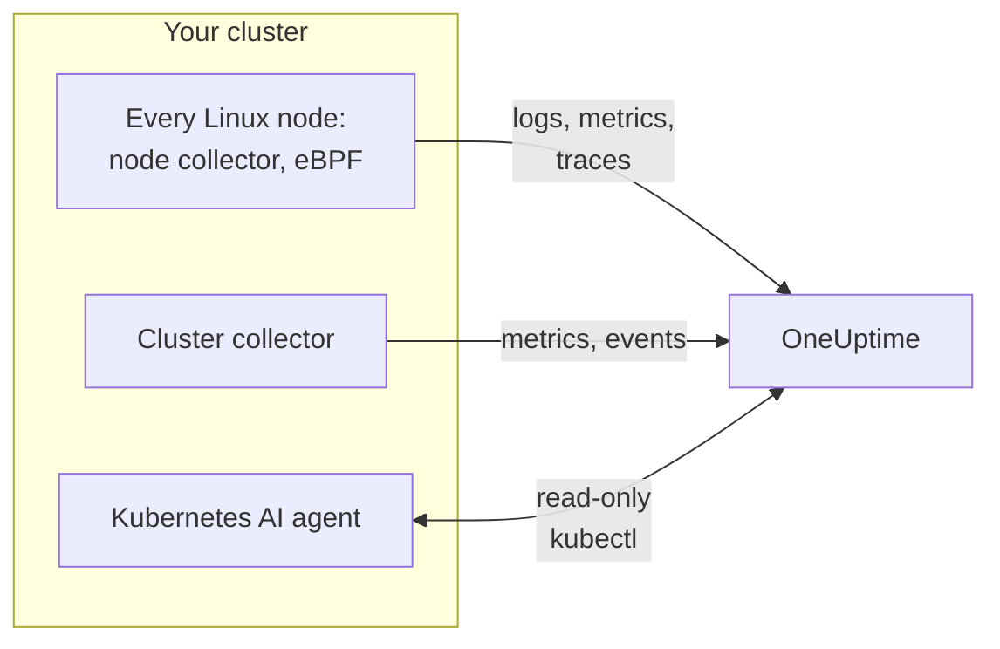

# Kubernetes Agent (Helm install)

The OneUptime Kubernetes agent is a Helm chart that collects your cluster's metrics, events and pod logs, application traces captured with eBPF, and per-node OS metrics, and sends them to OneUptime. One `helm install` puts it in place, with no code changes in your apps. [Kubernetes monitors](/docs/monitor/kubernetes-monitor) alert on what it sends.

:::cards
- [Install the agent](#install-the-agent): Four steps with Helm.
- [Pick a preset](#pick-a-preset): Standard clusters, GKE Autopilot or EKS Fargate.
- [Common options](#common-options): The settings most clusters change.
- [Troubleshooting](#troubleshooting): A diagnostic script, and the usual problems.
:::

## What the chart installs

The chart runs a few workloads in its own namespace. Each one sends what it collects to your OneUptime URL over OTLP, with the ingestion key you give it.



| Workload | Kind | What it does | On by default |
| --- | --- | --- | --- |
| Cluster collector | Deployment | Cluster metrics, Kubernetes events and the full specs of pods, nodes and workloads, from the Kubernetes API. | Yes |
| Node collector | DaemonSet | Pod logs from `/var/log/pods`, kubelet and cAdvisor metrics, and the node's OS metrics. | Yes |
| eBPF instrumentation (OBI) | DaemonSet | HTTP, gRPC, SQL and Redis traces and request metrics from every pod, and the service map. | Yes |
| Kubernetes AI agent | Deployment | Lets OneUptime AI run read-only `kubectl` while it investigates an incident or alert on this cluster. | Yes |
| Log tailer | Deployment | Pod logs through the Kubernetes API, where the node collector cannot read them. | With the `gke-autopilot` and `eks-fargate` presets |
| eBPF profiler | DaemonSet | Continuous CPU flame graphs of every process. | No |
| kube-state-metrics | Deployment | Pod phases, container waiting reasons and resource quotas. | No |

Every agent image is Linux-only, so every workload is pinned to Linux nodes.

## Before you begin

- **An ingestion key.** Create one in OneUptime under **Project Settings → Telemetry & APM → Ingestion Keys**. The agent sends it as the `x-oneuptime-token` header, so a project API key does not work here.
- **Helm 3** and `kubectl` access to the cluster. Upgrades use `--reset-then-reuse-values`, which needs Helm 3.14 or later.
- **A name for the cluster**, unique in your project. The chart refuses to install without one: two clusters with the same name would show as one.
- **Outbound HTTPS** from the cluster to your OneUptime URL.

## Install the agent

:::steps
### Add the Helm repository

```bash
helm repo add oneuptime https://helm-chart.oneuptime.com
helm repo update
```

### Install the chart

Replace the URL with your OneUptime URL, and the two placeholders with your ingestion key and the cluster's name:

```bash
helm install oneuptime-agent oneuptime/kubernetes-agent \
  --namespace oneuptime-kubernetes-agent \
  --create-namespace \
  --set oneuptime.url=https://oneuptime.com \
  --set oneuptime.apiKey=<YOUR_API_KEY> \
  --set clusterName=<A_UNIQUE_NAME_FOR_THIS_CLUSTER>
```

This uses the `standard` preset. On GKE Autopilot or EKS Fargate, [pick their preset](#pick-a-preset) instead.

### Check the pods are running

```bash
kubectl get pods -n oneuptime-kubernetes-agent
```

Every pod should reach `Running` within a minute or two.

### Find the cluster in OneUptime

Open **Products → Infrastructure → Kubernetes → All Clusters**. The cluster appears under its name within a few minutes, and its nodes, pods and workloads fill in.
:::

## Pick a preset

Some Kubernetes platforms do not let a workload mount a `hostPath` volume or run a DaemonSet, which the node collector uses. The `preset` setting picks what works on yours:

| Preset | Use for | Pod logs | On every node |
| --- | --- | --- | --- |
| `standard` (default) | Self-managed, **EKS on EC2**, **GKE Standard**, **AKS**, minikube, kind, k3s | The node collector reads `/var/log/pods` | Kubelet, cAdvisor and OS metrics |
| `gke-autopilot` | **GKE Autopilot** | The log tailer reads them through the Kubernetes API | Kubelet and cAdvisor metrics, without `hostPath` |
| `eks-fargate` | **EKS Fargate** | The log tailer reads them through the Kubernetes API | Nothing: Fargate runs no DaemonSets |

If you are not sure, leave `preset` unset to get `standard`. If the install fails with a Pod Security error that names `hostPath`, install again with `gke-autopilot`, or `eks-fargate` on EKS Fargate.

GKE Autopilot and EKS Fargate also refuse privileged pods, which the eBPF instrumentation and profiling need, so their presets leave both out:

:::tabs
@tab Standard
```bash
helm install oneuptime-agent oneuptime/kubernetes-agent \
  --namespace oneuptime-kubernetes-agent --create-namespace \
  --set oneuptime.url=https://oneuptime.com \
  --set oneuptime.apiKey=<YOUR_API_KEY> \
  --set clusterName=prod
```
@tab GKE Autopilot
```bash
helm install oneuptime-agent oneuptime/kubernetes-agent \
  --namespace oneuptime-kubernetes-agent --create-namespace \
  --set oneuptime.url=https://oneuptime.com \
  --set oneuptime.apiKey=<YOUR_API_KEY> \
  --set clusterName=prod-gke-autopilot \
  --set preset=gke-autopilot
```
@tab EKS Fargate
```bash
helm install oneuptime-agent oneuptime/kubernetes-agent \
  --namespace oneuptime-kubernetes-agent --create-namespace \
  --set oneuptime.url=https://oneuptime.com \
  --set oneuptime.apiKey=<YOUR_API_KEY> \
  --set clusterName=prod-eks-fargate \
  --set preset=eks-fargate
```
:::

## Tag the cluster with labels

Labels you pass at install time are attached to the cluster, and to the services and hosts this agent reports. `--set oneuptime.labels.<key>=<value>` becomes a project label named `<key>:<value>`:

```bash
helm install oneuptime-agent oneuptime/kubernetes-agent \
  --namespace oneuptime-kubernetes-agent \
  --create-namespace \
  --set oneuptime.url=https://oneuptime.com \
  --set oneuptime.apiKey=<YOUR_API_KEY> \
  --set clusterName=prod \
  --set oneuptime.labels.team=payments \
  --set oneuptime.labels.env=production \
  --set oneuptime.labels.region=us-east-1
```

Or keep them in a values file:

```yaml title="values.yaml"
oneuptime:
  url: https://oneuptime.com
  apiKey: <YOUR_API_KEY>
  labels:
    team: payments
    env: production
    region: us-east-1
clusterName: prod
```

```bash
helm install oneuptime-agent oneuptime/kubernetes-agent \
  --namespace oneuptime-kubernetes-agent --create-namespace \
  -f values.yaml
```

Every record this agent sends - logs, metrics, traces and profiles - then carries `team:payments`, `env:production` and `region:us-east-1`. Each label is an `oneuptime.label.<key>=<value>` resource attribute, and OneUptime turns every attribute that starts with `oneuptime.label.` into a label. Labels are matched without regard to case, so an existing `Production` label is reused, not duplicated. The agent never removes a label you added in OneUptime.

## Pod logs

`preset` sets `logs.mode`, which you can also set yourself:

| `logs.mode` | How logs are read | Good | Watch out for |
| --- | --- | --- | --- |
| `daemonset` | One node collector per node tails the files under `/var/log/pods`. | Lowest overhead, scales with the nodes, no load on the Kubernetes API server, follows log rotation. | Needs `hostPath` and DaemonSets. |
| `api` | One log tailer streams every container's log from the Kubernetes API, as `kubectl logs -f` does. | Works where `hostPath` is blocked or the `restricted` Pod Security Standard applies. | Every container stream is a long-lived connection to the API server. One replica handles a few thousand containers. |
| `disabled` | Nothing. | For apps that already send their logs another way. | |

To turn log collection off, set `--set logs.enabled=false` and send application logs with the [OpenTelemetry](/docs/telemetry/open-telemetry) SDKs instead. Metrics are not affected: the node collector keeps running.

### Mixed-OS clusters (Windows node pools)

Windows nodes never run an agent pod. Cluster-level data about them and their pods still arrives, because it comes from the Kubernetes API: node conditions, pod phases, Kubernetes events and kube-state-metrics. What Windows nodes lack is what is collected on the node: OS metrics, kubelet and cAdvisor metrics, eBPF traces, profiles and, in `daemonset` log mode, pod logs.

To collect the logs of pods on Windows nodes too, turn on the hybrid mode:

```bash
helm upgrade oneuptime-agent oneuptime/kubernetes-agent \
  --namespace oneuptime-kubernetes-agent --reset-then-reuse-values \
  --set logs.windowsPods.enabled=true
```

The log tailer then runs next to the node collectors, for the pods on Windows nodes only. Linux pods keep the cheaper file tailing, and the two split the pods by node OS, so no log line is sent twice.

- **Tailer image version.** The Windows-only split is built into the `kubernetes-log-tailer` image. An older image ignores it and tails *every* pod, sending each Linux pod's logs twice. Don't pin `logs.api.image.tag` to a version older than the chart's release, and if a node may have cached an old `release` image, add `--set logs.api.image.pullPolicy=Always` to the upgrade.
- **Severity filtering.** With `filters.logs.minSeverity` set, a line with no recognisable severity is dropped on the node collector's path but kept on the log tailer's - see [Filtering by Log Severity](/docs/telemetry/kubernetes-agent#filtering-by-log-severity). Windows pods can then send more lines without a level than Linux pods.

## Application traces with eBPF

The chart runs [OpenTelemetry eBPF Instrumentation (OBI)](https://opentelemetry.io/docs/zero-code/obi/) on every node. OBI loads eBPF programs into the Linux kernel and watches each pod's network traffic, so it can rebuild HTTP and HTTPS, gRPC, and SQL and Redis calls without any change to your apps: no SDK, no sidecar. It sends them to OneUptime as traces and request metrics.

Your services appear under **Products → Traces** and on the service map within a minute or two, with `k8s.cluster.name` set to the cluster's name, so you can filter by cluster.

### When to turn eBPF off

eBPF is on by default. Turn it off with `--set ebpf.enabled=false` when:

- The cluster is **GKE Autopilot** or **EKS Fargate**. Their presets do it for you: those platforms refuse privileged pods, and OBI must be privileged to load its programs.
- The nodes run a kernel older than **Linux 5.8** without BTF. Debian 11, Ubuntu 20.10, Fedora 34, RHEL 9 and later are fine.
- Your apps already send traces with an OpenTelemetry SDK, and you do not want them twice.

### What eBPF sends

OBI sends several kinds of signal. Each can be turned off with `--set ebpf.features.<key>=false`:

| Setting | Default | What it adds |
| --- | --- | --- |
| `ebpf.features.httpMetrics` | on | HTTP and gRPC request metrics per service: request rate, latency histograms and errors. |
| `ebpf.features.spanMetrics` | on | Span metrics: calls and duration per service, route or operation, span kind and status - `traces.span.metrics.calls` and `traces.span.metrics.duration` (seconds). |
| `ebpf.features.serviceGraph` | on | The rate and latency of each call from one service to another, which draw the service map. |
| `ebpf.features.networkMetrics` | on | Bytes and packets between every pair of pods, over TCP and UDP, with their Kubernetes names. Shows every pair of pods that talk, even over protocols OBI cannot read. |
| `ebpf.features.networkInterZoneMetrics` | off | The same between zones. Doubles the number of series: turn it on only if you schedule by zone. |
| `ebpf.features.tcpStats` | on | Per-node TCP statistics: round-trip times, failed connections and retransmits. |

### Linking traces across services

OBI can also carry the trace across a call: when pod A calls pod B over HTTP or gRPC, the span on B's side joins A's trace, with no SDK in either app. **This is off by default.** Turn it on with `--set ebpf.contextPropagation=true`, after reading the warning below.

| Option | Default | What it does |
| --- | --- | --- |
| `ebpf.contextPropagation` | off | Writes a W3C `traceparent` into outgoing traffic, so spans link across services. |
| `ebpf.contextPropagationMode` | `headers` | How: `headers` (HTTP/1.1 request headers, the narrowest), `tcp` (a TCP option, through Linux Traffic Control) or `all` (both). Read only when `contextPropagation` is on. |
| `ebpf.trackRequestHeaders` | on | Tracks request headers in the kernel, so the receiving side finds the `traceparent` on plain HTTP servers too. Has an effect only when `contextPropagation` is on. |

> [!WARNING]
> Every propagation mode changes traffic that is already in flight. For plain HTTP, OBI widens the outgoing request in the kernel to fit the header; for TLS and raw TCP it adds a TCP option from a Traffic Control hook, rewriting the packet and its checksum. When the connection's byte accounting is then not corrected exactly, the stream **desynchronizes**: transfers through a proxy such as nginx hang part-way, once a response passes about 64 KB, until the connection times out. Small requests keep working, so it looks like an application or proxy bug. No kernel version makes the rewrite go away. Traces, request metrics and the service map all work without it; an OpenTelemetry SDK in your services links traces with no kernel rewriting at all. If you turn it on, try it on a cluster that is not production first, and check large transfers through your proxy.

### Linking logs to traces

**Off by default.** When it is on, OBI attaches a probe to the `write()` system call of every process it instruments, and:

- A **JSON log line** gets `trace_id` and `span_id` fields (fields the line already has are kept). The node collector moves them onto the log record's own trace fields, so a span's logs are one click away in OneUptime, and so is a log line's trace.
- **Any other log line** is collected unchanged, without the link.

```bash
helm upgrade oneuptime-agent oneuptime/kubernetes-agent \
  --namespace oneuptime-kubernetes-agent --reset-then-reuse-values \
  --set ebpf.logToTraceCorrelation=true
```

| Option | Default | What it does |
| --- | --- | --- |
| `ebpf.logToTraceCorrelation` | `false` | Turns on OBI's log enricher and the node collector's `trace_id` lift. |
| `ebpf.logEnricher.services` | `[{service: [{exe_path: "*"}]}]` | Which processes the enricher touches. Each entry is an OBI [GlobAttributes](https://opentelemetry.io/docs/zero-code/obi/configure/options/#service-discovery) selector, with fields such as `exe_path`, `languages`, `k8s_pod_labels`, `k8s_pod_annotations`, `open_ports` and `cmd_args`. |

#### APM agents that crash with it

The enricher rewrites the app's output buffer **inside the process**: when a matched process calls `write()`, OBI blanks the original bytes and writes an enriched copy. APM agents that load through `LD_PRELOAD` and wrap `write()` themselves do not survive that:

| APM agent | Library | What happens |
| --- | --- | --- |
| Dynatrace OneAgent | `liboneagentproc.so` | The app crashes with SIGSEGV (exit 139). The Dynatrace watchdog's own `write()` stalls past its 10-second limit and the OneAgent restarts in a loop. |
| New Relic | `libnewrelic*.so` | The same kind of crash. |
| AppDynamics | `libappdynamics*.so` | The same kind of crash. |
| Datadog | `libdd*.so` | The same kind of crash. |
| Instana | `libinstana*.so` | The same kind of crash. |

**.NET apps are the most exposed:** Dynatrace's .NET agent always loads through `LD_PRELOAD`, and the console log of Microsoft.Extensions.Logging is unbuffered, so every line takes that path. Python and Go apps are usually unaffected.

To use it next to one of these agents, point `logEnricher.services` only at the pods without one. The enricher has no way to exclude, so list the ones to enrich:

```yaml title="values.yaml"
ebpf:
  logToTraceCorrelation: true
  logEnricher:
    services:
      # Enrich only pods with the apm-agent=none label
      - service:
          - k8s_pod_labels:
              apm-agent: "none"
```

Or choose by runtime. Dynatrace's `LD_PRELOAD` loading targets .NET, so enriching only Python, Go, Ruby and Node.js avoids it:

```yaml title="values.yaml"
ebpf:
  logToTraceCorrelation: true
  logEnricher:
    services:
      - service:
          - languages: "python,go,ruby,nodejs"
```

#### Logs must be JSON and unbuffered

- **Only JSON lines get a `trace_id`.** Switch the logger to a JSON format: `structlog`, `pino`, `winston`, `serilog`, `logback-json`, klog `--logging-format=json` and the like.
- **Buffered output breaks the link**, because the `write()` then happens on another thread than the request. In **Python**, set `PYTHONUNBUFFERED=1`. In **.NET**, call `Console.SetOut(new StreamWriter(Console.OpenStandardOutput()) { AutoFlush = true })` at startup; Microsoft.Extensions.Logging's `AddConsole()` and Serilog's async sinks do not work, Serilog's plain `WriteTo.Console()` does.
- Greenlet, gevent, Tornado and other custom async runtimes are not covered.

### Tuning eBPF

| Option | Default | What it does |
| --- | --- | --- |
| `ebpf.enabled` | `true` | Runs the eBPF DaemonSet. `false` leaves it out. |
| `ebpf.image.tag` | `v0.14.0` | The OBI image. OBI is before 1.0: pin a version you tested, and test again before you move it. |
| `ebpf.autoTargetExe` | `*` | Globs of the executables to instrument, comma-separated. Narrow it, as in `*/python,*/java`, to instrument fewer runtimes. |
| `ebpf.excludeExePaths` | Shells, cluster plumbing, service-mesh sidecars, CNI agents, browsers, ClickHouse, collectors and OBI itself | Globs of executables to skip, comma-separated. A broad glob skips your own binaries too. |
| `ebpf.logLevel` | `info` | `debug`, `info`, `warn` or `error`. |
| `ebpf.printTraces` | `false` | Also prints spans to OBI's own log, to check what it captures. |
| `ebpf.resources.*` | `100m` CPU and `512Mi` memory requested, `2000m` and `2Gi` limits | Raise them for nodes with heavy traffic or many short-lived processes. |

To check that OBI runs and sees traffic:

```bash
kubectl get pods -n oneuptime-kubernetes-agent -l component=ebpf-instrument
kubectl logs -n oneuptime-kubernetes-agent -l component=ebpf-instrument --tail=200
```

## Continuous CPU profiling

The [OpenTelemetry eBPF Profiler](https://github.com/open-telemetry/opentelemetry-ebpf-profiler) can run on every node too, as the `otel/opentelemetry-collector-ebpf-profiler` image. It samples what every process is running, 19 times a second, in Go, Java, .NET, Python, Ruby, Node.js, PHP, Perl, C, C++ and Rust, and sends the profiles to OneUptime. They appear under **Products → Performance Profiles**, and as a flame graph on each trace span.

**Profiling is off by default:** it costs more CPU and memory per node than the eBPF instrumentation. Turn it on with `--set profiling.enabled=true`.

With eBPF instrumentation on too (the default), each sample carries the trace it belongs to, so a span has its own flame graph. For that, the chart asks OBI to keep the running trace context available (`OTEL_EBPF_BPF_POPULATE_TRACE_CONTEXT=true`), which costs instrumented apps a little on every async context switch. Set `profiling.obiProcessContext=false` for flame graphs without the link to spans.

Profiling needs **Linux 5.10** or later, and a privileged pod with the node's process IDs: it cannot run on GKE Autopilot or EKS Fargate, and their presets leave it off. On nodes that are themselves containers, such as kind or k3d, it cannot tell processes apart, and almost no sample links to a span.

| Option | Default | What it does |
| --- | --- | --- |
| `profiling.enabled` | `false` | Runs the profiler DaemonSet. |
| `profiling.image.tag` | `0.152.0` | The profiler image. It is before 1.0: pin a version you tested. |
| `profiling.samplesPerSecond` | `19` | How many samples a second. 19 avoids lining up with common timer frequencies. |
| `profiling.offCpuThreshold` | `0` | A value from above 0 to 1 also profiles time spent off the CPU, which shows lock contention and blocking I/O, at some extra cost. |
| `profiling.tracers` | `""` (every runtime) | The language tracers to load, comma-separated, such as `go,python`. |
| `profiling.obiProcessContext` | `true` | Links samples to OBI's traces, and has OBI keep the trace context available for it. |

## Other data collection

| Option | Default | What it adds |
| --- | --- | --- |
| `hostMetrics.enabled` | on | Each node's OS metrics from `/proc` and `/sys`: disk I/O queues, filesystem inodes, network interface errors, paging and load average. Runs in the node collector, with no extra pods. |
| `kubeletstats.utilizationMetrics.enabled` | on | Container and pod CPU and memory as a percentage of their request and limit, which the CPU and memory saturation monitors read. Always 0 for a pod with no request or limit. |
| `kubeletstats.volumeMetrics.enabled` | on | Each PVC's free and total space (`k8s.volume.available`, `k8s.volume.capacity`), which the PVC Low Disk Space monitor reads. One series per PVC per pod. |
| `cadvisor.enabled` | on | CPU throttling and OOM kills from each kubelet's `/metrics/cadvisor`: `container_cpu_cfs_throttled_seconds_total`, `container_cpu_cfs_periods_total` and `container_oom_events_total`, and nothing else. |
| `kubeStateMetrics.enabled` | off | Pod phases (Pending, Terminating), pods that cannot be scheduled, container waiting reasons (CrashLoopBackOff, ImagePullBackOff) and resource quota use, from kube-state-metrics. `kubeStateMetrics.mode: bundled` (the default) runs a small kube-state-metrics for you; `external` reads one you already run, at `kubeStateMetrics.endpoint`. |
| `auditLogs.enabled` | off | The Kubernetes audit log, `/var/log/kubernetes/audit.log`: every request to the API, by whom, on what. Self-managed clusters only: managed ones (EKS, GKE, AKS, DOKS) send it to the cloud provider. |
| `csi.enabled` | off | The metrics of CSI storage drivers, from pods labelled `app=csi-driver` or `app.kubernetes.io/component=csi-driver`: volume attach and detach times, provisioning failures, IOPS. |
| `coreDns.enabled` | off | CoreDNS's metrics on `:9153/metrics`: query rate, latency, cache hits and errors. |
| `controlPlane.enabled` | off | etcd, the API server, the scheduler and the controller manager. Self-managed clusters only: managed ones do not expose them. |
| `cost.enabled` | off | What each workload costs. See [Kubernetes Cost](/docs/telemetry/kubernetes-cost). |

## Common options

| Option | Default | What it does |
| --- | --- | --- |
| `oneuptime.url` | (required) | Your OneUptime URL. |
| `oneuptime.apiKey` | (required) | The ingestion key, from **Project Settings → Telemetry & APM → Ingestion Keys**. Sent as the `x-oneuptime-token` header; a project API key does not work. |
| `clusterName` | (required) | The cluster's name, unique in the project. Every record carries it as `k8s.cluster.name`. |
| `preset` | (empty: `standard`) | `standard`, `gke-autopilot` or `eks-fargate`. See [Pick a preset](#pick-a-preset). |
| `oneuptime.labels` | `{}` | Labels for every record from this agent. See [Tag the cluster with labels](#tag-the-cluster-with-labels). |
| `namespaceFilters.rules` | Leaves `kube-system` out of `podLogs` and `ebpfDiscovery` | Rules that include or exclude namespaces, for `podLogs`, `ebpfDiscovery`, `metrics` and `traces`. Patterns can use `*`, and exclude always wins. |
| `filters.logs.minSeverity` | `""` | Drops pod log lines below this level: `TRACE`, `DEBUG`, `INFO`, `WARN`, `ERROR` or `FATAL`. |
| `filters.metrics.exclude` | `[]` | Metric names to drop. |
| `sampling.traces.percentage` | `100` | The share of traces to keep, from 0 to 100. Whole traces are kept or dropped. |
| `logs.enabled` | `true` | Collects pod logs. |
| `logs.mode` | (from `preset`) | `daemonset`, `api` or `disabled`. Overrides the preset. |
| `logs.windowsPods.enabled` | `false` | Also tails pods on Windows nodes. See [Mixed-OS clusters](#mixed-os-clusters-windows-node-pools). |
| `logs.api.replicas` | `1` | Log tailer replicas, in `api` mode. |
| `ebpf.enabled` | `true` | eBPF traces and request metrics. See [Application traces with eBPF](#application-traces-with-ebpf). |
| `profiling.enabled` | `false` | CPU flame graphs. See [Continuous CPU profiling](#continuous-cpu-profiling). |
| `kubeStateMetrics.enabled` | `false` | Cluster state from kube-state-metrics. |
| `aiAgent.enabled` | `true` | The Kubernetes AI agent. See [Kubernetes AI agent](/docs/telemetry/kubernetes-agent#kubernetes-ai-agent) for what it may do. |

The chart's [`values.yaml`](https://github.com/OneUptime/oneuptime/blob/master/HelmChart/Public/kubernetes-agent/values.yaml) lists and explains every option, and [Kubernetes Agent](/docs/telemetry/kubernetes-agent) covers filtering, sampling and keeping the volume of data down.

## Upgrading

```bash
helm repo update
helm upgrade oneuptime-agent oneuptime/kubernetes-agent \
  --namespace oneuptime-kubernetes-agent \
  --reset-then-reuse-values
```

`--reset-then-reuse-values` (Helm 3.14 and later) keeps the values you set - the preset, the cluster name, filters - and takes every other value from the new chart. Add any new `--set` after it. On Helm 3.13 or earlier, upgrade with the values you set instead:

```bash
helm repo update
helm get values oneuptime-agent --namespace oneuptime-kubernetes-agent -o yaml > values.yaml && \
  helm upgrade oneuptime-agent oneuptime/kubernetes-agent \
  --namespace oneuptime-kubernetes-agent -f values.yaml
```

Don't upgrade with `--reuse-values`: it keeps the defaults of the chart you upgrade from as well, so a newer chart's defaults, its eBPF image among them, never apply. When a release runs on an older chart's defaults, the notes Helm prints after the install or upgrade end with a warning and the command that fixes it.

> [!WARNING]
> **eBPF span metrics have new names.** `ebpf.features.spanMetrics` now sends `traces.span.metrics.calls` and `traces.span.metrics.duration` (seconds) instead of `traces_spanmetrics_calls_total` and `traces_spanmetrics_latency`: the same series, under the names OBI keeps (it deprecated the old ones). A dashboard, chart or metric monitor on an old name gets no new data after the upgrade, with no error - move it to the new name, and update any `filters.metrics` entry that names an old one.

## Uninstalling

```bash
helm uninstall oneuptime-agent --namespace oneuptime-kubernetes-agent
kubectl delete namespace oneuptime-kubernetes-agent
```

## Troubleshooting

:::details The cluster shows Disconnected, or no data arrives
Run the chart's diagnostic script. It checks the pods, the ingestion key and the way out of the cluster, asks OneUptime whether the key is accepted, and prints one verdict. It only reads, and changes nothing:

```bash
curl -fsSL https://raw.githubusercontent.com/OneUptime/oneuptime/master/HelmChart/Public/kubernetes-agent/troubleshoot.sh \
  | bash -s -- -n oneuptime-kubernetes-agent
```

The usual cause, especially after a reinstall, is a wrong or revoked ingestion key: OneUptime refuses it, and the collector drops every batch while its pods stay `Running`.
:::

:::details The install fails with "hostPath volumes are not allowed"
The cluster blocks `hostPath`. Switch to a preset that reads logs through the Kubernetes API; it leaves eBPF out too:

```bash
helm repo update
helm upgrade oneuptime-agent oneuptime/kubernetes-agent \
  --namespace oneuptime-kubernetes-agent \
  --reset-then-reuse-values \
  --set preset=gke-autopilot
```

On EKS Fargate, use `--set preset=eks-fargate`.
:::

:::details Agent pods are stuck in ImagePullBackOff on Windows nodes
Older charts scheduled the agent's DaemonSets on Windows nodes, where their Linux images can never be pulled. Run `helm upgrade`: the current chart pins every workload to Linux nodes, and the stuck pods go away. To collect the logs of pods on Windows nodes, see [Mixed-OS clusters](#mixed-os-clusters-windows-node-pools).
:::

:::details No logs arrive in OneUptime
Check the agent's pods and their logs:

```bash
kubectl get pods -n oneuptime-kubernetes-agent
kubectl logs -n oneuptime-kubernetes-agent -l app.kubernetes.io/part-of=oneuptime --tail=200
```

In `api` mode, the log tailer answers on `/healthz`, port 13133, with the state of its exports: reach it with `kubectl port-forward`.
:::

:::details The eBPF pods are in CrashLoopBackOff, or do not start
Read OBI's log:

```bash
kubectl logs -n oneuptime-kubernetes-agent -l component=ebpf-instrument --tail=200
```

- **The kernel is too old, or has no BTF.** OBI needs Linux 5.8 or later with BTF; check with `uname -r` on a node. If you cannot upgrade it, turn eBPF off with `--set ebpf.enabled=false`.
- **Privileged pods are refused.** Some clusters refuse them even outside Autopilot and Fargate. Turn eBPF off.
- **OBI runs, but no traces arrive.** Set `--set ebpf.printTraces=true` and read OBI's log again. Spans there mean the export to OneUptime fails: check the URL and the ingestion key. No spans there can mean the traffic is encrypted by a TLS library OBI cannot read, such as one linked statically.
:::

:::details Large transfers hang after turning on trace linking
That is `ebpf.contextPropagation` rewriting traffic: see the warning in [Linking traces across services](#linking-traces-across-services). Turn it off with `--set ebpf.contextPropagation=false`.
:::

:::details Apps crash with exit code 139 after turning on log linking
An APM agent that loads through `LD_PRELOAD` is in the same pods: see [APM agents that crash with it](#apm-agents-that-crash-with-it). Turn `ebpf.logToTraceCorrelation` off, or point `ebpf.logEnricher.services` at pods without that agent.
:::

:::details One log tailer is not enough for the cluster (api mode)
Split the namespaces between several releases, each installed with its own namespace rules:

```bash
helm install oneuptime-agent-ns-a oneuptime/kubernetes-agent \
  --set preset=gke-autopilot \
  --set-json 'namespaceFilters.rules=[{"action":"include","namespaces":["app-a","app-b"],"scopes":["podLogs"]}]' \
  ...
```

Raising `logs.api.replicas` adds tailers, but each one reads every allowed namespace, so you still need to split namespaces to avoid duplicates.
:::

## Next steps

:::cards
- [Kubernetes Monitor](/docs/monitor/kubernetes-monitor): Alert on what the agent sends.
- [Kubernetes Agent](/docs/telemetry/kubernetes-agent): Filtering, sampling, the AI agent, and keeping the data volume down.
- [Kubernetes Cost](/docs/telemetry/kubernetes-cost): See what each workload costs.
- [Traces Monitor](/docs/monitor/traces-monitor): Alert on the traces eBPF captures.
:::
