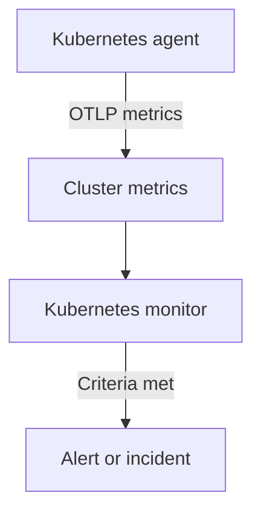

# Kubernetes Monitor

A Kubernetes monitor alerts on the metrics the OneUptime Kubernetes agent sends from a cluster: nodes, pods, containers, workloads, autoscalers and the control plane. Start from a ready-made alert template, pick a single metric, or write your own query, then set the threshold that opens an alert or incident.

:::cards
- [Install the agent](/docs/monitor/kubernetes-agent): One Helm command puts the cluster into OneUptime.
- [Create the monitor](#create-a-kubernetes-monitor): Pick the cluster, then a template, a metric or a query.
- [Alert templates](#pre-built-alert-templates): Eighteen ready-made alerts, from a silent cluster to etcd.
- [Criteria](#monitoring-criteria): Static thresholds and anomaly detection.
:::

## How it works

The agent ships the cluster's metrics to OneUptime over OTLP, each one stamped with the cluster's name (`k8s.cluster.name`, the chart's `clusterName`). The first data from a new name registers the cluster under **Kubernetes**, and from then on the cluster can be picked in a Kubernetes monitor. Every minute, the monitor queries those metrics over its **Time Range**, aggregates them, and compares the result with its criteria.

## Before you begin

- The OneUptime Kubernetes agent running in the cluster. See [Install the Kubernetes Agent](/docs/monitor/kubernetes-agent); the cluster appears under **Kubernetes** a few minutes after the install.
- For the control-plane templates (**etcd No Leader**, **API Server Request Saturation**, **Scheduler Backlog**): the agent's control-plane scrape, `controlPlane.enabled`, which reads the API server out of the box; etcd and the scheduler also need their endpoints listed (see [Enable control plane monitoring](/docs/telemetry/kubernetes-agent#enable-control-plane-monitoring)). Managed clusters (EKS, GKE, AKS) do not expose these endpoints, so those monitors never receive data there.

## Create a Kubernetes monitor

:::steps
### Start a new monitor

Go to **Monitors** and click **Create Monitor**. Under **More monitor types**, pick **Kubernetes** — or type `k8s` in the search box.

### Pick the cluster

Select it in **Kubernetes Cluster**. The list holds every cluster the agent has reported from. Once picked, a line under the field says whether data is arriving. **Add Kubernetes Cluster** opens setup steps with your keys filled in, which wait for the first data.

### Choose what to watch

A new monitor starts on **Cluster Stopped Reporting**, under **What to alert on**; **Change** picks another template. **Custom Metric** and **Advanced** are under **More fields**:

| Where | What you choose |
| --- | --- |
| **What to alert on** | A [pre-built alert template](#pre-built-alert-templates). It fills in the metric, scope, time range and criteria; you can still change the **Time Range**. |
| **Custom Metric** | One metric from the [metric catalog](#metric-catalog), then its **Resource Scope**, filters, **Aggregation** (Average, Maximum, Minimum, Sum or Count) and **Time Range**. |
| **Advanced** | The **Resource Scope**, filters and **Time Range**, and your own metric queries and formulas under **Select Metrics**, with a live chart of the result. |

### Set the criteria

Set when the monitor changes status and when it opens an alert or incident — see [Monitoring criteria](#monitoring-criteria). A template has already filled them in: review the thresholds, severities and on-call policies.

### Save the monitor

Finish the form and save. The monitor appears under **Monitors**, and its status follows your criteria from its first evaluation.
:::

## Configuration options

### Resource scope and filters

**Resource Scope** sets the level the metric is evaluated at, and decides which filters the form shows. Every filter is optional.

| Scope | Watches | Filters |
| --- | --- | --- |
| Cluster | The whole cluster | — |
| Namespace | Resources in a namespace | **Namespace** |
| Workload | A deployment, statefulset, daemonset, job or cronjob | **Namespace**, **Workload Kind**, **Workload Name** |
| Node | A cluster node | **Node Name** |
| Pod | A pod | **Namespace**, **Pod Name** |

A container's and a pod's metrics carry the names of the workloads the pod belongs to (a Deployment's pod carries the Deployment's name and its ReplicaSet's), so a Workload scope watches that workload's containers and pods. A workload's own metrics, such as a Job's failed pods, carry only their own workload's name: scope them to that workload's kind.

### Time Range

**Time Range** is the window the metric query covers each time the monitor is evaluated, from **Past 1 Minute** up to **Past 365 Days**. Short windows (1 to 15 minutes) suit alerting; longer ones smooth out noisy metrics.

### Metric queries and formulas

On the **Advanced** tab, each query names a metric, how its values are aggregated, and optional attribute filters. A **formula** combines queries with arithmetic — the node utilization templates, for example, divide usage by allocatable capacity.

## Metric catalog

The **Custom Metric** tab offers these metrics, grouped by resource type:

| Category | Metrics |
| --- | --- |
| Pod | Pod CPU Usage, Pod Memory Usage, Pod Phase (Code), Pod Filesystem Usage, Pod Memory Limit Utilization, Pod CPU Limit Utilization, Pod Network I/O (Cumulative, Both Directions) |
| Node | Node CPU Usage, Node Allocatable CPU, Node Memory Usage, Node Memory Working Set, Node Filesystem Usage, Node Allocatable Memory, Node Ready Condition, Node Filesystem Available |
| Container | Container Restarts, Container Restarts (Increase), Container CPU Limit, Container CPU Request, Container Memory Limit, Container Memory Request, Container Ready |
| Workload | Deployment Available Replicas, Deployment Desired Replicas, DaemonSet Misscheduled Nodes, DaemonSet Ready Nodes, StatefulSet Ready Replicas, Job Failed Pods, Job Failed Pods (Increase), Job Successful Pods |
| HPA | HPA Current Replicas, HPA Desired Replicas, HPA Max Replicas, HPA Min Replicas |
| Control Plane | etcd Has Leader, API Server In-Flight Requests, Scheduler Pending Pods |

> [!NOTE]
> **Pod CPU Usage** and **Node CPU Usage** are in cores, not percent: `0.18` is 0.18 of a core. **Pod Phase (Code)** is a code (1 Pending, 2 Running, 3 Succeeded, 4 Failed, 5 Unknown) — aggregate it with Maximum or Minimum, never Sum. **Node Ready Condition** is 1 when Ready, 0 when NotReady and -1 when Unknown, which is what a node that went down reports: alert on less than 1. **Container Restarts** is the container's running restart count; **Container Restarts (Increase)** is what the agent sends with every sample, the restarts since its previous sample of the container, so its sum over a window is the restarts in it. It carries what **Container Restarts** carries, the workload names of the container's pod included, but not the container's ID, which changes with every restart. **Job Failed Pods** is a Job's running count of failed pods; **Job Failed Pods (Increase)** is what the agent sends with every sample, the Job's pods that failed since its previous sample of the Job, so its sum over a window is the failures in it. It carries what **Job Failed Pods** carries: the Job's name and namespace. Control-plane metrics only arrive when the agent's control-plane scrape is on.

## Monitoring criteria

### What gets evaluated

These monitors always evaluate the **Metric Value** — the value of the configured metric query or formula. The criteria form has no Filter Type selector; it shows **Metric**, **Aggregation**, **Condition**, and **Threshold**.

### Aggregation types

| Aggregation | Description |
| --- | --- |
| Average | Average value over the time window |
| Sum | Sum of all values |
| Maximum Value | Highest value in the time window |
| Minimum Value | Lowest value in the time window |
| All Values | All values must match the criteria, and must cover the whole time window |
| Any Value | At least one value must match |

### Conditions

Static thresholds are compared against the **Threshold** you enter: **Greater Than**, **Less Than**, **Greater Than Or Equal To**, **Less Than Or Equal To** and **Equal To**. **Has No Data** matches when the query sent nothing in the window, **Has Data** when it sent anything.

Baseline anomaly detection needs no threshold. Pick one of these conditions, and the form shows **Sensitivity** and **Baseline Window** instead:

| Condition | Matches when the value |
| --- | --- |
| **Anomalously High** | Rises above the expected range |
| **Anomalously Low** | Falls below the expected range |
| **Anomalous** | Leaves the expected range in either direction |

Each sample is compared with a same-hour-of-week baseline built from the **Baseline Window** (14 days by default; 28, 60 or 90 days). **Sensitivity** sets how wide the expected range is: **Low (4σ — egregious deviations only)**, **Medium (3σ — recommended)**, the default, or **High (2σ — noisier, very stable services)**. Anomaly conditions stay in a "Learning" state and produce no alerts until at least the chosen Baseline Window of metric history exists.

**If No Data**, under **More fields**, decides what happens when the query returns nothing in the window: **Ignore** (the default) does not match, **Trigger** treats the silence as the problem, and **Treat As Zero** compares a zero. Time OneUptime itself was not receiving is never no data: a check whose window holds it waits instead, as [When OneUptime Is Not Receiving Data](/docs/monitor/when-oneuptime-is-not-receiving) explains.

## Pre-built alert templates

The **What to alert on** list holds these templates, grouped by category. Each one fills in two criteria: one that marks the monitor offline and opens an incident and an alert when the condition holds, and one that brings it back online when it clears.

| Template | Category | Fires when | Severity |
| --- | --- | --- | --- |
| Cluster Stopped Reporting | Availability | No data arrives from the cluster's agent for 10 minutes | Critical |
| CrashLoopBackOff Detection | Workload | A container restarted within 15 minutes and was ready for less than half of them | Critical |
| Pod Stuck in Pending | Scheduling | Some pod is in the Pending phase in every sample of a 15-minute window | Warning |
| Node Not Ready | Node | A node reports NotReady, or stops reporting its status (Unknown) | Critical |
| High Node CPU Utilization | Node | A node's average CPU usage is above 90% of its allocatable CPU | Warning |
| High Node Memory Utilization | Node | A node's average memory working set is above 85% of its allocatable memory | Warning |
| Deployment Replica Mismatch | Workload | A deployment has fewer available replicas than desired for 15 minutes | Warning |
| Job Failures | Workload | A pod of a job failed within 15 minutes | Warning |
| etcd No Leader | Control Plane | etcd has no elected leader | Critical |
| API Server Request Saturation | Control Plane | The API server holds 200 or more in-flight requests for the whole window | Critical |
| Scheduler Backlog | Scheduling | The scheduler's pending-pod queue is non-empty for 5 minutes | Warning |
| High Node Disk Usage | Storage | A node's filesystem is more than 90% full | Warning |
| DaemonSet Misscheduled Nodes | Workload | A DaemonSet runs pods on nodes that no longer match its node selector, affinity or tolerations | Warning |
| High Node CPU Request Commitment | Node | A node's summed container CPU requests exceed 90% of its allocatable CPU | Warning |
| High Node Memory Request Commitment | Node | A node's summed container memory requests exceed 90% of its allocatable memory | Warning |
| HPA Saturated at Max Replicas | Workload | An HPA scaled above its `minReplicas` runs at 90% or more of its `maxReplicas` | Critical |
| Pod Memory Saturating Container Limit | Workload | A pod uses more than 90% of its container memory limit | Critical |
| Pod CPU Saturating Container Limit | Workload | A pod uses more than 90% of its container CPU limit | Warning |

Templates on per-object metrics evaluate each node, pod, deployment, job, DaemonSet or HPA on its own, so a cluster with several unhealthy pods gets an incident per pod rather than one for the whole cluster.

**High Node CPU Request Commitment** and **High Node Memory Request Commitment** count only the requests of pods that have not finished, as the scheduler does. The cluster keeps reporting the requests of a pod that has Succeeded or Failed, such as a finished Job's, until the pod is deleted: those are left out.

**Cluster Stopped Reporting** fires when nothing arrives from the cluster's agent for ten minutes: the agent was uninstalled or keeps crashing, its API key was revoked, it lost its route to OneUptime, or the cluster's API server stopped answering it. It resolves when data comes back. When data stops, the other templates have nothing to compare and keep their last status, so this is the one that tells you.

> [!NOTE]
> **CrashLoopBackOff Detection** adds up `k8s.container.restarts.increase`, which the agent sends with every sample: the restarts since its previous sample of the container. So it counts every restart however far apart the samples are, it clears on its own once the restarts stop, and a pod that is recreated starts a new count rather than reading as restarts. An older agent does not send `k8s.container.restarts.increase`: [upgrade it](/docs/monitor/kubernetes-agent#upgrading) first. A monitor made from the template before then reads how much `k8s.container.restarts` grew within each minute, which misses about half of a loop's restarts: delete it and create the template again.

> [!NOTE]
> **Job Failures** adds up `k8s.job.failed_pods.increase`, which the agent sends with every sample: the Job's pods that failed since its previous sample of the Job. So it counts every failure however far apart the samples are, it clears on its own once the failures stop, and a Job recreated under the same name starts a new count rather than reading as failures. The failures before the agent's first sample of a Job are where its count starts, so a Job that fails within its first half-minute and never retries can go unseen. An older agent does not send `k8s.job.failed_pods.increase`: [upgrade it](/docs/monitor/kubernetes-agent#upgrading) first. A monitor made from the template before then reads how much `k8s.job.failed_pods` grew within each minute, which misses about half of the failures: delete it and create the template again.

### Catching causes, not just symptoms

The node-level templates (High Node CPU Utilization, High Node Memory Utilization, Node Not Ready, Pod Stuck in Pending) fire at the _end_ of a resource-exhaustion chain, when the cluster is already degraded. Three templates fire at the _start_ of it, which is usually where the fix is:

- **Pod Memory Saturating Container Limit** and **Pod CPU Saturating Container Limit** catch a workload pinned against its own limits. Crossing a memory limit is an immediate OOMKill; crossing a CPU limit makes the kernel throttle the pod, so it gets slower without ever erroring. Both are the usual cause behind CrashLoopBackOff and unexplained latency.
- **HPA Saturated at Max Replicas** catches an autoscaler with no headroom left. A workload whose per-pod limits are too low gets throttled or killed, which inflates the very metric the HPA scales on — so the autoscaler keeps adding replicas that are each equally starved, until it hits its ceiling. Raising the limits is the fix; raising `maxReplicas` makes it worse.

Enable them together on any namespace that runs an autoscaled workload: the combination tells "genuinely needs more capacity" apart from "under-resourced per pod".

> [!NOTE]
> The two pod-limit templates divide the pod's usage by the **sum** of its containers' limits, so pods with sidecars are measured correctly. The kubelet's pod memory figure includes reclaimable page cache, so a file-heavy workload can sit high on the memory template without ever being OOMKilled: read it as "approaching the limit", not "about to be killed".

## Troubleshooting

:::details The cluster is not in the Kubernetes Cluster list
Clusters register themselves from the agent's data, under the `clusterName` the agent was installed with. Check that the agent's pods are running and that the cluster is listed under **Products → Infrastructure → Kubernetes → All Clusters**. [Install the Kubernetes Agent](/docs/monitor/kubernetes-agent) covers the install and what to check when no data arrives.
:::

:::details A control-plane template never fires
**etcd No Leader**, **API Server Request Saturation** and **Scheduler Backlog** read metrics that only the agent's control-plane scrape collects. Turn on `controlPlane.enabled` in the agent's Helm values; it is off by default. That reads the API server. etcd and the scheduler run on the control-plane nodes, so **etcd No Leader** and **Scheduler Backlog** also need `controlPlane.etcd.endpoints` and `controlPlane.scheduler.endpoints` set to addresses the agent's pod can reach (see [Enable control plane monitoring](/docs/telemetry/kubernetes-agent#enable-control-plane-monitoring)). Managed clusters (EKS, GKE, AKS) do not expose these endpoints, so on them these monitors never receive data.
:::

:::details A CPU threshold never fires
**Pod CPU Usage** and **Node CPU Usage** are in cores, not percent, so a threshold of `80` means 80 cores. Set the threshold in cores, or start from **High Node CPU Utilization** or **Pod CPU Saturating Container Limit**, which compare a percentage.
:::

:::details CrashLoopBackOff Detection did not fire for a restart
The template fires when a container restarts within 15 minutes while it was ready for less than half of them, so a container that restarted once and came straight back does not page. It reads `k8s.container.restarts.increase`, which an older agent does not send: [upgrade the agent](/docs/monitor/kubernetes-agent#upgrading). A monitor made from the template before then reads how much `k8s.container.restarts` grew between two samples in the same minute, and misses the restarts between two minutes' samples: delete it and create the template again. If `filters.metrics.include` lists the metrics the agent sends, add `k8s.container.restarts.increase` to it. A monitor scoped to a workload also needs the workload names on `k8s.container.restarts.increase`, which an older agent sends it without: [upgrade the agent](/docs/monitor/kubernetes-agent#upgrading).
:::

:::details Job Failures did not fire for a failed Job
The template fires when a pod of a Job fails within 15 minutes, and clears fifteen minutes after the last failure. It reads `k8s.job.failed_pods.increase`, which an older agent does not send: [upgrade the agent](/docs/monitor/kubernetes-agent#upgrading). A monitor made from the template before then reads how much `k8s.job.failed_pods` grew between two samples in the same minute, and misses the failures between two minutes' samples: delete it and create the template again. The failures before the agent's first sample of a Job are where its count starts, so a Job whose only pod fails within its first half-minute goes unseen. If `filters.metrics.include` lists the metrics the agent sends, add `k8s.job.failed_pods.increase` to it. A monitor scoped to a workload must name the Job itself: a Job's failed pods carry its name and namespace, not the CronJob that created it.
:::

## Next steps

:::cards
- [Install the Kubernetes Agent](/docs/monitor/kubernetes-agent): Install, upgrade and tune the agent with Helm.
- [Kubernetes Agent](/docs/telemetry/kubernetes-agent): Namespace filters, control-plane metrics, log severity filters and the AI agent.
- [Metrics Monitor](/docs/monitor/metrics-monitor): Alert on any metric, including the agent's custom and eBPF metrics.
- [Incident and alert templating](/docs/monitor/incident-alert-templating): Put the breaching pod or node in incident titles.
:::
