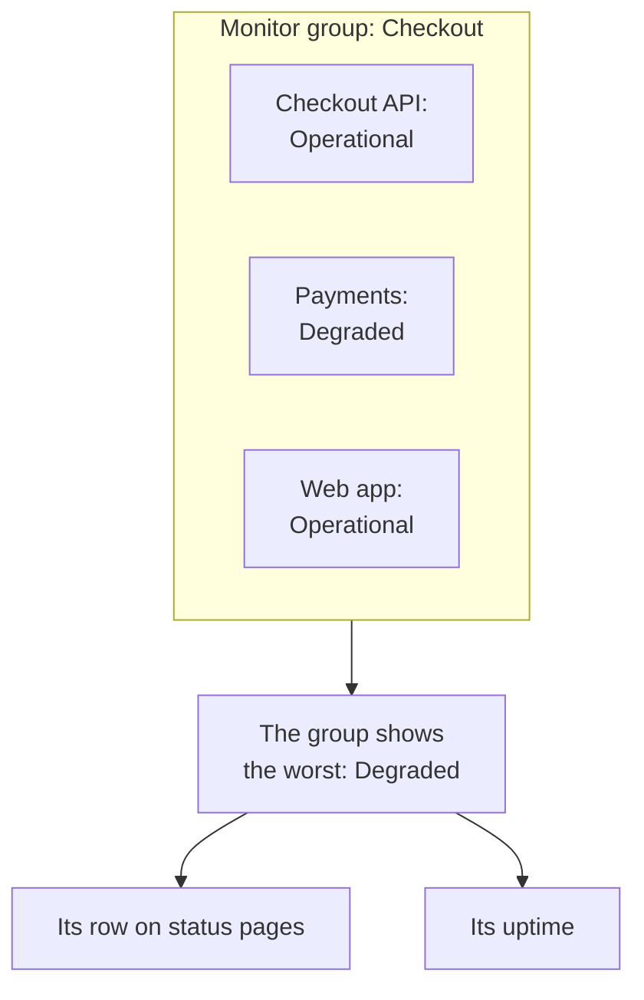

# Monitor Groups

A monitor group rolls several monitors up into one status. Group the monitors that together make up one service, such as Checkout: its API, its payment service and its web app. The group shows the worst status among them, keeps its own uptime, and a status page can show the whole group as one row.

:::cards
- [How a group's status is worked out](#how-a-groups-status-is-worked-out): The worst status among its monitors.
- [Turn on monitor groups](#turn-on-monitor-groups): One switch in Project Settings.
- [Create a monitor group](#create-a-monitor-group): Name it, then assign its monitors.
- [Show a group on a status page](#show-a-group-on-a-status-page): One row for the whole group.
:::

## How a group's status is worked out

A group starts at your operational status and takes the worst status among its monitors: the one lowest in your project's list of monitor statuses. One monitor going **Degraded** makes the whole group **Degraded**; one going **Offline** makes it **Offline**.

- **Archived monitors do not count.** An archived monitor is not checked, so its status is frozen; the group leaves it out.
- **An empty group is operational.** A group with no monitors, or with only archived ones, shows your operational status.
- **The order is yours.** Which status is worst is the order of **Monitors → Settings → Monitor Status**. See [Monitor statuses](/docs/monitor/criteria-and-statuses#monitor-statuses).

A monitor group is not a status page group. A status page group is a heading on one status page that holds rows. A monitor group is one row that stands for several monitors, and any status page can show it.

## Before you begin

- **Your plan.** On OneUptime Cloud, monitor groups need the Scale plan.
- **The switch.** Monitor groups are hidden until **Monitor Groups** is turned on for the project (see below). Turning it on takes the Project Owner role, or a custom role with the Edit Project or Manage Billing permission.
- **Your role.** Creating, changing and deleting groups takes the Project Owner, Project Admin, Project Member, Monitor Admin or Monitor Member role, or a custom role with the matching monitor group permissions. A Viewer can see groups but not change them.

## Turn on monitor groups

:::steps
### Open Feature Flags

Go to **Project Settings → Advanced → Feature Flags**. **Advanced** starts collapsed in the side menu: expand it first.

### Flip the switch

Flip the **Monitor Groups** switch. It saves at once: **Monitor Groups** appears in the **Monitors** side menu, and each status page's **Monitors** item is renamed **Resources**, where you can add a group.
:::

Turning the switch off again hides **Monitor Groups** from the menu. It deletes no group.

## Create a monitor group

:::steps
### Open Monitor Groups

Go to **Monitors → Monitor Groups**. The **Monitor Groups** card lists each group with its **Current Status**, labels and owners.

### Create the group

Click **Create Monitor Group**, enter a **Name** and, if you like, a **Description**, and click **Create Monitor Group** at the bottom of the form. The group starts with no monitors.

### Assign its monitors

Open the group and click **Monitors** in its side menu. Click **Assign Monitor**, pick a monitor in **Select Monitor** and click **Assign**. Do this for each monitor in the group.

### Check its status

Click **Overview**. **Current Status** shows the group's status now, and **Uptime Graph** shows its last 90 days, one bar per day.
:::

To take a monitor out of the group, click **Unassign** on its row in **Monitors in Group**. The monitor itself does not change. A monitor can belong to more than one group.

## A group's pages

Open a group to see its pages in the side menu:

| Page | What it shows |
| --- | --- |
| **Overview** | **Monitor Group Details**, **Current Status**, and **Uptime Graph** with the group's uptime percentage over the last 90 days. |
| **Owners** | The people and teams responsible for the group. |
| **Monitors** | **Monitors in Group**, with **Assign Monitor** and **Unassign**. |
| **Incidents** | The incidents on any monitor in the group. |
| **Alerts** | The alerts on any monitor in the group. |
| **Audit Logs** | Who changed the group, and when. It is under **Advanced**, which starts collapsed. |
| **Delete Group** | Deletes the group, also under **Advanced**. |

The uptime on **Overview** counts every status but the operational one as downtime. A status page counts only the statuses in its own **Counts as downtime** list: see [Choosing what shows on the page](/docs/status-pages/index#choosing-what-shows-on-the-page).

The **Monitor Groups** list can filter groups by owner and label, set labels and owners on many groups at once, and export or import groups as JSON.

## Show a group on a status page

:::steps
### Open the status page's resources

Go to **Status Pages**, open the page and click **Resources** in its side menu.

### Switch the dialog to a group

Click **Add Monitor**. Under the monitor dropdown, click **Add a Monitor Group instead.** The dropdown becomes **Monitor Group**.

### Pick the group and add it

Pick the group. **Display Name**, the name visitors read, fills in with the group's name until you type one of your own. Click **Add Monitor**: the row appears on the page with the group's status.
:::

On the status page, the row stands for every monitor in the group:

- **Its status.** It is the group's: the worst among its monitors.
- **Its incidents.** An incident on any monitor in the group appears on the page, with the group named among the affected resources.
- **Its subscribers.** A subscriber who picks the group hears about every monitor in it. See [Letting subscribers choose resources and event types](/docs/status-pages/subscribers#letting-subscribers-choose-resources-and-event-types).

For the rest of the row's options, such as its uptime and history chart, see [Status Page Resources & Groups](/docs/status-pages/resources-and-groups).

> [!WARNING]
> Deleting a monitor group also deletes its row from every status page that shows it. The monitors in the group, and their incidents, are not deleted.

## API and Terraform

A group is `/api/monitor-group`, and each monitor in it is a row of `/api/monitor-group-resource` that pairs a `monitorGroupId` with a `monitorId`. In Terraform they are `oneuptime_monitor_group` and `oneuptime_monitor_group_resource`: see [Monitor group](/docs/terraform/examples#monitor-group).

## Troubleshooting

:::details Monitor Groups is not in the Monitors menu
The **Monitor Groups** switch is off. Turn it on under **Project Settings → Advanced → Feature Flags**. On OneUptime Cloud, groups also need the Scale plan.
:::

:::details The group shows Offline, but most of its monitors are up
That is the rule: the group shows its worst monitor. Open **Monitors** on the group to find the monitor that is down, or unassign a monitor that does not belong in the group.
:::

:::details A status page cannot add the group
**Add a Monitor Group instead.** appears in the dialog only while the **Monitor Groups** switch is on for the project.
:::

## Next steps

:::cards
- [Monitor Criteria & Statuses](/docs/monitor/criteria-and-statuses): What sets each monitor's status.
- [Status Page Resources & Groups](/docs/status-pages/resources-and-groups): Lay out the rows of a status page.
- [Subscribers & Announcements](/docs/status-pages/subscribers): Tell customers about a group's incidents.
:::
